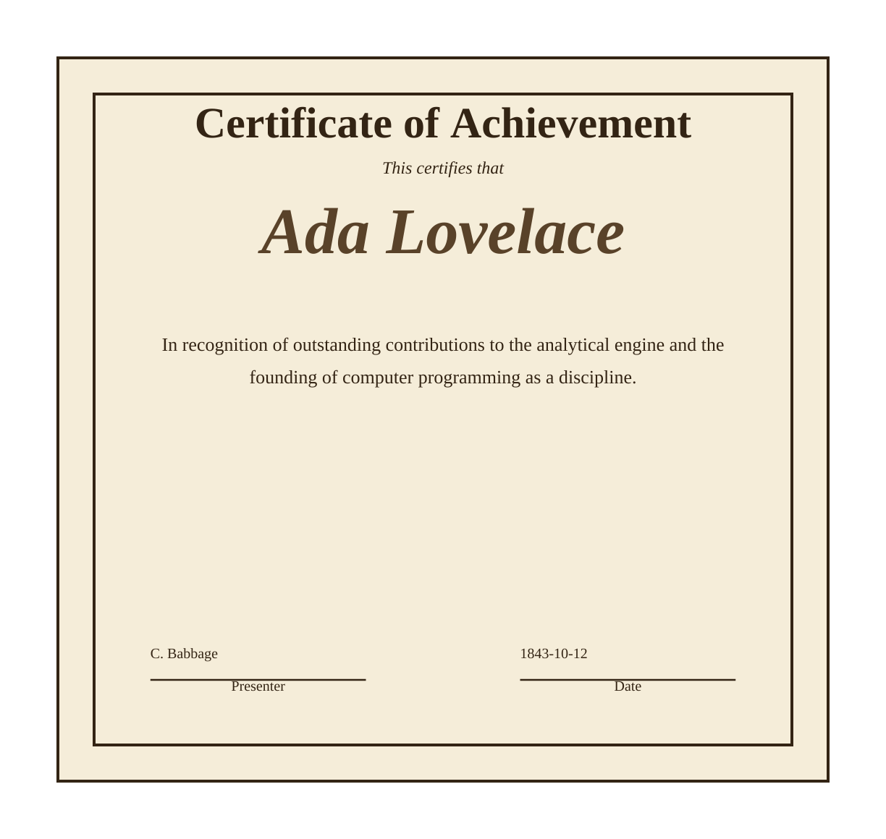
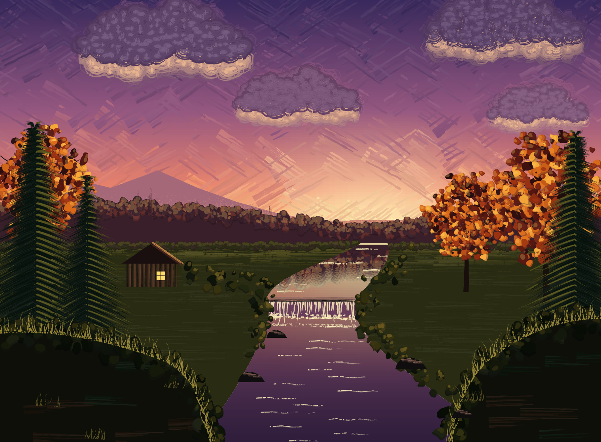

# pscat

<p>
  <a href="art/logo/pscat-logo-d.ps"></a>
  <b>PostScript for precision and imagination.</b><br/>
  <sub>The logo is drawn by pscat from <a href="art/logo/pscat-logo-d.ps">its PostScript source</a>.</sub>
</p>
<br clear="left"/>

pscat is a modern PostScript interpreter written in Rust for reliable document
rendering and creative graphics. It renders PostScript and EPS to PNG, SVG and
PDF from the command line, as an embeddable Rust library, in the browser via
WebAssembly, or through MCP for AI agents.

- **Documents:** letters, certificates, invitations and posters from page
  templates, charts and plots for papers, typewritten memos, and multi-page PDFs.
- **Art:** generative patterns, watercolor and oil paint, printmaking,
  handwriting, chalkboards and display type.

pscat aims to replace Ghostscript for most PostScript work, and uses Ghostscript
as its correctness reference: test expectations are pinned against
Ghostscript's output. It can also show a program drawing, stroke by stroke, in
a live window or in a browser tab.

<p>
  
  <a href="https://pscatlabs.github.io/pscat/gallery-evening-stream.html"></a>
</p>

<sub>Both drawn by pscat: <a href="examples/template_certificate.ps">a certificate</a> from the page templates, and <a href="gallery/evening_stream.ps">Evening Stream</a>, painted with the paint library.</sub>

**[pscatlabs.github.io/pscat](https://pscatlabs.github.io/pscat/)** has the docs, the full gallery, a specimen of every font,
and a live playground that runs the interpreter in your browser, no install.

<!-- gallery:highlights:start -->
<p>
  <a href="https://pscatlabs.github.io/pscat/gallery-cathedral-rose.html"></a>
  <a href="https://pscatlabs.github.io/pscat/gallery-ring-of-type.html"></a>
  <a href="https://pscatlabs.github.io/pscat/gallery-hortus.html"></a>
</p>
<p>
  <a href="https://pscatlabs.github.io/pscat/gallery-ripple-range.html"></a>
  <a href="https://pscatlabs.github.io/pscat/gallery-nightfall-triptych.html"></a>
  <a href="https://pscatlabs.github.io/pscat/gallery-alpine-lake.html"></a>
</p>
<!-- gallery:highlights:end -->

## Install

```sh
cargo install pscat          # pscat and pscat-mcp, from crates.io
pscat fonts install          # optional: the full font catalog, as font packs
npm install pscat            # from 0.6.2: the wasm renderer for browsers and Node
```

Or download a ready-built binary for macOS, Linux or Windows from the
[releases page](https://github.com/PSCatLabs/pscat/releases)
(no Rust needed). [Getting started](docs/guides/getting-started.md#installing-pscat-without-the-repo)
has the details. Then:

```sh
pscat --png out.png some_file.ps
```

## Quick start from a checkout

You need a stable [Rust toolchain](https://rustup.rs).

```sh
cargo run -- --page 500x500 examples/sierpinski.ps   # watch it draw, live
cargo run -- --png out.png examples/sierpinski.ps    # render to a PNG instead
cargo run -- -i                                      # REPL + window: type PostScript, watch it draw
```

A taste of the REPL:

```
PS> 40 2 add =
42
PS> mark 1 2 3
PS<4> pstack
3
2
1
-mark-
```

To try it with nothing installed, open the
[playground](https://pscatlabs.github.io/pscat/playground.html). New to PostScript? Start with
[Learn PostScript](https://pscatlabs.github.io/pscat/learn.html). More sample programs live in `examples/`, and finished pieces in
[`gallery/`](gallery/README.md).

## LaTeX on a chalkboard

`pscat chalk` writes a formula on a chalkboard from plain LaTeX, with no
PostScript. The same LaTeX and seed give the same picture:

```sh
pscat chalk 'x = \frac{-b \pm \sqrt{b^2-4ac}}{2a}' -o quadratic.png
```


More boards, each with its command, are
[on the site](https://pscatlabs.github.io/pscat/#chalkboard); the options and
the supported LaTeX are in the
[dry-media guide](docs/guides/dry-media.md#from-latex-to-a-board-pscat-chalk).
MCP clients get the same board from the `chalkboard_math` tool.

## Guides

Everything else is in [`docs/guides/`](docs/guides/README.md):

- [Getting started](docs/guides/getting-started.md): build, install, command-line flags, output formats
- [pscat in the browser](docs/guides/browser.md) and [for AI agents](docs/guides/agents.md)
- [Fonts](docs/guides/fonts.md) and [handwriting](docs/guides/handwriting.md)
- [artkit](docs/guides/artkit.md): the generative-art toolkit, and [style packs and page templates](docs/guides/style-packs-and-templates.md)
- [Painting](docs/guides/painting.md) and the [landscape cookbook](docs/guides/landscape-cookbook.md)
- [Printmaking and etching](docs/guides/printmaking.md) and [dry media](docs/guides/dry-media.md)
- [Lettering, headlines and apparel](docs/guides/lettering.md)
- [Charts and plots](docs/guides/charts.md)

## For AI agents

pscat works well from a coding agent. The skills in `plugin/skills/` (`pscat`,
`psart`, `psviz`) are plain Markdown any agent can read, and `pscat-mcp` is an
MCP server with ten tools. In Claude Code, both come as one plugin:
`/plugin install pscat --marketplace PSCatLabs/pscat`
(after installing pscat; see [plugin/README.md](plugin/README.md)). In Codex:
`codex plugin marketplace add PSCatLabs/pscat`, then
`codex plugin add pscat@pscat`. See the
[agents guide](docs/guides/agents.md). Any other MCP client can run
`pscat mcp` (the same server as `pscat-mcp`), and pscat is listed in the
[MCP Registry](https://registry.modelcontextprotocol.io/) from 0.6.3:

- MCP Registry name: `mcp-name: io.github.PSCatLabs/pscat`

## Contributing

Start with [`CONTRIBUTING.md`](CONTRIBUTING.md) (including how contributions are
licensed), then [`AGENTS.md`](AGENTS.md) for conventions and [`SDLC.md`](SDLC.md)
for how changes land. Report security problems as [`SECURITY.md`](SECURITY.md)
describes, and see [`docs/STABILITY.md`](docs/STABILITY.md) for what stays
stable between releases. [`docs/dev/HANDOFF.md`](docs/dev/HANDOFF.md) orients you in the code,
[`docs/dev/ARCHITECTURE.md`](docs/dev/ARCHITECTURE.md) explains the design, and
[`docs/dev/`](docs/dev/README.md) has the contributor notes, such as how to
preview the website. [`docs/archive/`](docs/archive/README.md) holds the project's history, including
the original stage-by-stage [status log](docs/archive/STATUS_LOG.md).

## Why

I used to write raw PostScript by hand in college and send it straight to
a LaserWriter. This is a from-scratch Rust interpreter built to relive
that — watching a hand-written recursive PostScript program draw itself,
live, without depending on a decades-old C codebase to do it.

## Licence

pscat's code is dual-licensed under [MIT](LICENSE-MIT) or
[Apache-2.0](LICENSE-APACHE), at your option. The package also embeds font
data: the Liberation faces, the URW Symbol and ZapfDingbats faces and the
Courier Prime-derived typewriter outlines, under the
[SIL Open Font License 1.1](LICENSE-OFL), and the TeX Gyre faces, under the
GUST Font License (LPPL-1.3c). That's why `Cargo.toml` says
`(MIT OR Apache-2.0) AND OFL-1.1 AND LPPL-1.3c`. The font terms cover only
the embedded font data, not pscat's code.

The fonts in `fonts/catalog/` keep their own upstream licences. The original
gallery, example and shirt art is dedicated to the public domain under
[CC0-1.0](LICENSE-CC0), with a few exceptions. CC0 grants no rights in the
pscat name or logo. [`THIRD_PARTY_NOTICES.md`](THIRD_PARTY_NOTICES.md) lists
what is under which terms.

<!-- sdlcify:managed:start -->
## SDLC

See [`SDLC.md`](SDLC.md) for how this repo's development lifecycle
works (issue → branch → PR → review → merge → cleanup) and the
branch-protection/merge policy currently enforced on GitHub — generated
and kept in sync by the `sdlcify` skill.
<!-- sdlcify:managed:end -->
