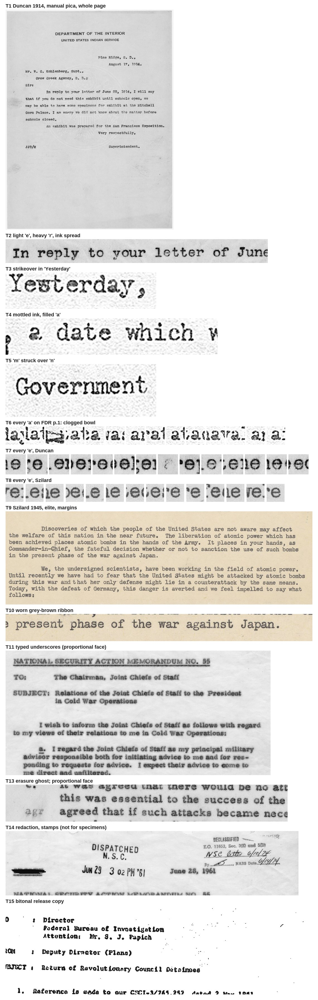
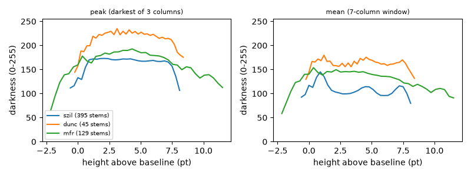

# Typewriter reference board (issue #210)

This is the reference board for epic #209 (`lib/typewriter.ps`). Each entry
is a real scan, what it shows, and what it means for the library.
`docs/dev/design/TYPEWRITER.md` turns these observations into a design. #211, #212 and #215
compare their renders against the crops here.

Rules followed:

- Every observation was made by looking at the scan, and most were also
  measured on it (see Measurements). A trait from #210's list that has no
  image behind it is marked **not yet sourced**.
- Every committed crop comes from a public-domain source: a work of the US
  government (17 U.S.C. § 105; Commons tag `{{PD-USGov}}`), or, for the
  Szilard petition, a work published without a copyright notice (Commons tag
  `{{PD-US-no notice}}`). The Status column gives the tag read from each file
  page. The O'Brien memo is measured but **not** cropped: see its row.
- Real agency letterheads, seals and classification markings appear in some
  crops (T1, T11, T14, T15). They are here as references only. The epic does not
  allow them in specimens: specimens use fictional organizations.
- `tools/make_board.py` rebuilds `refs/` and `reference_board.jpg` from the
  sources. `tools/measure.py`, `tools/mono.py` and `tools/stem.py` produce the
  numbers below, and `tools/lane.py` makes `refs/T16_stem_profile.png` (#468) from
  the Szilard, Duncan and MFR 1955 scans. They need Pillow, NumPy and tesseract
  (`lane.py` also matplotlib).

## Sources

| Key | Document | Typewriter | Scan | Source | Status |
|---|---|---|---|---|---|
| Duncan | J. J. Duncan to Supt. W. C. Kohlenberg, 17 Aug 1914 | manual, pica (10 cpi), double spaced | 2411×3150 TIFF, 300 dpi | [Commons, NARA 284501](https://commons.wikimedia.org/wiki/File:J.J._Duncan_to_Superintendent_W.C._Kohlenberg,_Crow_Creek_Agency,_South_Dakota._-_NARA_-_284501.tif) | `{{PD-USGov}}` (an Indian Service superintendent's letter) |
| FDR | "Day of Infamy" first typed draft, 7 Dec 1941, pp. 1–2 | manual, elite (12 cpi), triple spaced | 2400×3152 JPEG, 300 dpi | [Commons, via DPLA / FDR Library](https://commons.wikimedia.org/wiki/File:Annotated_Draft_of_Proposed_Message_to_Congress_Requesting_Declaration_of_War_Against_Japan_-_DPLA_-_2eb3ebba93444052d0046022975cbff5_(page_1).jpg) | `{{PD-USGov}}` (the President's own draft) |
| Szilard | Petition from Leo Szilard and other scientists to President Truman, 17 Jul 1945 | manual, elite, single spaced | 2069×3150 colour JPEG, about 240 dpi (inferred, see below) | [Commons, NARA 6250638](https://commons.wikimedia.org/wiki/File:Petition_from_Leo_Szilard_and_Other_Scientists_to_President_Harry_S._Truman_01.jpg) | `{{PD-US-no notice}}` (written by Manhattan Project scientists, not a federal work) |
| O'Brien | Larry O'Brien, memorandum to Kennedy coordinators, 1960 | monospace elite; electric inferred (see below) | 2551×3300 JPEG, 300 dpi | [Commons, NARA 194005](https://commons.wikimedia.org/wiki/File:Larry_O%27Brien_Memorandum_to_Kennedy_Co-ordinators_and_Campaign_Directors_-_NARA_-_194005.jpg) | Commons tags it `{{PD-USGov}}`, but a 1960 campaign memo is not plainly a federal work. **Measured and linked, not cropped.** |
| MFR 1955 | Eisenhower, Memorandum for the Record, 31 Jan 1955 | proportional (IBM Executive type) | 1686×2200 JPEG, 200 dpi | [Commons, NARA 186540](https://commons.wikimedia.org/wiki/File:Memorandum_for_the_Record_-_NARA_-_186540.jpg) | `{{PD-USGov}}` |
| NSAM 55 | National Security Action Memorandum No. 55, 28 Jun 1961 | proportional, bold | 2428×3150 JPEG, 300 dpi | [Commons, NARA 193454](https://commons.wikimedia.org/wiki/File:National_Security_Action_Memorandum_No._55_Relations_of_the_JCS_to_the_President_in_Cold_War_Operations_-_NARA_-_193454.jpg) | `{{PD-USGov}}` |
| JFK 10106 | CIA memorandum to the FBI, May 1961, JFK Assassination Records 104-10297-10106 | monospace; bitonal release copy | PDF, rasterized at 300 dpi | [archives.gov](https://www.archives.gov/files/research/jfk/releases/104-10297-10106.pdf) | US federal record (a CIA memorandum), 17 U.S.C. § 105 |
| NBS C431 | C. E. Waters, *Typewriter Ribbons and Carbon Paper*, National Bureau of Standards Circular C431 (about 1941) | text only | — | [Internet Archive](https://archive.org/details/circularofbureau431wate) | public domain (US government publication) |

These sources were viewed but no crop was committed:

- *On the Makaloa Mat* typescript (Commons). A museum photograph at 72 dpi, and
  its licence was not checked.
- The Eisenhower memorandum by A. J. Goodpaster (NARA 186630), and C. E. Hawley's
  CIA memorandum of 1954 (Commons). Both are proportional faces, as the MFR 1955
  scan is, and add nothing to it.
- 48 JFK release PDFs (index pages 226, 227, 300 and 400 of the 2017–2018
  release), OCR'd page by page and searched for `xxxx` overtypes. None was
  found.

### How pitch and resolution were checked

The scans' resolution tags are not trusted on their own. Each one was
cross-checked from the text:

- Character pitch was found by autocorrelating ink columns along a line. A grid
  fit (`tools/mono.py`) gives the median distance of each character from a
  fixed-pitch grid, in fractions of the pitch: about 0.25 for random
  placement, under 0.08 for monospace.
- Line pitch was found by autocorrelating ink rows. Typewriters advance by 1/6
  inch per line, so the ratio of line pitch to character pitch is 1.67 for
  pica (10/6) and 2.0 for elite (12/6). This ratio does not depend on the scan's
  dpi.

| Key | Character pitch | Line pitch | Ratio, and verdict | Grid fit |
|---|---|---|---|---|
| Duncan | 29.75 px | 98 px (double) | 49/29.75 = 1.65, so **pica**. 300 dpi gives a 24.0pt double space (measured 23.7pt). | 0.047 |
| FDR | 25.1 px | 151 px (triple) | 50.3/25.1 = 2.0, so **elite**. 300 dpi gives a 36pt triple space (measured 36.0pt). | not measured (handwriting) |
| Szilard | 20.0 px | 40 px (single) | 2.0, so **elite**. That makes the scan 240 dpi, an inferred figure. | 0.034 |
| O'Brien | 24.5 px | 49.6 px | 2.0, so **elite**, at 300 dpi. | 0.063 |
| JFK 10106 | 20.0 px | — | Not determined: the PDF's page size need not match the paper's, so 20 px at 300 dpi rasterization does not fix the pitch. | 0.097 (monospace, degraded) |
| MFR 1955 | — | — | **proportional** | 0.187 |
| NSAM 55 | — | — | **proportional** | 0.168 |

## Observations

| # | Crop | What it shows | What it means for the library |
|---|---|---|---|
| T1 | `T01_duncan_page_1914.jpg` | A whole 1914 letter. Pica, double spaced, with a printed letterhead and a faint embossed seal. The body is set in from a fixed left margin, with paragraph indents of 5 and 10 columns. | Page layout for #213: a fixed left margin, indents in whole columns, the date and signature placed by tab stops. |
| T2 | `T02_duncan_line.jpg` | "In reply to your letter of June". The first `e` of "letter" prints light and thin. The `r`s print heavy. Stems are about 1.44pt wide, against about 0.9pt for a clean Courier at 12pt: the ink spreads well past the type face. | Strike weight varies per strike and per key. Ink spread, not the base face, sets the stroke weight. |
| T3 | `T03_fdr_strikeover.jpg` | In "Yesterday", the `s` is typed over another letter in the same cell. Both remain legible, darker where they overlap. | A strikeover is a second strike at the same cell. It must get its own jitter, so the two shapes don't coincide. |
| T4 | `T04_fdr_filled_counters.jpg` | "a date which". The ink is mottled at a fine scale of about 0.5pt (2 px at 300 dpi), not flat. The bowl of `a` is filled solid. The bowl of `e` is partly filled. | Ink texture at the ribbon's yarn scale (NBS C431: about 150 yarns per inch, or 0.48pt). Counters fill. |
| T5 | `T05_fdr2_strikeover.jpg` | "Government", with an `m` struck over an `n`. | A second example of M8: a correction by overtyping. |
| T6 | `T06_fdr_a_tiles.png` | Every `a` on FDR page 1, tiled. Nearly all show the same filled bowl. | A filled counter is a property of the machine (dirt in that slug), not chance. It belongs in the per-machine layer, with per-strike variation in how full. |
| T7 | `T07_duncan_e_tiles.png` | Every `e` in the Duncan letter. The shape is constant. Weight varies, and one strike is almost missing. | Per-strike pressure. A rare very light strike is real. |
| T8 | `T08_szilard_e_tiles.png` | Every `e` in the Szilard petition. The shape and the grey tone are very even. | A good machine with a worn ribbon: low variation, low contrast. |
| T9 | `T09_szilard_block.jpg` | Elite, single spaced, justified only on the left, with a ragged right edge. Paragraphs indent 10 columns. Hyphenation at line ends ("im-/posed"). The paper is toned. | Layout for #213. The look is set by margin regularity: the left edge is very straight (0.17pt sd). |
| T10 | `T10_szilard_zoom.jpg` | The ink is grey-brown, not black (mean darkness 0.63, against 0.76–0.81 elsewhere). Edges are soft but not ragged. | Ink colour and strength are parameters. A worn ribbon is lighter, not just patchier. |
| T11 | `T11_nsam55_underscores.jpg` | A heading underlined by typed underscores, as one continuous rule, and the item letters `a.` underscored. The O'Brien memo (not cropped, linked above) shows the same on monospace elite: a continuous underscore under each word, with very even weight. | The underscore is a separate strike in the same cell, after backspacing. Its rule joins across cells. |
| T12 | O'Brien memo, item C (not cropped; [file page](https://commons.wikimedia.org/wiki/File:Larry_O%27Brien_Memorandum_to_Kennedy_Co-ordinators_and_Campaign_Directors_-_NARA_-_194005.jpg)) | One paragraph of the memo: many letters print only their top or bottom half ("use one", "party"), with stray marks. | A strike can land unevenly, printing one side heavier, or one side not at all. This is the "prints heavier on one side" trait. Here it may come from a stencil or duplication rather than the typewriter. |
| T13 | `T13_mfr1955_erasure.jpg` | A proportional executive face. In the margin, a ghost of erased typing ("agr") remains as a faint grey. Weight varies strongly per letter. | An erasure leaves a faint ghost of the original strikes: a correction for #213 or #214. Proportional faces are out of scope (see TYPEWRITER.md). |
| T14 | `T14_nsam55_marks.jpg` | A black redaction bar, a "DISPATCHED" date stamp, a declassification stamp with handwriting, and a struck-through typed line. | Released-document marks for #214. Specimens must invent their own: no real markings. |
| T15 | `T15_jfk_release_copy.jpg` | A bitonal release copy. Counters are filled, thin strokes have dropped out, and specks are scattered over the page. | The "released copy" degradation for #214. It sits on top of the typewriter look, so #211 and #212 tune against T2–T10, not this. |

### Text source: NBS Circular C431 (about 1941)

- "Typewriter ribbons, with few exceptions, are made from a thin, closely
  woven cotton fabric. The weave is plain." Federal specifications required at
  least 135 yarns per linear inch, later 300 per square inch (about 150 each
  way). So the yarn pitch is about 0.17 mm, or 0.48pt.
- "If the yarns are thick and the weave is open, the strokes of the individual
  characters will be made up of dots, instead of being solid lines." Ribbon
  texture shows as dots along the strokes, and more so on a dry or coarse
  ribbon.
- "Any typewritten character is a little less sharp than the face of the type,
  because slight roughnesses of the ribbon and the paper make the two touch one
  another in spots slightly beyond the sharp edges of the type." This is the
  ink spread and the feathered edge.
- Pica is 10 characters per inch, elite 12. A 7-inch line holds 70 or 84
  characters, and there are 6 lines to the inch.
- Carbon copies are larger and blurrier, and each further sheet in the pack
  more so. Elite gives fewer legible carbons than pica.

**Added in #468** (pp. 10-13 of the same circular, which also bears on two-colour
ribbons and the worn lane; re-read from the Internet Archive text):

- "Many ribbons have inks of two colors, for instance black and red, running side by
  side." The inks "must be made ... so that the colors will not diffuse, or 'bleed',
  into one another." "Sometimes a new ribbon is seen in which it is evident that
  coloring matter from the black half has spread into the red. There is no easy way to
  find out whether some of the red has gone into the black half. The majority of
  bicolor ribbons received for test by the Bureau show no such diffusion of the
  color. Some ribbons are so inked that a white 'pin stripe' is left between the two
  colors. It seems to remain white indefinitely."
- When a ribbon is in use, "the type hit it in a narrow band near the edge from one end
  to the other. The ink in this band gradually becomes exhausted, a little each time it
  is struck by the type." Twenty or thirty characters struck repeatedly on one stretch
  of ribbon each print paler than the last. After a rest of about 20 minutes the next line prints darker than the ten or
  twenty before it, because ink has flowed back in from the rest of the ribbon
  (the "recovery").
- An oily ink with too little carbon black gives lines with "the distinctly purplish
  color of the toner" as they wear. If the ink has enough carbon, "the lines change from
  intense black to light gray by degrees, and are not purplish."

## Measurements

These come from `tools/measure.py`. Tesseract gives each character's identity
and box. Each line gets a robust fit: a grid at the measured pitch for x, and
a straight baseline for the characters with no descender. Residuals from those
fits are in points.

**Resolution limit:** one pixel is 0.24pt at 300 dpi and 0.30pt at 240 dpi,
and OCR boxes are whole pixels. Standard deviations of 0.15–0.3pt are at the
one-pixel level, so read them as upper bounds. The ranges are what matter: the
real noise is a fraction of a point, not points.

| Quantity | Duncan 1914, pica | Szilard 1945, elite | O'Brien 1960, elite |
|---|---|---|---|
| characters measured | 368 | 2707 | 1875 |
| per-strike horizontal sd (all characters) | 0.31 | 0.25 | 0.31 |
| per-strike horizontal sd within one letter | 0.25 | 0.22 | 0.27 |
| per-strike vertical sd (baseline residual) | 0.29 | 0.19 | 0.16 |
| per-strike vertical sd within one letter | 0.20 | 0.18 | 0.14 |
| per-letter vertical offset sd, raw | 0.17 | 0.10 | 0.08 |
| per-letter vertical offset sd, face shape removed* | 0.09 | 0.06 | 0.08 |
| largest per-letter vertical offsets, face shape removed | `w` −0.17, `s` −0.16, `c` +0.16 | `S` +0.14, `d` +0.10 | `w` +0.23, `c` −0.13 |
| strikes off by more than 0.5pt vertically | 6.6% | 0.8% | 0.1% |
| strikes off by more than 1pt horizontally | 0.8% | 0.9% | 0.2% |
| baseline tilt per line, sd about the page's skew | 0.09° (max 0.20°) | 0.06° (max 0.16°) | 0.10° (max 0.19°) |
| line-start wander, sd with page skew removed | 0.24 (one group) | 0.17 | 0.38† |
| line advance: median, and sd | 23.66, 0.43 (double) | 12.21, 0.16 | 11.90, 0.33 |
| inked stem width | 1.44 | 0.90 | 1.44 |
| ink coverage of the glyph box: per-strike coefficient of variation within a letter | 0.12 | 0.09 | 0.07 |
| ink darkness of glyph pixels: mean, and sd of the per-letter means | 0.76, 0.023 | 0.63, 0.005 | 0.81, 0.006 |

\* A letter's mean vertical offset mixes the machine's quirk with the face's
design (round letters overshoot the baseline, for example). Subtracting the mean
over the three documents for each of the 19 letters they share removes most of
the design part. With three documents, that subtraction also removes about a
fifth of the true spread. So the per-machine figure is about 0.07–0.11pt.

† O'Brien's T12 paragraph may be a pasted-in correction, which would inflate its
line-start figure.

FDR's pages were left out of the line and placement figures, because
handwriting on the page confuses the fits. Its ink figures are kept: coverage
CV 0.21, stem 0.96pt. They show a heavier, more uneven ribbon than the others.

**Rotation per strike could not be measured.** Fitting the centre line of
`l`/`I`/`1` stems gives a spread of 1.6–5°. That is the noise of fitting 10–20
pixels of stem, not real rotation: at full size no strike on the board looks
rotated by more than about 1°. The design uses a small per-strike rotation and
leaves larger tilts to a few per-machine "bent slugs".

**Electric, by inference.** O'Brien 1960 is the only monospace sample that
might be electric. The evidence is circumstantial: per-letter darkness is about
four times more even than Duncan's (0.006 against 0.023), it has the lowest
coverage CV (0.07), and its underlining is continuous. A manual typist's uneven
finger force produces exactly the variation that is missing here. Szilard's
1945 petition is nearly as even (0.005), so evenness alone doesn't prove an
electric machine. The design therefore treats "electric" as a preset with low
pressure variation, not as a separate model.

## Search for the unsourced traits (#468)

TYPEWRITER.md Q3 asked for public-domain scans of three traits the board had no
image for: two-colour ribbon bleed, embossed punctuation and a confirmed electric
page. #538 also wants a two-colour page with a red run, and a page showing a worn
ribbon lane. The search was bounded. **It found no qualifying
scan for any of the four, so no new crop of a page is committed.** What it did
find is below, with what each result means for `lib/typewriter.ps`. No library
code changed in #468; numbers for #538 are in
`notes/468-typewriter-trait-references.md` and on that issue.

### What was searched

- Wikimedia Commons: its file search with about 30 phrasings (typewritten, red and
  black ribbon, two-colour, typed in red, Selectric, reading copy, typewriter
  exemplar, and so on), the categories *Typewritten documents*, *IBM Selectric* and
  *Typewriter ribbons*, and file-page licence metadata through the API. Commons has
  no text search inside images, so this finds titles and descriptions only.
- A hue scan: about 700 colour page thumbnails (700 px wide) of NARA and DPLA
  scans on Commons (memoranda, letters, telegrams, reports, vouchers) were ranked
  by the fraction of saturated red pixels (R above 130, R-G above 70, R-B above
  60), and all 44 thumbnails above the threshold were looked at in montages.
  Every red mark was a rubber stamp ("SECRET", "TOP SECRET", declassification
  stamps), a printed letterhead or form, red pencil or crayon, a wax seal, a coloured
  sheet or a photograph; about a third (a series of typed copies of 1860s letters)
  scored only because the scan includes a Kodak colour target. None was typed in
  red. Limits: the threshold would miss faded or brownish red typing on toned
  paper, thumbnails at 700 px would lose a thin red run, several queries (for
  example "NARA report") returned mostly photographs, and the scan only reaches
  files whose titles match, not the many thousands of undescribed pages. `tools/` does not include this scanner: it was
  throwaway, and the board's rule is that each crop comes from a named file.
- The Library of Congress search API (three queries), the Internet Archive
  metadata search for typewriter-ribbon texts, and four general web searches.
  Those found retail listings, the IBM Selectric and IBM Electric articles on
  Wikipedia, CIA reading-room memoranda about *leasing* Selectric machines, and
  the NBS circulars already on the board. The text of the NBS circulars (C95,
  C186, C431) refers to no figures of typed samples.

### Two-colour ribbon (black and red)

**Not sourced as a page.** C431 (above) is the best public-domain evidence found,
and it is text. It says that bichrome ribbons are common ("black and red, running
side by side"), that bleed is rare ("the majority ... show no such diffusion"), that
when it happens black spreads into red, that the reverse cannot easily be detected,
and that some ribbons deliberately leave a white "pin stripe" between the colours.

Implications for `lib/typewriter.ps` (not changed here):

- `/Bleed` defaults to 0 and should stay there; a bichrome preset should use a
  small value. Depth and rates still have no measurement behind them.
- A real boundary may be a gap, not a blend: add an opt-in gap of about one yarn
  (40 glyph units at 12 pt, from the 0.48 pt yarn pitch) to test against, rather than
  widening the transition (`tBlTr`, 60 units each side, already about three yarns).
- The documented direction is black into red. For a red run, a black-tinted
  head or foot on the red letters has support; a red foot on black text has none
  beyond the mechanism.
- The "350 glyph units" in #538 is out of date: the code uses `tBleed` x 540.

### Worn lane

**Not sourced as a page, and the three board scans measured show no lane.**
`tools/lane.py` measures the darkness of the vertical stems of `d h k l b` against
height above the baseline, so a worn lane (grey in the middle of the x-height, darker
at ascender tops) would show as a dip in the middle. It gives two statistics: the
stem's peak (darkest of three columns) and the mean over a 7-column window, which falls
when a stem loses ink, as `/WornBand`'s holes do.

*T16: stem darkness (0-255) at each height above the baseline, by both statistics; the table gives it by height band.*

| Scan | stems | peak, 2-4 pt | peak, 4-6 pt | peak, 6-7 pt | mean, 2-4 pt | mean, 4-6 pt | mean, 6-7 pt |
|---|---|---|---|---|---|---|---|
| Szilard 1945 (worn, T10) | 395 | 171.5 | 168.8 | 167.6 | 101.8 | 105.9 | 100.3 |
| Duncan 1914 (fresh, T2) | 45 | 226.8 | 225.5 | 217.5 | 160.1 | 167.9 | 161.3 |
| MFR 1955 | 129 | 186.4 | 186.3 | 177.4 | 146.0 | 140.2 | 134.1 |

No scan is lighter in the middle than at 6-7 pt (just under the stem tips): on the
peak statistic the tops are 1-5% lighter than the x-height zone, and on the mean they
are within 2% for Szilard and Duncan and 8% lighter for MFR. Neither statistic has the
sign a worn lane needs. The last point or two of each stem fall off with edge blur and
serifs, and are left out. This does not prove the machines had no lane, only that
none is visible at these resolutions (0.30-0.36 pt per pixel) and in these stems. The
baseline comes from tesseract's boxes, and Duncan has few stems. C431 does support the
mechanism: the type strikes a narrow band of the ribbon, and that band runs out
of ink and recovers with rest.

Implications: `/WornBand` has no measurement to tune against, and the one it can
be compared with points the other way. At `/WornBand 1` the lane loses about 15% of
its ink (TYPEWRITER.md), against differences of at most 8% here and none with the
model's sign. A realistic preset should keep it small (0.3 takes about 4.5%); dark
tops are a design choice for the gallery, not something the board shows.

### Embossed punctuation

**Not sourced.** An embossed period shows only in raking light, on the back of the
sheet, or on thin onionskin held to the light. Every scan on the board is a flat,
front-lit scan of the face, and no NARA or DPLA scan seen in the search showed a
verso or a transmitted-light view of typing. Q3's rule (extra pressure on `. , ' "`) stays a design choice.

### Confirmed electric page

**Not sourced.** No scan on Commons or the archives searched states which
machine typed it.

- The MFR 1955 (proportional) and NSAM 55 (proportional, bold) pages were
  typed on a proportional-spacing typewriter. In the 1950s and 60s that most likely means the
  IBM Executive, which Wikipedia (*IBM Electric*) says was electric, introduced in
  1944, with proportional spacing and four character widths. The NARA records for
  both pages say nothing about the machine, so this stays an inference, and the
  board's existing "IBM Executive type" is the same inference.
- MFR 1955 ink, measured with `tools/measure.py` at 200 dpi: mean darkness 0.65,
  per-letter spread of the mean 0.019, coverage CV 0.17. That is no more even than
  Duncan's manual typing (0.023 and 0.12 at 300 dpi), but a proportional face
  and 200 dpi make these numbers poor comparisons. So there is no new evidence for
  or against `/electric`'s low pressure variation, and the O'Brien inference stands.
- C431 says the Bureau's wear-down test used the "Electromatic", an electric typewriter
  whose "keys have a trigger action and merely release the typebars", with the force set
  by a motor-driven cylinder. That supports pressure being independent of the
  finger: an electric typebar machine strikes with a set force. It has no image.
- Pages in federal collections from the 1960s to the 80s were probably typed on
  Selectrics, and the CIA reading room has memoranda about leasing them, but no page
  found says what typed it, and the same type elements ran on later IBM electronic
  machines. The one route that settles it is a photograph or scan of a page typed on a machine the
  project's owner can name (see the follow-up in the notes).

## #210 traits

| Trait in #210 | Status |
|---|---|
| manual and electric typewriters | Manual: T1–T10. Electric: **inferred only**, from the O'Brien measurements (see Electric, by inference), and MFR 1955 and NSAM 55 as an IBM Executive (#468: probable, not stated on any page). |
| pica and elite pitch | Pica: T1, T2. Elite: T3–T10. Both are verified from the line/character pitch ratio. |
| per-machine quirks: high or low letters, lean, one side heavier | High/low letters are measured (0.07–0.11pt sd, at most about 0.23pt). The clogged `a` (T6). One side heavier: T12 (observed, not cropped). **Lean is not resolved** at these scans (see Rotation). |
| per-strike offset, rotation, pressure | Offset is measured (0.2–0.3pt sd). Pressure: T2, T7 and coverage CV 0.07–0.21. Rotation: upper bound only. |
| light strokes from weak fingers | T2, T7 |
| punctuation that embosses the paper | **Not sourced** (#468 searched again). Periods print dark and round (T1, T2), but no scan shows raking light, a verso or transmitted light, so embossing is not visible. |
| ribbon weave showing through | T4 at about 0.5pt, and NBS C431's description. |
| feathered edges | T2, T4, and C431's "touch ... slightly beyond the sharp edges". |
| filled counters | T4, T6, T15 |
| wearing or drying ribbon | T10 (worn, grey-brown) against T2 (fresh, black). |
| worn lane (#538) | **Not sourced** (#468). The stem profile (T16) shows no grey middle and no dark tops in Szilard, Duncan or MFR 1955 (peak and mean statistics). C431 p. 11-12 supports a narrow band that runs out of ink. |
| two-colour ribbon bleed | **Not sourced as a page** (#210's search, then #468's: about 700 colour scans hue-ranked, none typed in red). Text evidence: NBS C431 pp. 10-12 (bleed is rare, black into red, some ribbons leave a white pin stripe). |
| baseline drift along a line | Measured: 0.06–0.10° sd per line. |
| line-start wander after each carriage return | Measured: 0.17–0.38pt sd. |
| uneven platen advance | Measured: 0.16–0.43pt sd. |
| strikeovers | T3, T5 |
| `xxxx` over words | **Not yet sourced.** Nothing turned up in a search of 48 JFK release PDFs by OCR. It is a strikeover repeated along a word (T3, T5), so the design covers it. |
| underscores made by backspacing | T11 |
