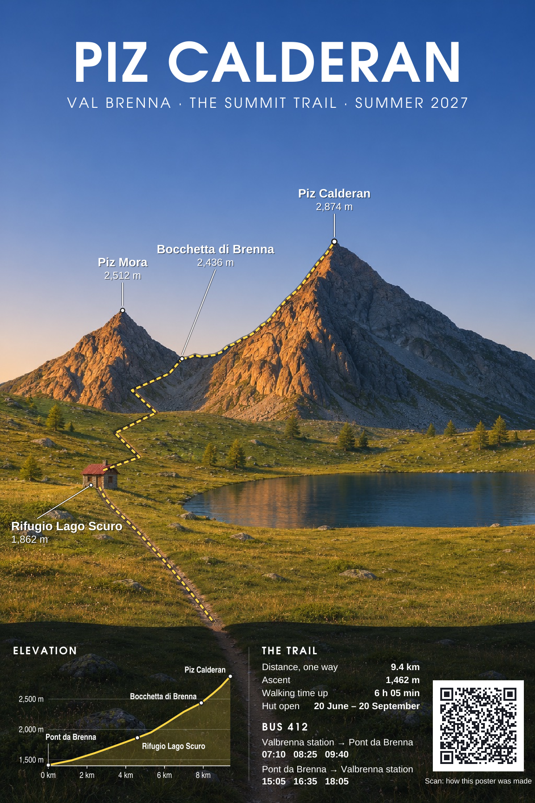
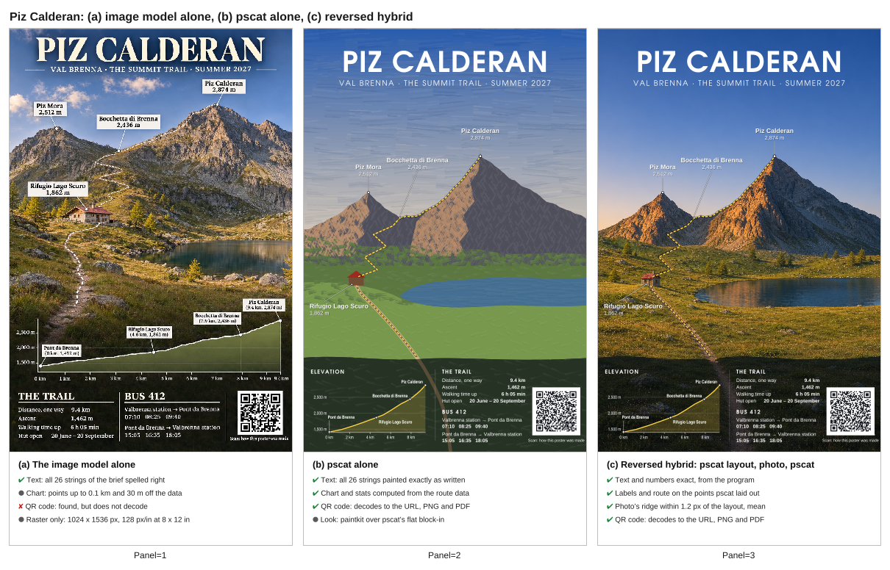
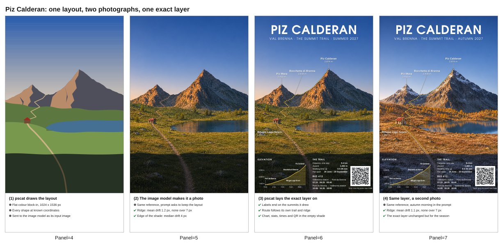

## hybrid, reversed: pscat lays out, the image model photographs, pscat sets the exact layer (PR #1020, issue #1001, 2026-11-05)

- **What changed / what to look at:** a new gallery piece, `examples/hybrid/alpine_trail.ps` (Piz Calderan). pscat drew a flat layout reference, OpenAI's image model made it a photograph, and pscat laid labels, the route, an elevation profile, stats, bus times and a QR code back on at the reference's coordinates. There are also two new guide sheets: the comparison and the process. These are new, so there is no before. The comparator is the image model's own whole-poster attempt, panel (a) of the comparison.
- **Perceptual check:** the issue has no explicit one. Its intent: "The empty areas are where the program put them, so the type never fights the picture"; "Photorealism and exactness can still come together, with pscat in control of the composition."
- **Reviewer:** PASS, round 1 (https://github.com/PSCatLabs/pscat/pull/1020#issuecomment-6665908638). Polish noted:
  - the autumn poster still says "Hut open 20 June – 20 September";
  - the route's zigzags above the hut cross grass with no path in the photo;
  - the col's leader line is faint;
  - the reference panel's sky shows banding.

| output | after |
|---|---|
| gallery still (summer) |  |
| comparison sheet |  |
| process sheet (reference, photo, poster, autumn) |  |
