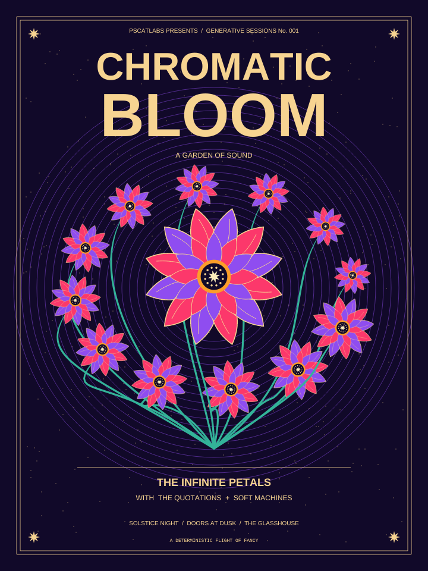
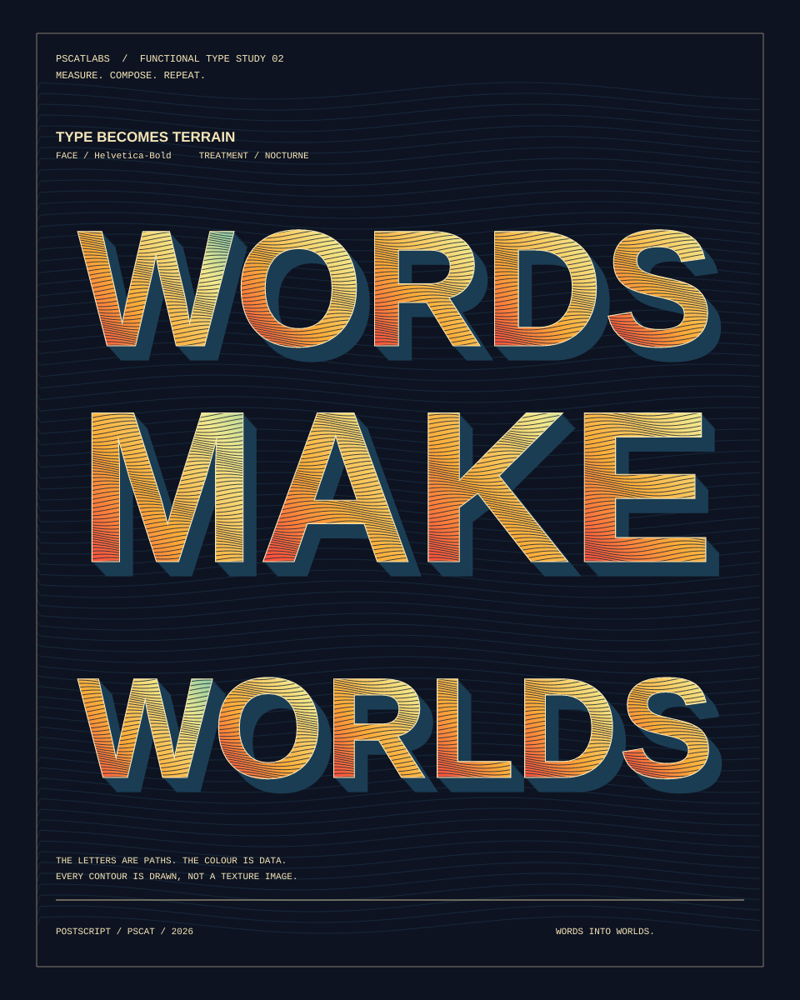
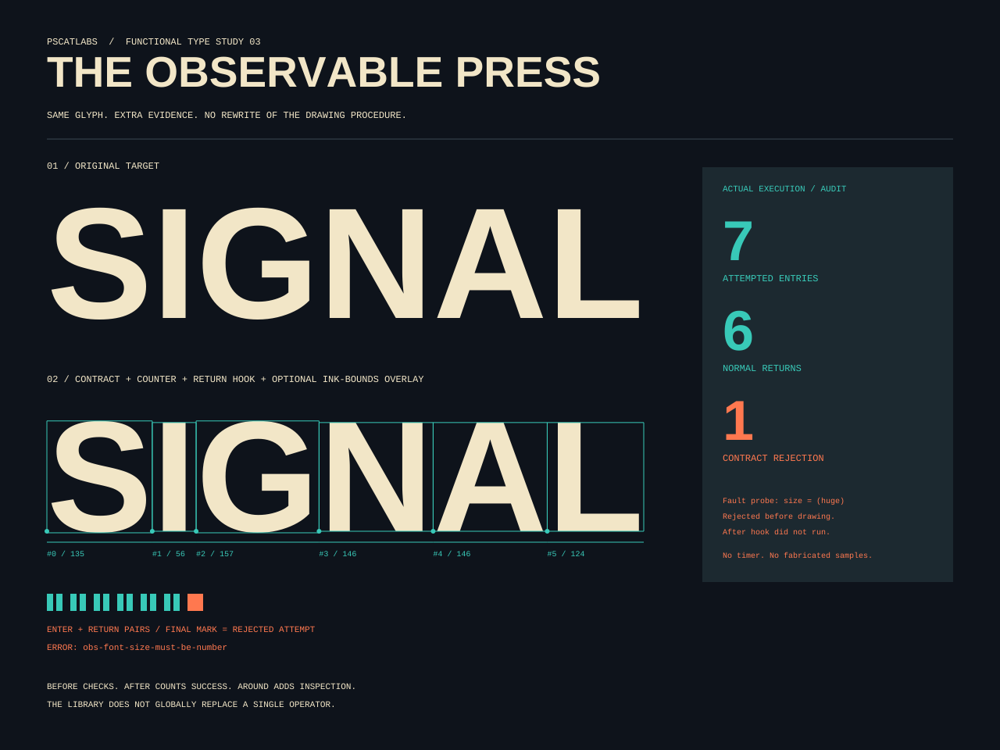

## functional examples: PSCatLabs, not ArtColony, in the showcase headers (PR #1017, issue #1013, 2026-11-05)

- **What changed / what to look at:** the small header line on the functional showcase art changes from "ARTCOLONY" to "PSCATLABS" (poster and its colourways: `PSCATLABS PRESENTS / GENERATIVE SESSIONS No. 001`; type and press studies: `PSCATLABS / FUNCTIONAL TYPE STUDY 02/03`). This affects 12 PNGs under `docs/functional-postscript/assets/`; a pixel diff confines every change to that header line.
- **Perceptual check:** the issue has none of its own. Its intent: "replace the text with PSCatLabs wording ... Re-render the affected assets", keeping the layout.
- **Reviewer:** PASS, round 1 (https://github.com/PSCatLabs/pscat/pull/1017#issuecomment-6665174144).

| before | after |
|---|---|
|  |  |
|  |  |
|  |  |
