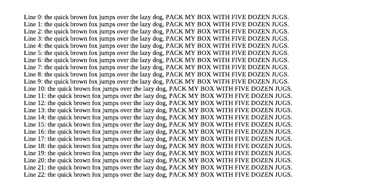
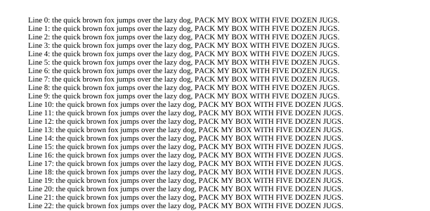
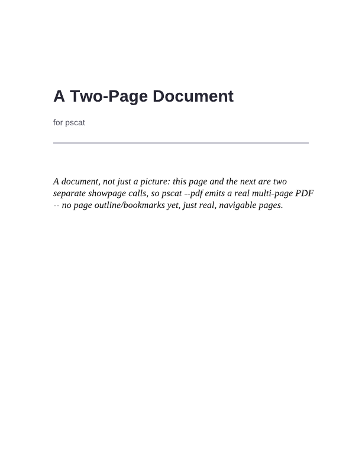
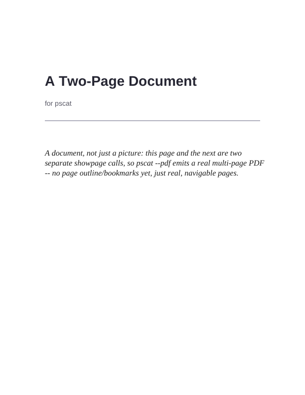
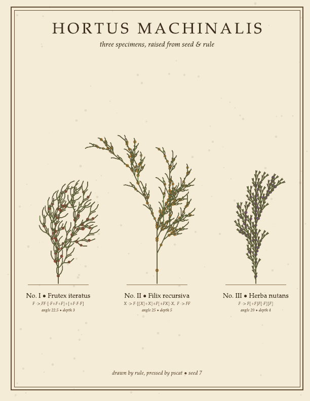

## pdf: text in embedded fonts is the default; --text-as-paths opts out (PR #1398, issue #1026, 2026-11-20)

- **What changed / what to look at:** `pscat --pdf` (and wasm/npm `pdf`) now writes `show` text as selectable PDF text in embedded subset fonts. Before, it drew glyph outlines, which `--text-as-paths` still writes byte for byte. The images are pdftoppm rasters at 72 dpi of each PDF: does the text look the same?
- **Perceptual check:** the issue has no formal check. Its intent is that text becomes searchable and selectable with the same look, keeping outlines as the `--text-as-paths` option. Scope: the owner decision on #1026 (make text the default, add the opt-out).
- **Reviewer:** PASS, round 1 (https://github.com/PSCatLabs/pscat/pull/1398#issuecomment-7055291077). Polish: small text rasterizes a touch lighter in poppler. At 72 dpi, the text PDF is closer to pscat's own canvas than the outline PDF is (notes/1026-pdf-text-default.md).

| before (`--text-as-paths`) | after (default) |
|---|---|
|  |  |
|  |  |
|  |  |
