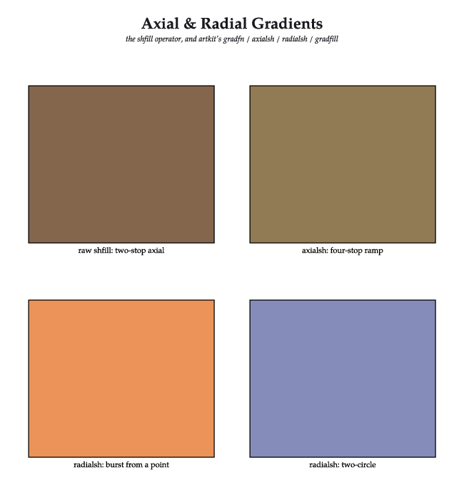
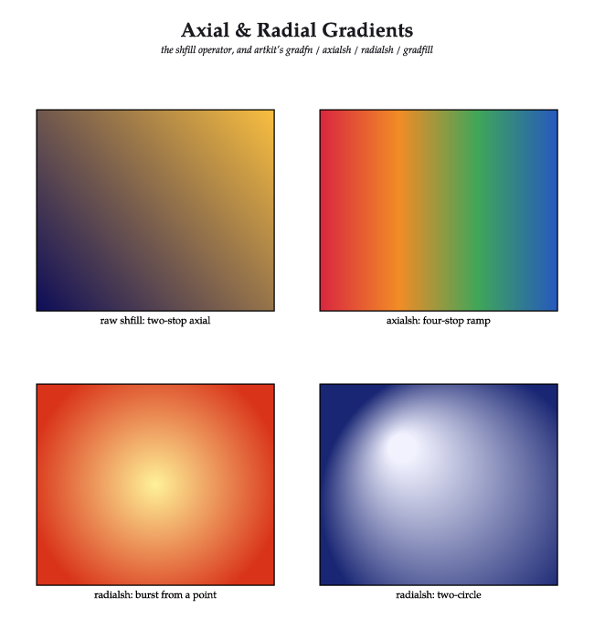
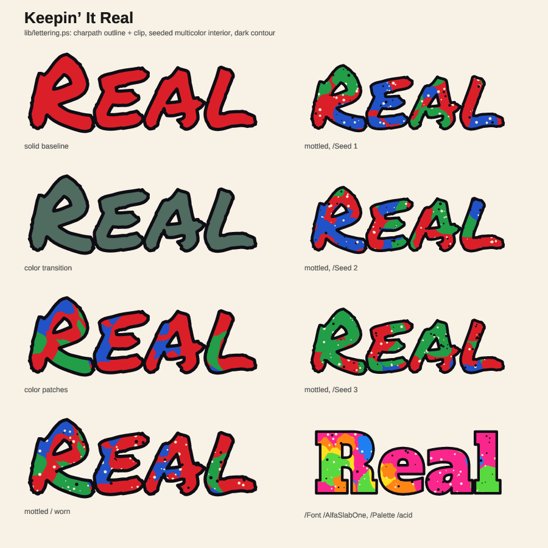
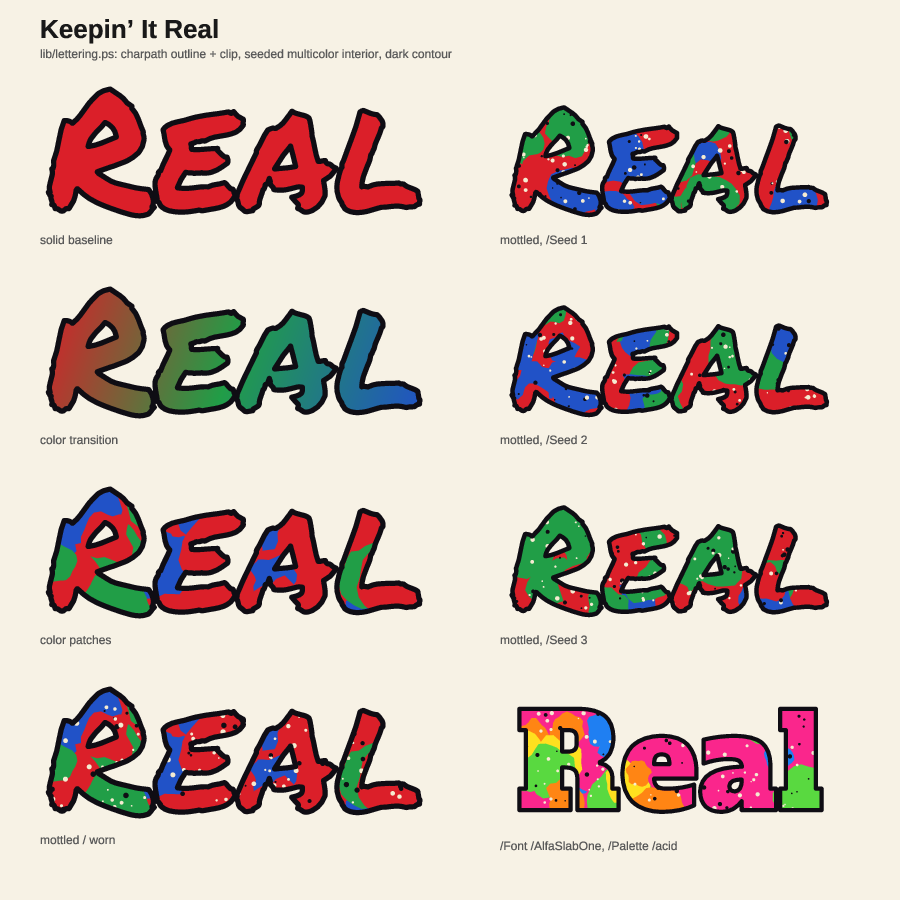

## pdf: shfill exports as a real PDF shading, not the gradient's average (PR #1031, issue #1028, 2026-11-05)

- **What changed / what to look at:** `--pdf` (CLI and WASM) now writes `shfill` as a native PDF shading (`sh` on a `/Shading` resource) instead of one flat fill in the ramp's average colour. PNG and SVG are byte-identical (192 of 192 PNG pages across the corpus). Of 127 examples/gallery PDFs, only the 5 that use `shfill` change. The images are those PDFs rasterised by Ghostscript at 72 dpi, before and after.
- **Perceptual check:** the issue has no separate section; its stated intent is: "Clip paths, `/Extend`, `/Background` and `/BBox` must behave as in the PNG render", with the PDF compared "against the PNG render within a small tolerance" and "Never fall back to a flat average."
- **Reviewer:** PASS, round 1 (https://github.com/PSCatLabs/pscat/pull/1031#issuecomment-6669767639). polish: the lettering PDF's contours and speckles differ slightly from its PNG, identically before and after (not this change).
- **Not merged by the agent:** owner override for this run. The owner merges before 0.7.0.

| before | after |
|---|---|
|  |  |
|  |  |
