## hybrid showcase polish and the shfill sky (PR #1145, issues #1029 and #1042, 2026-11-11)

- **What changed / what to look at:** the pscat-alone sky of the talk poster is now drawn with `shfill` (smooth in PNG, PDF and SVG), and the reviewers' polish from #1019 to #1021: the autumn poster's hut row, the route on the photograph's trail, the col leader's halo, the poster's and the menu's QR captions, the menu's type size and leader dots, the layout reference's smooth sky, and a times sign in pixel sizes. Look at the five guide sheets and the sky crops. Not changed on purpose: the menu's empty top-right corner and the sheets' "Panel=N" captions (#1000).
- **Perceptual check:** #1042: "the sky looks the same or smoother than before (no banding) in PNG and in the Ghostscript-rasterised PDF." #1029 has none written; its items are the polish list in the issue.
- **Reviewer:** PASS, round 1 (https://github.com/PSCatLabs/pscat/pull/1145#issuecomment-6811989090), on cf80b96. Polish noted: the route's change is small and cannot be told from the crop (the overlay above is the evidence); the menu's margin is tighter (acceptable).

| output | before | after |
|---|---|---|
| poster sheet | 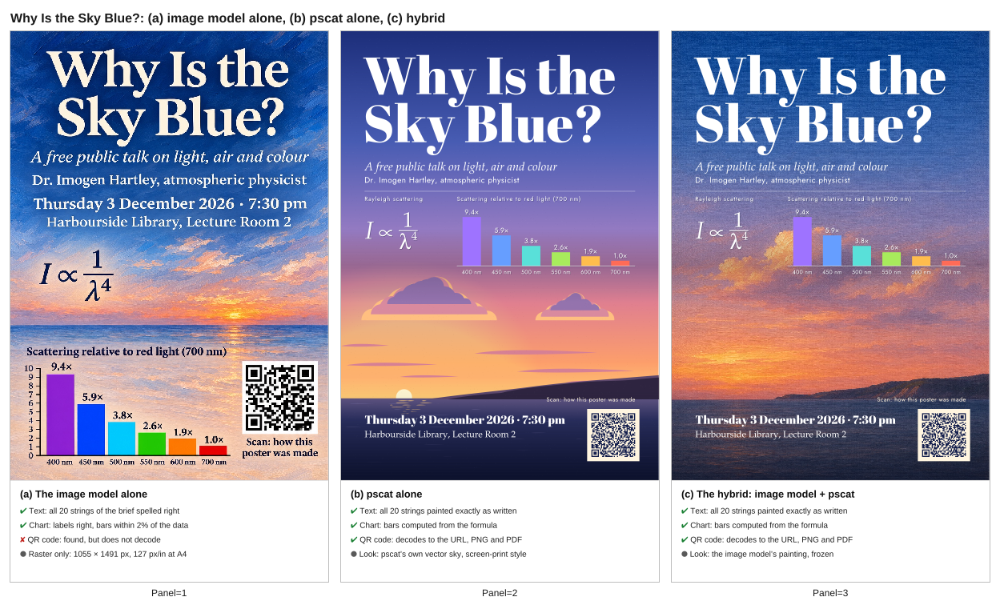 |  |
| menu sheet | 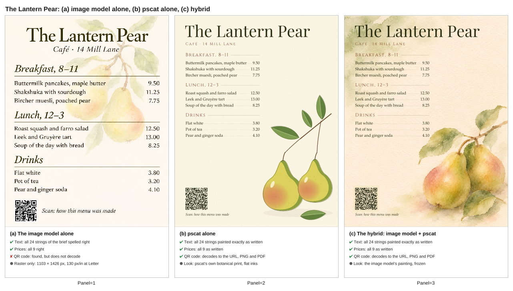 |  |
| alpine process sheet | 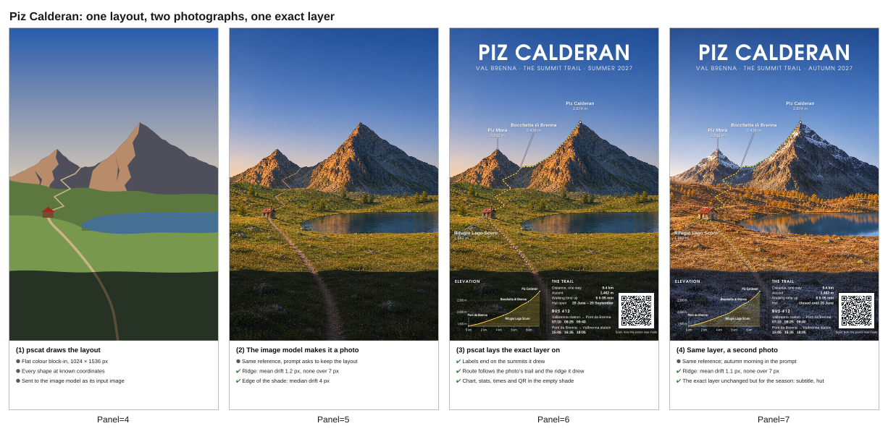 |  |
| alpine comparison sheet | 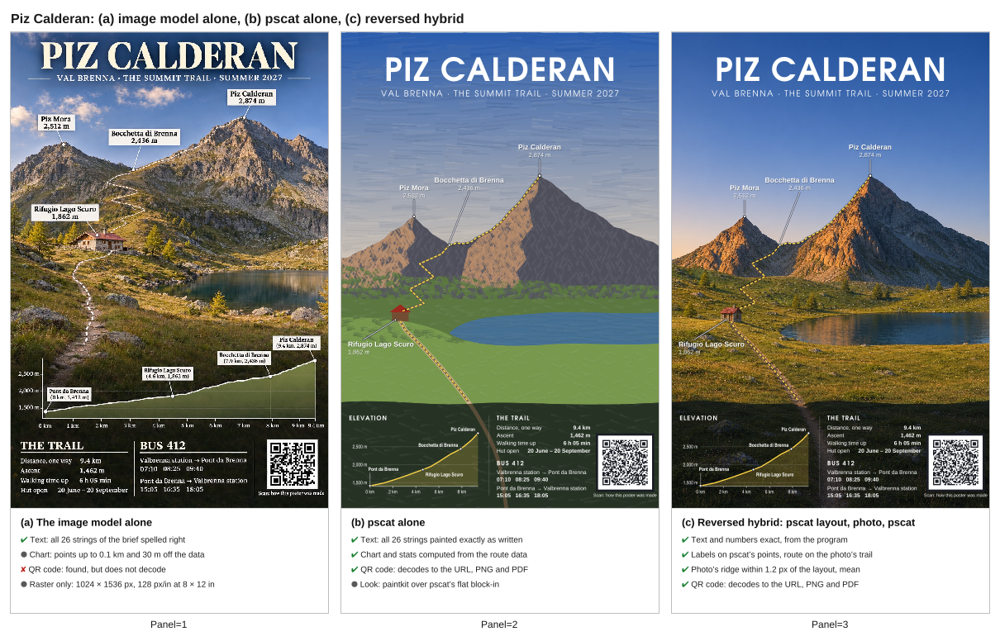 |  |
| ferry sheet (times sign only) | 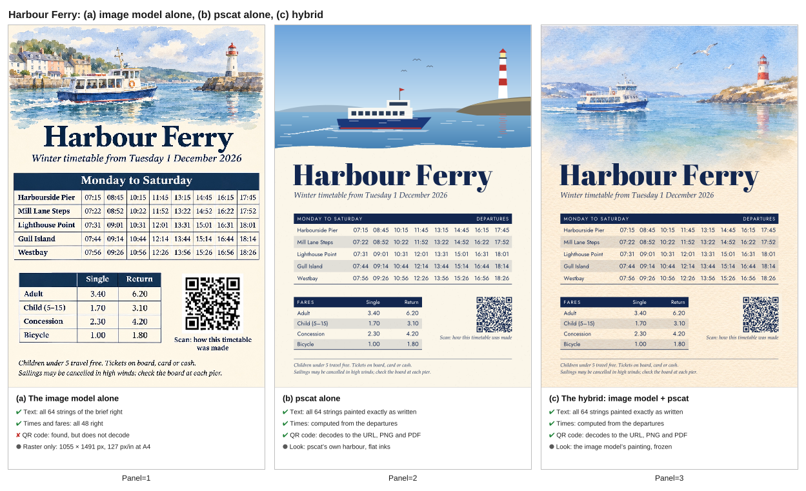 |  |
| pscat-alone sky, PNG | 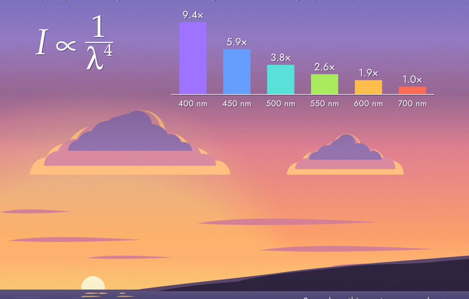 | 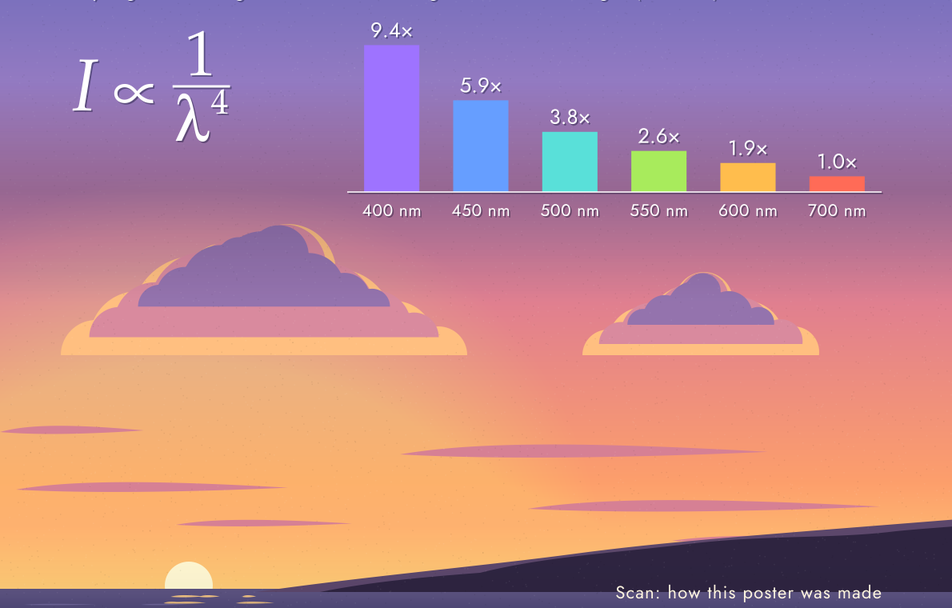 |
| pscat-alone sky, PDF rasterised by gs | 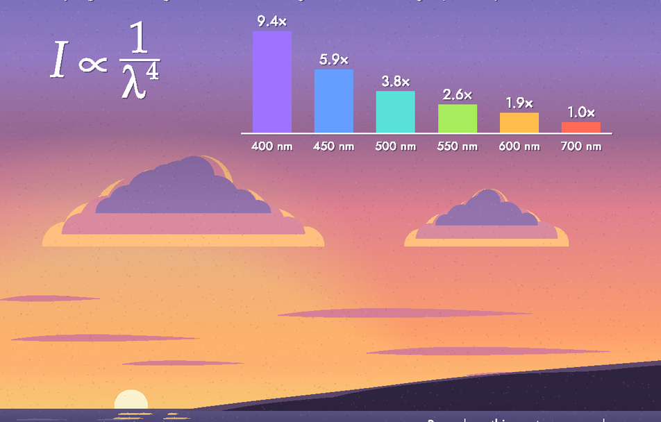 | 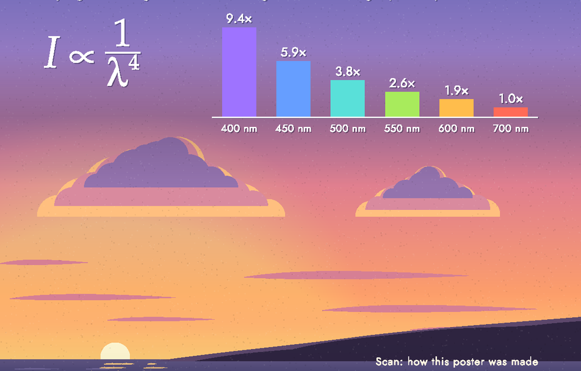 |
| pscat-alone sky, SVG in a browser | 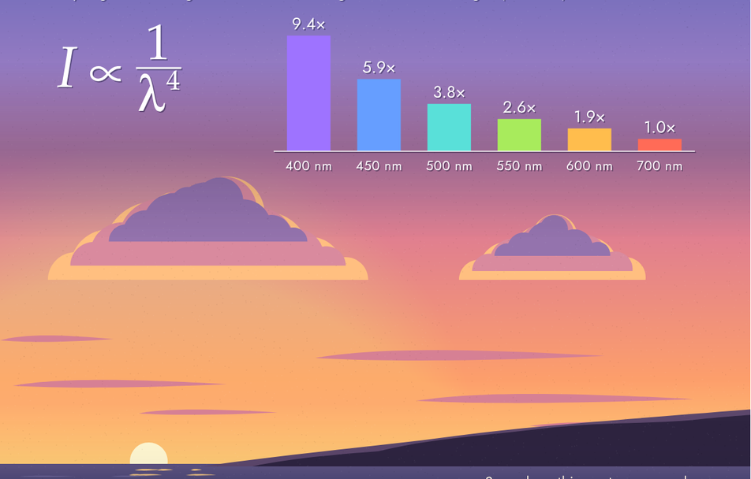 | 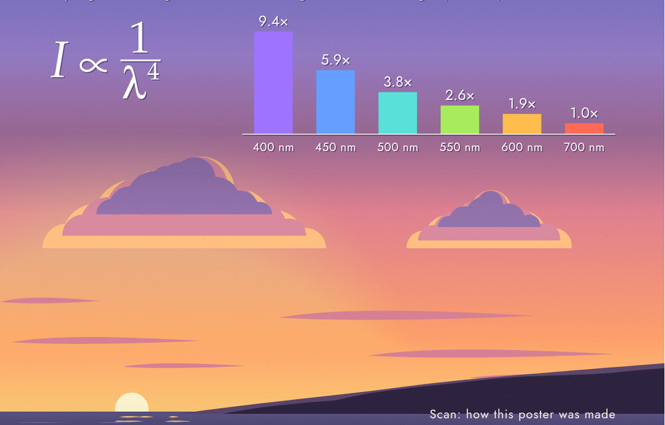 |
| poster QR caption | 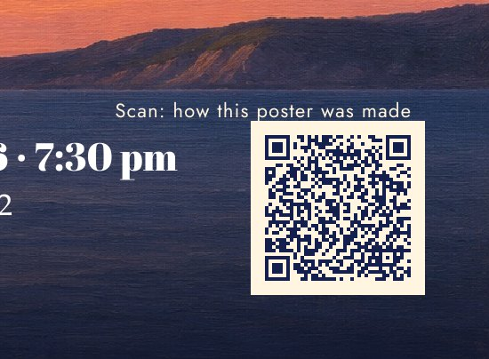 |  |
| menu card | 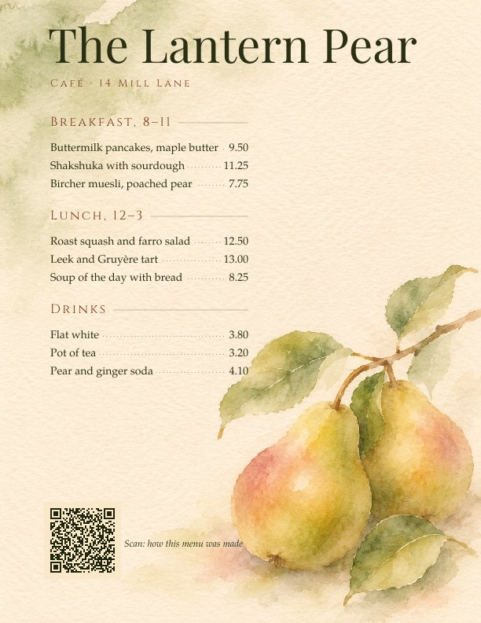 | 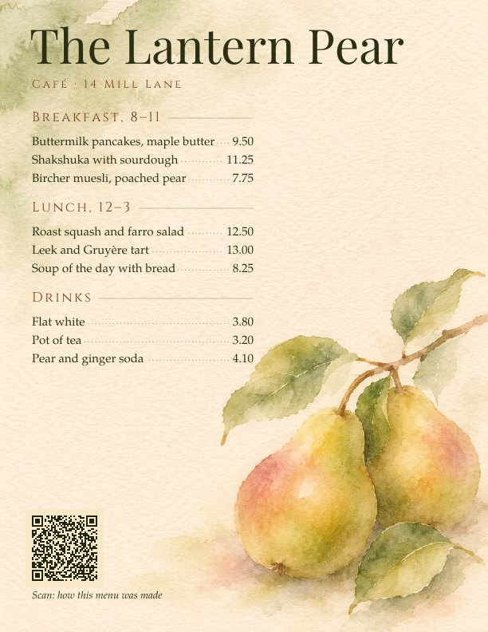 |
| alpine route above the hut |  | 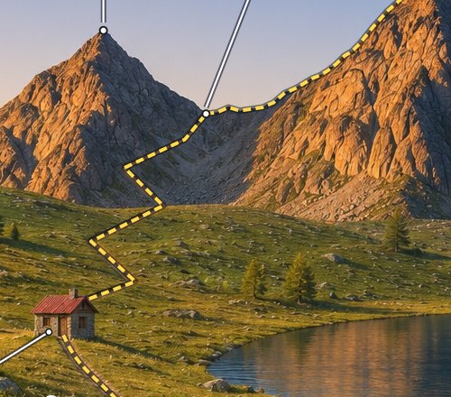 |
| col leader line |  | 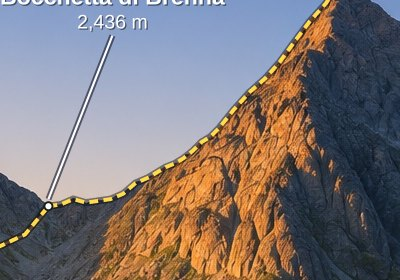 |
| autumn facts panel | 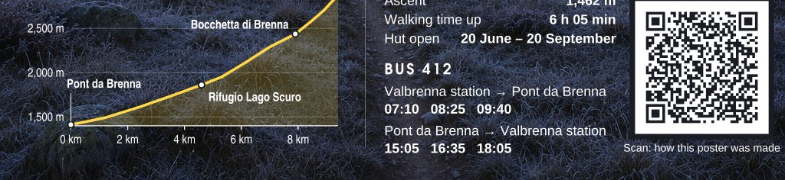 | 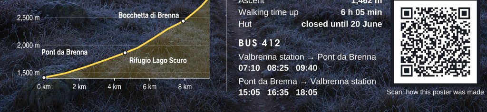 |
| layout reference sky | 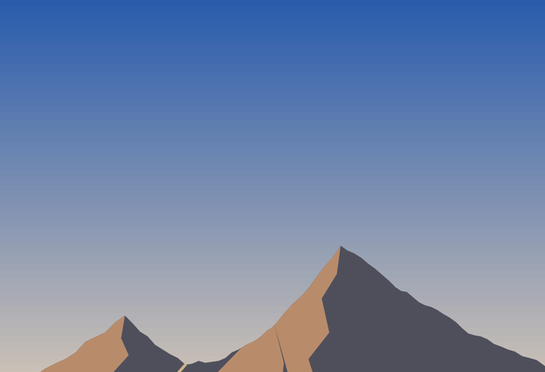 | 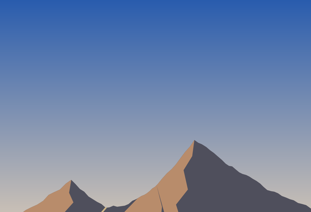 |
| route trace overlay (summer, autumn) | | 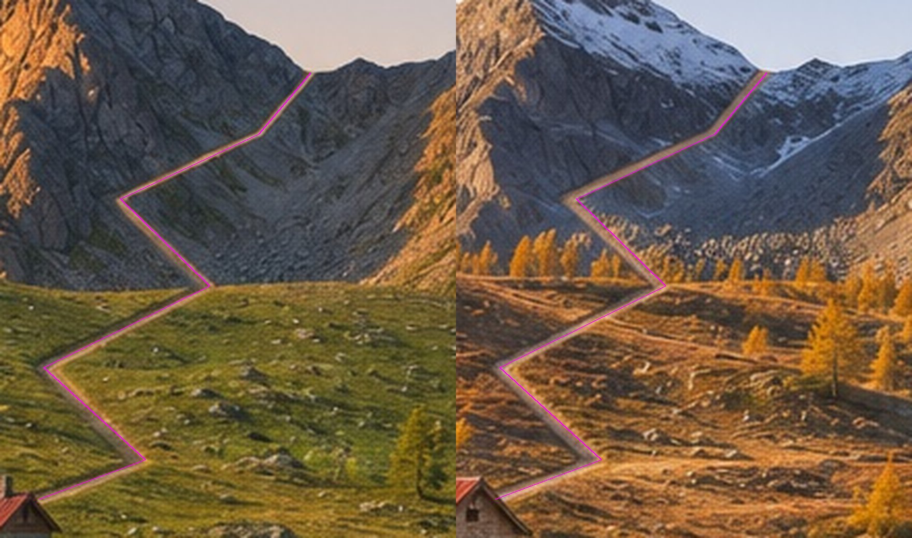 |
