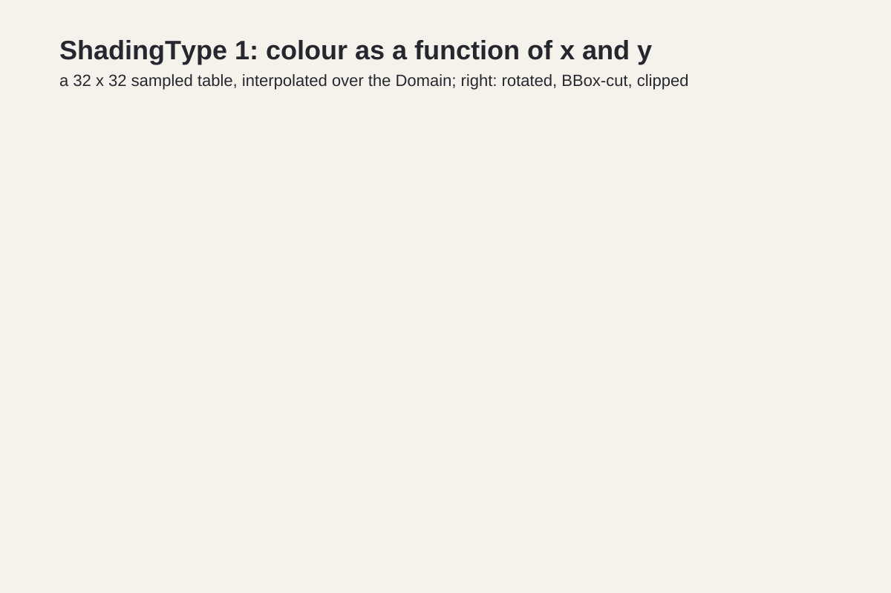
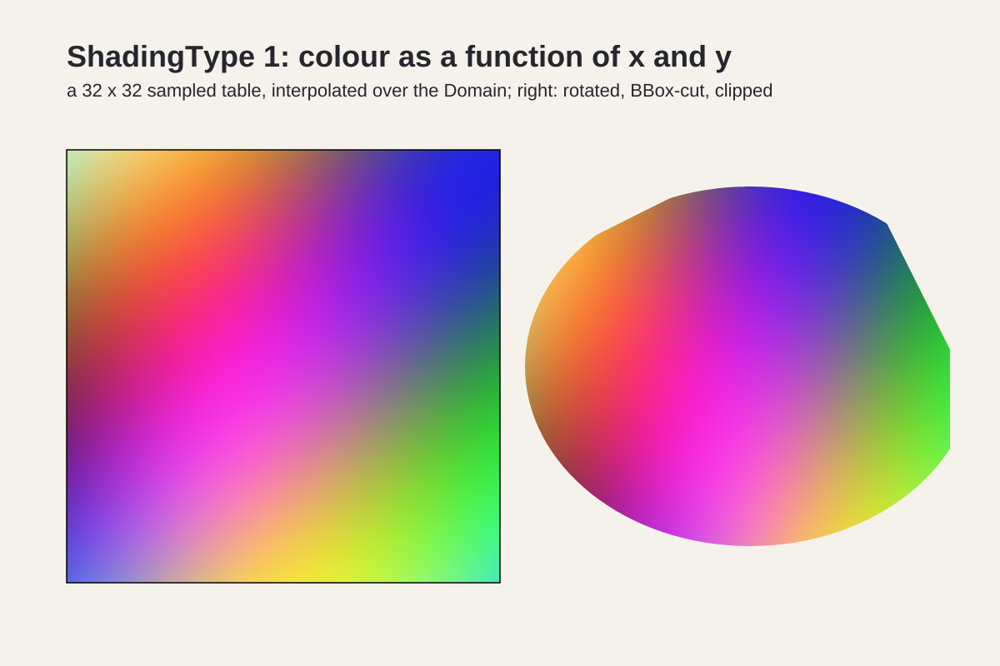
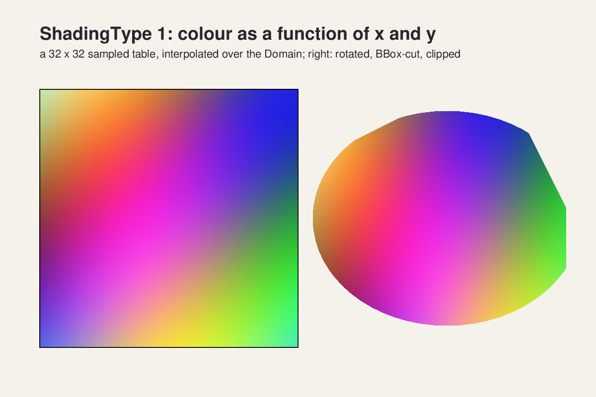
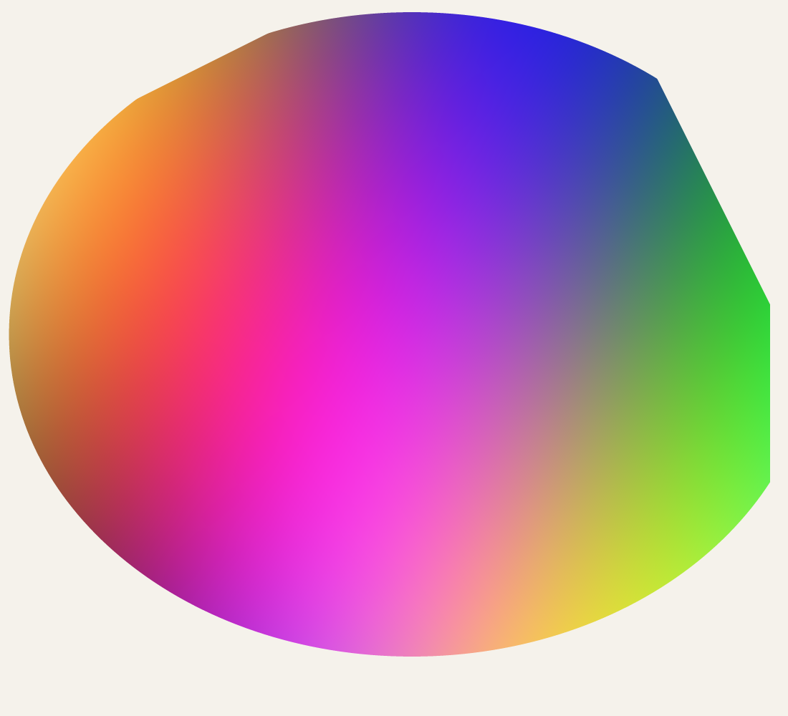

## shfill: ShadingType 1 (function-based) and FunctionType 0 in PNG, SVG and PDF (PR #1322, issue #1039 part 1, 2026-11-19)

- **What changed / what to look at:** `shfill` now paints function-based shadings, which used to fail with a rangecheck. The new `examples/function_shading.ps` shows a 32×32 sampled field two ways: straight, then rotated, cut by a BBox and clipped to an ellipse. Look for smooth colour with no banding, crisp Domain and BBox edges, and the same picture as Ghostscript. No existing render changed: the two-binary identity check found 128 of 128 pages identical.
- **Perceptual check (part 1, from the scope comment on the issue):** "a smooth Type 1 colour field at 300 dpi, with no banding, crisp Domain and BBox edges, and agreement with Ghostscript." The issue's own check is worded for meshes, which are deferred.
- **Reviewer:** PASS, round 1 (https://github.com/PSCatLabs/pscat/pull/1322#issuecomment-7015523314). polish: the curved clip edge's anti-aliasing differs slightly from gs, visible only zoomed in.

| before (144 dpi) | after (144 dpi) | gs (144 dpi) |
|---|---|---|
|  |  |  |

| after, 300 dpi crop | gs, 300 dpi crop |
|---|---|
|  |  |
