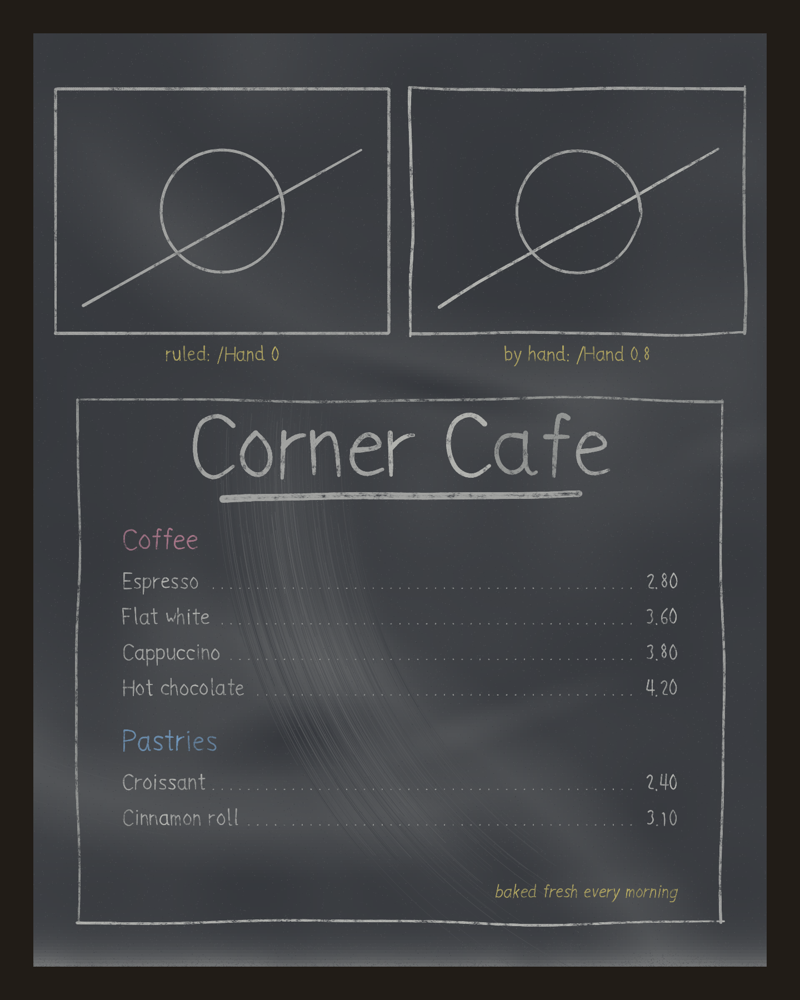

## drychalk: /Hand freehand chalk, /Corners, dctext and dcleader (PR pending, issues #1049 and #1054, 2026-11-07)

- **What changed / what to look at:** `dcchalk /Hand` draws a path freehand. The repro's box, diagonal and circle drift instead of being ruler-straight, the box's corners overshoot, and the circle closes a little past its start. Lettering is unchanged. There is also a new specimen of a cafe menu set with `dctext` (`/Align`, `/Fit`) and `dcleader` (dotted leaders).
- **Perceptual check:** #1049 has no explicit check. Its stated intent: "The box and diagonal are ruler-straight." It should read as hand-drawn, with slow drift, low tremor, no hooked overshoot and outlines that are not perfectly closed.
- **Reviewer:** PASS, round 1, posted on the PR as "Perceptual review, round 1". Polish notes: the Croissant row's leader starts close to the final "t", and the leader dots are faint over a light smudge.
- **Merge:** owner-merge after the 0.7.0 tag (major issue, release freeze), so this entry records the review rather than an agent merge.

| before | after |
|---|---|
|  |  |

New specimen (after only): 
