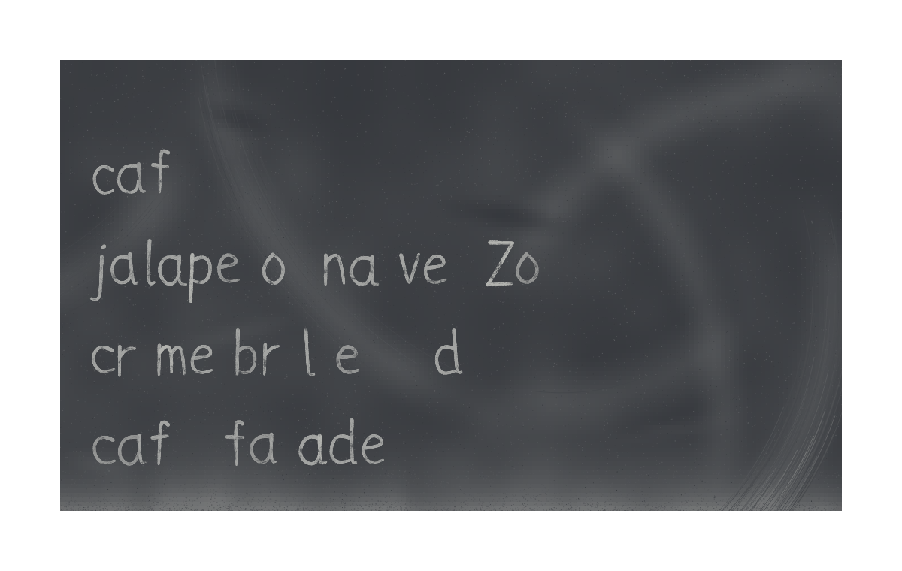
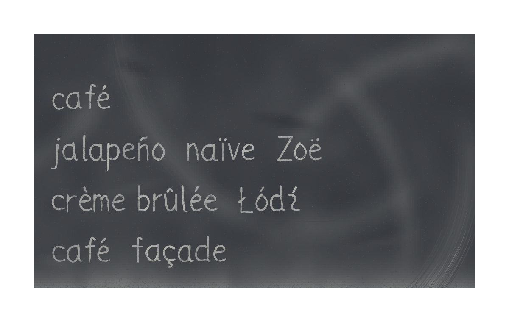
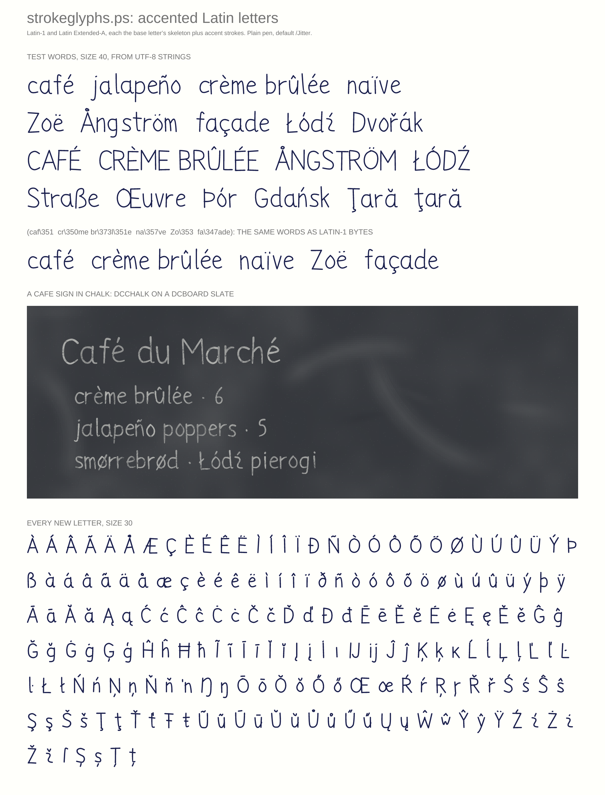

## strokeglyphs: accented Latin letters (Latin-1, Latin Extended-A) and Latin-1 strings (PR #1068, issue #1051, 2026-11-06)

- **What changed / what to look at:** `sgpath` now writes accented Latin letters (café, jalapeño, crème brûlée, naïve, Zoë, Ångström, façade, Łódź), each the base letter's skeleton plus accent strokes. A Latin-1 byte string (`(caf\351)`) draws the same word. The issue's repro on a slate is shown before (with `/Strict false`, so the missing letters are gaps) and after, followed by the new specimen. Existing renders are byte-identical (`identity_check.sh --loader lib/strokeglyphs.ps`, 18/18).
- **Perceptual check:** the issue has none. The dispatcher's test was: "accents read as the intended letter at sign sizes, match the stroke weight and sit at a plausible height. Keep it human, never tidied: fix a glyph only if it misreads as another character."
- **Reviewer:** PASS, round 1 (https://github.com/PSCatLabs/pscat/pull/1068#issuecomment-6703515235)

| before | after |
|---|---|
|  |  |
| (new file) |  |
