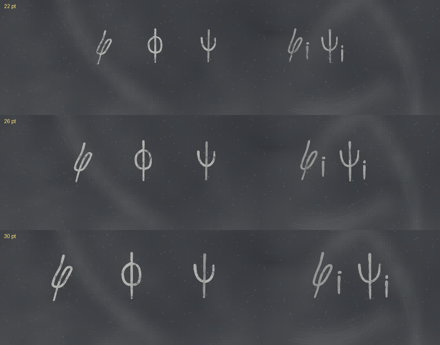
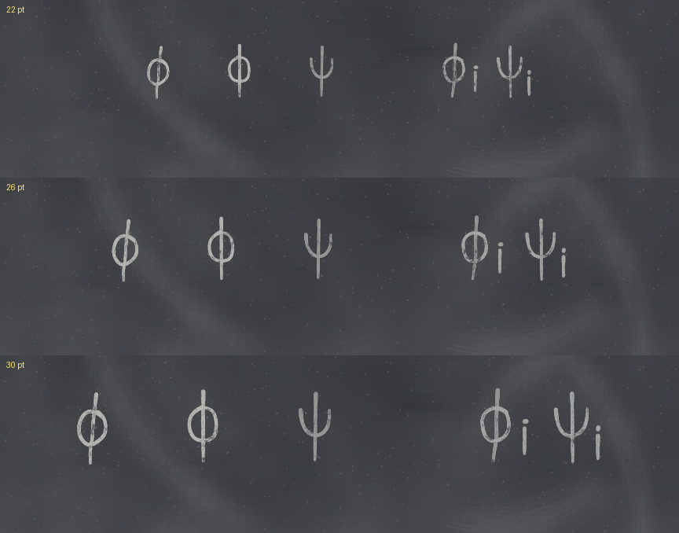

## chalk: report every unsupported character or command at once with line:column; a lone $ is now an error; \varphi no longer reads as psi (PR #1152, issue #1087, 2026-11-11)

- **What changed / what to look at:** the looped phi (mathkit's `\varphi`) is now a closed loop on a near-vertical stem, at 22, 26 and 30 pt, next to `\phi` and `\psi`. Rows: `\varphi \phi \psi` then `\varphi_i \psi_i`.
- **Perceptual check:** the issue asks for a looped phi that "differs clearly from `\psi` at small sizes"; TASTE.md: sloppy but legible, never tidied.
- **Reviewer:** PASS, round 1 ([the PR's "Perceptual review, round 1" comment](https://github.com/PSCatLabs/pscat/pull/1152)). Could it be read as psi: before yes (22 pt), sometimes (26, 30 pt); after no. Polish: at 22 pt it leans enough to pass for a slashed zero out of context, and it is now close to `\phi`.

| before | after |
|---|---|
|  |  |
