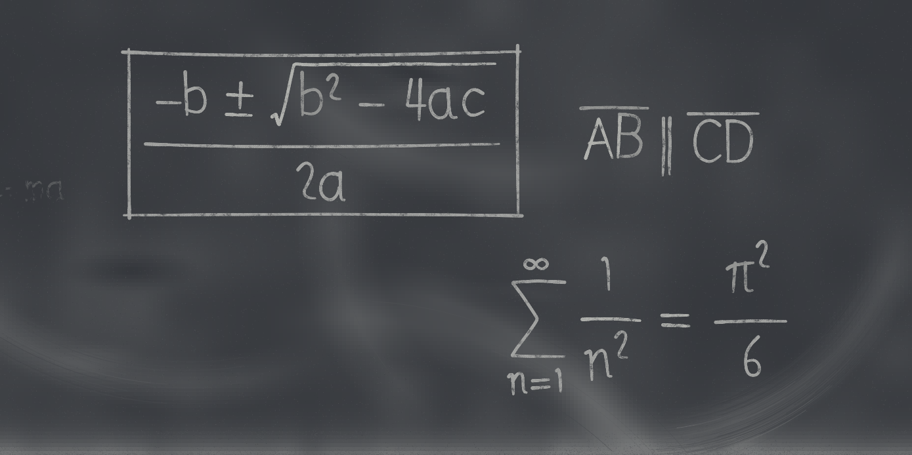
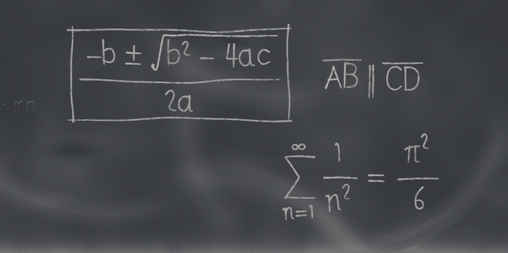
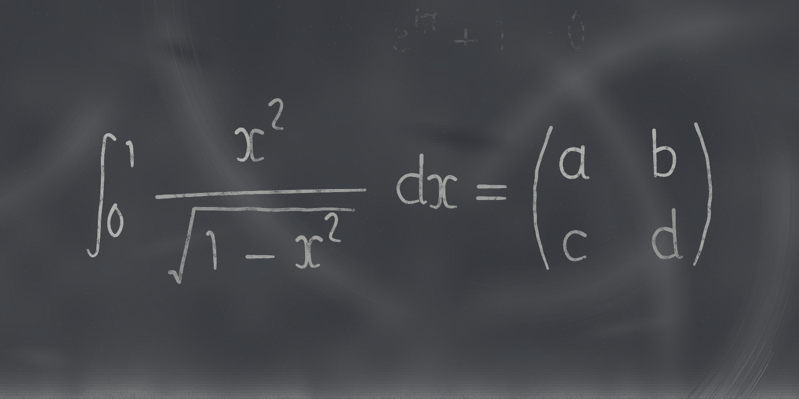

## chalk: --hand and chalkboard_math hand for freehand chalk strokes (PR #1326, issue #1111, 2026-11-19)

- **What changed / what to look at:** `pscat chalk --hand` and `chalkboard_math`'s `hand` draw the board's long ruled strokes (box edges, fraction bars, overlines) with drychalk's `/Hand` drift, so they undulate and sag like freehand chalk. Lettering and short bars barely move (drift scales with stroke length). With no hand amount the board is unchanged. Merged into `feature/0.7.1`, not main.
- **Perceptual check:** "The `--hand` board reads as more hand-drawn than the plain one; no glyph misreads and no stroke is broken or jagged."
- **Reviewer:** PASS, round 1: a cold reviewer (blank context, images labelled A and B) picked the `--hand` board as the more hand-drawn one unprompted, found no misread glyph and no broken strokes, and called the effect subtle (https://github.com/PSCatLabs/pscat/pull/1326, "Perceptual check").

| before | after |
|---|---|
|  |  |
|  |  |
