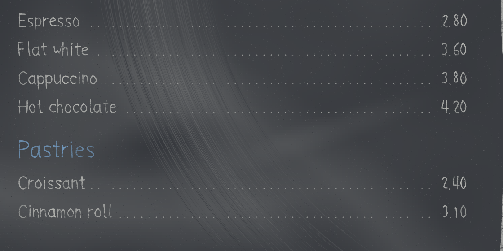
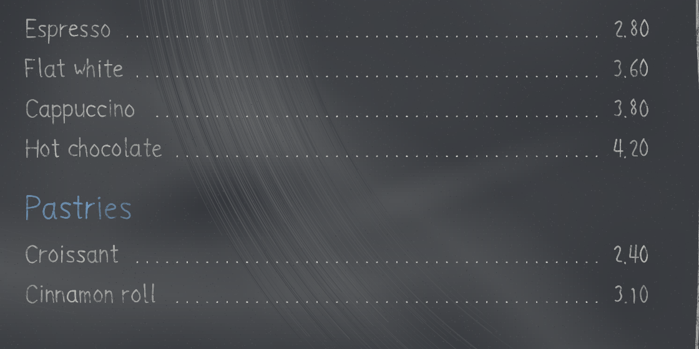
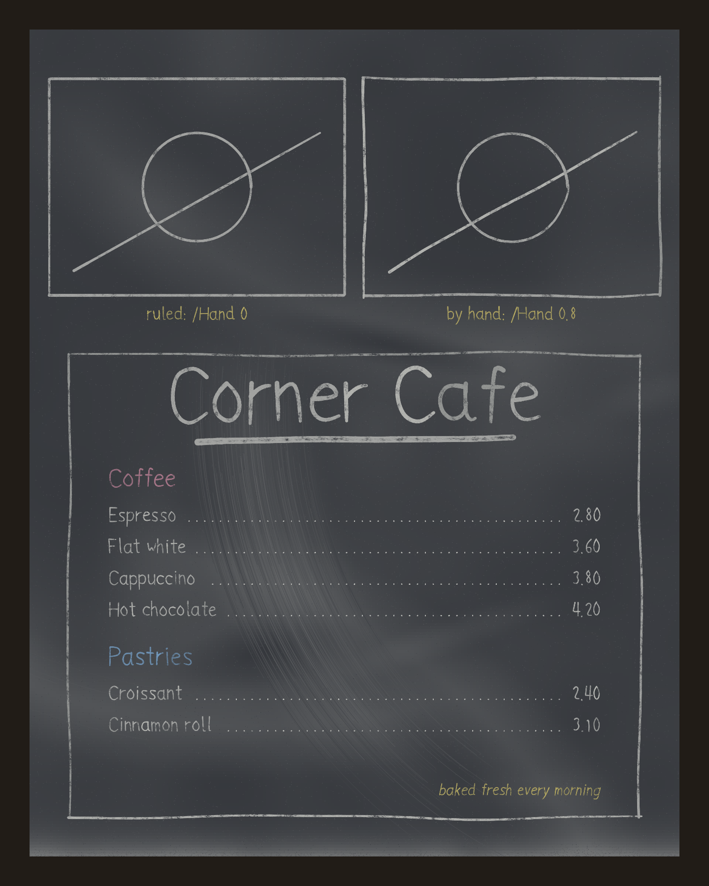

## drychalk: dcleader dots clear the last letter and hold over smudges (PR pending, issue #1112, 2026-11-19)

- **What changed / what to look at:** the cafe menu in `examples/drychalk_hand.ps`. A row's leader now starts a clear gap (half the text size, was 0.3) after the last letter, so "Croissant" and "Cinnamon roll" no longer have a dot touching them. The dots are a little brighter (the lettering's strength plus 0.15) and 0.85 of its width, so they stay visible over the lighter smudge and swipe. Dots still line up from row to row.
- **Perceptual check:** "On a chalk menu board, the leader dots leave a clear gap after the last letter and stay visible over smudged areas, while still reading as chalk."
- **Reviewer:** PASS, round 1 (blank-context agent, posted on the PR as "Perceptual review, round 1"). Polish: dots in the densest part of the smudge streak are still a little dimmer than those over clean board.

| before | after |
|---|---|
|  |  |

Whole specimen, after: 
