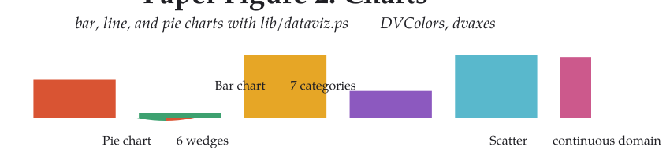

## fonts: a missing glyph advances by a space on the standard 35, as in Ghostscript (PR #1297, issue #1115, 2026-11-18)

- **What changed / what to look at:** text containing a missing glyph (here a UTF-8 em dash, three unencoded bytes) is spaced as in Ghostscript: the gap at the dash is about half what it was. Two tracked renders move, `examples/dataviz_paper.ps` (subtitle, chart titles) and `gallery/mochi_denim_blue.ps` (title strip; its committed still is re-rendered). Every other tracked example and gallery page is byte-identical. Merged into `feature/0.7.1`, not main.
- **Perceptual check:** "Text containing a missing glyph has the same spacing as in Ghostscript; nothing else in the gallery moves."
- **Reviewer:** PASS, round 1 (https://github.com/PSCatLabs/pscat/pull/1297#issuecomment-7000663936)

| before | after | Ghostscript |
|---|---|---|
|  |  |  |
|  |  |  |
