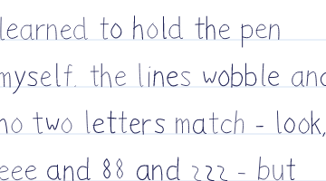
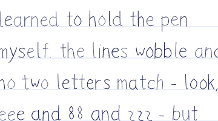
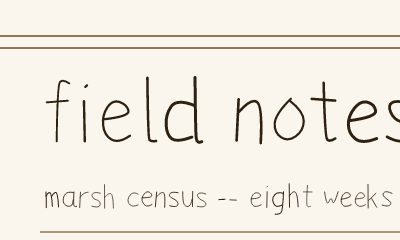
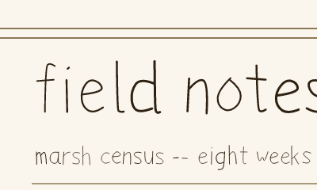

## Anisotropic CTMs stroke with an elliptical pen (rectstroke matrix, stroke under concat) (PR #1203, issue #1196, 2026-11-12)

- **What changed / what to look at:** a stroke under a non-uniform CTM now uses the elliptical pen the PLRM and gs use, where pscat used one round pen of average width. Ten pages move. `selftest/drivers/arcto.ps` panel 3 (a rounded rectangle under `1.6 0.7 scale`) now has heavy vertical sides and thin horizontal runs, like gs (third row). Nine handwriting pages change only at edges, because `lib/handscript.ps` and `lib/hangul.ps` slant each glyph with a small shear (|k| <= 0.08): gallery `field_notes`, `hundred_lines`, `released_memo` and `time_traveler_memo`, and examples `handwriting`, `hangul_handscript`, `drychalk_specimen`, `released_specimen` and `released_pages` page 2. At most 0.97% of a page's pixels change. The committed gallery stills were not re-rendered; main already did not reproduce those four byte for byte.
- **Perceptual check:** the issue has no perceptual check. Its intent: rectstroke's matrix (and stroke under `concat`) scale the line width as gs does, and "gallery stills are unchanged". TASTE.md: handwriting stays sloppy but legible.
- **Reviewer:** PASS, round 1 (https://github.com/PSCatLabs/pscat/pull/1203#issuecomment-6845789870). No handwriting glyph changes shape, weight or legibility at viewing size or at 4x. Panel 3 matches gs: 4x side widths 9.5 / 4.0 px against gs 10.0 / 4.5 and theory 9.6 / 4.2. polish: at 72 dpi the 1 px horizontal runs look greyer than gs's, because gs fattens thin lines by about half a pixel.

| before | after |
|---|---|
|  |  |
|  |  |
|  |  |

gs 10.07.1 on the same arcto crop: 
