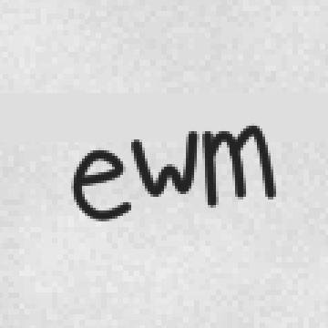
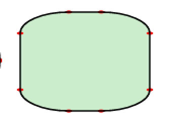
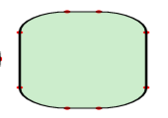
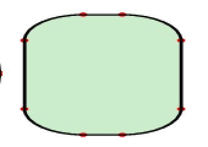
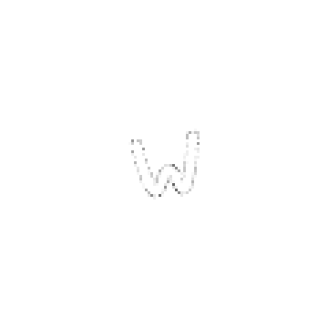

## Anisotropic CTMs stroke with an elliptical pen (rectstroke matrix, stroke under concat) (PR #1203, issue #1196, 2026-11-12)

- **What changed / what to look at:** a stroke under a non-uniform CTM now uses the elliptical pen the PLRM and gs use, where pscat used one round pen of average width. After Codex round 1, the round pen is still used wherever it is within 1/16 px of the true one, so two pages move. `selftest/drivers/arcto.ps` panel 3 (a rounded rectangle under `1.6 0.7 scale`) now has heavy vertical sides and thin horizontal runs, like gs (the gs crop is below the table). In `gallery/released_memo.ps` one handwritten glyph (the "w" of the initials) changes at its edges: its per-glyph shear takes its pen just past the 1/16 px bound. At most 0.01% of that page's pixels change, by at most 19/255. The nine handwriting pages that changed in round 0 are byte-identical to main again. The committed gallery stills were not re-rendered.
- **Perceptual check:** the issue has no perceptual check. Its intent: rectstroke's matrix (and stroke under `concat`) scale the line width as gs does, and "gallery stills are unchanged". TASTE.md: handwriting stays sloppy but legible.
- **Reviewer:** PASS, round 1 (https://github.com/PSCatLabs/pscat/pull/1203#issuecomment-6845789870). No handwriting glyph changes shape, weight or legibility at viewing size or at 4x. Panel 3 matches gs: 4x side widths 9.5 / 4.0 px against gs 10.0 / 4.5 and theory 9.6 / 4.2. polish: at 72 dpi the 1 px horizontal runs look greyer than gs's, because gs fattens thin lines by about half a pixel. Round 1 (Codex) narrowed the diff set from ten pages to these two; the arcto render is byte-identical to the one reviewed.

| before | after |
|---|---|
|  |  |
|  |  |

gs 10.07.1 on the same arcto crop: 

3x crop of the released_memo initials; 8x amplified diff: 
