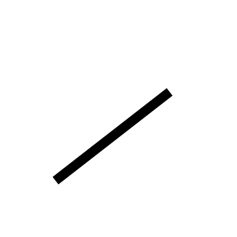
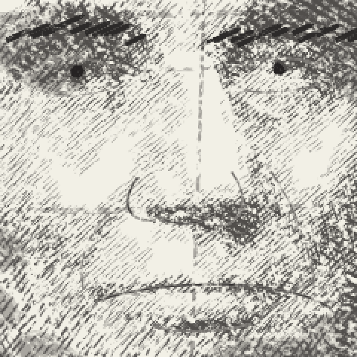

## Stroke: ignore zero-length segments inside a subpath, as gs does (PR #1454, issue #1224, 2026-11-27)

- **What changed / what to look at:** a stroked line whose first segment has no length no longer gets a stray start cap (first pair: the issue's `25 25 moveto 25 25 lineto 60 40 lineto` under square caps, 4 wide, at 288 dpi), and zero-length segments anywhere in a stroke no longer aim a cap or join. Across the gallery and examples the change is invisible to the eye (second pair: the most-changed piece, `gallery/lincoln_charcoal`, 3x crop of the face, up to 50/255 on 18k px). Look for a missing cap, a gap, a blob or a lost join on a dry-media stroke.
- **Perceptual check:** the issue (#1224) states no written perceptual acceptance check; judged against its intent (caps and joins follow the real segments, as in gs) and `docs/dev/TASTE.md`.
- **Reviewer:** PASS, round 1 (https://github.com/PSCatLabs/pscat/pull/1454#issuecomment-7213603497), 12 before/after pairs.

| before | after |
|---|---|
|  |  |
|  |  |
