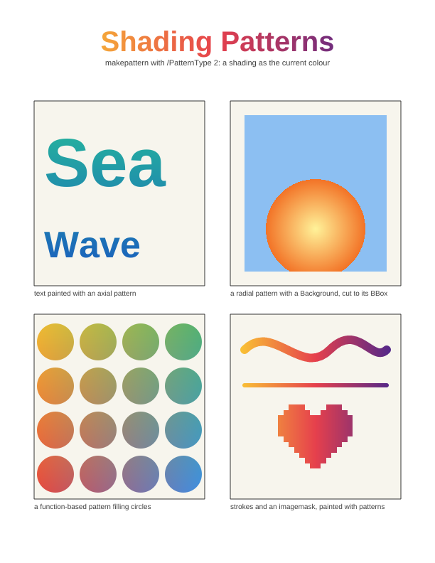
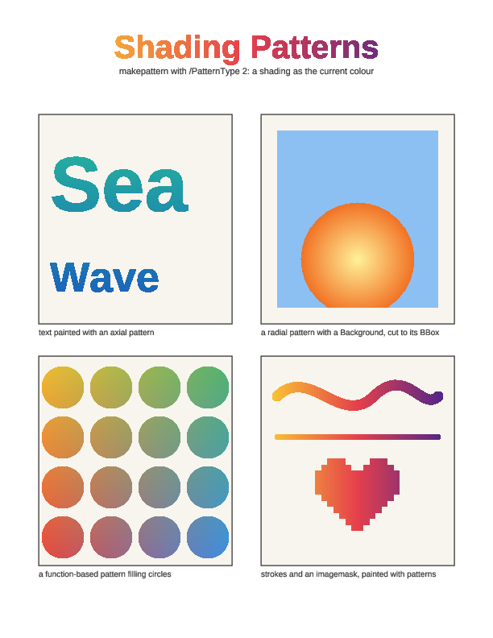

## Shading patterns: makepattern PatternType 2 in PNG, SVG and PDF (PR #1367, issue #1298, 2026-11-20)

- **What changed / what to look at:** a new feature and its new specimen sheet (`examples/shading_patterns.ps`). A shading is the current colour, filling text, strokes, circles and an imagemask. Shown here in all three outputs: PNG, the SVG rasterised by Chrome, and the PDF rasterised by gs. The base build stops at `makepattern` with a `rangecheck`, so the before image is a blank page.
- **Perceptual check:** "gradient-filled text matches across the three outputs."
- **Reviewer:** PASS, round 1 (https://github.com/PSCatLabs/pscat/pull/1367#issuecomment-7035290266). Polish noted: gs's raster of the PDF has aliased glyph edges, because gs paints pattern fills without anti-aliasing.

| before | after, PNG | after, SVG (Chrome) | after, PDF (gs) |
|---|---|---|---|
|  |  |  |  |
