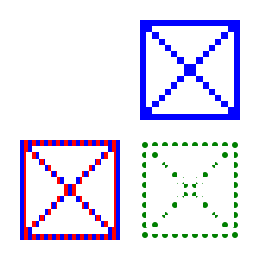
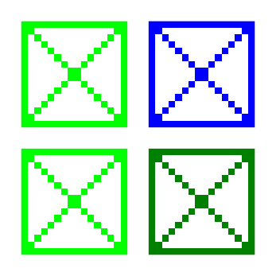
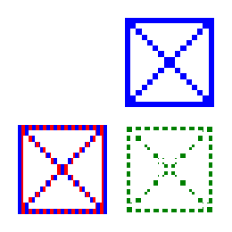
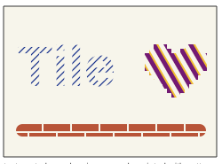
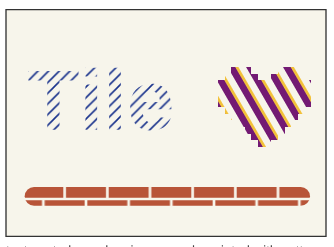
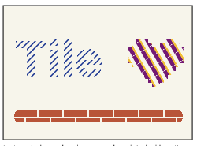

## imagemask paints the current pattern through its stencil in PNG, SVG and PDF (PR #1317, issue #1299, 2026-11-19)

- **What changed / what to look at:** an `imagemask` under `setpattern` shows the pattern instead of a flat colour; under the null pattern it paints nothing. Test page: a stencil under a stripe pattern (bottom left), an uncoloured dot pattern (bottom right), the null pattern (top left), solid blue (top right, unchanged). The specimen `examples/patterns.ps` panel 6 gains a heart stencil.
- **Perceptual check:** "the stencil shows the pattern, not a flat colour, in all three outputs."
- **Reviewer:** PASS, round 1 (https://github.com/PSCatLabs/pscat/pull/1317#issuecomment-7010393197)

| output | before | after |
|---|---|---|
| PNG |  |  |
| SVG (Chrome) |  |  |
| PDF (gs) |  |  |
| specimen panel 6, PNG / SVG / PDF |  |   |
