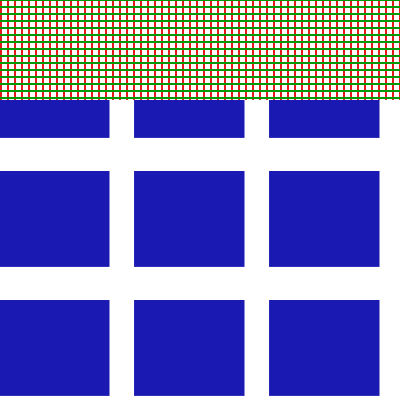
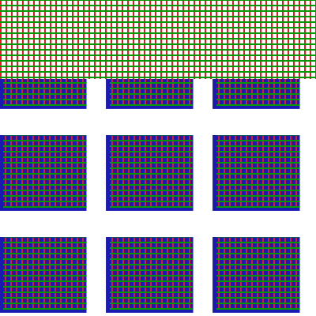
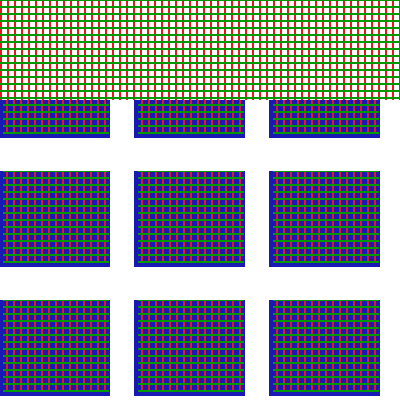
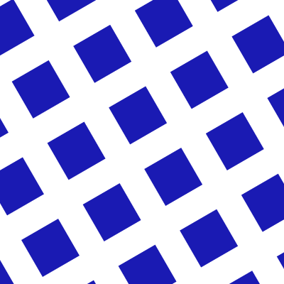
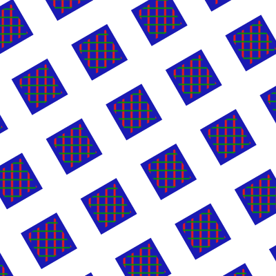
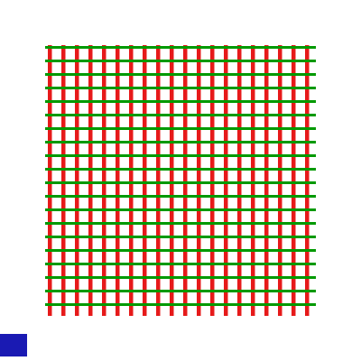
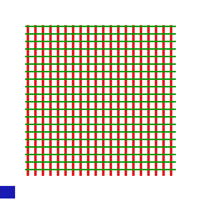
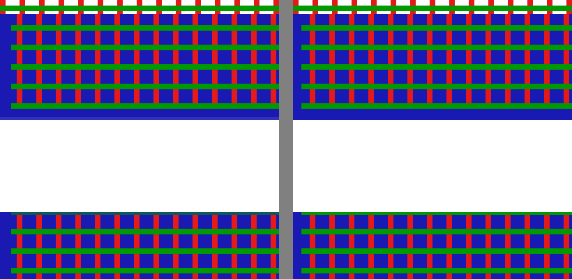

## patterns: a pattern paints in another context, placed as gs places it (PR #1330, issue #1300, 2026-11-19)

- **What changed / what to look at:** a page pattern used inside another pattern's `PaintProc`, and a pattern made inside one and used on the page, now paint (before: nothing) in PNG, SVG and PDF, aligned as gs aligns them. Patterns used in their own context are byte-identical.
- **Perceptual check:** "the inner pattern shows inside the outer tiles, aligned as gs aligns it."
- **Reviewer:** PASS, round 1 (https://github.com/PSCatLabs/pscat/pull/1330#issuecomment-7021529158). polish: pscat's anti-aliased stripe ends look softer than gs's aliased ones.

| before | after | gs |
|---|---|---|
|  |  |  |
|  |  |  |
|  |  |  |

Zoom of one scaled cell, pscat left, gs right: 
