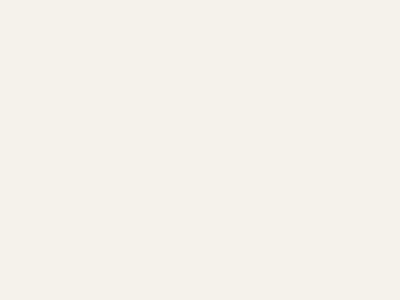
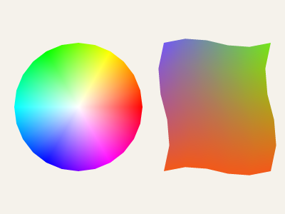

## Gouraud mesh shadings: shfill ShadingType 4 and 5 in PNG, SVG and PDF (issue #1325, part 1, 2026-11-20)

- **What changed / what to look at:** a new feature. A free-form triangle fan (ShadingType 4, left) and a wavy lattice (ShadingType 5, right) are shown in all three outputs (PNG, the SVG rasterised by Chrome, and the PDF rasterised by gs), next to gs's own render of the program. The base build stops at the first `shfill` with a `rangecheck`, so the "before" image is a blank page. Patch meshes (types 6 and 7) come in a second PR.
- **Perceptual check:** "A mesh specimen (a Gouraud triangle fan and a Coons patch) renders smoothly with no seams, and the PNG, SVG and PDF outputs agree with gs's render within a few levels." (Only the fan part applies here; the Coons patch is part 2.)
- **Reviewer:** PASS, round 1 (see the PR's "Perceptual review, round 1" comment). Polish: pscat anti-aliases the mesh's outer edge, while gs fills every pixel the edge touches, so the lattice's sides look slightly more angular than gs's.

| before | after, PNG | after, SVG (Chrome) | after, PDF (gs) | gs reference |
|---|---|---|---|---|
|  |  |  |  |  |
