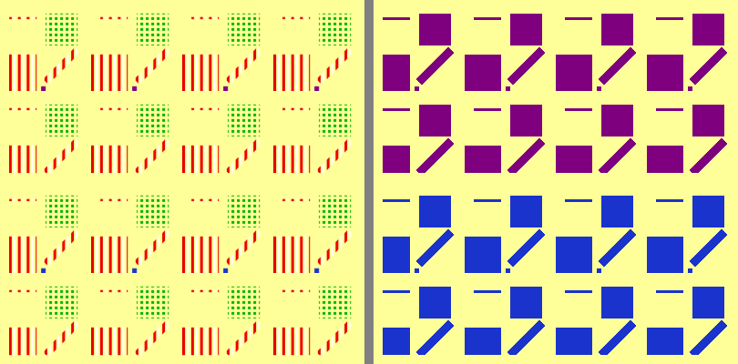
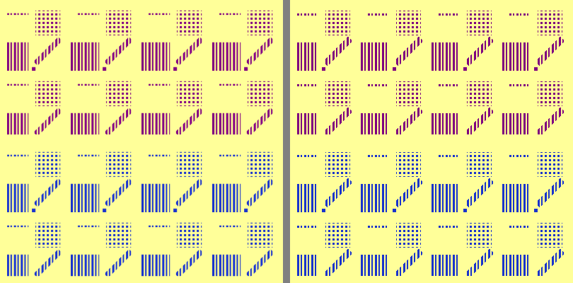
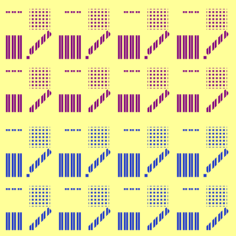
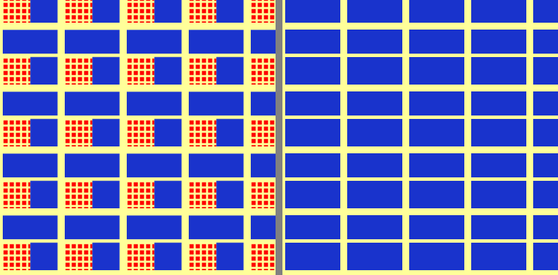
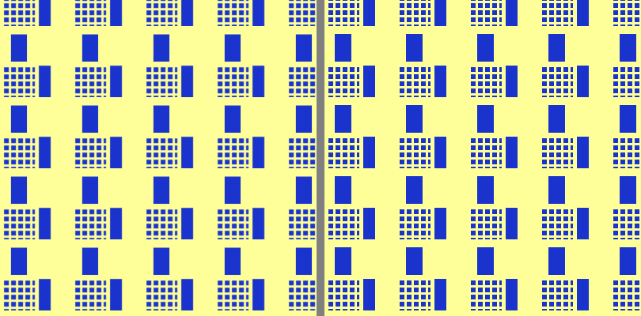
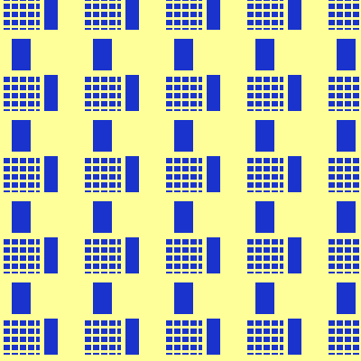

## patterns: a pattern inside an uncoloured PaintProc paints its coverage in SVG and PDF too (PR #1386, issue #1340, 2026-11-20)

- **What changed / what to look at:** a mark painted with a pattern inside an uncoloured pattern's `PaintProc` now shows the inner pattern's coverage in the outer colour in SVG and PDF, as the PNG and gs already did. Before, SVG showed the inner pattern's own colours and PDF a solid fill. Each image: left the SVG (WebKit), right the PDF (gs). PNG unchanged.
- **Perceptual check:** the issue has none; its intent: "make the three outputs agree with gs's raster."
- **Reviewer:** PASS, round 1 (https://github.com/PSCatLabs/pscat/pull/1386#issuecomment-7048813773). polish: WebKit's anti-aliased SVG stripes look thinner than gs's pixel-snapped ones when zoomed.

| before | after | gs |
|---|---|---|
|  |  |  |
|  |  |  |
