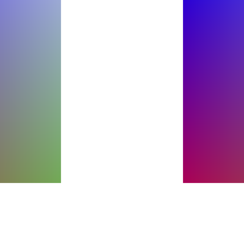
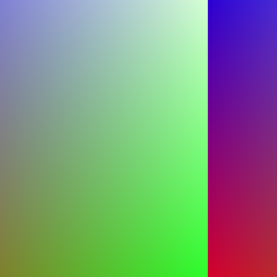
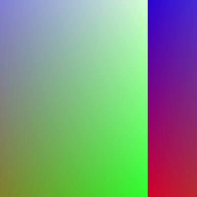
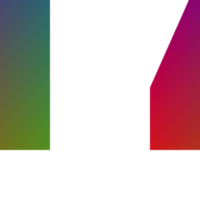
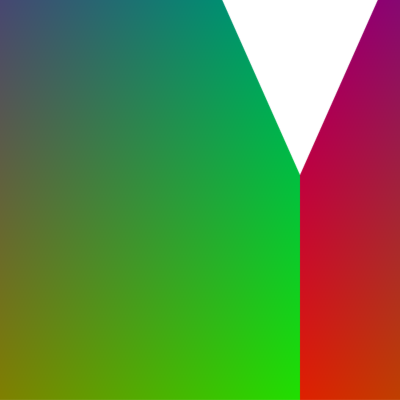
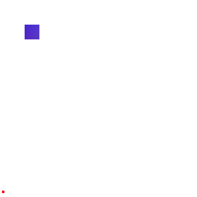
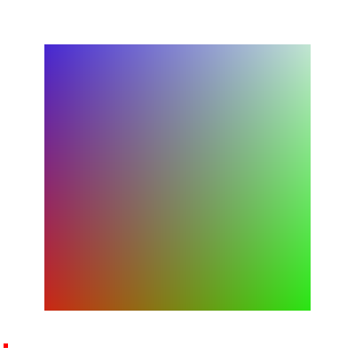

## SVG: a Type 1 or mesh shading pattern paints in a context it was not made in (PR #1475, issue #1368, 2026-11-27)

- **What changed / what to look at:** SVG (not PNG or PDF, which were right) showed only the part of a Type 1 or mesh shading pattern that lay on the canvas the pattern was made on, when it was used in another context (inside a tile larger than the page, or made in a tile and used on the page). The SVG now paints the whole shading, as the PNG does. Images are the SVG rasterised by resvg; the last column is pscat's PNG of the same program.
- **Perceptual check:** none written on the issue; judged against its intent: the SVG paints what the PNG and PDF paint.
- **Reviewer:** PASS, round 1 (PR #1475 comment "Perceptual review, round 1")

| picture | before (SVG) | after (SVG) | PNG reference |
|---|---|---|---|
| Type 1 in a 600 pt cell |  |  |  |
| Type 4 mesh, same |  |  |  |
| Type 1 made in a tile, used on the page |  |  |  |
