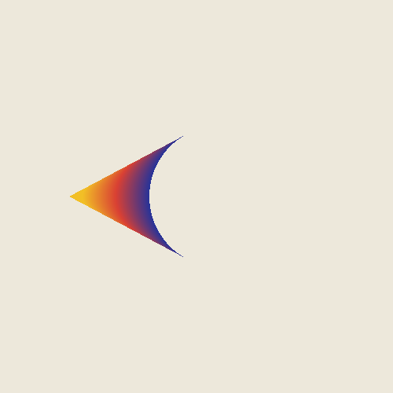
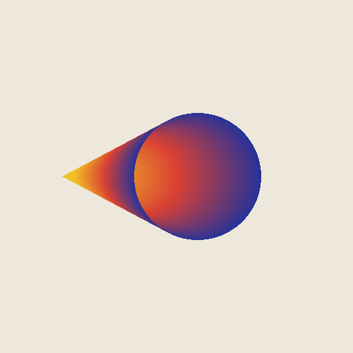
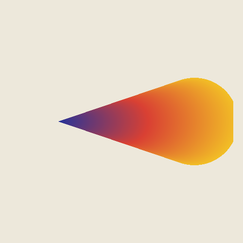

## SVG: a radial whose circles are not nested paints its smaller root (PR #PRNUM, issue #1370, 2026-11-27)

- **What changed / what to look at:** SVG (not PNG or PDF, which were right) showed a hole where a cone-shaped radial shading, with its end not extended, should paint the smaller circle's disk. The SVG now has two gradients and matches the PNG. Images are the SVG rasterised by resvg; the third column is pscat's PNG of the same program.
- **Perceptual check:** none written on the issue; judged against its intent: the SVG paints the smaller root where the PNG, PDF and gs do.
- **Reviewer:** PASS, round 1 (PR #PRNUM comment "Perceptual review, round 1")

| before (SVG) | after (SVG) | PNG reference |
|---|---|---|
|  |  |  |
|  |  |  |
