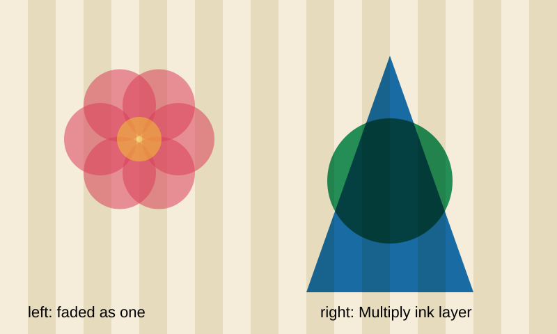
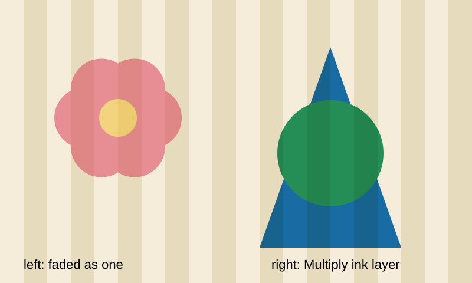

## graphics: transparency groups (begingroup/endgroup) for raster, PDF and SVG (PR #1417, issue #1406, 2026-11-24)

- **What changed / what to look at:** the new `begingroup`/`endgroup` operators fade or blend a whole drawing as one thing. The left flower is at 0.55: before, each petal was faded alone, so the overlaps are darker; after, it is one shape. The right triangle and circle are a Multiply ink layer: before, the circle multiplied with the triangle too; after, only the layer multiplies onto the ground. The third image is the PDF rasterised by Ghostscript. Existing renders do not change: a two-binary identity check found 210 of 210 corpus pages identical.
- **Perceptual check:** the issue has no formal check. Its intent: group opacity and blend in the graphics model, so layered drawings export to PDF and SVG. Scope: the whole issue (blur is out of scope in the issue itself).
- **Reviewer:** PASS, round 1 (https://github.com/PSCatLabs/pscat/pull/1417#issuecomment-7154812770). Polish: the demo does not show the SVG backend; a resvg test covers it.

| before | after | after, PDF via gs |
|---|---|---|
|  |  |  |
