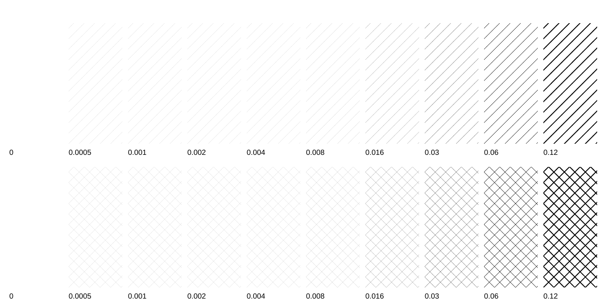
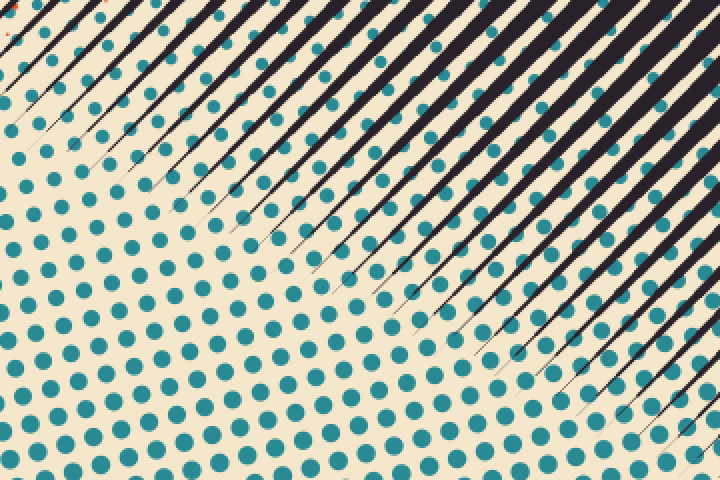
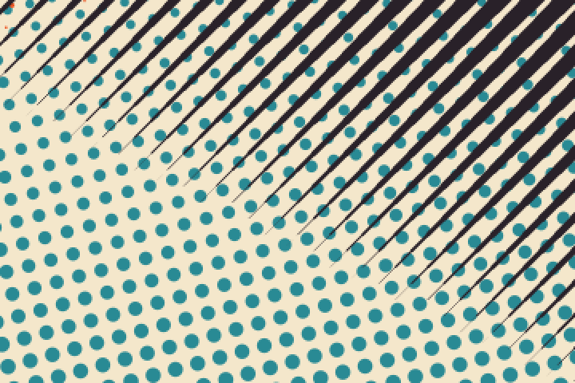
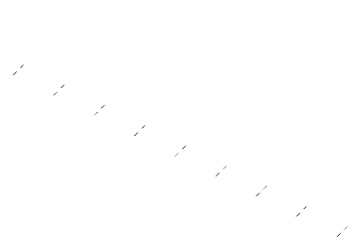

## halftonekit: a line or cross screen fades smoothly at tiny tones (PR #1415, issue #1408, 2026-11-24)

- **What changed / what to look at:** A `/line` or `/cross` halftone at a tone below about 0.0125 (72 dpi, defaults) used to draw every rule at the stroker's 0.1 px floor, so a tone leaving 0 popped a full screen in. Now the rule is shortened instead, so ink tracks tone. Look at the ramp (tones 0 to 0.12, line row on top, cross row below) and the gallery crop: ordinary tones are unchanged.
- **Perceptual check:** the issue has no formal check. Its stated expectation for the repro is "an almost blank page" at `/Tone 0.001`, and "a tone that fades smoothly to zero".
- **Reviewer:** PASS, round 1 (https://github.com/PSCatLabs/pscat/pull/1415#issuecomment-7147764490)

| before | after |
|---|---|
|  |  |
|  |  |
|  |  |

Difference between the two gallery crops, amplified 12x (dark = changed; only the tips of the fading ridges):

