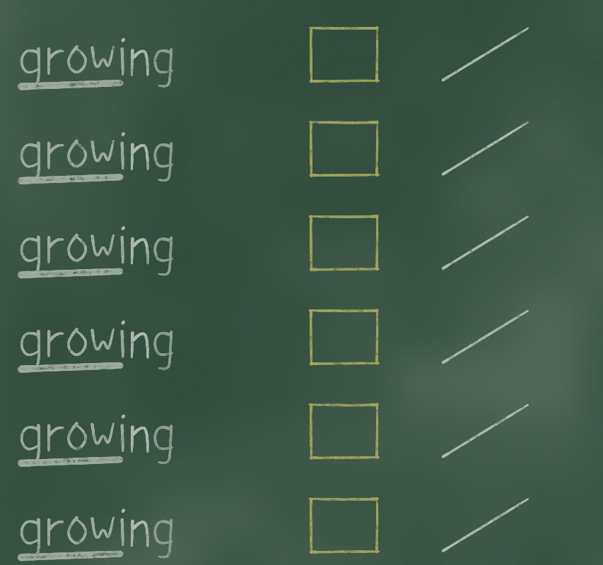
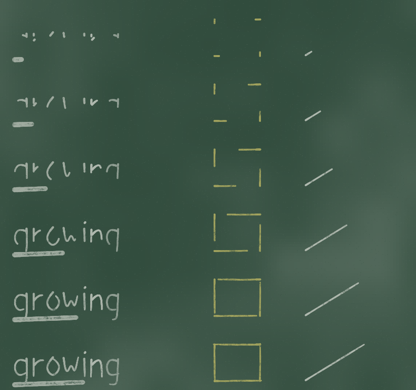

## drychalk: /From /To draw part of a stroke (PR PRNUM, issue #1409, 2026-11-24)

- **What changed / what to look at:** `dcchalk` takes `/From` and `/To` (0..1): part of each stroke, with the whole stroke's width, pressure, texture and dust there. The sheet shows the same drawing (a word, a side-of-chalk underline, a yellow box in four strokes with `/Hand`, a diagonal) at six moments of drawing: top row earliest, bottom row finished. Look at the cut: no landing or lift blob, no gap, texture matching the finished row.
- **Perceptual check:** #1409 has no explicit check. Its stated intent: a stroke grows "with the pressure profile, width variation, texture and dust that the full stroke would have there", so a shorter path is not the same as part of the long one (no new landing and lift).
- **Reviewer:** PASS, round 1 (see the PR's "Perceptual review, round 1" comment). The bottom row is pixel-identical to the finished drawing. One polish note: the earliest row is only scattered nubs, as expected for a very early moment.
- **Before:** the library could not draw part of a stroke, so every row is the finished drawing. **After:** the rows grow.

| before | after |
|---|---|
|  |  |
