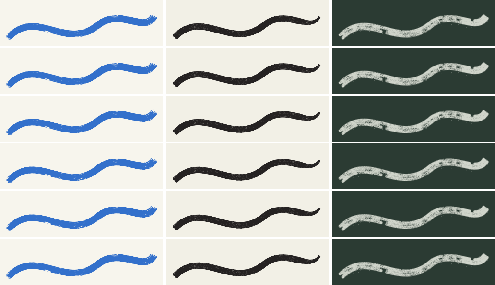
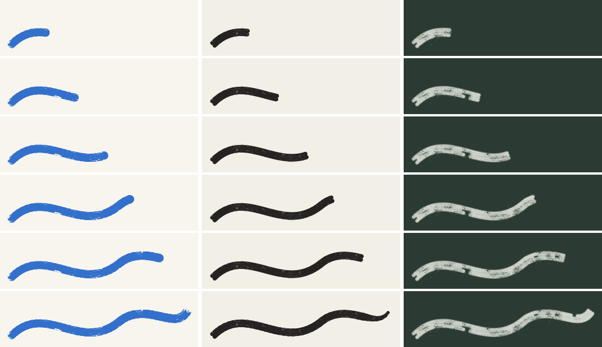

## dkstroke, dycrayon and dhstroke: /From /To (PR #PRNUM, issue #1418, 2026-11-25)

- **What changed / what to look at:** `dkstroke`, `dycrayon` and `dhstroke` take `/From` and `/To` (0..1): part of each stroke, with the whole stroke's pressure, widths, lanes, texture and fallout there. The sheet shows the same stroke in three media (wax crayon, compressed charcoal, a tilted side-of-stick stroke with fallout on a dark board) at six moments of drawing: top row earliest, bottom row finished. Look at the cut: the part drawn does not change between rows, and the bottom row is the finished stroke.
- **Perceptual check:** "A crayon or charcoal stroke drawn as `/From 0 /To t` for growing t looks like the same stroke being drawn: the part already drawn does not change between frames, and the finished stroke at t=1 is identical to today's output. Defaults leave existing output byte-identical (identity check)."
- **Reviewer:** PASS, round 1 (see the PR's "Perceptual review, round 1" comment). Polish: rows 1-5 end in a plain rounded cap where the finished stroke ends in a tapered tip, as expected for a stroke cut part-way.
- **Before:** the library could not draw part of a stroke, so every row is the finished stroke. **After:** the rows grow, and the last row is byte-identical to the before image's.

| before | after |
|---|---|
|  |  |
