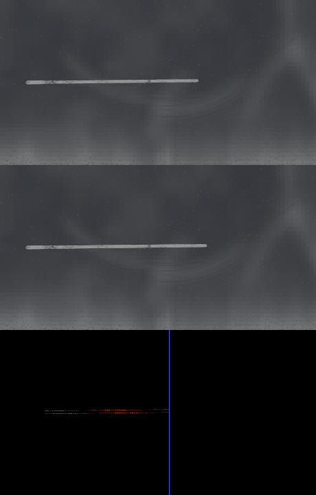
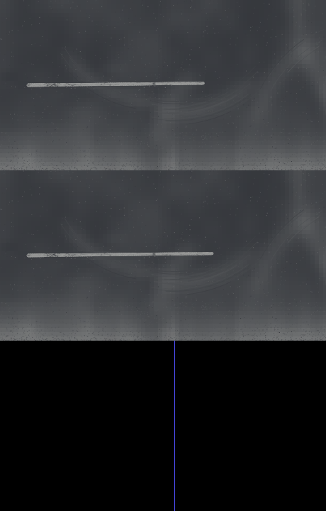
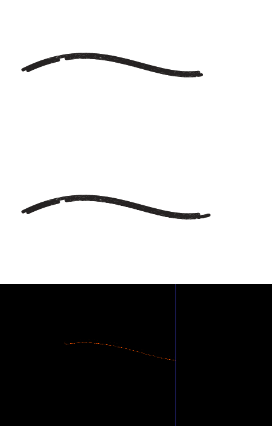
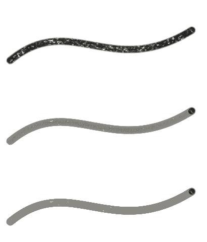
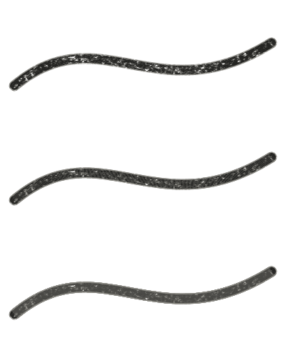
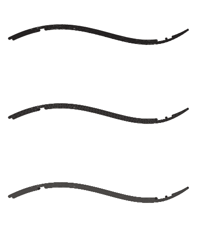
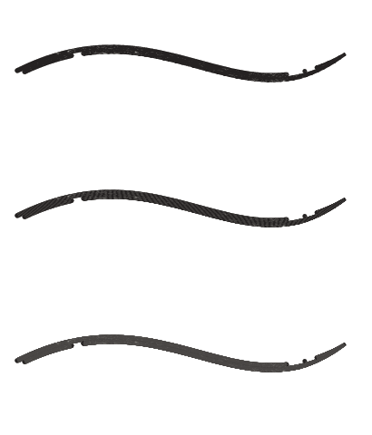
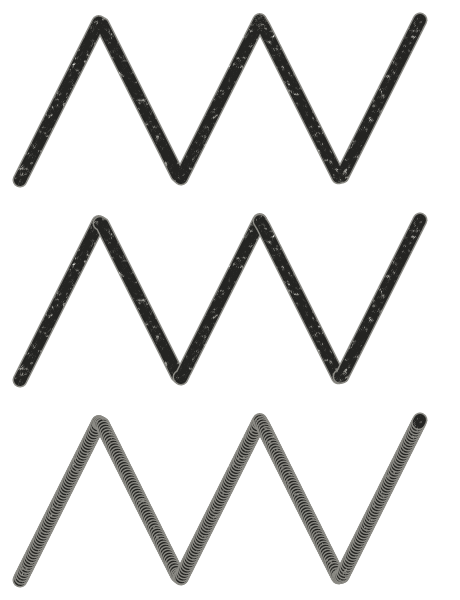
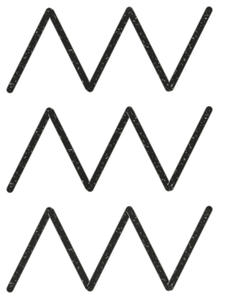

## drykit: a growing part keeps its drawn pixels; a /From cut starts flat (PR #TBD, issue #1419, 2026-11-26)

- **What changed / what to look at:** only strokes drawn with `/From`/`/To` change (dkstroke, dhstroke, dycrayon, dcchalk tip strokes). Default renders are byte-identical. Look at the 1500-piece rows: they are the part of the check that is not met.
- **Perceptual check:** "Render frames of a growing chalk stroke at 3 to 4% steps and step through them: no frame changes the edge of the already-drawn part, and a stroke built from 1500 tiny `/From prev /To now` pieces is as dark as the whole stroke."
- **Reviewer:** FAIL, round 1, on the 1500-piece clause only. Charcoal at 1500 pieces is still a flat, lighter band, the same as before. dkstroke at 1500 is much better but still greyer. The reviewer passed growth (chalk and charcoal), chalk pieces, and corners. Polish: a fine hatch shows at 300 pieces on dkstroke and charcoal. Decided by the owner (Decision block on the PR).

| before | after |
|---|---|
|  |  |
|  |  |
|  |  |
|  |  |
|  |  |
|  |  |
