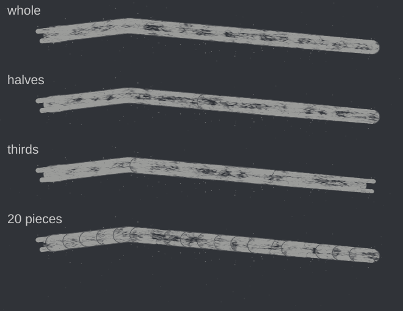
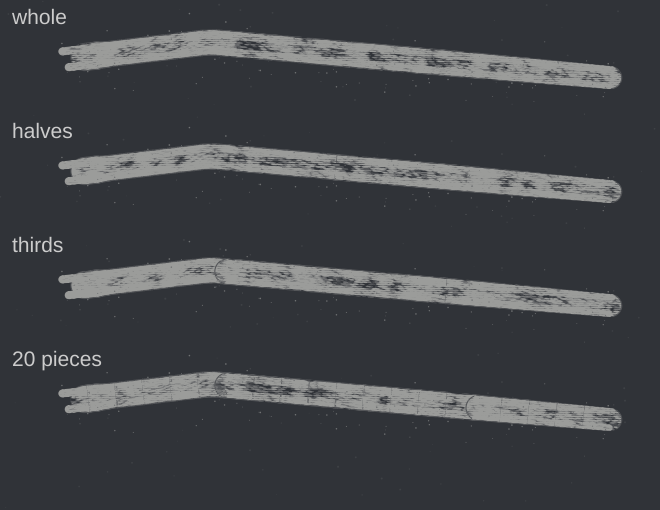
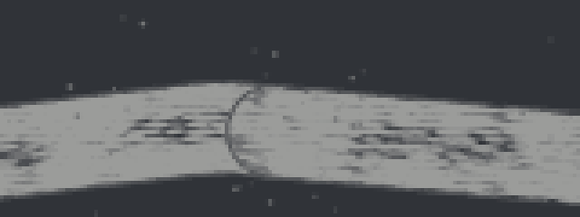
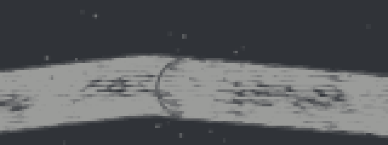

## drychalk: /Tilt pieces keep the whole lane's dropouts (PR #1443, issue #1420, 2026-11-26)

- **What changed / what to look at:** a `/Tilt` chalk stroke drawn as adjacent `/From`/`/To` pieces (2, 3, 20) against the same stroke drawn whole. Before, there was a dropout restart at every join; after, the dropouts run on through. A faint one-pixel arc is left at a few joins: drykit's round start after a touch-band change (proposed follow-up).
- **Perceptual check:** "A /Tilt stroke drawn as two or three adjacent pieces looks like the same stroke drawn whole: no visible change in the lane dropouts at the joins."
- **Reviewer:** PASS, round 1 (https://github.com/PSCatLabs/pscat/pull/1443#issuecomment-7207187132)

| before | after |
|---|---|
|  |  |
|  |  |
