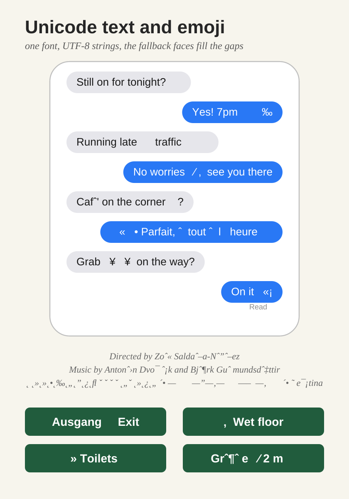
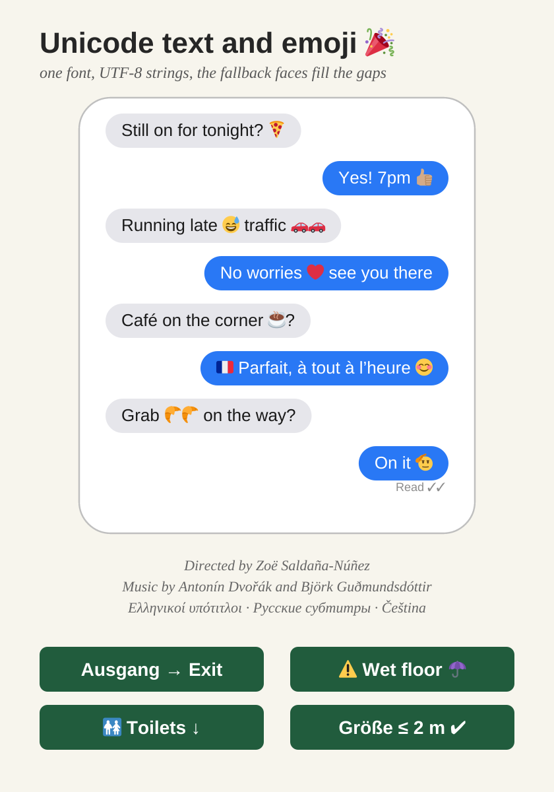
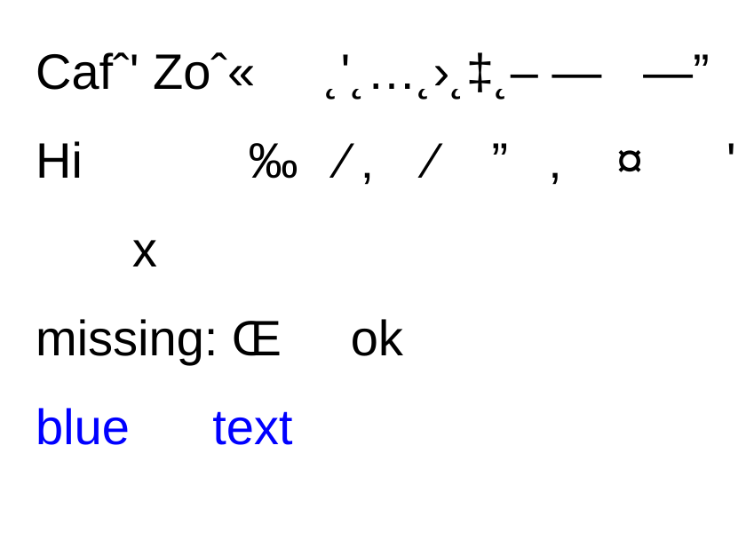
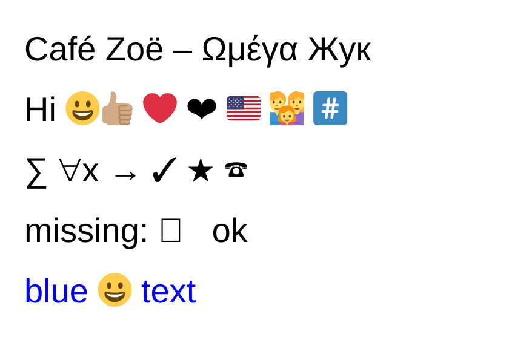

## Text: UTF-8 strings, fallback faces and colour emoji in show, stringwidth and charpath (PR #1439, issue #1425, 2026-11-26)

- **What changed / what to look at:** a font with `/PSCatUnicode true` draws UTF-8 text (accents, Greek, Cyrillic, symbols) from the compiled-in fallback faces and colour emoji from the bundled Twemoji face; a character nothing has draws a `.notdef` box and warns. No existing render changed (two-binary identity check: 210 of 210 pages identical). The "before" images are the previous binary rendering the same new files, so they show the old byte-by-byte mojibake.
- **Perceptual check:** the issue has none; the review judged against the issue's stated intent (its four bullets) and TASTE.md.
- **Reviewer:** PASS, round 1 (https://github.com/PSCatLabs/pscat/pull/1439#issuecomment-7204796641). Polish: emoji are a little taller than caps; the cup and `?` sit close in one bubble. This PR is tier (c) (CODEOWNERS paths), so the owner also sees these images in its Decision block.

| before | after |
|---|---|
|  |  |
|  |  |
