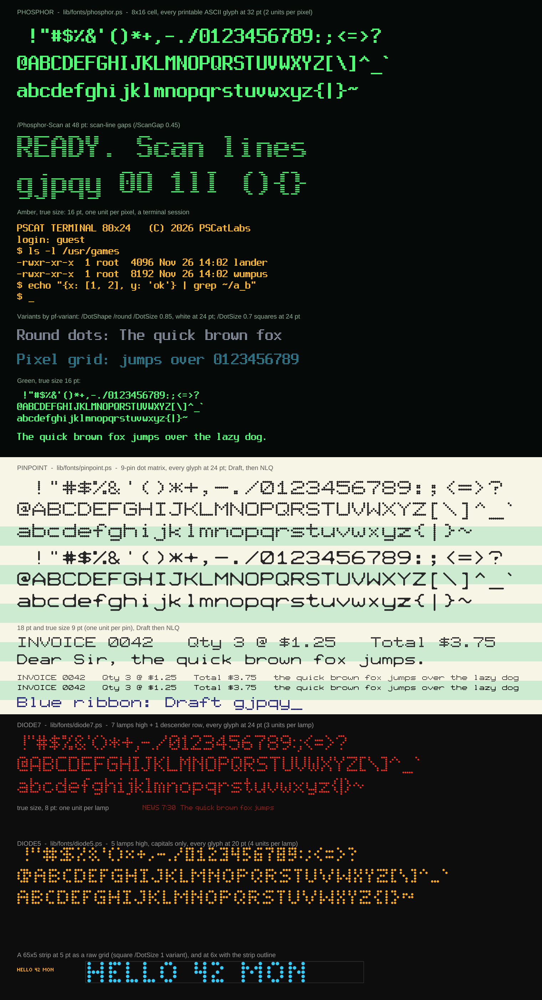

## fonts: original terminal, dot-matrix and LED pixel fonts (PR #1438, issue #1426, 2026-11-26)

- **What changed / what to look at:** four new bitmap faces in `lib/fonts/`: `/Phosphor` and `/Phosphor-Scan` (video terminal, 8x16 cell), `/Pinpoint-Draft` and `/Pinpoint-NLQ` (nine-pin dot matrix), `/Diode7` and `/Diode5` (LED rows). All are original designs drawn in the caller's colour. Look at the terminal face first (top of the specimen): does it read as an old video terminal, at 32 pt and at true size?
- **Perceptual check:** the issue has no formal check. Its intent is original terminal, dot-matrix and LED pixel fonts, available by name, with visible scan-line gaps and round dots that have a size parameter.
- **Reviewer:** PASS, round 1 (https://github.com/PSCatLabs/pscat/pull/1438#issuecomment-7204665764). Polish: "1" and "l" look alike in the scan-line sample; the true-size Diode7 line is dim red on near-black.

| before | after |
|---|---|
| (new faces; nothing before) |  |
