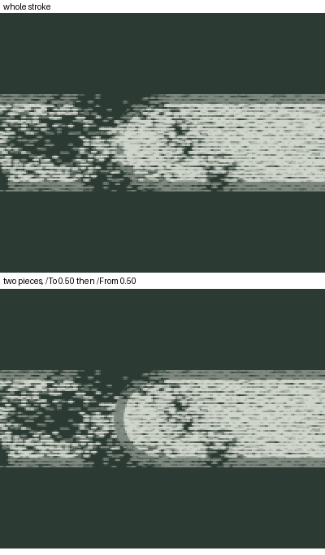
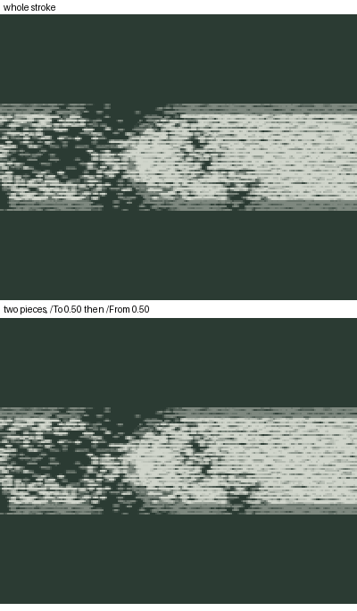
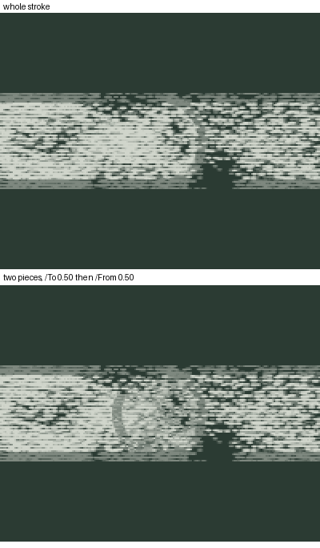
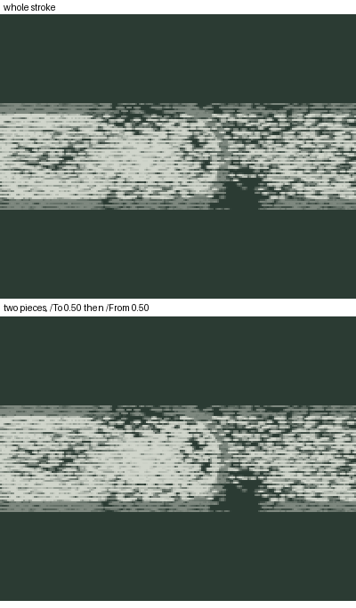
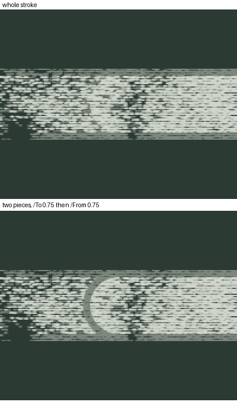
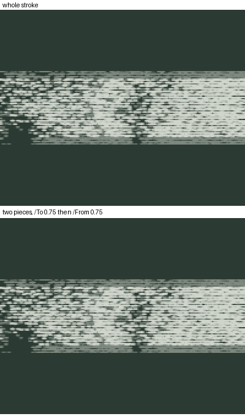
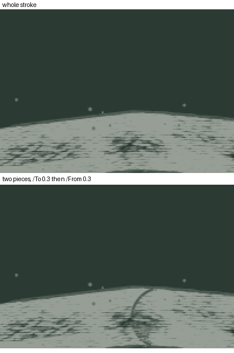
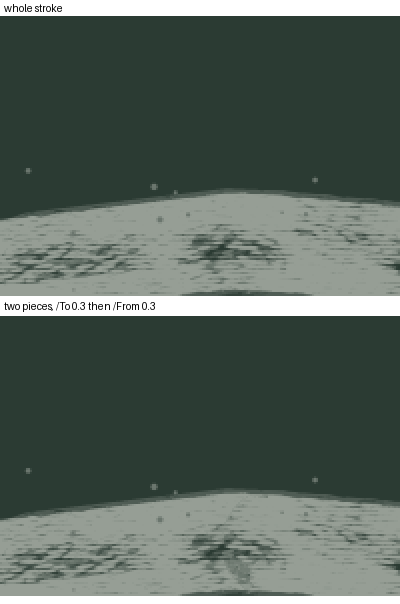

## drykit: a /From cut at a touch band change joins two pieces without a ring (PR #1478, issue #1444, 2026-11-27)

- **What changed / what to look at:** a stroke drawn as two pieces (`/To c` then `/From c`) where its touch changes band at the cut, against the same stroke drawn whole (top of each image). Before, there was a darker or lighter arc at the join; after, the join matches the whole stroke. Only partial (`/From`/`/To`) drawing changes; whole strokes and `/From 0 /To t` are byte-identical.
- **Perceptual check:** "draw a `/Width 8` dkstroke whole and as two incremental pieces cut at 0.5, at several touch bands; the join must not show a ring."
- **Reviewer:** PASS, round 1 (https://github.com/PSCatLabs/pscat/pull/1478#issuecomment-7225211465)

| before | after |
|---|---|
|  |  |
|  |  |
|  |  |
|  |  |
