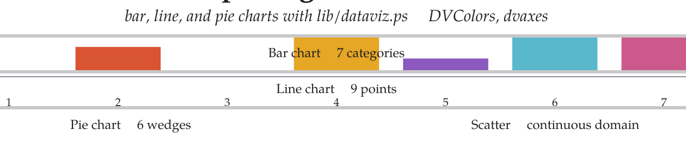
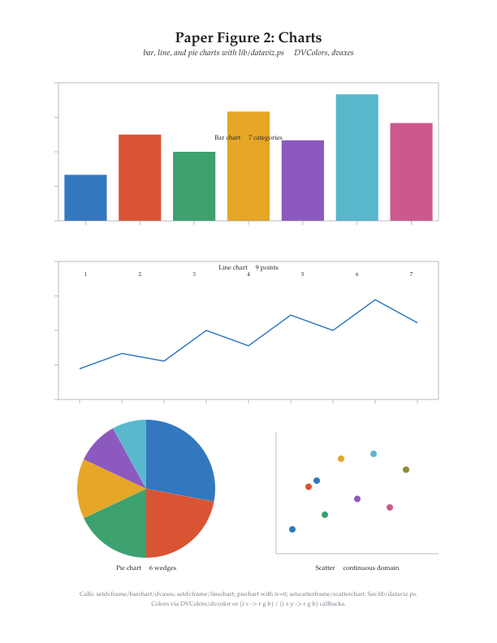

## Draw the em dash in dataviz_paper and mochi_denim_blue (PR #1447, issue #1445, 2026-11-26)

- **What changed / what to look at:** the em dash in `examples/dataviz_paper.ps` (subtitle and four chart captions) and `gallery/mochi_denim_blue.ps` (signature) drew as a blank gap; it is now a dash of the right width, and the lines re-centre around it. `gallery/renders/mochi_denim_blue.png` is regenerated. Merged into `feature/0.8.0`, not main.
- **Perceptual check:** "the em dash in each piece shows as a dash of the right width where it was a blank gap, and the rest of each page is unchanged."
- **Reviewer:** PASS, round 1 (https://github.com/PSCatLabs/pscat/pull/1447#issuecomment-7207869790). Polish: the dash sits a touch low against the lowercase letters in the 3x crops; the "Bar chart" and "Line chart" captions overlap the bars and axis labels, as they did before.

| before | after |
|---|---|
|  |  |
|  |  |
|  |  |
