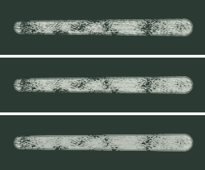
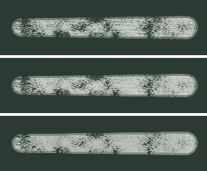
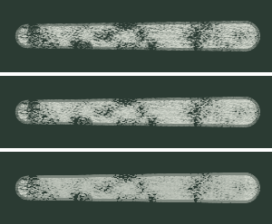
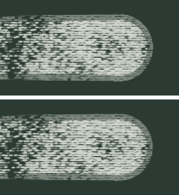
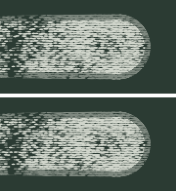

## drykit: a part ends as the whole stroke does; document incremental-piece weight by touch (PR #1485, issue #1482, 2026-11-27)

- **What changed / what to look at:** a stroke drawn as 40 or 300 incremental pieces (`/From prev /To now`), shown under the same stroke drawn whole. The far end of a part now matches the whole stroke: before, its rim was paler. The weight of many pieces is unchanged; at a low touch they still come out heavier, which is now documented in the guide. Whole strokes and `/From 0 /To t` frames are byte-identical.
- **Perceptual check:** "Before and after crops of 40-piece and 300-piece growth against the whole stroke at widths 6 and 8, in the PR body (raw blob URLs pinned to a commit SHA)."
- **Reviewer:** PASS, round 1 (https://github.com/PSCatLabs/pscat/pull/1485#issuecomment-7228182203)

| before | after |
|---|---|
|  |  |
|  |  |
|  |  |
