## gallery: regenerate the committed renders for 0.7.0 (PR #1249, issue #858, 2026-11-16)

- **What changed / what to look at:** 47 committed renders re-rendered with a release build of main at 0.7.0-rc.5, no source change: 36 edge-level (from #778), 5 edge-located but strong (sub-pixel grain, from #778), 6 larger (three hybrid gallery stills from #1145, `first_rain` tone shift from #852, `fonts/catalog/specimen-2.png` stale against its own source, the `pscat chalk` demo's ghost writing from #698). `docs/guides/hybrid/sky_talk_compare.png` was left out because its re-render shows a white seam in panel (b), a #1040 side effect in `examples/hybrid/sky_talk.ps` (see the PR body and `notes/858-regenerate-gallery-renders.md`). Look at the three hybrids first, then the catalog page.
- **Perceptual check:** the issue's: "Check that the files really differ only by edge levels; flag anything larger", plus the owner's two scope comments (the chalk demo and the three hybrids, which `#1145` changed on purpose).
- **Reviewer:** PASS, round 2 (https://github.com/PSCatLabs/pscat/pull/1249, "Perceptual review, round 2"). Round 1 was a FAIL on the `sky_talk_compare` seam; that file was dropped.

| image | before | after |
|---|---|---|
| hybrid_menu_card | 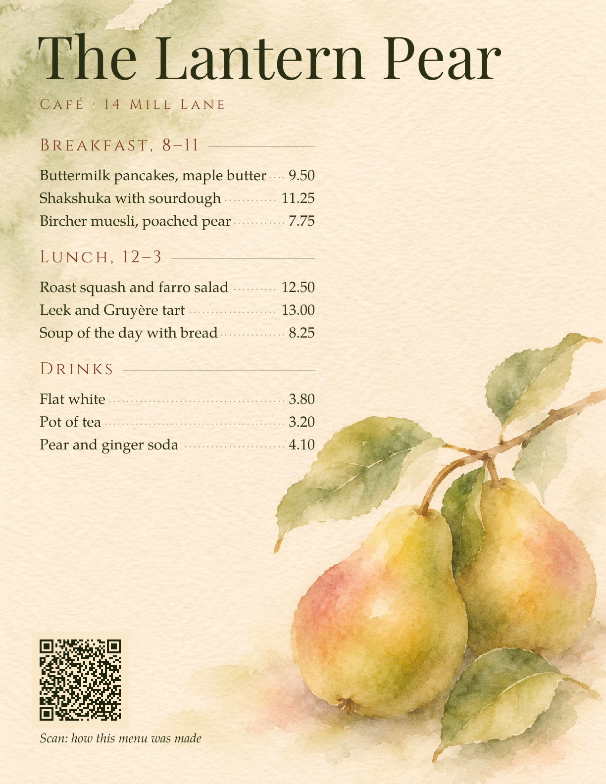 |  |
| hybrid_alpine_trail | 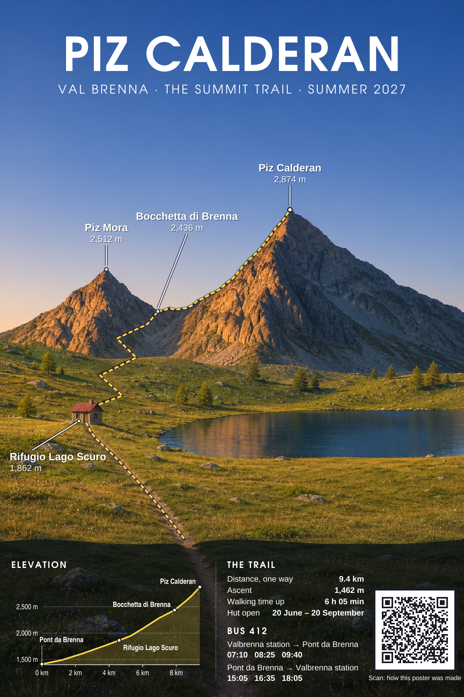 |  |
| hybrid_sky_talk | 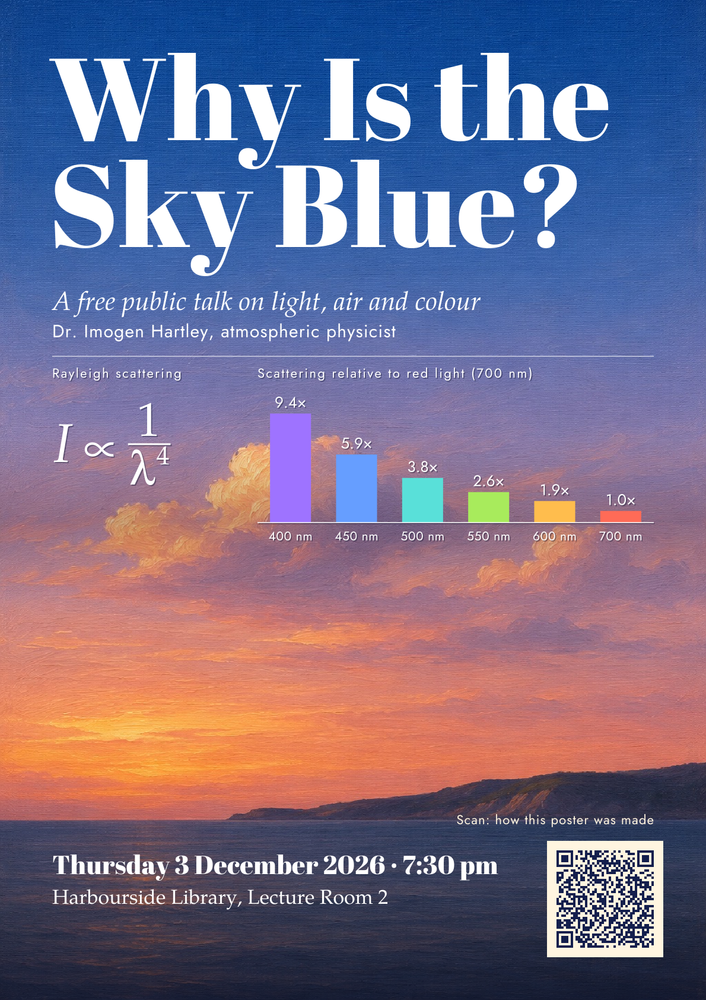 |  |
| first_rain | 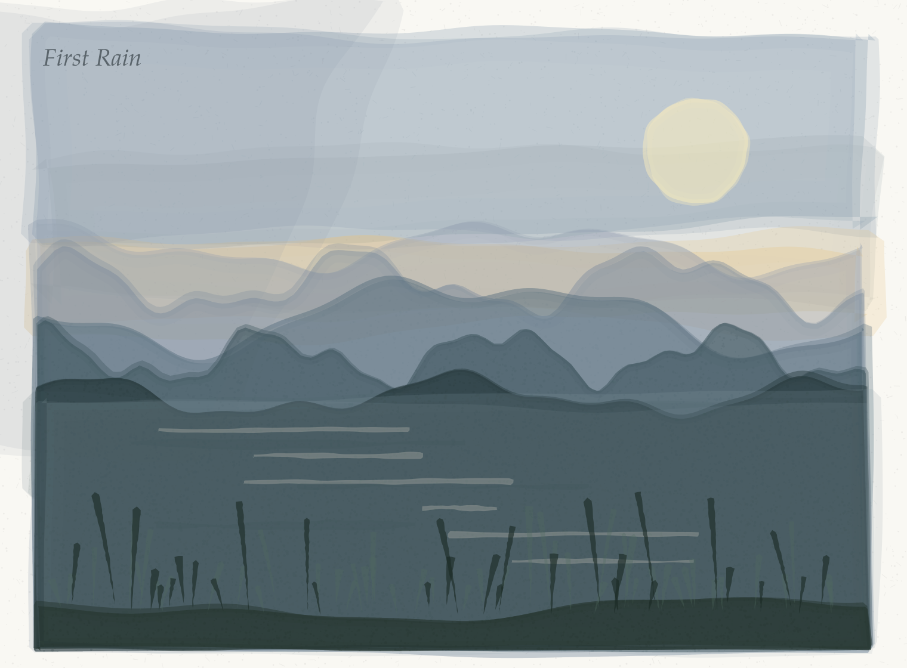 |  |
| font catalog, page 2 | 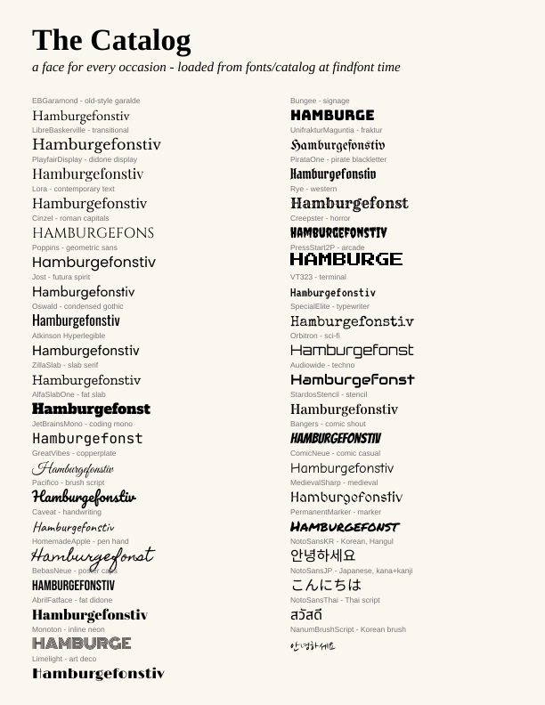 |  |
| `pscat chalk` demo | 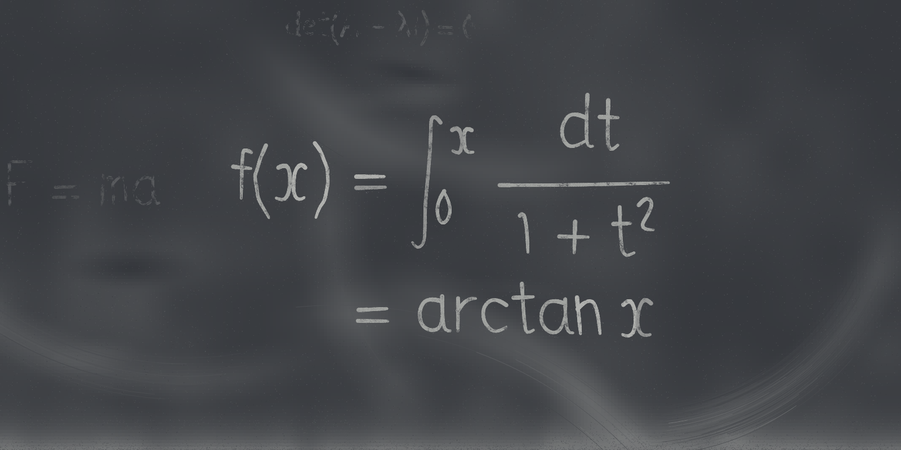 |  |
| crayon_drawing, crop at 3x | 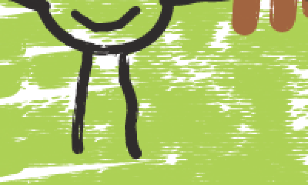 | 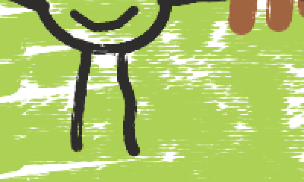 |
| lincoln_charcoal, crop at 4x | 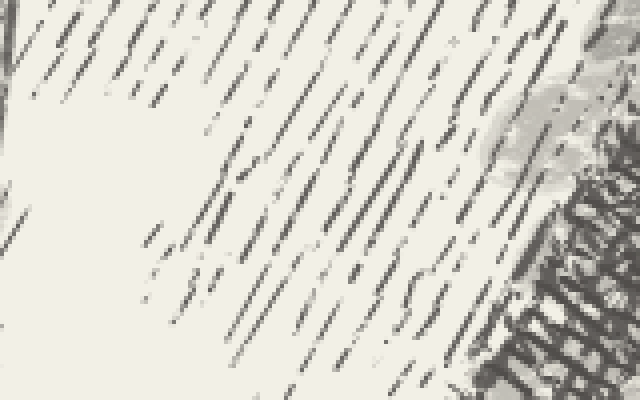 | 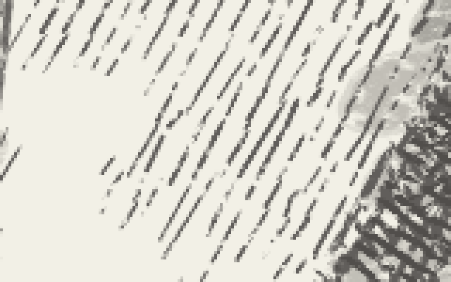 |
| fugitive_pigments, crop at 3x |  | 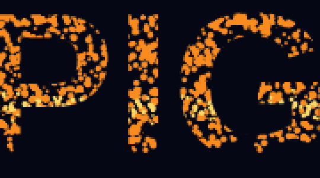 |

Reviewer polish notes (follow-ups, not defects of this PR): on catalog page 2 the HomemadeApple descenders touch the next label and the NanumBrushScript sample is small (`examples/font_catalog.ps` spacing).
