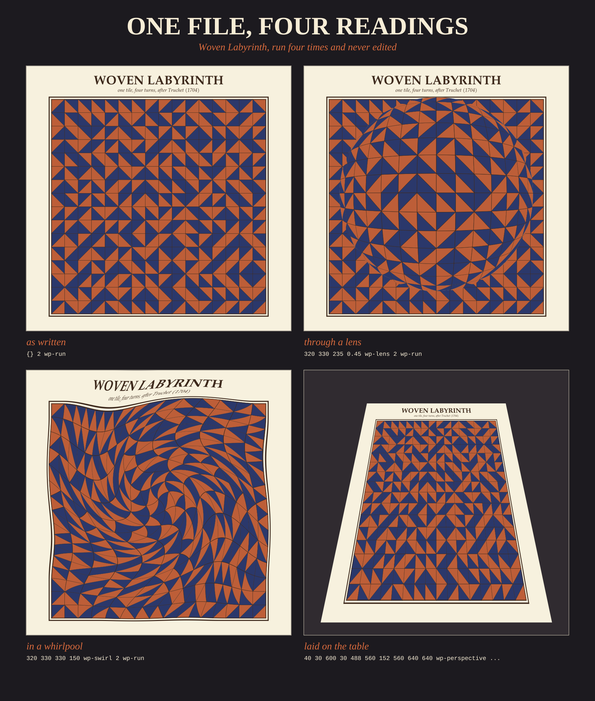

## warp: closing edges bend with the warp (PR #962, Codex round 1 P1, 2026-11-12)

- **What changed / what to look at:** `gallery/renders/four_readings.png`, in the lens and whirlpool panels. A closed shape used to get a straight chord before its warped closing edge, which left thin, light seams across many tiles. Now every closing edge follows the warp. The "as written" and "laid on the table" panels are unchanged. The other four warp pieces are pixel-identical.
- **Perceptual check:** the piece reads as one Truchet labyrinth seen through four maps, with whole tiles and no stray lines.
- **Reviewer:** PASS, round 1, by the dispatcher (independent of the fix): https://github.com/PSCatLabs/pscat/pull/962#issuecomment-6832696874

| before | after |
|---|---|
|  |  |
