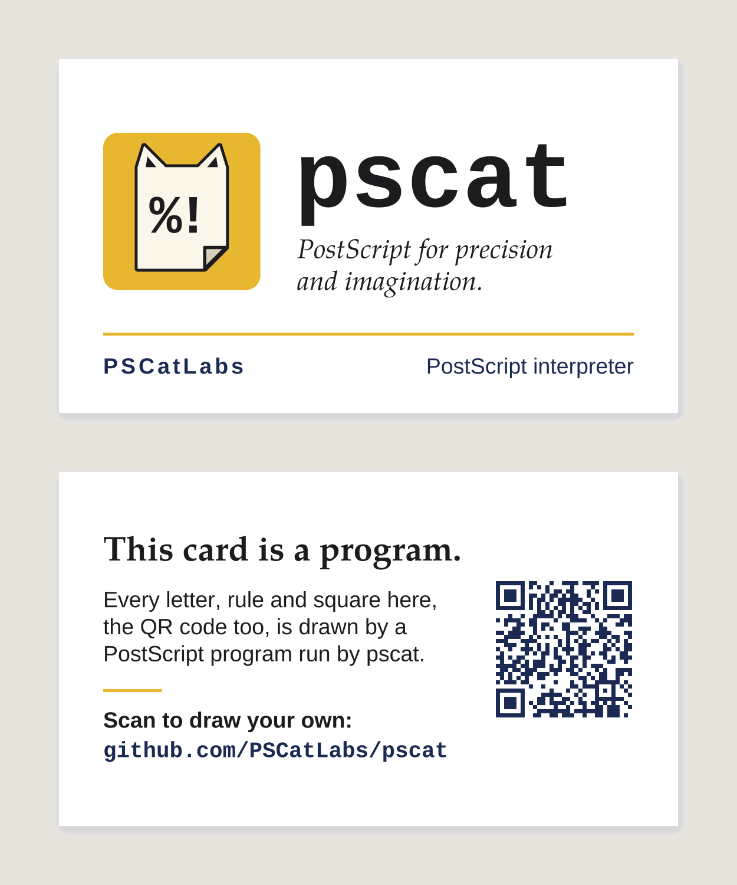

## Gallery: two-sided printable PSCat business card with the repository QR (PR #979, issue #974, 2026-11-02)

- **What changed / what to look at:** a new gallery piece, The Program Card (`gallery/pscat_card.ps`). The still is a proof of both sides of a 3.5 x 2 in card: the logo, wordmark and tagline on the front, and a call to action with the repository QR on the back.
- **Perceptual check:** the issue has no section by that name. Its acceptance bullet says: "Gallery manifest/renders/generated pages synchronized; card-size proof and independent perceptual review meet `docs/dev/TASTE.md` and this acceptance bar." The bar includes "polished PSCat typography/branding and clear call to action, exact repository QR".
- **Reviewer:** PASS, round 1 (https://github.com/PSCatLabs/pscat/pull/979#issuecomment-6596693268)

| before | after |
|---|---|
| none (new piece) |  |
