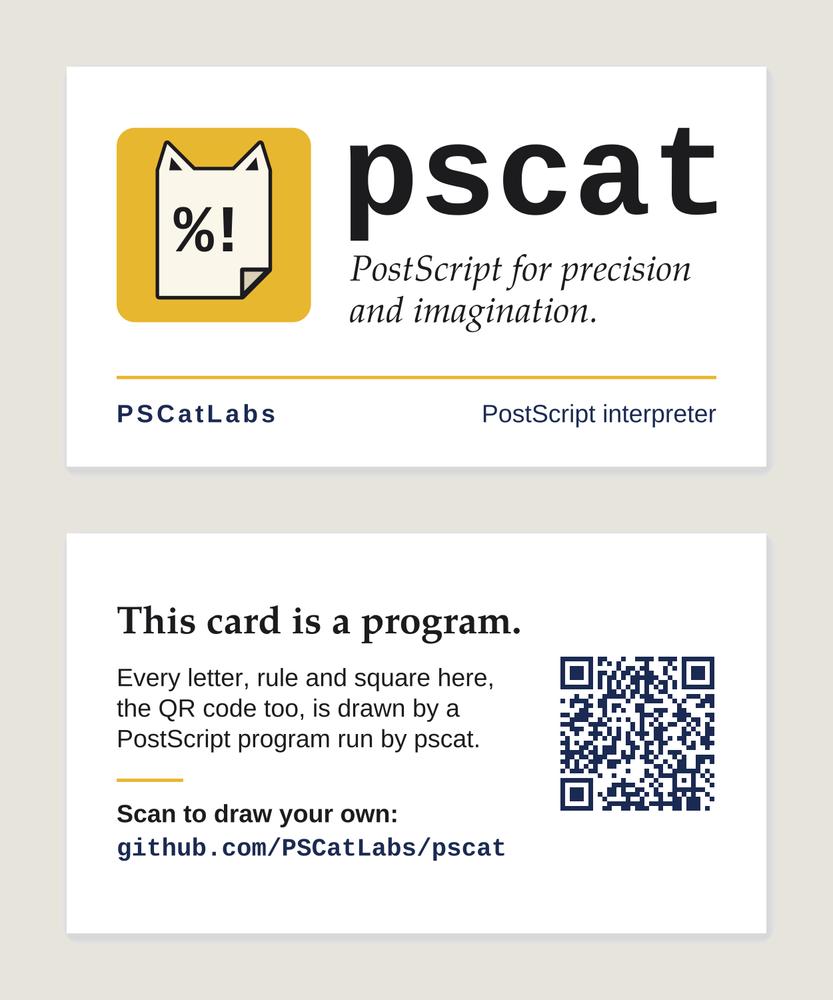

## Business card: white stock settled, front set as one lockup (PR #990, issue #987, 2026-11-03)

- **What changed / what to look at:** the front of `gallery/pscat_card.ps`. The logo tile, wordmark and tagline are one lockup: the wordmark's t tops out level with the tile and ends at the mustard rule's right end, which fills the empty top right. The stock stays white. The brief now says a warm white comes from the paper stock, not a printed tint. The back, with the QR, is byte-identical.
- **Perceptual check:** (the issue has no separate check; its intent) "Card stock is pure white … decide which wins … or keep the white and update the brief"; "Front top-right reads empty … Rebalance … without crowding the 9 pt safe margin."
- **Reviewer:** PASS, round 2 (https://github.com/PSCatLabs/pscat/pull/990#issuecomment-6612931099). Round 1 also passed (https://github.com/PSCatLabs/pscat/pull/990#issuecomment-6612930622); its polish note, that the wordmark fell 4 pt short of the rule, was fixed before round 2. Polish noted: the 13 pt tagline now outweighs the 9 pt footer line.

| before | after |
|---|---|
|  |  |
