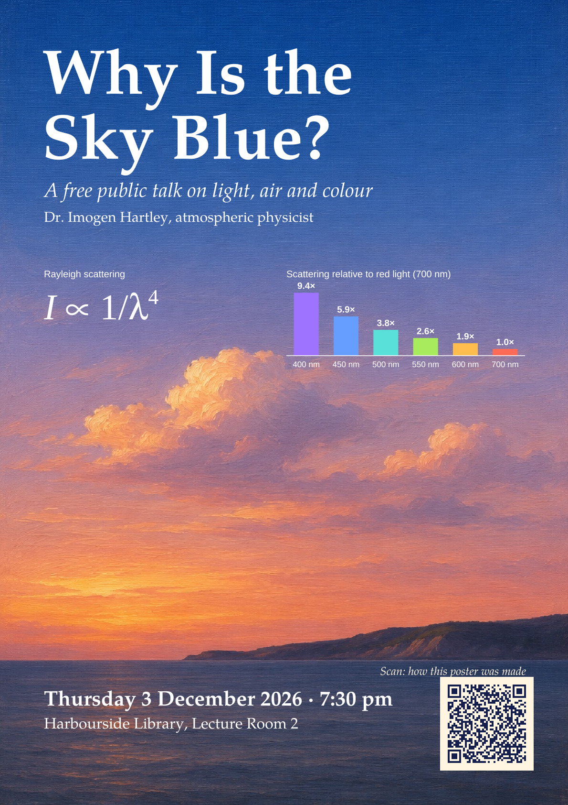
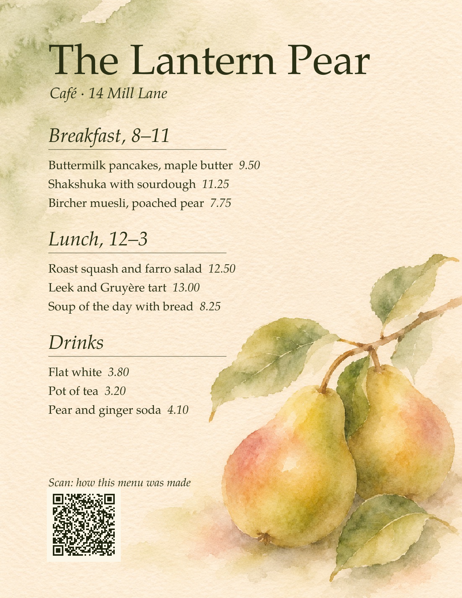
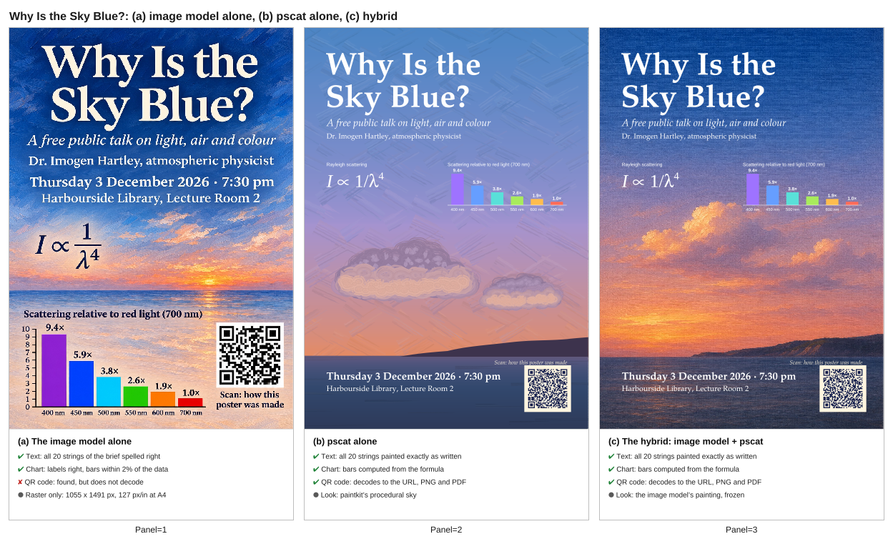
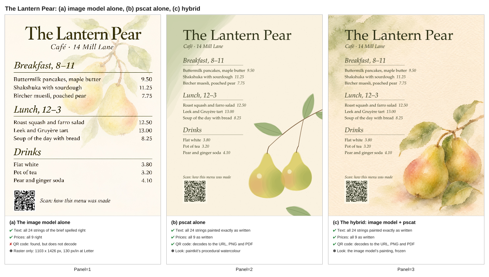

## docs/gallery: pscat + an image model, a hybrid showcase with a checked three-way comparison (PR #997, issue #995, 2026-11-04)

- **What changed / what to look at:** two new gallery pieces (an A4 talk poster and a café menu, each an image-model background frozen as a JPEG with pscat's type, chart and QR code on top) and two new comparison sheets (image model alone / pscat alone / hybrid, with checked facts under each panel). New files only; there is no before.
- **Perceptual check:** the issue has none written as such; its intent: "Show that pscat plus an image model beats either one alone, on accuracy and on looks", with "the QR decode and spelling checks stated as facts, not opinions".
- **Reviewer:** PASS, round 1 (https://github.com/PSCatLabs/pscat/pull/997#issuecomment-6641030370). Polish noted: the poster's QR caption sits tight; the menu's inline prices; the sheets' "Panel=N" captions; the poster chart is small at sheet size.
- **Owner note:** the image model got every string and number right in both whole-poster attempts; only its QR codes fail. The guide says so.

| after | after |
|---|---|
|  |  |

