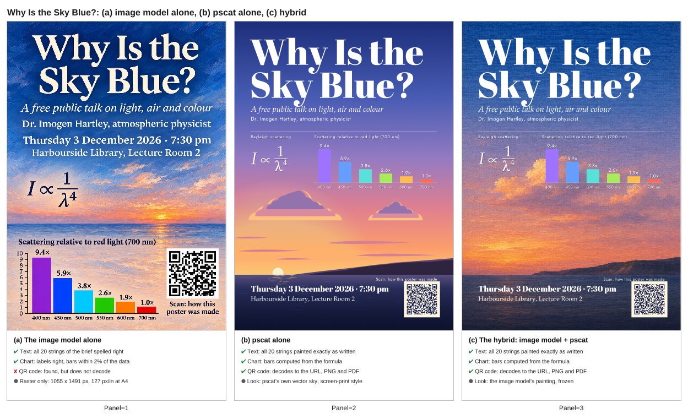
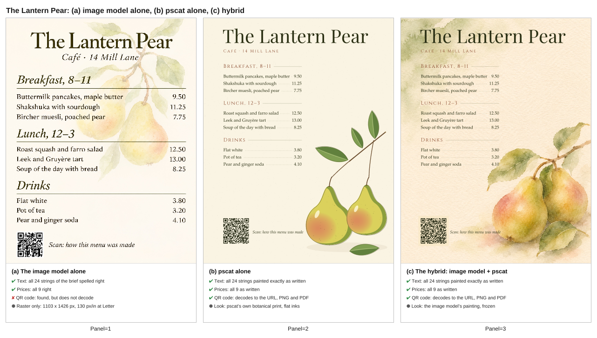
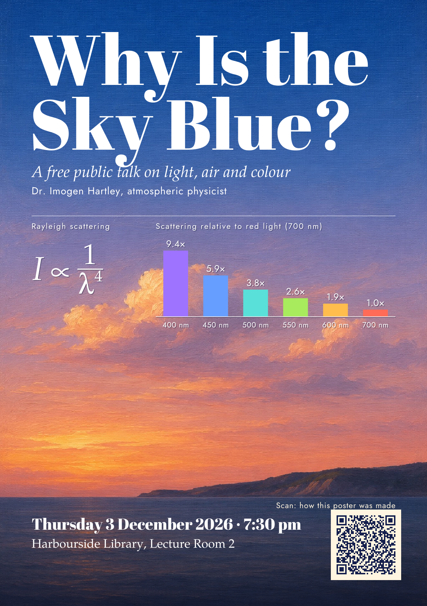
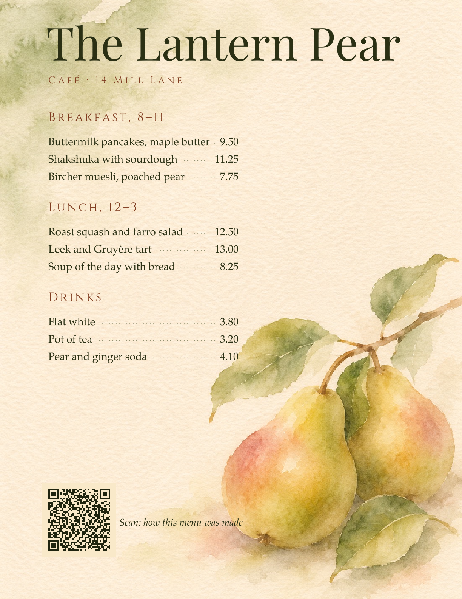

## hybrid showcase: redesign the pscat layouts so they beat the image-model-only panels (PR #1019, issue #998, 2026-11-05)

- **What changed / what to look at:** the two hybrid examples' exact layers were redesigned: the poster has a display title, a typeset formula and a full-width chart on a grid; the menu has a price column with leaders. The pscat-alone art is now a screen-printed vector sky and a flat-ink botanical print. Look at both comparison sheets and both gallery stills.
- **Perceptual check:** "A fresh perceptual-review agent, shown the three panels unlabelled, prefers (c) on design quality for both pieces, and does not rank (b) last on layout. Record its notes in the PR." Plus the owner's sign-off on this sheet.
- **Reviewer:** PASS, round 2 (https://github.com/PSCatLabs/pscat/pull/1019#issuecomment-6665636101). Round 1 failed on the title's descender touching the subtitle, and that is fixed. Polish noted: the poster's QR caption sits tight on the code; the menu's QR caption touches the pear; the pancakes row gets one leader dot; the menu text is small at sheet size next to (a). Three unlabelled blind rounds are in the PR body.

| before | after |
|---|---|
|  |  |
|  |  |
|  |  |
|  |  |
