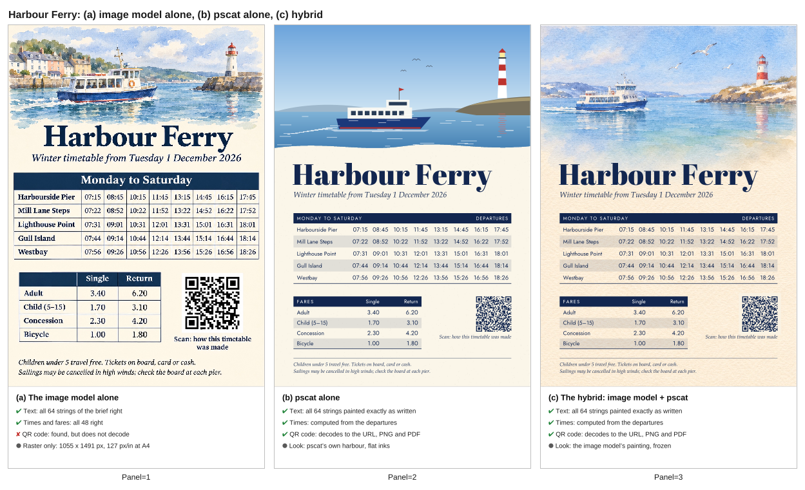

## hybrid guide: repeat-run accuracy test and a harder example (PR #1021, issue #999, 2026-11-05)

- **What changed / what to look at:** a new comparison sheet for a new example, the A4 ferry timetable: (a) the image model alone, (b) pscat alone, (c) the hybrid, with the checked facts under each. This is a new file, so there is no before.
- **Perceptual check:** the issue has none written as a perceptual check. Its acceptance: "The repeat-test table and the harder example(s) are in the guide, with every check stated as a fact."
- **Reviewer:** PASS, round 1 (https://github.com/PSCatLabs/pscat/pull/1021#issuecomment-6665993984). Polish noted: the sheet's "Panel=N" captions, and "1055 x 1491" written with an x.

| after (new) |
|---|
|  |
