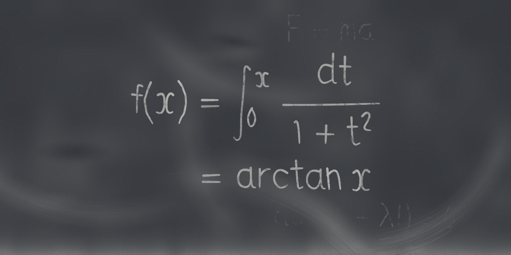

# Dry media: chalk, crayon, charcoal and board math

These libraries draw the way a dry stick does: pigment lands only where the stick
meets the raised tooth of a surface (slate, newsprint, drawing paper), so strokes
break into streaks and grain. They are all built on one core, `drykit`, and
share its canvas with the [painting](painting.md) tools. Load artkit, paintkit
and drykit first (each example below shows the lines).

## The core: drykit

`lib/drykit.ps` (design notes in `docs/dev/design/DRYMEDIA.md`) is the core of
the dry media: chalk, crayon and charcoal. It draws the current path as a
dry stick dragged across a toothed surface, and pigment lands only where
the stick's contact patch meets raised tooth.
- **`dksurface`** names the surface: slate, green board, newsprint, drawing
  paper or construction paper. Each is a `pkcanvas` tooth plus the
  surface's colour, so paintkit and drykit marks share one canvas.
- **`dkstroke`** draws in the current colour.
  - Light `/Touch` catches only the tooth's peaks. The knuckles are stretched
    along the direction of travel, so the gaps read as streaks.
  - `/Tilt` lays the stick on its side.
  - `/Wear` flattens the tip along a stroke.
  - `/Lanes`, `/Load` and `/Dropout` break it into striations.
  - `/Fallout` scatters loose particles beside it.
  - Tone builds in deposit levels, drawn faint-first.
- **`{ ... } dkbatch`** draws several `dkstroke` calls level-major, so
  crossing hatch layers stay dark where they cross.
- **`{ ... } dkclip`** clips to the current path while the procedure
  runs, and the strokes it makes keep that region inside a batch. So
  differently clipped strokes, such as overlapping hatched regions, can
  share one batch. A plain `clip` (or `eoclip`, `rectclip`) made inside
  the batch is kept the same way: `{ gsave region clip ... grestore }`
  works, nested and even-odd clips included, and so does a
  `clipsave ... cliprestore` pair. One catch: a procedure
  bound before the batch calls `clip`, `gsave` and `grestore` directly,
  so drykit sees neither its clips nor its restores. If you pass a
  callback that clips and strokes to a bound `gsave ... exec ... grestore`
  wrapper, pscat still draws it exactly: drykit asks pscat's
  `.sameclip` (a pscat-only operator) whether the clip it captured is
  still in force, and sees the wrapper's `grestore` that way. In pscat,
  once a plain clip made in the batch has been captured, any later clip
  change, bound or not, is picked up at the next stroke; a clip made by
  bound code before any plain clip in the batch is still not kept
  (`notes/488-sameclip.md`). Under Ghostscript the batch's later strokes
  stay under that clip, since standard PostScript gives drykit no way to
  see that `grestore` (why: `notes/459-bound-wrapper-grestore.md`). For a
  program that must draw the same in both, any of these three fixes it:

  ```postscript
  /wrap { gsave exec grestore } bind def   % bound before the batch
  {
      { region { line } dkclip } wrap        % dkclip inside the callback
      gsave { region clip line } wrap grestore   % or: a gsave the batch sees
      line                                   % drawn unclipped either way
  } dkbatch
  ```

  The third: define and `bind` the wrapper inside the batch. There
  `gsave` and `grestore` are drykit's tracking procedures, and `bind`
  leaves procedures alone.
- **Size.** A batch has no practical stroke limit: a 2,500-stroke
  derivation in one `dcchalk` draws. drykit cuts a batch into catches of a
  bounded size, and splits again any that turn out too big. The one stroke
  it refuses has a single point too wide for any catch: on slate at the
  default budget, a point whose mark reaches more than about 87 pt from
  its centerline (a `/Tilt` stroke spreads its width over lanes, so it
  reaches less per lane). It is refused with
  `dkcatch-area-exceeds-safety-limit` when the stroke is made, before
  anything in its batch is drawn.
- **`/After true`** on a `dkstroke` inside a batch draws that stroke on
  its own after the batch has rendered, in call order, in its own colour.
  It is how an eraser or a smudge can be drawn from inside a batch, over
  everything the batch lays.

drykit takes no draws from the caller's `rand` stream. Its surface and
tool-side randomness come from private seeded generators, and fallout goes
through a seeded `scatter`, which restores the stream. Adding a stroke
never moves another mark.
Fine tooth relies on Ghostscript's fill adjust being off, and drykit turns
it off itself. `examples/drykit_specimen.ps` shows one stick on all five
surfaces, at three pressures, at three tilts, with a wearing tip and with a
crossing.

```postscript
(lib/artkit.ps) run (lib/paintkit.ps) run (lib/drykit.ps) run
<< /Surface /greenboard >> dksurface
0.93 0.94 0.90 setrgbcolor
newpath 40 60 moveto 300 80 lineto
<< /Width 3 /Touch 0.7 >> dkstroke
```

## Chalk on a board: drychalk

`lib/drychalk.ps` is chalk on a board, built on drykit.
- **`dcboard`** (`x y w h opts`) dresses a board and makes it the surface
  for chalk. It draws:
  - the board's tone, black slate or green board;
  - a dust film that is never flat;
  - the last lecture's writing, erased (`/Ghost`, a path procedure);
  - eraser swipe arcs, darker finger wipes and lighter smudges;
  - dust settled along the ledge (`/Ledge`) and in the chalk tray
    (`/Tray`).
- **`dcchalk`** strokes the current path as chalk, one stroke per subpath.
  - Each stroke lands heavy, tires in the middle and lifts thin.
  - Its weight differs a little from its neighbours'.
  - Dots are pressed, and dust falls beside every stroke.
  - `/Firm` holds a long stroke's weight to its end and presses a short one
    a little harder; `pscat chalk --no-board` sets it (default 0, so a board
    and every other caller render as before).
  - With `/Tilt`, the stick lies on its side for broad underlines and
    shading: two bright edges over a granular face.
- **`/name dcchalkcolor`** sets white or a soft yellow, pink, blue, green
  or orange.

The defaults were tuned against the photographs in `docs/dev/design/drymedia/refs/`.
Real chalk reads about halfway from the board to white, not white.
`examples/drychalk_specimen.ps` shows `gallery/hundred_lines.ps`'s
pen-stroke chalk before and after, on both boards.

```postscript
(lib/artkit.ps) run (lib/paintkit.ps) run (lib/drykit.ps) run
(lib/handscript.ps) run (lib/strokeglyphs.ps) run (lib/drychalk.ps) run
40 40 520 300 << /Surface /slate /Ghost { (old notes) 60 250 << /Size 30 >> sgpath } >> dcboard
/white dcchalkcolor
newpath (fresh notes) 60 180 << /Size 32 >> sgpath << /Width 1.8 >> dcchalk
```

## Crayon: drycrayon

`lib/drycrayon.ps` is wax crayon on paper, and a child's ways of drawing with it,
built on drykit. `dypaper` sets up the paper (drykit's coarse construction-paper
tooth on a white ground), `/name dycolor` picks a colour from the crayon box,
and `dycrayon` draws the current path as wax. The "child's drawing" motions
each build a path and paint nothing, so they compose with `dycrayon`:
`dywobble` (a shaky, overshooting version of a path), `dyscribble`
(back-and-forth scribble fill over a region), `dyloop` (a circle drawn in one
loop that doesn't close), `dyfigure` (a stick or tadpole figure), `dyrays` (quick
sun rays around a disc) and `dygrass` (quick grass blades along a path). They
draw only from artkit's `frnd`, so they are deterministic under your own
`srand`, and `--sweep-seed` varies the composition while the paper texture stays
put. `examples/drycrayon_specimen.ps` shows the medium and
`examples/drycrayon_motion_demo.ps` the motions; the gallery piece *My Family
and Our House* is a whole picture drawn this way.

## Charcoal: drycharcoal

`lib/drycharcoal.ps` is charcoal on drykit, with three media (`/vine`:
grey and dusty; `/compressed`: dark and dense; `/pencil`: a sharp point) and a
`/Grade` from 0 (hard) to 1 (soft). Its words are call patterns for
`dkstroke`: `dhstroke` draws the current path in a medium, `dhhatch` hatches a
region to a value (a number, or a `{x y -> value}` callback), `dhsmudge` is a
stump's or finger's track, `dhlift` is an eraser's track (kneaded or hard), and
`dhsketch` lays faint construction lines. It needs hatchkit loaded.
`dhsmudge` and `dhlift` may run inside a `dkbatch`: they are drawn after the
batch's strokes, in call order, over all of them (even hatching made later
in the batch), so to hatch over a lift, hatch in a later batch.
`examples/drycharcoal_specimen.ps` is the specimen; the gallery piece *Study
after Berger, 1864* is a charcoal portrait built with it.

## Single-stroke glyphs: strokeglyphs

`lib/strokeglyphs.ps` gives single-stroke skeleton glyphs for board math as *paths*, not
ink: capitals, handscript's lowercase and digits, a math hand (curly x,
crossed z), Greek, operators and relations, and growing delimiters.
`sgpath` appends a string's jittered centerlines to the current path
(UTF-8 or an array of glyph names), `sgwidth` measures from the fixed
advances, `sggrow` builds a sum, product, integral, radical, paren,
bracket, brace or bar sized to a height and depth, and `sgmetrics` gives
the advance, box, italic correction and TeX math class. Jitter comes from
its own seeded generator, never the caller's `rand`, and
`examples/strokeglyphs.ps` is the specimen sheet. A character or glyph name
with no glyph raises `sg-missing-glyph:<char>` from `sgpath` and `sgwidth`
before anything is drawn; `/Strict false` restores the old
advance-300-and-draw-nothing behaviour. It also has the board-math
symbols a lecture needs: `≡ ∼ ≃ ⊆ ⊃ ⊇ ↦ ⊥ ∝ ∴ ∘ ∗ ⋆ ∖ ⟨ ⟩ ‖ ℏ ℓ ι υ Υ`, the
double, triple and contour integrals `∬ ∭ ∮` (also `sggrow` symbols), and
superscript digits (`i²`, `x⁻¹`); `examples/strokeglyphs_board_math.ps`
is their specimen.
It has subscript digits, signs and letters (`H₂O`, `xₙ`, `Σᵢ₌₀`,
derived from the digit skeletons the way the superscripts are) and the
variant Greek letters `ϑ ϰ ϱ ϖ ς ϵ ϕ`; `examples/strokeglyphs_subscripts_greek.ps`
is their specimen. In mathkit `\varphi \vartheta \varkappa \varrho \varpi
\varsigma` draw the variants, and `\epsilon` is the lunate ϵ while
`\varepsilon` stays the three-shaped ε, as in TeX.

```postscript
(lib/handscript.ps) run
(lib/strokeglyphs.ps) run
newpath (∀ε>0 ∃δ>0) 40 300 << /Size 40 /Seed 7 >> sgpath
1.5 setlinewidth 1 setlinecap 1 setlinejoin stroke
```

## TeX math as chalk strokes: mathkit

`lib/mathkit.ps` lays out a subset of TeX math as those
skeletons with TeX's box model. The subset covers:
- scripts, `\frac`, `\sqrt[n]{}`;
- `\sum`, `\prod`, `\int`, `\iint`, `\iiint` and `\oint` with limits, and `\lim`;
- `\left( \right)` delimiters that grow to fit, including `\langle \rangle`
  and `\|`, or the characters `⟨ ⟩ ‖ ∥` typed directly;
- relations and operators such as `\equiv \sim \subseteq \mapsto \perp
  \therefore \circ \ast`, and `\hbar \ell`;
- `*` is `\ast`, as in TeX: a binary operator between terms, and `z^*` or
  `A_*` a raised or lowered asterisk for a conjugate or an adjoint;
  inside `\text{}`, `\mathrm{}` and `\operatorname{}` it is a raised text
  asterisk (strokeglyphs' `/asterisk`), as TeX sets it in text;
- matrices and `cases`, accents and `\boxed`;
- Greek and operator names;
- `\overbrace{...}^{label}` and `\underbrace{...}_{label}` with a grown
  brace (`\nolimits` after it sets the label beside it, as a script),
  `\overset`, `\underset`, `\stackrel` and `\substack` limits;
- `\displaystyle`, `\textstyle` and `\scriptstyle` mid-formula;
- `\not` before a relation (`\not=` is ≠, `\not\in` is ∉, anything else
  gets a slash), `\bmod`, `\pmod{n}`, `\mod{n}` and `\pod{n}`.

Anything outside the subset fails with an error that names it. The
layout is written with a lecturer's irregularity: sizes and gaps vary,
scripts sit a little high or low, fraction bars overshoot, and the
baseline slopes and drifts (`/Irregular`, where 0 is clean TeX).
- `mkpath` appends a formula's path and `mkmetrics` measures it.
- `mkalign` writes a derivation aligned on `=`. It returns a record per
  line, which `mkframe` and `mkunderline` follow along its slope. With
  several `&` on a line it sets TeX align's columns (right, left, right,
  left ...), each pair `/ColumnGap` (in multiples of `/Size`, default 2)
  after the last; `/ColumnGap 0` is amsmath's `alignat`. `/ColumnWander`
  (default 0; 1 is as far as a line's own wander) lets each pair after
  the first drift sideways down the lines, as a hand's columns do.
  `/LineAlign /center` centres each line on its own width at `x`, as TeX
  `gather` sets its rows (the default, `/relation`, is `align`'s: on the
  `&` or the first relation).
- `mkarrow` points a side note at a term.
- `x0 y0 x1 y1 opts mkbrace` draws a hand-drawn curly brace whose arms
  end at the two points, its point to the right of the direction from
  the first to the second (left to right points down), and returns that
  point's x y, where its label goes.

Every TeX backslash is written twice in a PostScript string.
`examples/mathkit_specimen.ps` is the specimen: the fixed test set, from
the quadratic formula to Maxwell's equations, and a derivation in chalk.
`examples/mathkit_structures.ps` shows the structures issue #340 added
(`docs/dev/design/drymedia/mathkit_structures.png`), and
`examples/mathkit_columns_braces.ps` what issue #439 added: `\mod`,
`\pod`, side labels, a column's wander, `alignat` and `mkbrace`
(`docs/dev/design/drymedia/mathkit_columns_braces.png`).
The gallery piece `gallery/chalkboard_lecture.ps` fills a
whole board with it: Euler's formula derived across three drychalk
panels, using the structures where a lecturer would. Underbraces name the
Taylor terms, a starred `\overset{(*)}{=}` marks where the signs flip, and
`mkbrace` names each regrouped bracket. The powers of i sit in wandering
columns with a `\pmod` rule.

```postscript
(lib/handscript.ps) run (lib/strokeglyphs.ps) run (lib/mathkit.ps) run
newpath (\\int_{-\\infty}^{\\infty} e^{-x^2}\\,dx = \\sqrt{\\pi}) 40 300
  << /Size 36 /Seed 3 >> mkpath
1.6 setlinewidth 1 setlinecap 1 setlinejoin stroke
```

### From LaTeX to a board: `pscat chalk`

`pscat chalk` writes a formula on a board with no PostScript at all. Type the
LaTeX as you would in a document (single backslashes, `\\` between rows, `&`
to align them) and quote it for the shell:

```sh
pscat chalk 'x = \frac{-b \pm \sqrt{b^2-4ac}}{2a}' -o quadratic.png
pscat chalk 'f(x) &= \int_0^x \frac{dt}{1+t^2} \\ &= \arctan x' --seed 7 -o board.png
pscat chalk --file eq.tex --config chalk.json -o eq.pdf     # or - for stdin
pscat chalk 'e^{i\pi} + 1 = 0' --no-board --color yellow -o overlay.png
```



The input may carry `%` comments and newlines, and a display wrapper around
the whole (`$...$`, `$$...$$`, `\[...\]`, `\(...\)`, or an `align`, `align*`,
`aligned`, `gather`, `equation` ... environment); `\label{}`, `\notag` and
`\nonumber` are dropped. Several math pairs, as in `\(a\) + \(b\)`, are
one formula with the delimiters removed. Words outside the pairs, or a
delimiter that is never closed or closes nothing, fail with a one-line error
naming it. Each top-level `\\` starts a row (those inside `pmatrix`,
`cases` or `\substack{}` stay where they are). A bracket right after a
row break is TeX's row spacing (`\\[2pt]`, `\\[0.5\baselineskip]`, dropped) only
when it holds a length; anything else (`\\ [\hat{x},\hat{p}] = i\hbar`, a
commutator) starts the next row, where LaTeX would stop with an error. Write
`\left[ ... \right]` to be sure of a bracket. The rows are set with
`mkalign`: on their relations (or `&`), as `align` sets them, except inside a
`gather`, `gather*` or `gathered` wrapper, where each row is centred on its
own width, as LaTeX does. The supported subset is mathkit's, listed above and in full at
the top of `lib/mathkit.ps`. Anything else fails with one line naming it,
exits non-zero and writes no file:

```text
pscat chalk: unsupported LaTeX command \oplus (the supported subset is listed at the top of lib/mathkit.ps)
pscat chalk: unsupported character: @
```

The block is measured first and shrunk, if it must be, to fit inside the
margins and above the ledge, then centred (or set at the left margin). Same
LaTeX, same config, same seed: the same bytes, every time. `-o` takes
`.png`, `.svg` or `.pdf`; a full board is several megabytes as SVG or PDF
(every chalk catch is its own small fill), so prefer PNG. `--print-ps` prints
the generated program instead of rendering it.

The config is JSON. Every key is optional and an unknown key is an error;
flags (`--seed`, `--size`, `--irregular`, `--color`, `--width`,
`--height`, `--dpi`, `--no-board`) override it, and `--json '{...}'` takes it
inline.

```json
{
  "layout": {"size": 64, "irregular": 1, "align": "center", "margin": 40,
             "width": 800, "height": 400, "dpi": 144},
  "chalk":  {"color": "white", "strength": 0.55, "pressure": 0.68,
             "tilt": 0, "dust": 0.5},
  "board":  {"tone": "slate", "haze": 0.4, "ghosting": 0.4,
             "swipes": 6, "wipes": 2, "smudges": 3, "ledge": 18},
  "seed": 1
}
```

| key | default | meaning |
|---|---|---|
| `layout.size` | 64 | writing size in points, before any shrink to fit |
| `layout.irregular` | 1 | mathkit's `/Irregular`: 0 is a clean, untilted layout, 2 a hurried hand |
| `layout.slope` | random | the baselines' tilt in degrees (-45..45) |
| `layout.jitter` | 0.016 | each glyph's wobble, a fraction of the size |
| `layout.align` | `center` | `center` or `left` |
| `layout.margin` | 40 | clear space in points round the writing |
| `layout.width`, `layout.height` | 800, 400 | the page in points |
| `layout.dpi` | 144 | PNG resolution |
| `chalk.color` | `white` | `white`, `yellow`, `pink`, `blue`, `green`, `orange` |
| `chalk.strength` | 0.55 | how far the brightest chalk reads from the board toward the stick's colour |
| `chalk.pressure` | 0.68 (0.34 with no board) | drychalk's `/Touch`: how much of the tooth catches |
| `chalk.tilt` | 0 | degrees; toward 90 the stick lies on its side |
| `chalk.dust` | 0.5 | loose dust beside each stroke |
| `chalk.width` | 0.048 × size | stroke width in points |
| `board.tone` | `slate` | `slate`, `greenboard`, or `[r, g, b]` |
| `board.haze` | 0.4 | the dust film, 0 (freshly washed) to 1 |
| `board.ghosting` | 0.4 | an earlier lecture's erased writing: `false`/0 for none, `true`, or 0..1. It keeps clear of the formula (a margin of over half the writing size above and below it, most of one beside it); a board the formula fills has fewer ghosts, and may have none |
| `board.swipes`, `.wipes`, `.smudges` | 6, 2, 3 | eraser arcs, finger wipes, dust smears |
| `board.ledge` | 18 | the dusty band along the bottom, in points |
| `board` | | `false` for chalk alone on a transparent page |
| `seed` | 1 | the layout, chalk and board all follow it |
| `hand` | `strokeglyphs` | reserved: the only hand there is |

The generator is `pscat::chalk` (`src/chalk.rs`), plain Rust with no file or
environment access, so other front ends share it: `chalk::render(latex,
&config, Format::Png)` returns the bytes, and a TeX error comes back as
`ChalkError::Latex { kind, token }`.
