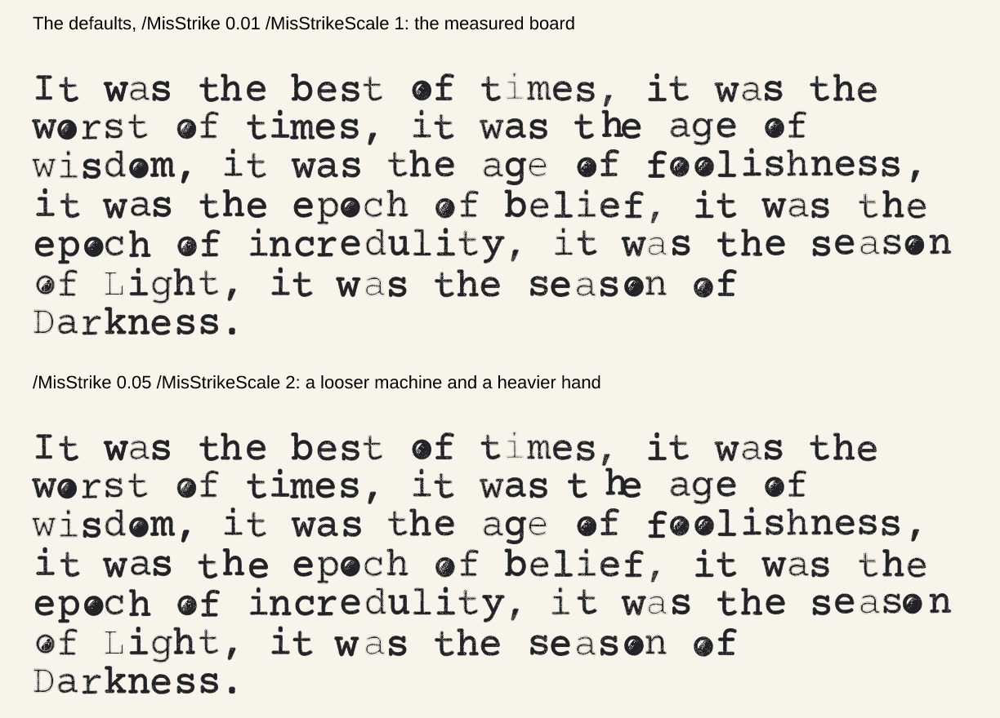
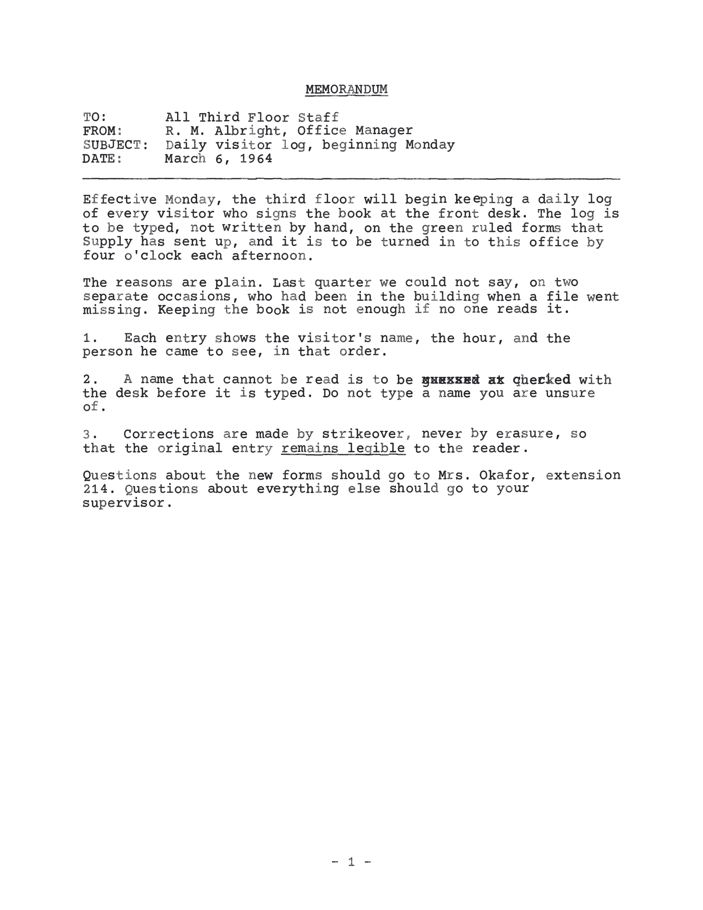
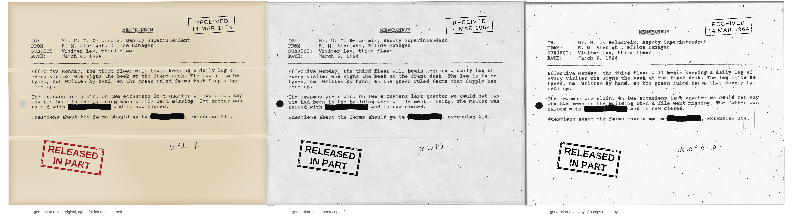
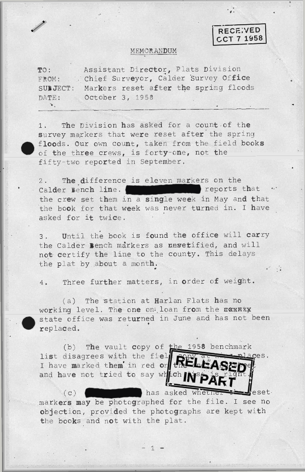
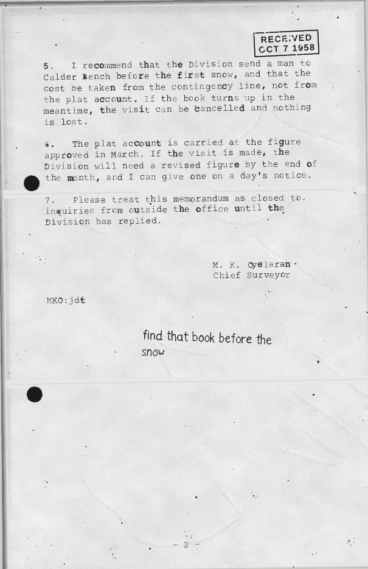

# Fonts

pscat has three kinds of fonts, and they all work through the ordinary
PostScript operators (`findfont`, `scalefont`, `setfont`, `show`).

- **Standard fonts.** Helvetica, Times and Courier, backed by bundled,
  metric-compatible Liberation faces, plus the other LaserWriter names
  through the catalog below.
- **Type 3 fonts.** Glyphs that are programs. pscat's own display faces, its
  handwriting font and its typewriter font are all Type 3. Because a glyph is
  code, it can be different every time it is drawn (`examples/type3_ransom.ps`
  invents every glyph fresh at show time). Bitmap Type 3 fonts stamp their
  raster with `imagemask`.
- **Type 1 fonts.** The real thing: `currentfile eexec`, encrypted charstrings
  and the `N RD <binary>` idiom. Ghostscript accepts the Type 1 file the test
  suite generates, byte for byte.

This guide covers the Type 3 display library, the typewriter, and the runtime
catalog of 67 outline faces. For the handwriting font see
[handwriting](handwriting.md). For the design behind all of it, see `docs/dev/FONTS.md`
in the repo root.

## The display font library

`lib/fonts/` — original display faces, each one a self-contained
pure-PostScript file that defines a Type 3 font and draws nothing on
load (the `lib/handscript.ps` doctrine: embeddable wholesale, runs
unchanged in Ghostscript). Because Type 3 glyphs are programs, the
letterforms do things outline fonts can't:

| Face | Material |
|---|---|
| `/Neon` | Bent glass tube — the glow is five widening strokes of overdraw, no alpha anywhere |
| `/Marquee` | Theater-sign bulbs along every stroke, halos, glints, and the occasional burnt-out bulb (seeded rand) |
| `/Constellation` | Letters as star charts: magnitudes and tints rand-drawn, hairline asterism lines, field stars |
| `/Lapidary` | Chiseled capitals: shadow, raised face, dark incision, and a hairline of sunlight on the arris |
| `/Circuitry` | Copper PCB runs — solder-mask channel, specular seam, through-hole pads at every terminal, vias at pitch |
| `/Stitchwork` | Cross-stitch X's pinned to the 45° aida grid, three passes of floss, a seeded-jitter hand |
| `/Confetti` | A thrown handful — paper slips and dots in a six-color party palette, still falling |

All seven share one capital skeleton set (both cases map to the same
capitals; digits and `.,-'!?` included) and take dials through their
scratch dicts — retube `/Neon` in pink, dial `/Marquee`'s burnout
rate, warm up `/Lapidary`'s stone, re-spool `/Stitchwork` in blue
floss. `examples/font_library.ps` and `examples/font_library2.ps`
are the specimen posters:

<p>
</p>

```sh
cargo run --release -- --png poster.png examples/font_library.ps
cargo run --release -- --png poster2.png examples/font_library2.ps
```

## The /Typewriter font

`lib/typewriter.ps` (design notes in `docs/dev/design/TYPEWRITER.md`) defines
`/Typewriter`, a Type 3 font that types like a real machine. The glyphs
are Courier Prime's outlines (`lib/typewriter_outlines.ps`, generated by
`scripts/gen_typewriter_outlines.py`), redrawn at every strike with three
layers of variation measured from real typed pages: each key's fixed
quirks on the machine (`/Machine`), each line's carriage return and tilt,
and each strike's offset, rotation and pressure (`/Seed`). `/Wear` scales
them all: 1 is a good manual and the default, 2.5 a battered one. The
same seeds give the same page in pscat and Ghostscript, and the caller's
`rand` stream is never touched.

```postscript
(lib/typewriter_outlines.ps) run (lib/typewriter.ps) run
72 700 moveto << /Machine 7 /Seed 3 >> tw-setup
(Dear Sir, I enclose the specimens.) show
```

`tw-setup` starts a block (options, cell frame, font); `tw-set` changes
options inside one: a red ribbon run (`/Ink`), a strikeover (`/Strike`).
It also takes pica and elite pitch (`/Pitch 10` or `12`) and the `/manual`,
`/electric` and `/worn` presets. `examples/typewriter_specimen.ps` shows the full ASCII
set from no variation to a battered machine:

<p></p>

The ink is ribbon ink: the face pressed through inked fabric, so the weave's
voids show in the letter, the edge feathers, clogged keys fill their counters,
and density follows pressure and `/Ribbon` (wetness). `/InkModel false` gives
flat ink. Strike weight varies as it does in the scans: most strikes are alike, a
few are light, and a rare one is nearly blank (`/Preset /electric` is much more
even). `docs/dev/design/typewriter/ink_vs_real.png` sets it beside the reference scans.

Two ribbon extras are opt-in. `/WornBand` (`0..1`) wears the lane of ribbon every
x-height strike hits, so the middle of each letter prints lighter than its tops and
tails, at the same height in every strike. `/Bleed` (`0..1`, with `/BleedInk` and
`/BleedSide`) is a black/red ribbon a little out of register: the part of a letter
past the colour boundary prints in the other colour, with a ragged edge, and the
boundary wanders from strike to strike. `/BleedGap` (yarns, default 0) leaves a white
pin stripe of that many yarns (one is 0.48 pt) at the boundary, as some ribbons are inked,
and needs `/Bleed` above 0. `/WornBand`, `/Bleed` and `/BleedGap` default to 0 (nothing changes) and are shown at
the foot of the specimen (`/BleedGap` in `docs/dev/design/typewriter/ribbon_extras_538.png`). `/WornBand` is a look, not a measurement: no scan shows a grey middle with
dark tops, so keep it small (0.3) if you want it realistic. `/Bleed` 1 moves the boundary in by up to 540 glyph
units from outside the face, and most real two-colour ribbons show no bleed at all. A clogged counter
is ribbon ink like the rest of the letter, so it takes the other colour (and the worn lane's lighter weave) where the zones put it.

Mis-strikes are the machine's and the typist's: a loose typebar or a sloppy
segment, a hurried or uneven hand. `/MisStrike` (`0..1`, default `0.01`, the
measured board) is the fraction of strikes that land well off their place (0 is
never) and `/MisStrikeScale` (default `1`) is how far, as a multiple of the
measured jump (4x the normal x offset, 2x the y; `2` is 8x and 4x). They
scale with `/Wear`, so `/Wear 0` has none, the presets do not set them, and a
page with the defaults is unchanged. `/MisStrike 0.05 /MisStrikeScale 2` against
the defaults is in `docs/dev/design/typewriter/misstrike_554.png`:

<p></p>

### Typing a page: `tw-type`

`tw-type` takes one options dict and types a whole text the way a typist would,
the same `/Machine`, `/Seed`, `/Wear`, `/Pitch`, `/Ink` and other `tw-setup`
keys alongside its layout keys:

```postscript
(lib/typewriter_outlines.ps) run (lib/typewriter.ps) run
<< /Text (Dear Sir,\n\nI enclose the <u>specimens</u> you asked for.)
   /Margin 72 /Spacing 1.5 /Machine 7 /Seed 3 >> tw-type
showpage
```

- **Page:** `/Width` and `/Height` (612 x 792), `/Margin` (72) or a side at
  a time (`/MarginLeft` ...). Pica gives 10 characters to the inch, `/Pitch 12`
  elite. Text wraps by word at the margins; a word wider than a line is split.
- **Spacing and tabs:** `/Spacing` 1, 1.5 or 2 (single is 12pt, and the platen
  steps in half-lines). The font gives each line its own carriage-return
  offset, advance error and baseline drift. `/Tabs` is a stop every N columns
  (5), or an array of columns. `/Indent` indents each paragraph's first line.
- **Markup in `/Text`** (nothing to escape; any other `<` is literal):
  `<u>underlined</u>` (backspace and type underscores), `<x>crossed out</x>`
  (x struck over each letter) and `<o>old|new</o>` (new typed over old, one
  unbreakable token as wide as the longer side) and `<r>redacted</r>` (typed,
  then covered by a bar over the whole run; see the released-document look
  below). Each pass strikes at its own
  strike index, so an x over an `x` is a second blow, not a copy of the first.
- **Memo:** `/Memo << /To (...) /From (...) /Subject (...) /Date (...) >>`
  types a centred, underlined MEMORANDUM title, the TO / FROM / SUBJECT / DATE
  block with long fields hung under their text, and an underscore rule. Also
  `/Cc`, `/Title` and `/Rule`.
- **Pages:** text that runs past the bottom margin continues after a `showpage`;
  `/PageNumbers /bottom` types "- 2 -" and `/top` types "2" from page 2.
  `/PageStart { ... }` runs before every page, the first included, inside a
  `gsave`: paint the paper there, so a page you composed is not cleared. Pages
  after the first follow a `showpage`, so they are typed in the default
  graphics state, not a rotated or scaled one. `/PageEnd { ... }` runs the same
  way after every page, the last included, with the page's frame still set:
  draw over the page there. The caller does the
  last `showpage`, as with `hs-write`. `tw-type` leaves the carriage at the start
  of the next line, so `show` can carry on.
- **Measuring:** `<< ... >> tw-linecount` returns the number of lines and
  `tw-pageheight` the page height that holds them, drawing nothing and
  changing no option. They share the layout with `tw-type`, so they always
  agree on the line breaks.
- Bytes above 126 are not on the machine: each is a blank cell. The text is
  one PostScript string, so Ghostscript's 65,535-byte string limit caps it at
  about 30 pages.

`scripts/typewrite.sh` does the same from a text file, to PNG or PDF:

```sh
./scripts/typewrite.sh --reflow --memo-to "All Third Floor Staff" \
    --memo-from "R. M. Albright, Office Manager" \
    --memo-subject "Daily visitor log, beginning Monday" \
    --memo-date "March 6, 1964" --machine 6 --seed 21 --page-numbers bottom \
    --dpi 200 -o memo.png examples/typewriter_memo.txt
```

<p></p>

`--height fit` sizes the page to its text, `--ps PATH` writes the driver for
Ghostscript (`gs -dNOSAFER`; the render above beside the same page in
[gs](../dev/design/typewriter_memo_gs.png)), `--reflow` joins each paragraph's lines.
Typographic quotes and dashes become ASCII; any other non-ASCII letter becomes
`?`, since the machine has no such key. `--help` lists every option.

### The released-document look

`lib/released.ps` (issue #214; needs `lib/artkit.ps` and `lib/surfacekit.ps`,
and `lib/handscript.ps` for margin notes) makes a typed page look like a
document that was released decades later:

```postscript
(lib/artkit.ps) run (lib/surfacekit.ps) run (lib/handscript.ps) run
(lib/typewriter_outlines.ps) run (lib/typewriter.ps) run (lib/released.ps) run
{ << /Text (The matter was raised with <r>Mr. L. T. Voss</r> and is now closed.)
     /Memo << /To (All Staff) /Subject (Daily log) >>
     /Redactor { rel-redact } >> tw-type }
<< /Age 0.6 /EdgeDark 0.5 /Folds 0.5 /Lamp 0.25 /Skew 0.3 /Punch 3
   /Generation 3
   /Stamps [ << /Lines [ (RECEIVED) (14 MAR 1964) ] /X 480 /Y 700 /Angle 3 >> ]
   /Notes  [ << /Text (ok to file - jb) /X 360 /Y 128 /Angle 5 >> ] >> rel-page
showpage
```

`rel-page` runs the content proc (any drawing; `tw-type` is the intended one)
inside a stack of effects, each optional and each off at strength 0:

- **Paper** (under the type): `/Age` (ivory tone, blotches, foxing, fibres),
  `/EdgeDark`, `/Lamp` (the scanner's gradient), `/Folds` at `/FoldAt`, `/Punch`
  holes, and `/Skew` on a `/Backdrop`.
- **Photocopies**: `/Generation` 1 to 8. Each generation is a sheet the last
  one was copied onto, with its own small rotation and shift, black specks,
  streaks and a lid-dark sliver at the edge (`/Speckle`, `/CopyEdge`). A copy
  is grey and contrasty: paper and stains go white, but not to flat white:
  `/Haze` (0 to 1, default 0.6) leaves the light grey of a real copy's toner
  fog, with a crumpled-paper wave (tilted noise and a few long creases) and a fine grain, under the type (0.6 is about 0.90
  against T14's 0.91; 1 is T2's 0.84; 0 is the old white copy; it needs
  `/Generation` above 0, and a high generation that should read bitonal, like
  T15, wants it low: the specimen's third sheet uses 0.2). The content's type gets the
  typewriter's `/Copies` key, which thickens strokes, closes counters and drops
  light strikes (`rel-page` sets it for you). `/Dropout` (0 to 1, default 1)
  breaks the thin strokes: a copy's content is drawn through small holes that
  cut a hairline in two and only notch a stem, more of them at higher
  generations and unevenly across a line, as T15 does; a `rel-redact` bar
  stays solid (a plain bar from `tw-type` is cut like the type, so pass
  `/Redactor { rel-redact }`), and 0 gives the copy without it. `/Soften`
  (0 to 1, default 1) blurs the marks a copy copies (stamps, notes, redaction
  bars) with a soft fringe, more with each generation; an original is never
  blurred and 0 keeps a copy's marks crisp. `rel-stamp` and `rel-note` take
  their own `/Soften`.
- **Marks** over the content: `/Stamps` (`rel-stamp`: ink through a clip with
  holes, so the page shows through), `/Notes` (`rel-note`: handwriting),
  `/Staple`, `/Clip` (a gem clip hung from the top edge: its outer loop on the
  sheet, the inner loop as a dent in the paper, a rust ghost browner with `/Age`).
- **Redactions**: `<r>words</r>` in a `tw-type` text; `/Redactor { rel-redact }`
  makes the bar a marker's, otherwise it is a plain black bar. The bar covers
  whole cells, so a word is always covered.

A document of several pages is a paged `rel-page`: give it `/Paged true` and wire
`tw-type`'s two hooks, `/PageStart { rel-page-start } /PageEnd { rel-page-end }`.
Every sheet then gets the paper, its own copier dirt, the lid and edge shadow,
the redaction bars and the marks; the staple and the clips go on the first sheet
only, and a stamp or note with `/Page 2` goes on page 2 only
(`examples/released_pages.ps`). Use `rel-paper` alone as `/PageStart` to age the
pages of a long document without the copy layers. The same `/Seed` draws the
same page. Every stamp, name and note in a piece must be invented: no real
agency's seal or marking.

<p></p>

A two-page memo through a paged `rel-page` (`examples/released_pages.ps`):

<p> </p>

`examples/released_specimen.ps` renders this (gs: [the same](../dev/design/released_specimen_gs.png));
`docs/dev/design/typewriter/release_vs_real.png` sets crops of it beside the reference
scans T14, T15 and T10.

The gallery piece *Released in Part* (`gallery/released_memo.ps`, issue #215) is a
whole page made this way: an elite manual (`/Pitch 12 /Size 11.5`), tabbed
numbered paragraphs, a strikeover, an x-out, underscores, marker redactions, two
stamps, initials and a note, through one copy. One tip from it: `rel-page` gives
the type `/Copies` equal to `/Generation`, which at 1 already fills most
counters; set a smaller `/Copies` (0.35 there) in the `tw-type` dict to keep a
first copy's type open while the page still goes through the copier.
`docs/dev/design/typewriter/tools/blind_compare.py` sets crops of it, unlabelled and
shuffled, among strips from three reference scans (`docs/dev/design/typewriter/blind_grid.png`), and the
whole page beside T1 (`docs/dev/design/typewriter/memo_vs_real.png`).

*The Man from 2026* (`gallery/time_traveler_memo.ps`, issue #590) is the other
side: an original that was never copied (`/Generation 0`). After `tw-type`, the
same machine types more on the same cell frame: `tw-set` with a fresh `/Strike`
and a red `/Ink` (and a little `/Bleed` of black, `/BleedSide /above`) types the
classification lines at the head and foot, as a typist would with the ribbon
lifted to its red half; another `tw-set` puts the black ink back. The carriage
that `tw-type` leaves, plus `tw-linecount` lines, gives the first baseline to
place them from.

## The font catalog

`fonts/catalog/` — 67 libre outline faces loaded from disk at
`findfont` time (never compiled in; the binary and wasm stay lean).
With it, **every name in the classic LaserWriter 35 resolves to a
metric-compatible libre face**: the bundled Liberation faces cover
Helvetica/Times/Courier, TeX Gyre covers Palatino, Bookman, New
Century Schoolbook, Avant Garde, Zapf Chancery, and
Helvetica-Narrow, and the URW symbol faces give `/Symbol` and
`/ZapfDingbats` real glyphs with their proper PLRM encodings. On
top of that: 38 curated display and text families — Garamond to
Playfair, Poppins to Oswald, Great Vibes to Permanent Marker,
fraktur, western, horror, arcade, terminal, sci-fi, stencil, comic.

```sh
cargo run -- --fonts                 # list every reachable face and alias
cargo run -- -e '/Palatino-Roman findfont 24 scalefont setfont ...'
cargo run -- --png sheets.png examples/font_catalog.ps   # the specimen sheets
```

[`fonts/catalog/README.md`](../../fonts/catalog/README.md) is the manifest (families, genres,
licenses — all OFL, Apache 2.0, GUST, or AGPL-with-font-exception;
per-family license files ride alongside the fonts). Drop your own
`.ttf`/`.otf` into any subdirectory and `/<FileStem> findfont`
finds it. The [font gallery](https://jeromebanks.github.io/postscript_interpreter/fonts.html)
on the project site shows every face — Type 3 library included, with a card
for `/Typewriter` (one key struck twenty times) beside Courier Prime's — one
card at a time.
