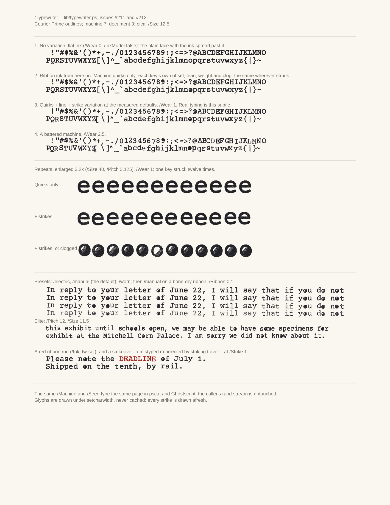

# Fonts

pscat has three kinds of fonts, and they all work through the ordinary
PostScript operators (`findfont`, `scalefont`, `setfont`, `show`).

- **Standard fonts.** Helvetica, Times and Courier, backed by bundled,
  metric-compatible Liberation faces, plus the other LaserWriter names
  through the catalog below.
- **Type 3 fonts.** Glyphs that are programs. pscat's own display faces, its
  handwriting font and its typewriter font are all Type 3. Because a glyph is
  code, it can be different every time it is drawn (`examples/type3_ransom.ps`
  invents every glyph fresh at show time). Bitmap Type 3 fonts stamp their
  raster with `imagemask`.
- **Type 1 fonts.** The real thing: `currentfile eexec`, encrypted charstrings
  and the `N RD <binary>` idiom. Ghostscript accepts the Type 1 file the test
  suite generates, byte for byte.

This guide covers the Type 3 display library, the typewriter, and the runtime
catalog of 61 outline faces. For the handwriting font see
[handwriting](handwriting.md). For the design behind all of it, see `FONTS.md`
in the repo root.

## The display font library

`lib/fonts/` — original display faces, each one a self-contained
pure-PostScript file that defines a Type 3 font and draws nothing on
load (the `lib/handscript.ps` doctrine: embeddable wholesale, runs
unchanged in Ghostscript). Because Type 3 glyphs are programs, the
letterforms do things outline fonts can't:

| Face | Material |
|---|---|
| `/Neon` | Bent glass tube — the glow is five widening strokes of overdraw, no alpha anywhere |
| `/Marquee` | Theater-sign bulbs along every stroke, halos, glints, and the occasional burnt-out bulb (seeded rand) |
| `/Constellation` | Letters as star charts: magnitudes and tints rand-drawn, hairline asterism lines, field stars |
| `/Lapidary` | Chiseled capitals: shadow, raised face, dark incision, and a hairline of sunlight on the arris |
| `/Circuitry` | Copper PCB runs — solder-mask channel, specular seam, through-hole pads at every terminal, vias at pitch |
| `/Stitchwork` | Cross-stitch X's pinned to the 45° aida grid, three passes of floss, a seeded-jitter hand |
| `/Confetti` | A thrown handful — paper slips and dots in a six-color party palette, still falling |

All seven share one capital skeleton set (both cases map to the same
capitals; digits and `.,-'!?` included) and take dials through their
scratch dicts — retube `/Neon` in pink, dial `/Marquee`'s burnout
rate, warm up `/Lapidary`'s stone, re-spool `/Stitchwork` in blue
floss. `examples/font_library.ps` and `examples/font_library2.ps`
are the specimen posters:

<p>
</p>

```sh
cargo run --release -- --png poster.png examples/font_library.ps
cargo run --release -- --png poster2.png examples/font_library2.ps
```

## The /Typewriter font

`lib/typewriter.ps` (design notes in `docs/TYPEWRITER.md`) defines
`/Typewriter`, a Type 3 font that types like a real machine. The glyphs
are Courier Prime's outlines (`lib/typewriter_outlines.ps`, generated by
`scripts/gen_typewriter_outlines.py`), redrawn at every strike with three
layers of variation measured from real typed pages: each key's fixed
quirks on the machine (`/Machine`), each line's carriage return and tilt,
and each strike's offset, rotation and pressure (`/Seed`). `/Wear` scales
them all: 1 is a good manual and the default, 2.5 a battered one. The
same seeds give the same page in pscat and Ghostscript, and the caller's
`rand` stream is never touched.

```postscript
(lib/typewriter_outlines.ps) run (lib/typewriter.ps) run
72 700 moveto << /Machine 7 /Seed 3 >> tw-setup
(Dear Sir, I enclose the specimens.) show
```

`tw-setup` starts a block (options, cell frame, font); `tw-set` changes
options inside one: a red ribbon run (`/Ink`), a strikeover (`/Strike`).
It also takes pica and elite pitch (`/Pitch 10` or `12`) and the `/manual`,
`/electric` and `/worn` presets. `examples/typewriter_specimen.ps` shows the full ASCII
set from no variation to a battered machine:

<p></p>

The ink is ribbon ink: the face pressed through inked fabric, so the weave's
voids show in the letter, the edge feathers, clogged keys fill their counters,
and density follows pressure and `/Ribbon` (wetness). `/InkModel false` gives
flat ink. `docs/typewriter/ink_vs_real.png` sets it beside the reference scans.

The ribbon weave, clogged counters and one-side-heavy keys come with
## The font catalog

`fonts/catalog/` — 61 libre outline faces loaded from disk at
`findfont` time (never compiled in; the binary and wasm stay lean).
With it, **every name in the classic LaserWriter 35 resolves to a
metric-compatible libre face**: the bundled Liberation faces cover
Helvetica/Times/Courier, TeX Gyre covers Palatino, Bookman, New
Century Schoolbook, Avant Garde, Zapf Chancery, and
Helvetica-Narrow, and the URW symbol faces give `/Symbol` and
`/ZapfDingbats` real glyphs with their proper PLRM encodings. On
top of that: 35 curated display and text families — Garamond to
Playfair, Poppins to Oswald, Great Vibes to Permanent Marker,
fraktur, western, horror, arcade, terminal, sci-fi, stencil, comic.

```sh
cargo run -- --fonts                 # list every reachable face and alias
cargo run -- -e '/Palatino-Roman findfont 24 scalefont setfont ...'
cargo run -- --png sheets.png examples/font_catalog.ps   # the specimen sheets
```

[`fonts/catalog/README.md`](../../fonts/catalog/README.md) is the manifest (families, genres,
licenses — all OFL, Apache 2.0, GUST, or AGPL-with-font-exception;
per-family license files ride alongside the fonts). Drop your own
`.ttf`/`.otf` into any subdirectory and `/<FileStem> findfont`
finds it. The [font gallery](https://jeromebanks.github.io/postscript_interpreter/fonts.html)
on the project site shows every face — Type 3 library included — one
card at a time.
