# Landscape techniques cookbook for artist agents

How to paint a sky, clouds, mountains, mist, a far forest, evergreens, bushes, water, a reflection, a foreground bank and grass with `lib/paintkit.ps`, in the order a wet-on-wet landscape is painted. Each recipe names the tools, the order, the settings that matter and the usual failure with its fix, and gives a complete snippet that renders as it stands, with a thumbnail of what it makes.

The recipes come from two worked pieces: `gallery/alpine_lake.ps` (issue #118, a snow range over a lake) and Evening Stream (issue #187, `gallery/evening_stream.ps` and `notes/187-evening-stream.md`, pending in [PR #348](https://github.com/jeromebanks/postscript_interpreter/pull/348) and not on `main` yet). Nothing here is a library helper: every recipe is prose plus paintkit calls, so you copy a snippet, change the numbers and keep going. Parameter lists are in `pscat --capabilities`; the tools themselves are described in `README.md` and `.claude/skills/psart/SKILL.md`.

## Running a recipe

Every snippet is complete and sized for a 360 by 240 pt page. From the repo root:

```sh
pscat --page 360x240 --dpi 144 --png out.png recipe.ps
```

`--png` (or `--headless`) is required, or pscat opens a window and waits. `--dpi 144` renders at twice the size: fine spray and bristles need it to read as vapour rather than static, and the thumbnails below are made that way (`pscat --page 360x240 --dpi 144`). Then **look at the PNG**. Run it again with `--lint` once it draws, which catches a blank page, an unbalanced `gsave` and stack leaks that a good-looking picture can hide. A clean lint does not mean the program ran clean, though: watch stderr for a `%%[ Error: ...` line, because a recipe that died halfway still prints a picture.

The snippets share a few habits. They are worth copying.

- **Seed first**: `N srand` after the library loads. Every mark draws from the random stream, so the same seed paints the same picture and a changed number moves only what comes after it.
- **Prefix your own names** (`wt_y`, `mt_px`). Paintkit's presets redefine their own `pk-`, `pn-`, `pb-`, `pz-`, `po-`, `pq-`, `pd-` names on every call, and so does artkit, so a scratch name that collides is overwritten in the middle of a painting.
- **Colours are `r g b` on the stack, `[r g b]` in a dict.** `mix3` (`[a] [b] t mix3` gives `r g b`) and `shade` (`[a] k shade` gives `r g b`) return three numbers, so `setrgbcolor` takes them directly and a `/Colors` entry wraps them: `[ [ c 1.03 shade ] ... ]`. The presets paint in the colour you set; there is no colour key outside `/Colors`.
- **Stay out of `setalpha`.** Nothing here uses it, so the same snippet renders under Ghostscript, with only its random stream differing and no antialiasing (fine spray comes out heavier). The snippets end without `showpage`, because pscat paints its page at exit, so ask gs for one: `gs -q -dNOSAFER -dBATCH -dNOPAUSE -sDEVICE=png16m -g360x240 -r72 -sOutputFile=out.png recipe.ps -c showpage` (`-dNOSAFER` because the snippet reads `lib/`). All eleven were checked this way.

## Colour: a palette that mixes like paint

The pigment palette (`pigmix`, `pigcolor`, `pigcolors`; `lib/paintkit.ps`, "Pigments") is the way to pick landscape colours. `[ /phthaloblue 1 /titaniumwhite 2 ] pigmix` is a sky blue, `[ /cadmiumyellow 1 /sapgreen 1 ] pigmix` a leaf green, and the mix stays rich where an RGB lerp (`mix3`) goes grey: blue and yellow make green, not olive. `pigmix` returns `r g b`; `pigcolor` returns `[r g b]` for the keys that want an array (`/HighlightColor`, `/ShadowColor`, a `/Colors` entry); `pigcolors` converts a whole `/Colors` list. Weights are parts, so `[ /a 3 /b 1 ]` and `[ /a 30 /b 10 ]` are the same paint. Specimen: `docs/dev/design/paintkit_pigment_demo.png` (`examples/paintkit_pigment_demo.ps`).

Two limits to know. Complements (phthalo blue with bright red) fall to a very dark neutral, so mix a shadow from the colour's own neighbours, not its opposite. And mixing is of colours, not of glazes: a pot of paint, never a layer seen through another. `/Colors`, `/HighlightColor` and `/ShadowColor` take a bare pigment name (`/Colors [ /sapgreen /cadmiumyellow ]`); a `pigmix` spec goes through `pigcolors` (or `pigcolor` for one colour), as `[ /sapgreen 1 ] pigcolor`.

Landscape value rules that the recipes bake in: each plane back to front is **darker, warmer and harder-edged** than the one behind it; the far planes are paler and bluer, because of the air between you and them; the only near-whites belong to the lightest thing in the scene (snow, a glow, foam), and the foreground can be near black. Mix a plane's colour once, in a named constant, and derive its lit and shaded versions from it with `shade` or `pigshade`.

## The order of work

Paint from the farthest plane forward, so each plane overlaps the last, and keep the reflection after everything it reflects.

1. **Sky**, the whole page, then **clouds** worked wet into it. (Recipes 1, 2.)
2. **The far range**: silhouette, then knife snow and shadow planes clipped to it. (3.)
3. **Mist** on the range, with the near range's foot lifted into haze last of its own plane. (4.)
4. **A nearer range**, if the scene has one, the same way, darker and warmer.
5. **The far forest** on the far shore and the **far evergreens** standing in it. (5, 6.)
6. **Water**: the base colour, then horizontal pulls and light lines. (8.)
7. **The reflection** of everything above the waterline, pulled down into the water. (9.) The reflection is not a second drawing: it replays what you painted.
8. **The foreground bank** over the shoreline seam, with its earth, lip and edge breakers. (10.)
9. **Framing evergreens** and **bushes** on the near banks, painted after the water so they are not reflected. (6, 7.)
10. **Grass**, the last marks. (11.)

Why this order: `pkwet` softens a mark into "the colour declared to be under it", so the plane behind has to be down first. Strokes of a lighter plane laid over a darker one cannot be taken back. The bank goes last because it hides the seam where the water's reflection meets the shore.

Two scene-level rules from Alpine Lake: **frame the picture with trees on the near banks, not the far shore** (a tall pine on the far shore reads as a giant, and its lowest tier meets its own mirror image at the waterline as a chevron); and **a mirror about one waterline is only right for water at that distance**, so a stream that bends toward the viewer reflects the sky gradient alone beyond the first reach (Evening Stream pulls the far wood's reflection only into its upper reach).

## 1. Sky

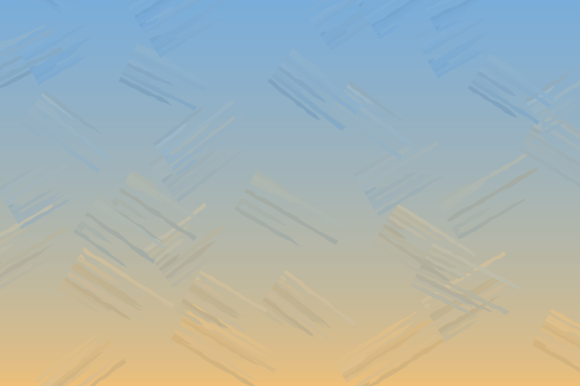

**Tools.** Flat bands (`rectfill`) for the gradient; `pkcrisscross` for where the strokes fall, `pkbroad` for the brush (issues #184, #115); `/Colors` for the load (issue #183).

**Order.** The gradient first, warm at the horizon and cool at the zenith, then a criss-cross block-in over it in thin bands so the gradient picks up a brushed surface.

**Settings that matter.**
- Bands of 2 to 2.5 pt look like a smooth gradient and cost nothing; `0.7 exp` on the height bends the ramp so the warm colour hugs the horizon.
- One `pkbroad` call paints one load, so the block-in is worked in 30 pt bands, each loaded with the gradient's own colour at its middle: `/Colors [ [ c 1.03 shade ] [ c 0.97 shade ] ]` with `/ColorMix 1`, a stroke a shade lighter on one edge and a shade darker on the other, blended on the brush. Without `/Colors` the strokes are one flat tint and read as a pattern.
- `/Charge 0.7 /Depletion 0.8` leaves the strokes broken, as a brush that runs out; `/Depletion 0` is an even block-in.

**Failures.**
- *The block-in reads as a pattern of flat tinted strokes.* Each stroke is one tint. Load two neighbouring sky colours with `/Colors`, as the snippet does.
- *Strokes that drift off the gradient.* Each band is loaded with the gradient's colour at its own middle, so a thick band is wrong at its ends; keep the bands thin (30 pt here).

```postscript
% recipe: sky
(lib/artkit.ps) run
(lib/paintkit.ps) run
5 srand
/HORIZON [ /cadmiumyellow 1 /titaniumwhite 5 /alizarin 0.15 ] pigcolor def
/ZENITH  [ /phthaloblue 1 /titaniumwhite 2 ] pigcolor def
% y -> r g b   the sky's colour at height y: warm low, cool high
/skyat { 240 div 0 max 1 min 0.7 exp /skt exch def HORIZON ZENITH skt mix3 } def

% 1. The ground colour: thin flat bands, one colour each.
0 2 240 { /sky_y exch def sky_y skyat setrgbcolor 0 sky_y 360 2.5 rectfill } for

% 2. The block-in: criss-cross strokes of a broad brush loaded with two
%    neighbouring sky colours, so the gradient picks up a brushed surface.
%    One band of strokes per colour, because one call paints one colour.
0 30 250 {
  /sky_y exch def
  [ sky_y 15 add skyat ] /sky_c exch def
  0 sky_y 360 30 screct
  << /Count 4 /Length 56 /Angle 32 /Lean 6 /LengthJitter 0.2 >> pkcrisscross
  << /Width 30 /Charge 0.7 /Depletion 0.8 /Edge 0.3 /ColorMix 1
     /Colors [ [ sky_c 1.03 shade ] [ sky_c 0.97 shade ] ] >> pkbroad
} for
```

## 2. Clouds

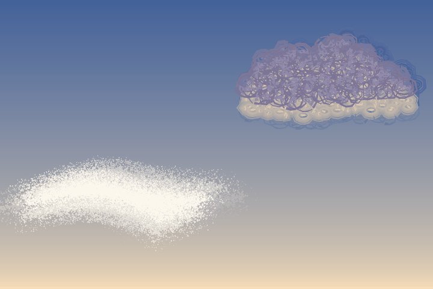

Two kinds. **Vapour** is spray, soft all through; use it for haze and wispy cirrus. **A cloud with form** has a body and a lit underside; use it for cumulus. Both are painted wet into the sky with `pkwet`, so they settle into it instead of sitting on it.

**Vapour (left of the picture).**
- `pkspray` with a fine speck: `/Speck` 1 to 1.2, a small `/Nozzle` (about 7% of the cloud's width) and a high `/Density` (about 400). At a 1 pt speck the particles fuse into a solid core and only the falloff stays granular. At `/Speck` 2 or 3 the same counts give lumpy bars that read as paint, not vapour.
- Several overlapping arcs of spray make the shape, not one long path.
- `pkwet` with `/Soft 1` and `/Under` set to the colour actually behind the mark. A single `[r g b]` is the simple case. Over a graded sky, give a procedure `x y -> r g b` and `/At [x y]`, the place the cloud sits: each softening pass is then mixed toward the sky at its own displacement, and the pale or dark rim a single colour leaves at one end goes away (issue #179). The procedure must be pure: no painting, no `pkwet`, exactly three numbers out. A mark that is tall against the sky's change wants the backdrop per band: give `/Box [x y w h]` (where the mark sits) and `/Bands [cols rows]` in place of `/At`, and the procedure is asked once per cell of a grid over the box and each softening pass is painted once per cell, mixed toward that cell's sky (issue #359). Pick rows so a cell is no taller than about half `/Offset`. The mark then runs (`/Layers` - 1) x cells + 1 times, so keep that within 64. For a cloud about as tall as `/Offset`, `/At` is as good and cheaper, which is why the snippet below uses it.

**A cloud with form (right of the picture).** From Evening Stream.
- Scumble tiny circles over the cloud's outline with `pkscumblein` (a region motion, so the outline goes through `scpath` first), and paint them with a `pkbroad` loaded with two cloud colours.
- **The brush must be at least twice the circle radius** (`/Width` 2.2 times `/Radius` in the snippet), or each circle paints as a ring, a "Cheerio" cloud.
- **A lit side** (issue #345). Scrub the body over the whole cloud in one value, then the light into the side that faces it: the same `pkscumblein` call with `/Light` (where the light comes from, in degrees: 270 is the glow below an evening cloud, 90 the sun above, 160 a low sun on the left) keeps only the circles along the edge facing the light, in a band that follows every lump of the outline. `/Reach` is how deep the band goes, as a fraction of the cloud's depth along the light, and `/Feather` grades its inner border. Paint it the way a painter models a mass: a deep, soft half-light (`/Reach 0.4 /Feather 0.9`, a load between body and light), then the core of the light near the edge (`/Reach 0.2`). Keep the light close in value to the body and in one shape; a light that is too bright or too scattered is the usual mistake. A shadow side is the same call with the light turned round and a darker load.
- Work the body wet into the sky (`/Under` the sky), and the lights wet into the body (`/Under` the body colour, a lower `/Soft`), since that is what is under them.
- `/Count` is worked out from the cloud's area over one circle's area, so the circles stay the same size when you change the cloud's width.

**Failures.**
- *Ring clouds.* Brush narrower than 2x the circle radius (above).
- *Clouds that read as static.* The speck is coarse; see the 1 pt rule.
- *Spots like a leopard.* Dabs (`pkdab`) clumped at cloud scale read as spots; use scumbled circles.
- *A pale or dark halo around a cloud.* `/Under` is the wrong colour, or a single colour over a strong gradient. Use the `/Under` procedure with `/At`, or with `/Box` and `/Bands` if the mark is tall.
- *Lights that read as rings.* A thin lit band holds few circles, and a lone circle paints as a ring. Use smaller circles (and more of them) for the core of the light, as the snippet does.
- *A light that is a stripe.* One lit pass at one value ends on a line. Lay a deep half-light first, then a shallow core.

```postscript
% recipe: clouds
(lib/artkit.ps) run
(lib/paintkit.ps) run
/DAWN [0.97 0.87 0.72] def  /HIGH [0.26 0.38 0.60] def
/skyat { 240 div 0 max 1 min 0.7 exp /skt exch def DAWN HIGH skt mix3 } def
0 2 240 { /sky_y exch def sky_y skyat setrgbcolor 0 sky_y 360 2.5 rectfill } for

% A. Vapour: very fine spray fuses into a soft core; pkwet grades the fringe.
%    x y w seed -
/vapour {
  srand /cl_w exch def /cl_y exch def /cl_x exch def
  [ 0.99 0.97 0.93 ] aload pop setrgbcolor
  { 0 1 4 {
      /cl_k exch def
      newpath cl_x cl_w cl_k mul 0.08 mul add  cl_y cl_k 3 mul add moveto
      cl_x cl_w 0.35 mul add  cl_y cl_w 0.16 mul add
      cl_x cl_w 0.7 mul add   cl_y
      cl_x cl_w add cl_w cl_k mul 0.06 mul sub  cl_y cl_k 4 mul sub 4 add curveto
      << /Nozzle cl_w 0.07 mul /Density 400 /Falloff 0.9 /Speck 1.2 /Overspray 0.5 >> pkspray
  } for }
  % /Under is the colour behind the mark: a procedure x y -> r g b, asked
  % where the cloud sits (/At), so the rim matches the graded sky.
  << /Soft 1 /Offset 30 /At [ cl_x cl_w 2 div add  cl_y cl_w 0.08 mul add ] /Under { exch pop skyat } >> pkwet
} def
20 70 150 1 vapour

% B. A cloud with form, lit from below.
/lump {                                 % x y w h -  a lumpy cloud outline
  /cb_h exch def /cb_w exch def /cb_y exch def /cb_x exch def
  newpath cb_x cb_y moveto
  cb_x cb_w 0.1 mul add cb_y cb_h 0.9 mul add  cb_x cb_w 0.3 mul add cb_y cb_h 1.1 mul add
  cb_x cb_w 0.42 mul add cb_y cb_h 0.8 mul add curveto
  cb_x cb_w 0.55 mul add cb_y cb_h 1.35 mul add  cb_x cb_w 0.8 mul add cb_y cb_h 1.05 mul add
  cb_x cb_w 0.84 mul add cb_y cb_h 0.5 mul add curveto
  cb_x cb_w 0.95 mul add cb_y cb_h 0.5 mul add  cb_x cb_w 1.02 mul add cb_y cb_h 0.2 mul add
  cb_x cb_w add cb_y curveto
  cb_x cb_w 0.6 mul add cb_y cb_h 0.1 mul sub  cb_x cb_w 0.3 mul add cb_y cb_h 0.3 mul sub
  cb_x cb_y curveto closepath
} def
/form {                                  % x y w seed -
  srand /fm_w exch def /fm_y exch def /fm_x exch def
  /fm_h fm_w 0.28 mul def
  /fm_r fm_w 0.04 mul def                % circle radius
  /fm_under [ fm_x fm_w 2 div add skyat ] def
  /fm_body [ 0.55 0.52 0.66 ] def  /fm_lit [ 1 0.88 0.72 ] def
  /fm_n fm_w fm_h mul 1.4 mul fm_r dup mul 3.14 mul div cvi def
  { % the body over the whole cloud, in one value ...
    fm_x fm_y fm_w fm_h lump scpath
    << /Count fm_n /Radius fm_r /Squash 0.7 >> pkscumblein
    % the brush is at least 2x the circle radius, or each circle is a ring
    << /Width fm_r 2.2 mul /Charge 0.75 /Depletion 0.5 /Edge 0.4 /ColorMix 0.8
       /Colors [ [ fm_body 1.1 shade ] [ fm_body 0.9 shade ] ] >> pkbroad }
  << /Soft 0.6 /Under fm_under >> pkwet
  { % ... then its lit side: /Light keeps only the circles along the edge
    % that faces the light (270, the glow below), following every lump.
    % A deep, soft half-light first, then the core of the light at the edge.
    fm_x fm_y fm_w fm_h lump scpath
    << /Count fm_n 2 mul /Radius fm_r /Squash 0.7 /Light 270 /Reach 0.4 /Feather 0.9 >> pkscumblein
    << /Width fm_r 2.2 mul /Charge 0.75 /Depletion 0.5 /Edge 0.4 /ColorMix 0.8
       /Colors [ [ fm_body fm_lit 0.35 mix3 ] [ fm_body fm_lit 0.5 mix3 ] ] >> pkbroad
    % the core: a thin band, so smaller circles, or each one shows as a ring
    fm_x fm_y fm_w fm_h lump scpath
    << /Count fm_n 4 mul /Radius fm_r 0.6 mul /Squash 0.7 /Light 270 /Reach 0.22 /Feather 1 >> pkscumblein
    << /Width fm_r 1.4 mul /Charge 0.8 /Depletion 0.4 /Edge 0.4 /ColorMix 0.8
       /Colors [ [ fm_lit fm_under 0.2 mix3 ] [ fm_lit fm_body 0.2 mix3 ] ] >> pkbroad }
  % worked wet into the body, which is what is under it
  << /Soft 0.2 /Under fm_body >> pkwet
} def
200 150 140 2 form
```

## 3. Mountains

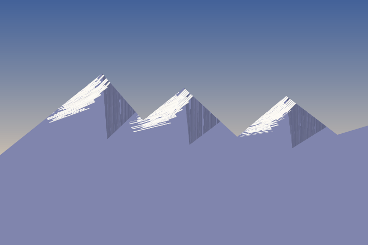

**Tools.** `pktrowel`, the palette knife (issue #111), `pktrowelplane` (issue #180) for an area, and `clip`.

**Order.** The silhouette in the range's colour. Then, with the silhouette set as the clip, a shadow plane and snow on every peak.

**The key rules.**
- **Clip the knife work to the silhouette.** A knife edge on a real ridge stops dead against the sky, and clipping is what gives your ridge the same crisp line. An unclipped pull overshoots into the sky.
- **Shadow planes are areas filled with pulls, never pulls along a shallow ridge.** A knife pull along a ridge just becomes a bar across the range. Hang a triangle off the right ridge (the peak, a point down the ridge, a point low inside the face) and fill it with `pktrowelplane`: one call lays overlapping vertical pulls clipped to the path, and the blade's texture makes it read as a plane. (Alpine Lake's shadow planes are built this way since issue #361; before that they were a hand-made triangle, clip and loop of vertical pulls.)
- **Snow goes down the lit face**, pulled a little steeper than the slope so it bites into the face, in several pulls that fall short by different amounts; the snow's lower edge is then ragged, as it is on a mountain.
- Order each peak: shadow plane first, then snow, so the snow's edge overlaps the plane's.

**Settings.** `/Width` is the blade length, in points; a narrow, loaded blade (`/Coverage 0.85`) with `/Overlap 0.5` closes overlapping pulls into one plane. `/Scrape` and `/Viscosity` set the streaks and chatter; leave `/Angle` near 12 degrees. The knife lays no base pass, so whatever is under it shows through the gaps; that is why the range is filled first.

**Failures.**
- *Snow bars across the range.* A pull along the ridge; pull down the face.
- *Ragged, floating snow on the sky.* No clip.

`pktrowelplane` takes `/Direction` (the way the pulls run), `/Overlap` and every `pktrowel` key, and clips to the path it is given, so the plane's edge is crisp with no clip of your own. `examples/paintkit_plane_demo.ps` builds a whole peak from planes.

```postscript
% recipe: mountains
(lib/artkit.ps) run
(lib/paintkit.ps) run
3 srand
/RANGE [0.50 0.52 0.68] def   /SNOW [0.99 0.98 0.96] def
/DAWN [0.97 0.87 0.72] def    /HIGH [0.26 0.38 0.60] def
0 2 240 { /mt_y exch def
  DAWN HIGH mt_y 60 sub 180 div 0 max 1 min 0.7 exp mix3 setrgbcolor
  0 mt_y 360 2.5 rectfill } for

% The silhouette: x y pairs. The peaks are the points higher than both neighbours.
/PTS [ -10 80  50 128  100 168  140 122  180 154  232 106  280 146  330 108  370 120 ] def
/silhouette { newpath -10 -10 moveto
  0 2 PTS length 1 sub { PTS exch 2 getinterval aload pop lineto } for
  370 -10 lineto closepath } def

% x0 y0 x1 y1 blade coverage -   one knife pull along a fresh segment
/pull { /mt_c exch def /mt_b exch def newpath 4 2 roll moveto lineto
  << /Width mt_b /Angle 12 /Coverage mt_c /Viscosity 0.7 /Scrape 0.35
     /Drag 0.5 /EdgeBuildup 0.15 /ColorJitter 0.03 >> pktrowel } def

% px py lx ly rx ry -   snow down the lit (left) face, a shadow plane on the right
/peak {
  /mt_ry exch def /mt_rx exch def /mt_ly exch def /mt_lx exch def
  /mt_py exch def /mt_px exch def
  /mt_h mt_py 60 sub 0.4 mul def                       % how far the snow runs
  /mt_ls mt_px mt_lx sub mt_py mt_ly sub div def       % left face: x per unit of drop
  /mt_rs mt_rx mt_px sub mt_py mt_ry sub div def       % right face
  % the shaded face first: a triangle hung off the right ridge, filled with
  % vertical pulls by pktrowelplane. (A pull along a shallow ridge just becomes a bar.)
  /mt_d mt_py 60 sub 0.35 mul def
  /mt_x2 mt_px mt_d mt_rs 1.4 min mul add def
  [ RANGE 0.78 shade ] aload pop setrgbcolor
  newpath mt_px mt_py moveto mt_x2 mt_py mt_d sub lineto
  mt_px mt_x2 mt_px sub 0.15 mul add mt_py mt_d 1.7 mul sub lineto closepath
  << /Width 12 /Direction -90 /Angle 12 /Coverage 0.85 /Overlap 0.5 /Viscosity 0.7
     /Scrape 0.35 /Drag 0.5 /EdgeBuildup 0.15 /ColorJitter 0.03 >> pktrowelplane
  % snow, pulled down the lit face a little steeper than the slope
  SNOW aload pop setrgbcolor
  0 1 4 { /mt_k exch def
    /mt_e mt_h 0.45 mt_k 0.14 mul add mul def
    mt_px mt_k 4 mul sub  mt_py 2 sub mt_k 7 mul sub
    mt_px mt_k 4 mul sub mt_e mt_ls mul 0.7 mul sub  mt_py mt_e sub
    24 mt_k 3 mul sub 0.82 mt_k 0.08 mul sub pull } for
} def

RANGE aload pop setrgbcolor silhouette fill
% The knife work is clipped to the silhouette, as a real knife edge is:
% the paint stops dead against the sky, so the ridge stays crisp.
gsave silhouette clip
  100 168 50 128 140 122 peak
  180 154 140 122 232 106 peak
  280 146 232 106 330 108 peak
grestore
```

## 4. Mist

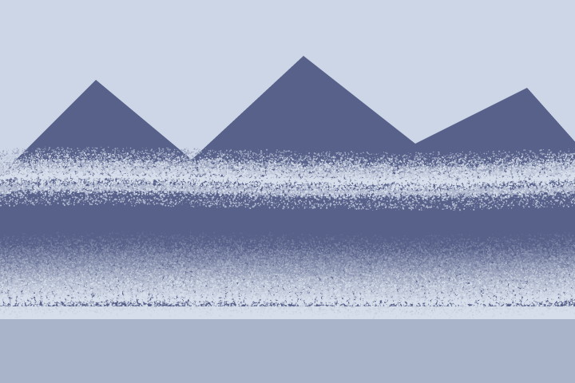

**Tools.** `pkspray` for the vapour and `pkwet` to soften it, plain for a band and directional for a foot.

**Order.** Mist is the last thing laid on its own plane, over the range it veils, and before the nearer plane that stands in front of it.

**Settings.**
- The same 1 pt speck rule as the clouds: `/Speck 1`, a small `/Nozzle`, `/Density` 300 to 400 for a band that fuses.
- A **band** is `pkwet /Soft 0.6` with `/Under` a colour between the range and the sky.
- A **foot** is a directional `pkwet`: `/Direction 90 /OneSided true /Stretch 8 /Offset 30 /Layers 14 /Under` the range's colour. The wrapped spray is tapped along the foot and lifted up the slope in layers, so the foot dissolves into the haze rising off the lake. Clip to the range's silhouette first so the haze stays inside the range.
- Keep `/Layers` pinned while tuning: with `/Layers` left to default, a directional `/Offset` also sets the depth and re-rolls everything after it.
- Expect a granular fringe at 2x. The dense core fuses and the falloff stays granular; that grain is what makes it vapour and not a gradient. Only a coarser speck than 1 pt turns it into static. A *sparse* 1 pt band is different: at 2x it reads as a granular streak, which is why Alpine Lake's far band changed (below).
- A lifted foot repeats whatever it wraps once per layer, so sparse 1 pt spray in it multiplies into gravel. Two settings work: fuse the spray densely, as the snippet below does, or let a solid band carry the lift (a wavering top keeps the layers' steps from ruling) with the spray only a sparse, fine grain on it (`/Speck 0.6`, `/Density` about 50), as Alpine Lake does since issue #206.
- A band can take the same treatment as a foot (Alpine Lake's far mist since issue #407): filled lenses of haze, a two-sided directional `pkwet` (`/Direction 90 /Offset 7 /Layers 8`, not one-sided) so each fades up and down off its core, and fine sparse spray along it. Break it into banks with gaps, mix the core part-way toward the range, and keep the offset short: a full-width band reads as a ruled stripe, a full-strength core as a white line, and a long offset buries the planes beneath it in the outer passes' flat colour.

**Failures.**
- *Ruled stripes.* Alpine Lake's first mist was a stack of horizontal `pkbroad` strokes whose charge fell as they rose; at 2x it read as ruled stripes. Use the directional lift.
- *A pale rim round the foot.* `/Under` should be the colour that is really behind the foot, not the mist. Where the range is half faded already, mix it. Where the sky changes down a tall foot, a procedural `/Under` with `/Box` and `/Bands` asks for the backdrop band by band (recipe 2); pin `/Layers` low, since a foot's 14 layers leave room for only 4 cells.
- *Static.* Speck too coarse, or `/Density` too low; raise it.
- *Gravel in a lifted foot.* 1 pt spray at a sparse density, repeated through 14 layers, reads as a coarse speckled band, not haze. Fuse the spray, or carry the lift on a band and make the spray finer (above).
- *A lifted foot that stops a reflection.* A directional `pkwet` nested inside another multiplies their passes, and the innermost procedure may run at most 64 times; pull the reflection of a part that already has a lifted foot sharp instead of pulling it again (Alpine Lake's `35 lksharp`, recipe 9).

```postscript
% recipe: mist
(lib/artkit.ps) run
(lib/paintkit.ps) run
6 srand
/SKY [0.80 0.84 0.90] def  /RANGE [0.34 0.38 0.54] def  /MIST [0.84 0.87 0.92] def
SKY aload pop setrgbcolor clippath fill
/range { newpath -10 40 moveto -10 120 lineto 60 190 lineto 120 140 lineto
  190 205 lineto 260 150 lineto 330 185 lineto 370 140 lineto 370 40 lineto closepath } def
RANGE aload pop setrgbcolor range fill
[ RANGE SKY 0.7 mix3 ] aload pop setrgbcolor -10 -10 380 51 rectfill      % the lake

% 1. A band of mist, tapped wet into what is under it. Fine spray (1pt
%    specks) fuses into vapour; pkwet grades its edge into the range.
MIST aload pop setrgbcolor
{ newpath -20 128 moveto 100 134 200 120 380 130 curveto
  << /Nozzle 7 /Density 400 /Falloff 1 /Speck 1 /Speckle 0.6 /Overspray 0.6 >> pkspray }
<< /Soft 0.6 /Offset 12 /Under [ RANGE SKY 0.5 mix3 ] >> pkwet

% 2. The foot, lifted into haze. Clip to the range so the haze stays
%    inside it, lay a band of mist, tap spray along it, and lift the whole
%    thing up the slope with a one-sided directional pkwet.
gsave range clip
  MIST aload pop setrgbcolor
  -20 40 400 8 rectfill
  { newpath -20 50 moveto 120 57 240 45 380 54 curveto
    << /Nozzle 8 /Density 300 /Falloff 1 /Speck 1 /Speckle 0.6 /Overspray 0.6 >> pkspray }
  << /Direction 90 /OneSided true /Stretch 8 /Offset 30 /Layers 14
     /Pickup 0.9 /Under RANGE >> pkwet
grestore
```

## 5. The far forest

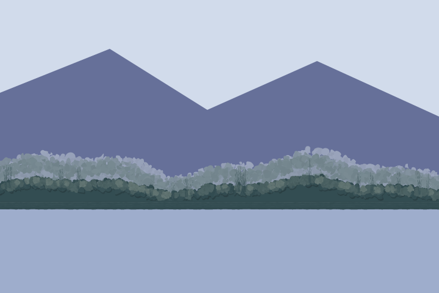

**Tools.** A filled mass, `pkdab` for the tapped crest, `pkscumblein` with `/Light` (issue #345) and `pkdab` for the crest's lit side, `pkfan` for the spires, `pkbroad` for the band along the shore, `pkwet` for the back row's softness.

**Order.** The back row (paler, softened), the front row (darker, crisp): the mass, its tapped crest, the light along the crest, the spires standing out of it, and the band along the shore.

**Key idea.** **A far forest is a filled mass with a tapped crest**, not a thousand trees. The mass is a plain fill under a crest path; the crest is `pkdab` with `/Size` 2, `/Scatter` 4 and `/Density` 4 along that same path, which makes the fuzzy edge that reads as foliage. A distant forest is an edge, not a texture.

**The crest's light** (issue #383). A wood against a glowing sky is backlit: a dark mass with a thin, broken light along its top edge where the glow catches the leaves, and none inside. The mass is a region (its crest path closed down to the waterline, then `scpath`), and `pkscumblein /Light 90` keeps only the circles along its top edge, following every hump of the crest, a small `pkdab` clump on each. Two passes, as in recipes 2 and 7: a half-light (`/Reach 0.17 /Feather 0.8`), then a core right at the edge (`/Reach 0.07`, smaller circles and dabs). Both loads are a mix of the body and a pale, slightly warm glow, so the light stays close to the body's value: the front row must stay darker than the back row, or the light reads as haze and the two rows fuse.

**Settings.**
- Put a crest function (`foothill` in the snippet) in a named procedure and have the mass, the crest and the spires all use it, so they agree.
- The back row's crest is `0.95` times the front crest's height, in a colour half mixed toward the mist; wrap its crest in `pkwet /Soft 0.6` with `/Under` the colour of what is really behind it (the half-faded range foot), not the mist itself, which would leave a pale rim around the forest.
- The front row is one body colour, with its light only along the crest, and left crisp. The contrast between a softened back and a crisp front is what puts air between the two. The back row takes no lit pass: it is the paler, hazier plane, and its edge is already the lightest thing in the wood.
- Lift the lit region by 2 pt (`gsave 0 2 translate` around the lit passes). The tapped crest's dabs (`/Scatter 4`) stand above the fill's edge, so a region on the fill's edge puts the light under a dark rim: a light line under a dark outline, not a lit crest.
- `/Reach` is a fraction of the region's depth along the light, which is the mass's whole height (about 22 pt), so where the crest dips to 9 pt a deep reach lights it all the way down. Keep the half-light shallow (0.17, about 4 pt) and the core shallower, or the whole front row is lit and the dark mass is lost.
- Dab size sets the look: `/Size 1.4 /Scatter 1` is a clump about 4 pt across. At `/Size 1.9 /Scatter 1.8` the clumps read as grey bubbles stuck on the mass.
- `pkfan` spires: `/Width 5 /Bristles 10 /Splay 0.9 /Ragged 0.5 /Flick 0.9`; a few, at random positions along the crest.

**Failures.**
- *A ruled, flat edge on the mass.* Always a tapped crest over a filled mass, never the fill alone. The fill's edge is a vector line; for a forest the tapped dabs are the right break, since they read as foliage. A mass that is not foliage (a meadow, a bare bank) takes `pkbrushedge` instead (recipe 10).
- *A pale rim round the back row.* `/Under` is wrong; see above.
- *A washed-out front row.* The lit load is too light, the band too deep or the clumps too big, so the front row matches the back row in value. Keep the loads close to the body (the snippet's are 40% and 80% of the way to a glow that is itself only 35% of the way to a pale colour), keep `/Reach` under 0.2, and keep the dabs small.
- *Lit bubbles instead of a lit crest.* Too few circles (`/Count` is over the whole region and the band holds a fraction of it, so a thin band needs hundreds) or dabs too big. A lone clump reads as a spot, as on a bush.
- *The light under a dark rim.* The lit region is not lifted over the tapped crest; see the settings.

```postscript
% recipe: forest
(lib/artkit.ps) run
(lib/paintkit.ps) run
4 srand
/SKY [0.82 0.86 0.92] def  /RANGE [0.40 0.44 0.60] def  /MIST [0.84 0.87 0.92] def
/LINE [0.20 0.30 0.32] def /WL 70 def                    % the waterline
SKY aload pop setrgbcolor clippath fill
RANGE aload pop setrgbcolor
newpath -10 WL moveto -10 160 lineto 90 200 lineto 170 150 lineto 260 190 lineto 370 140 lineto 370 WL lineto fill
[ 0.62 0.68 0.80 ] aload pop setrgbcolor -10 -10 380 WL 10 add rectfill        % the lake

% x -> height of the foothill's crest above the shore
/foothill { /fo_x exch def
  fo_x 1.8 mul sin 8 mul fo_x 4.6 mul sin 4 mul add 28 add } def
% k -   a fresh path along the crest, scaled by k
/crest { /fo_k exch def newpath -10 dup foothill fo_k mul WL add moveto
  -4 6 370 { dup foothill fo_k mul WL add lineto } for } def
% k -   fill the mass under that crest, down to the waterline
/mass { crest 370 WL lineto -10 WL lineto closepath fill } def

% 1. The back row: paler. Its crest is tapped wet, so it softens into
%    the mist behind it, and /Under is what is really behind it.
/BACK [ LINE MIST 0.4 mix3 ] def
BACK aload pop setrgbcolor 0.95 mass
{ 0.95 crest << /Size 2.2 /Scatter 5 /Density 4 /Shadow 0 /Highlight 0 /Irregular 1 >> pkdab }
<< /Soft 0.6 /Under [ RANGE MIST 0.5 mix3 ] >> pkwet

% 2. The front row: one body colour, left crisp. The mass, its tapped crest,
%    the crest's lit side (below), a few spires standing out of it, and a
%    band along the shore.
LINE aload pop setrgbcolor
0.55 mass
0.55 crest
<< /Size 2 /Scatter 4 /Density 4 /Shadow 0.3 /Highlight 0.08 /Irregular 1 >> pkdab

% 2b. The crest's lit side. The sky glow is above the wood, so the light
%    comes from 90, and a backlit wood is a dark mass with a thin, broken
%    light along its top edge, not a lit band. The mass is a region, and
%    /Light keeps only the circles along its top edge, a small clump of
%    dabs on each, in a load close to the body's value. The region is lifted
%    2 pt so the dabs sit on the tapped crest (whose dabs stand above the
%    fill's edge), not under it.
/GLOW [ LINE [ 0.80 0.82 0.74 ] 0.35 mix3 ] def       % the sky glow, a shade warmer than the sky
/lit_mass { 0.55 crest 370 WL lineto -10 WL lineto closepath scpath } def
gsave 0 2 translate
[ LINE GLOW 0.4 mix3 ] aload pop setrgbcolor
lit_mass
<< /Count 700 /Radius 1.6 /Light 90 /Reach 0.17 /Feather 0.8 >> pkscumblein
<< /Size 1.4 /Scatter 1 /Density 3 /Irregular 1 /Highlight 0.15 /Shadow 0 /Light 90 /HighlightColor GLOW >> pkdab
[ LINE GLOW 0.8 mix3 ] aload pop setrgbcolor
lit_mass
<< /Count 900 /Radius 1.2 /Light 90 /Reach 0.07 /Feather 1 >> pkscumblein
<< /Size 1.1 /Scatter 0.8 /Density 3 /Irregular 1 /Highlight 0.3 /Shadow 0 /Light 90 /HighlightColor GLOW >> pkdab
grestore
LINE aload pop setrgbcolor                  % back to the body's colour for the spires and the band
0 1 18 { pop
  /fo_x 360 chance def  /fo_t fo_x foothill 0.55 mul WL add def
  newpath fo_x fo_t 2 sub moveto fo_x fo_t 12 add 14 chance add lineto
  << /Width 5 /Bristles 10 /Splay 0.9 /Load 0.9 /Ragged 0.5 /Flick 0.9 >> pkfan
} for
newpath -10 WL 2 add moveto 370 WL 2 add lineto
<< /Width 7 /Charge 0.95 /Depletion 0 /Edge 0.5 >> pkbroad
```

## 6. Evergreens

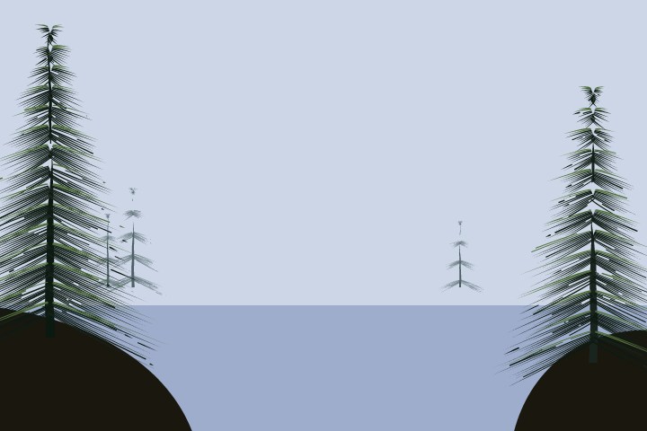

**Tools.** `pkliner` for the trunk, `pkfan` for the branch tiers, with `/Colors` and `/Light` (issues #116, #114, #183).

**Order.** A liner trunk, then tiers of branches pulled out and down from it, widening toward the base. Alpine Lake adds a few sparse light strokes on the lit side as a last pass.

**Settings.**
- Each tier is a real stroke out from the trunk (`moveto`, `lineto`), left and right. **A load is brush-relative, so a stroke drawn backwards swaps its colours**; with `/Light` (degrees, the direction the light comes from) each stroke puts the first colour on whichever side faces the light. A pressed fan or a dab is never flipped, so draw the tiers as strokes.
- `/Colors [ lit dark dark dark ] /ColorMix 0.15`: the entries are evenly spaced across the brush, so repeating the dark one gives it more of the head, and a low `/ColorMix` keeps the seam crisp.
- `/Width` of about 11% of the tree's height, `/Bristles` 12 to 26 (more costs CPU time quickly) and `/Ragged` 0.45 or more. `/Ragged` feathers the tips, without it the tiers read as combs.

**Where they stand.**
- **Far stands: paler and bluer**, small, on the far shore; the same tree, more air.
- **Frame the picture with trees on the near banks, not the far shore**, and paint them last, after the water, so they are not reflected (the bank in front would hide their reflection anyway). Stand them on the far shore instead and they read as giants.

**Failures.**
- *Branches that all point the same way.* The load is not flipped: use `/Light`.
- A lit tip on a dark stem for grass and fir needles would be [#229](https://github.com/jeromebanks/postscript_interpreter/issues/229), `/TipColor`.

```postscript
% recipe: evergreens
(lib/artkit.ps) run
(lib/paintkit.ps) run
7 srand
/SKY [0.80 0.84 0.90] def  /LAKE [0.62 0.68 0.80] def
SKY aload pop setrgbcolor clippath fill
LAKE aload pop setrgbcolor -10 -10 380 80 rectfill
/DARK [0.05 0.10 0.07] def  /LIT [0.30 0.42 0.22] def
/FARDARK [0.30 0.38 0.40] def  /FARLIT [0.42 0.50 0.50] def

% x y h seed dark lit -   a pine: a liner trunk, then branch tiers pulled
% out and down from it, widening toward the base. Each tier is a real
% stroke out from the trunk, so /Light can flip the loaded colours.
/pine {
  /tr_lit exch def /tr_dark exch def srand
  /tr_h exch def /tr_y exch def /tr_x exch def
  tr_dark aload pop setrgbcolor
  newpath tr_x tr_y moveto tr_x tr_y tr_h add lineto
  << /Width tr_h 0.03 mul 1 max /Taper 0.95 /Waver 0.3 >> pkliner
  /tr_n tr_h 14 div cvi 3 max def
  0 1 tr_n { /tr_k exch def
    /tr_f tr_k tr_n div def                              % 0 at the top
    /tr_ty tr_y tr_h add tr_h 0.9 mul tr_f mul sub def
    /tr_sp tr_h 0.04 mul tr_h 0.34 mul tr_f mul add def  % the tier's reach
    [ -1 1 ] { /tr_s exch def
      newpath tr_x tr_ty moveto
      tr_x tr_sp tr_s mul add  tr_ty tr_sp 0.45 mul sub lineto
      << /Width tr_h 0.11 mul 3 max /Bristles 10 /Splay 0.8 /Load 0.88
         /Dropout 0.12 /Ragged 0.45 /Flick 0.7
         /Colors [ tr_lit tr_dark tr_dark tr_dark ] /ColorMix 0.15 /Light 150 >> pkfan
    } forall
  } for
} def

% Far stands: small, paler and bluer, on the far shore. The same tree,
% with more air between it and the eye.
60 80 40 1 FARDARK FARLIT pine
74 80 54 2 FARDARK FARLIT pine
256 80 36 3 FARDARK FARLIT pine
% Near trees frame the picture from the foreground banks, and are painted
% last. They stand on the bank, not the far shore, or they read as giants.
[ 0.10 0.09 0.06 ] aload pop setrgbcolor
newpath -10 -10 moveto -10 70 lineto 60 62 100 30 110 -10 curveto closepath fill
newpath 370 -10 moveto 370 56 lineto 320 60 290 30 284 -10 curveto closepath fill
28 52 170 4 DARK LIT pine
330 38 150 5 DARK LIT pine
```

## 7. Bushes

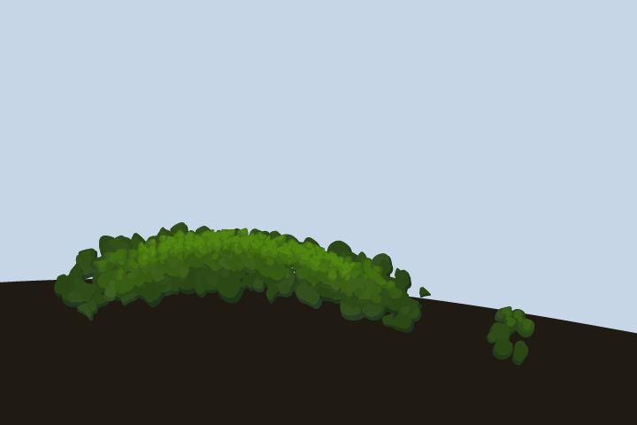

**Tools.** `pkscumblein` with `/Light` (issues #184, #345) for where the leaves go, `pkdab` (issue #117) with `/HighlightColor` and `/ShadowColor` (issue #226) for the leaves, and the pigment palette.

**Order.** The body over the whole bush in one value, then the shadow side, then the lit side, then the core of the light: each pass a smaller, lighter (or darker) dab on the circles the region motion keeps.

**Settings.**
- The bush is a **region**: draw its outline (a lumpy dome on a flat foot) and `scpath` it. `pkscumblein` scatters small circles over it and `pkdab` pounces a clump of leaves on each, so the bush fills its shape instead of following a line.
- `/Light` on `pkscumblein` keeps only the circles along the edge that faces the light, following each lobe of the outline, so every bump gets its own lit cap. The shadow side is the same call with the light turned round (`LIGHT 180 add`) and a cooler load.
- `/Reach` 0.3 to 0.4 for the half-light, 0.15 for its core; `/Feather` 0.7 to 0.8 so the light thins out into the body rather than ending on a line.
- `/HighlightColor` and `/ShadowColor` are the colours the lit and shaded dabs mix toward instead of white and black: a warm yellow-green and a cool blue-black make a sunlit bush. On the shadow pass set `/HighlightColor` to the body colour, or its dabs get chalky highlights.
- A tree mass reads as one value with its light and dark as variations on it: keep the lit load a mix of the body and the warm colour, not the warm colour itself.

**Failures.**
- *A floating bush.* The outline's foot is above the bank. Sit it on the rise, so the body's dabs overlap the bank's edge.
- *White, chalky highlights.* No `/HighlightColor`; the dabs mix toward white.
- *A spotty, leopard bush.* Lights scattered over the whole mass. Keep them on the side facing the light with `/Light`, in one shape.
- *A flat, sausage bush.* One pass along a spine, every dab painted alike. Mass it as a region with a lit and a shadow side.

```postscript
% recipe: bushes
(lib/artkit.ps) run
(lib/paintkit.ps) run
2 srand
[ 0.78 0.84 0.90 ] aload pop setrgbcolor clippath fill
/GREEN [ /sapgreen 1 /vandykebrown 0.3 ] pigcolor def
/WARM  [ /cadmiumyellow 2 /sapgreen 1 ] pigcolor def       % what the sun does to green
/COOL  [ /prussianblue 1 /midnightblack 0.4 ] pigcolor def % what shade does to it
[ 0.12 0.10 0.07 ] aload pop setrgbcolor                   % the bank under the bush
newpath -10 -10 moveto -10 80 lineto 150 90 260 70 370 50 curveto 370 -10 lineto closepath fill

% cx y w h - region   a bush's outline: a lumpy dome on a flat foot
/bu_dome {
  /bu_h exch def /bu_w exch def /bu_y exch def /bu_x exch def
  newpath
  0 6 180 {
    /bu_a exch def
    /bu_k 1 bu_a 7 mul sin 0.1 mul add bu_a 13 mul 40 add sin 0.06 mul add def
    bu_x bu_a cos bu_w 2 div mul bu_k mul add  bu_y bu_a sin bu_h mul bu_k mul add
    bu_a 0 eq { moveto } { lineto } ifelse
  } for
  closepath scpath
} def

% A bush is a mass with a lit side and a shadow side, built in passes over
% one region: pkscumblein scatters small circles over the outline and
% pkdab pounces a clump of leaves on each. The body goes over the whole
% region in one value; then /Light keeps only the circles on the side that
% faces the light, so the same call lays the shadow side (light turned
% round, a cooler load) and the lit side (a warmer load, then its core).
/LIGHT 115 def                                             % sun up and to the left
GREEN aload pop setrgbcolor
135 72 190 52 bu_dome << /Count 90 /Radius 3 >> pkscumblein
<< /Size 4 /Scatter 5 /Density 3 /Highlight 0.2 /Shadow 0.5 /Irregular 0.9
   /HighlightColor WARM /ShadowColor COOL >> pkdab

[ GREEN COOL 0.5 mix3 ] aload pop setrgbcolor
135 72 190 52 bu_dome << /Count 70 /Radius 3 /Light LIGHT 180 add /Reach 0.3 /Feather 0.8 >> pkscumblein
<< /Size 3.4 /Scatter 4 /Density 3 /Irregular 0.9 /Highlight 0.1 /Shadow 0.4
   /HighlightColor GREEN /ShadowColor COOL >> pkdab

[ GREEN WARM 0.35 mix3 ] aload pop setrgbcolor
135 72 190 52 bu_dome << /Count 90 /Radius 2.5 /Light LIGHT /Reach 0.4 /Feather 0.7 >> pkscumblein
<< /Size 3 /Scatter 4 /Density 3 /Irregular 0.9 /Highlight 0.5 /Light LIGHT /HighlightColor WARM >> pkdab

[ GREEN WARM 0.65 mix3 ] aload pop setrgbcolor
135 72 190 52 bu_dome << /Count 90 /Radius 2 /Light LIGHT /Reach 0.15 >> pkscumblein
<< /Size 2.4 /Scatter 3 /Density 3 /Irregular 0.9 /Highlight 0.7 /Light LIGHT /HighlightColor WARM >> pkdab

% A standalone clump: a single-point subpath.
GREEN aload pop setrgbcolor
newpath 290 52 moveto
<< /Size 4 /Scatter 12 /Density 6 /Highlight 0.5 /Shadow 0.5 /Light 70
   /HighlightColor WARM /ShadowColor COOL >> pkdab
```

## 8. Water

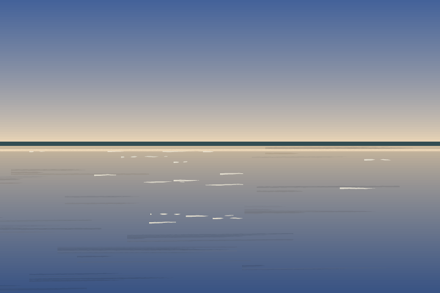

**Tools.** Flat bands, `pkbroad`, `pkliner` (and `pkzigzag` for light on moving water, issue #184).

**Order.** The base colour first, then horizontal pulls of the water colour, then the light lines last.

**Settings.**
- Water is the sky mirrored about the waterline in thin bands, a little darker (`0.84` to `0.86` of the sky's colour), so it is lightest at the far shore and deepens toward the viewer.
- Horizontal strokes of a broad brush that runs out (`/Charge 0.25 /Depletion 0.9`) leave the colour beneath showing between them; that is the water's surface.
- Light lines: a fine liner (`/Width 1.1 /Taper 0.6 /Waver 0.3`) in the sky's colour, densest just below the far shore (`chance` squared biases the spread), sparser toward the viewer. A last line where the shore meets its reflection ties them together. Alpine Lake (issue #206) breaks each into a short run of glints of uneven length, width and strength, and the shore line into lengths.
- Over a reflection, mix the horizontal pulls some way toward the reflected colour they cross: a pull in the pure sky colour reads as a pale rule across a dark reflected wood.
- For moving water, `pkzigzag` builds a zig-zag about a guide path and a narrow `pkbroad` loaded with the glow and the water colour paints it (Evening Stream).

**Failures.**
- *Water that reads as a flat sheet.* Without the horizontal pulls the surface has nothing on it; vary their starts and lengths.
- *Light lines that look like scratches.* Too white, too many, or evenly spread; use the sky's own colour.
- *Ruled lines.* Long pulls of one width, and a low-charge brush running out to one or two striations over hundreds of points, read as rules drawn across the lake. Keep pulls short and vary their width.

```postscript
% recipe: water
(lib/artkit.ps) run
(lib/paintkit.ps) run
8 srand
/WL 120 def                                             % the waterline
/DAWN [0.97 0.87 0.72] def  /HIGH [0.26 0.38 0.60] def
/skyat { WL sub 120 div 0 max 1 min 0.7 exp /wt_t exch def DAWN HIGH wt_t mix3 } def
0 2 240 { /wt_y exch def wt_y skyat setrgbcolor 0 wt_y 360 2.5 rectfill } for
[ 0.20 0.30 0.32 ] aload pop setrgbcolor -10 WL -2 add 380 6 rectfill   % far shore

% 1. The lake: the sky mirrored in thin bands, a little darker, so the
%    water is lightest at the far shore and deepens toward the viewer.
WL 2 sub -2 0 { /wt_y exch def
  [ WL wt_y sub WL add skyat ] 0.86 shade setrgbcolor
  0 wt_y 360 2.5 rectfill } for

% 2. Horizontal pulls of the water colour: a broad brush that runs out,
%    so the colour beneath shows between the strokes.
WL 4 sub -8 0 { /wt_y exch def
  [ WL wt_y sub WL add skyat ] 0.8 shade setrgbcolor
  /wt_x 300 chance 60 sub def
  newpath wt_x wt_y moveto wt_x 90 add 80 chance add wt_y 1.5 frnd mul add lineto
  << /Width 7 /Charge 0.25 /Depletion 0.9 /Edge 0.3 >> pkbroad
} for

% 3. Light lines, last: a fine liner in the sky's colour, densest just
%    below the far shore and sparser toward the viewer.
[ 0.9 0.88 0.82 ] aload pop setrgbcolor
0 1 16 { pop
  /wt_x 340 chance def  /wt_y WL 4 sub 70 chance dup mul 70 div sub def
  newpath wt_x wt_y moveto wt_x 12 add 30 chance add wt_y 0.6 frnd mul add lineto
  << /Width 1.1 /Taper 0.6 /Waver 0.3 /Charge 0.8 /Depletion 0.6 >> pkliner
} for
% the light line where the shore meets its own reflection
[ WL skyat ] 1.1 shade setrgbcolor
newpath -10 WL 3 sub moveto 370 WL 3 sub lineto
<< /Width 1.6 /Charge 0.9 /Depletion 0.3 /Edge 0.2 >> pkbroad
```

## 9. Reflections

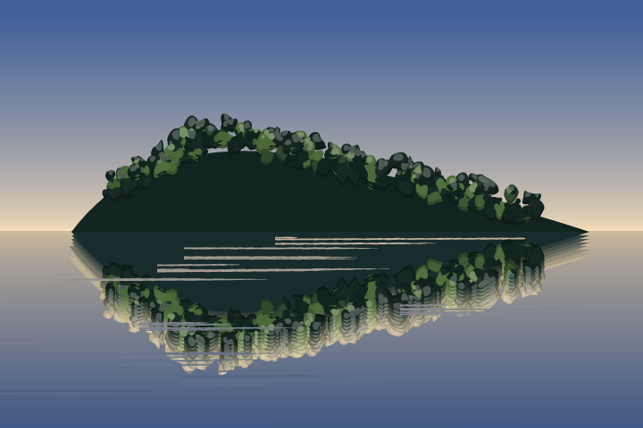

**Tools.** `pkwet` with `/Direction 270 /OneSided true` (issue #181), a procedure that mirrors itself, `pkbroad` for the graze.

**The whole-element pull.** An element that paints only in the colour it inherits and in loaded colours (`/Colors`) can be pulled down whole by one directional `pkwet`, with no part-by-part replay. Put **the mirror and the `srand` inside the procedure**:

```text
{ gsave 0 WL 2 mul translate 1 -1 scale  element  grestore }
<< /Direction 270 /OneSided true /Stretch 5 /Offset 14 /Layers 8 /Under water >> pkwet
```

- **Self-seeded.** The element starts with its own `N srand`, so a second run lays the same marks. The reflection replays them, upside down.
- **Mirror inside.** `/Direction` is measured in the user space `pkwet` is called in. Call `pkwet` from inside a `1 -1 scale` and 270 points up the page.
- **Inherited colour.** `pkwet` grades a pass by setting a mixed colour before the procedure runs, so a procedure that calls `setrgbcolor` draws every pass at full strength and the pull comes out as hard echoes. Set the colour first (mixed a little toward the water, as the snippet does), and never call `setrgbcolor` inside.
- Pass `/Under` the colour of the water where the reflection falls, and clip to the water.
- Then graze horizontal strokes of the water colour across the reflection with a low-charge `pkbroad`, so the reflection shows between the strokes.
- A bright part (snow) goes in well toward the water's colour, since a reflection is darker and lower in contrast than what it mirrors; at the foot of the lake, short ripples in the reflected range's own colour vanish on the range and break the snow into bands (Alpine Lake, issue #206).

**An element with several colours.** An element that sets its own colours (a snow range with white, shadow and rock) cannot be pulled whole. Alpine Lake handles it by recording: every painting step in each element is a numbered checkpoint that logs the random state (`rrand`) as it paints; in the lake the whole scene runs again under `1 -1 scale`, and a checkpoint paints only when its code is the one asked for, after restoring its logged state (`srand`), so one single-colour part at a time is pulled down with its own directional `pkwet` and its own `/Under`. Geometry and clips run in both modes, since they draw nothing. See `lkdo`, `lkpull` and `lksharp` in `gallery/alpine_lake.ps`. It is too much to be a short snippet, so prefer the whole-element pull when you can arrange it: load the colours onto the brush with `/Colors` (and `pkdab`'s `/HighlightColor`), as Evening Stream does for its far wood.

**Failures.**
- *Stepped echoes.* The passes are too far apart. `/Offset` over `/Layers - 1` should stay near 2 pt. With `/Layers` left to default, `/Offset` also sets the depth, so pin `/Layers` while tuning.
- *A reflection that goes the wrong way.* The mirror is outside the procedure.
- *The reflection has changed shape.* The element does not seed itself, so it is a different drawing.
- *An error about too many passes.* Nested directional `pkwet`s multiply their passes, and the innermost procedure may run at most 64 times; lay a part that already has a lifted foot sharp in the reflection, as Alpine Lake's `35 lksharp` does.

```postscript
% recipe: reflection
(lib/artkit.ps) run
(lib/paintkit.ps) run
/WL 110 def                                             % the waterline
/DAWN [0.97 0.87 0.72] def  /HIGH [0.26 0.38 0.60] def
/skyat { WL sub 120 div 0 max 1 min 0.7 exp /rf_t exch def DAWN HIGH rf_t mix3 } def
0 2 240 { /rf_y exch def rf_y skyat setrgbcolor 0 rf_y 360 2.5 rectfill } for
WL 2 sub -2 0 { /rf_y exch def
  [ WL rf_y sub WL add skyat ] 0.86 shade setrgbcolor
  0 rf_y 360 2.5 rectfill } for

% The element: a wooded point. It paints only in the colour it inherits and
% in loaded colours (/Colors), and it seeds its own randomness first, so
% every run lays exactly the same marks. That is what lets pkwet pull the
% WHOLE element down in one go, with no part-by-part replay.
/DARK [0.07 0.14 0.12] def  /LIT [0.30 0.42 0.22] def
/point {
  9 srand
  newpath 40 WL moveto 70 WL 40 add 120 WL 56 add 190 WL 38 add curveto
  250 WL 24 add 300 WL 10 add 330 WL curveto closepath fill
  newpath 60 WL 24 add moveto 120 WL 58 add lineto 190 WL 40 add lineto 300 WL 14 add lineto
  << /Size 3.2 /Scatter 8 /Density 4 /Irregular 0.9 /Shadow 0.4 /Highlight 0.4
     /Light 90 /Colors [ DARK DARK LIT ] >> pkdab
} def
DARK aload pop setrgbcolor point                        % the element itself

% The reflection: the mirror and the seed live INSIDE the procedure, so
% /Direction 270 is straight down the page. /Under is the water colour
% the pulled passes fade toward. Clip to the water.
gsave 0 0 360 WL rectclip
  DARK [ [ 330 skyat ] 0.84 shade ] 0.15 mix3 setrgbcolor
  { gsave 0 WL 2 mul translate 1 -1 scale point grestore }
  << /Direction 270 /OneSided true /Stretch 5 /Offset 14 /Layers 8
     /Pickup 0.75 /Under [ WL 20 sub skyat ] >> pkwet
  % then graze horizontal strokes of the water colour across it
  7 srand
  WL 4 sub -8 0 { /rf_y exch def
    [ WL rf_y sub WL add skyat ] 0.84 shade setrgbcolor
    /rf_x 300 chance 60 sub def
    newpath rf_x rf_y moveto rf_x 90 add 80 chance add rf_y 1.5 frnd mul add lineto
    << /Width 7 /Charge 0.25 /Depletion 0.9 /Edge 0.3 >> pkbroad
  } for
grestore
```

## 10. The foreground bank

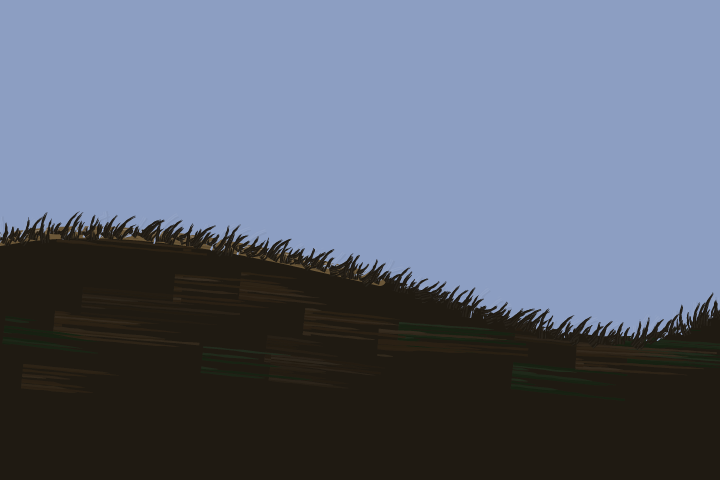

**Tools.** A fill, `pkbroad` clipped to it, `pkoil` for the lip, `pkbrushedge` for the edge (issues #115, #347).

**Order.** The mass in one near-black colour; brushed earth over it, clipped to it; the lit lip; the brushed edge over all of it.

**Settings.**
- Brushed earth: dozens of broad strokes of two or three browns and dark greens, `/Width 14 /Charge 0.6 /Depletion 0.9 /Edge 0.2 /Grain 20`, **clipped to the bank's path** so they never leave it.
- The lip catches the light: one `pkoil` stroke along the top edge in a lighter earth, `/Width 6 /Ridges 8 /Highlight 0.3`; it is a thin accent, so the brushed edge in step 4 breaks it with the rest of the rim.
- The edge: `bankpath << /Under LAKE /Slant -30 /Length 12 >> pkbrushedge` in the bank's colour. `/Under` is what is really behind the bank (a procedure `x y -> r g b` for graded water); `/Slant` tilts the strokes the way the bank was dragged; `/Crisp 0.3` leaves stretches of the rim untouched, which a near bank in strong light can take. `/Mass` (the same forms as `/Under`) is the colour pulled out when it is not one colour: a procedure `x y -> r g b` for a bank or meadow graded along its length.
- The bank is the nearest thing in the picture, so it can be nearly black; keep its value far from the water's. Only the grass tips catch the last light in Evening Stream.

**Ruled edges.** A filled mass leaves a ruled vector edge, the one thing that gives away a digital bank. `pkbrushedge` breaks it in one call: the mass's colour pulled out across the edge and the colour behind cut back in, so they interlock (issue #347; specimen `docs/dev/design/paintkit_brushedge_demo.png`). Give it the closed outline you filled (holes and mirrored reflections work) or just the visible crest left open, whose out side is `/Outward` (default up). Bushes and grass along the rim still help, as things growing there, not as the only fix.

**Failures.**
- *The earth bleeds past the bank.* No clip.
- *A bank that looks cut out.* The edge is bare; brush it with `pkbrushedge`, then add bushes or grass where something grows.
- *A pale band just inside the edge.* The inward cuts are too dense: keep `/InSpacing` at 2 or more.
- *Spikes of the wrong colour along a graded mass.* One pull-out colour cannot match a mass lit toward one end: give `/Mass` the procedure that graded the fill (issue #426).

```postscript
% recipe: bank
(lib/artkit.ps) run
(lib/paintkit.ps) run
8 srand
/LAKE [ 0.55 0.62 0.76 ] def
LAKE aload pop setrgbcolor clippath fill
0 50 translate
/BANK [ 0.12 0.10 0.07 ] def

/bankpath { newpath -10 -60 moveto -10 70 lineto
  60 84 130 66 190 52 curveto 230 40 260 26 300 22 curveto
  330 20 350 30 370 40 curveto 370 -60 lineto closepath } def

% 1. The mass, in one dark colour.
BANK aload pop setrgbcolor bankpath fill

% 2. Brushed earth, clipped to the bank: broad strokes of browns and
%    dark greens, a loaded brush that runs out as it travels.
gsave bankpath clip
  0 1 30 { pop
    [ [0.17 0.13 0.08] [0.09 0.13 0.07] [0.14 0.11 0.07] ] 3 chance get aload pop setrgbcolor
    /bk_x 380 chance 20 sub def  /bk_y 90 chance def
    newpath bk_x bk_y moveto bk_x 50 add 30 chance add bk_y 4 frnd 2 sub mul add lineto
    << /Width 14 /Charge 0.6 /Depletion 0.9 /Edge 0.2 /Grain 20 >> pkbroad
  } for
grestore

% 3. The lip catches the light: one oil stroke along the top edge.
[ 0.42 0.34 0.22 ] aload pop setrgbcolor
newpath 0 70 moveto 60 82 130 64 190 50 curveto
<< /Width 6 /Ridges 8 /Load 0.5 /Dropout 0.5 /Highlight 0.3 >> pkoil

% 4. Brush the ruled edge: the bank's colour pulled out over the water and
%    the water cut back into the bank, slanted the way the bank was dragged.
%    After the lip, so the lip is broken with the rest of the edge.
BANK aload pop setrgbcolor
bankpath << /Under LAKE /Slant -30 /Length 12 /Lean 20 /Bow 0.15 >> pkbrushedge
```

## 11. Grass

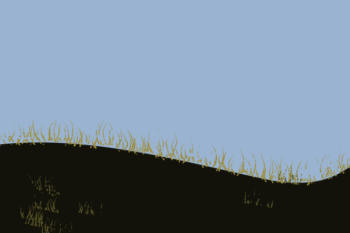

**Tools.** `pkpull` (issue #184) builds the strokes, `pkliner` paints them, and `pkcanvas` with `/Touch` (issue #182) gives light marks one canvas to catch on.

**Order.** The grass is the last mark of the painting. Along the rim first, then a few tufts across the bank, dimmer than the rim's.

**Settings.**
- `pkpull` pulls strokes from the current path along a direction: `/Direction 90 /Length 18 /LengthJitter 0.6 /Spacing 2.2 /Lean 16 /Bow 0.2 /Scatter 3`. `/Bow` curves them like blades, `/Lean` tilts them, and `/Scatter` (points) starts each one up to that far to either side of the guide, across it, so the roots do not sit on one ruled line. It builds a path and paints nothing, so the next call decides the brush: here `pkliner`, `/Width 1.4 /Taper 0.95 /Waver 0.6`.
- **One canvas.** `<< /Seed 7 /Weave 2.5 /Relief 0.6 >> pkcanvas` once, *first*, in the space the piece is painted in (before any `translate` or `scale`). `/Touch` (0 to 1) on `pkliner`, `pkdry`, `pkfan`, `pkbroad` or `pktrowel` lands a mark only on the knuckles that pressure reaches: lower is lighter. Every touched stroke catches on the same weave, so a dry brush and a knife crossing share it. A `/Touch` with no canvas is an error.
- The rim's grass is lighter in tone and heavier in touch (0.8); the tufts across the bank are dimmer (0.7).

**Failures.**
- *Grass, or a waterfall, like a picket fence hung from a rail.* Unset, `pkpull` starts every stroke exactly on the spine, and `/Wander` only slides a start *along* it. Set `/Scatter` to a few points (the rim here uses 3; a fall pulled down off a lip reads better at 4 to 6) so the starts spread across the line. Raise `/LengthJitter` too, so the tips do not line up either.
- *Grass that is one flat colour.* A dark stem with a lit tip would be `/TipColor` ([#229](https://github.com/jeromebanks/postscript_interpreter/issues/229)); for now layer a darker pass under a lighter one.
- *`/Touch` that does nothing visible.* `/Touch 1` is full contact, the same as unset; take it down to 0.5 to 0.8.
- *The canvas pattern moved.* `pkcanvas` must be called before any `translate`, `scale` or `rotate` the piece applies, and supersampling with `2 2 scale` goes before it.

```postscript
% recipe: grass
(lib/artkit.ps) run
(lib/paintkit.ps) run
% The canvas first, once, before any translate or scale: a seeded weave of
% raised knuckles that every /Touch stroke catches on.
<< /Seed 7 /Weave 2.5 /Relief 0.6 >> pkcanvas
5 srand
[ 0.60 0.70 0.82 ] aload pop setrgbcolor clippath fill
/BANK [ 0.07 0.07 0.04 ] def
BANK aload pop setrgbcolor
newpath -10 -10 moveto -10 90 lineto 90 104 200 70 280 54 curveto
  330 46 350 60 370 76 curveto 370 -10 lineto closepath fill

% 1. Grass along the rim: pkpull pulls strokes up from the guide path,
%    leaning and bowing like blades, and a liner paints each one.
newpath -10 90 moveto 90 104 200 70 280 54 curveto 330 46 350 60 370 76 curveto
<< /Length 18 /LengthJitter 0.6 /Spacing 2.2 /Direction 90 /Lean 16 /Bow 0.2
   /Scatter 3 >> pkpull
[ 0.62 0.55 0.22 ] aload pop setrgbcolor
<< /Width 1.4 /Taper 0.95 /Waver 0.6 /Touch 0.8 >> pkliner

% 2. Tufts across the bank, dimmer than the rim's: short pulls from
%    single short guide strokes, a darker colour, a lighter touch.
0 1 8 { pop
  /gr_x 340 chance def  /gr_y 60 chance def
  newpath gr_x gr_y moveto gr_x 20 add 12 chance add gr_y 4 frnd 2 sub mul add lineto
  << /Length 12 /LengthJitter 0.6 /Spacing 2.5 /Direction 90 /Lean 18 /Bow 0.2 >> pkpull
  [ 0.34 0.32 0.14 ] aload pop setrgbcolor
  << /Width 1.3 /Taper 0.95 /Waver 0.6 /Touch 0.7 >> pkliner
} for
```

## Tools not yet landed

A recipe is a workaround where one of these would be one call. When one lands, update the recipe named here.

| Issue | What it adds | Recipe it changes |
|---|---|---|
| [#229](https://github.com/jeromebanks/postscript_interpreter/issues/229) | `/TipColor` and `/TipReach`: a lit tip on a dark stem | 6 Evergreens, 11 Grass |
| [#230](https://github.com/jeromebanks/postscript_interpreter/issues/230) | `/Colors` on `pkdry` and `pkoil`'s ridges | 4 Mist, 10 Bank, foam on water |

Evening Stream ([PR #348](https://github.com/jeromebanks/postscript_interpreter/pull/348), pending, `gallery/evening_stream.ps` on `feature/187-second-wet-on-wet-landscape`) is the second worked example once it merges: a dark sunset with a stream, a cabin and autumn trees. Its techniques are folded into recipes 2, 8, 9, 10 and 11. When it merges, link its still `gallery/renders/evening_stream.png` from this page.

## Keeping the recipes honest

`tests/landscape_cookbook.rs` extracts every `postscript` block in this file, runs each on a 360 by 240 page, and fails if it errors, leaves the operand stack dirty, trips pscat's lint (a blank page, an unbalanced `gsave`), draws a nearly blank page, takes more than 5 s of CPU, or has no thumbnail. A block's first line is `% recipe: <name>`, and its thumbnail is `docs/guides/landscape/<name>.png`. After you change a snippet, regenerate its picture and look at it:

```sh
COOKBOOK_WRITE_THUMBS=1 cargo test --profile ci --test landscape_cookbook
```

The thumbnails are rendered at 2x (720 by 480 px), as above. The test does not compare pictures: a thumbnail that no longer matches its snippet is a stale illustration, not a failing recipe, so look at the PNG after any change.
