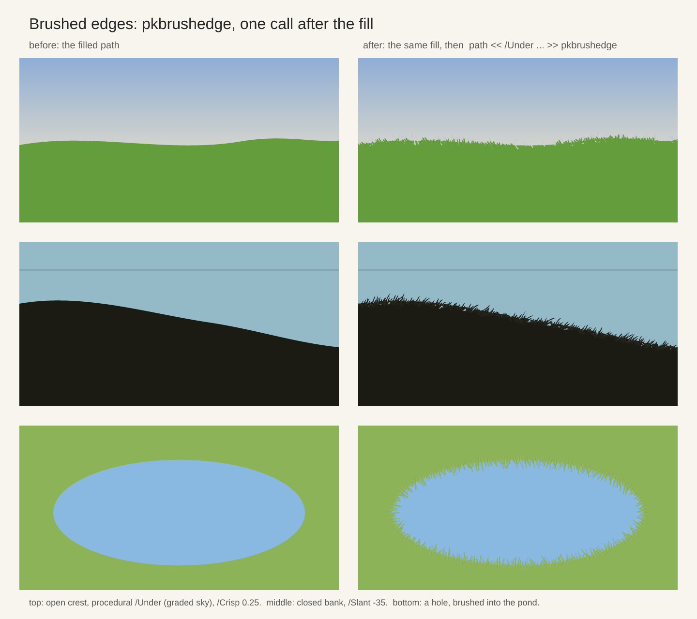
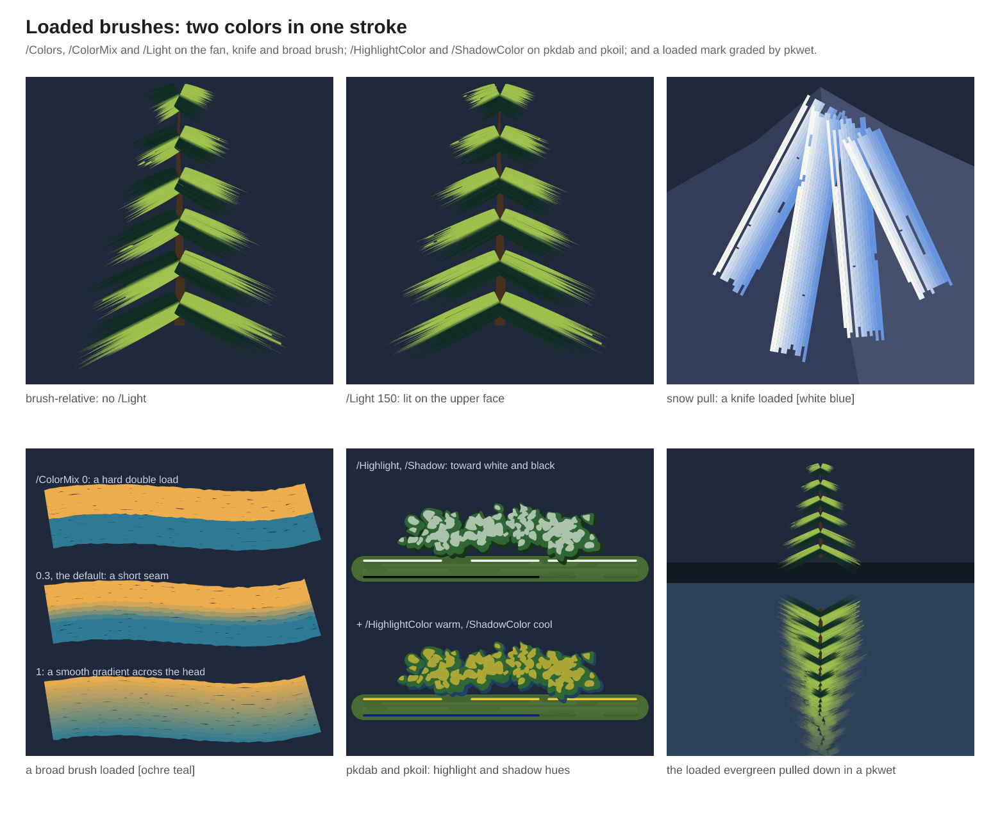
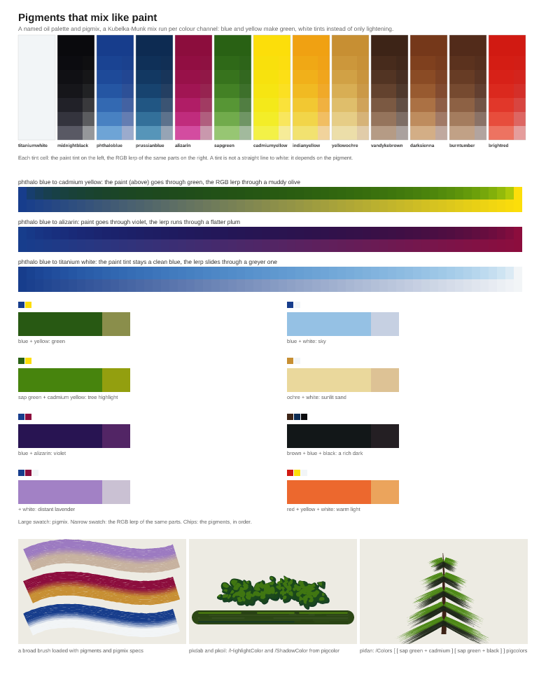
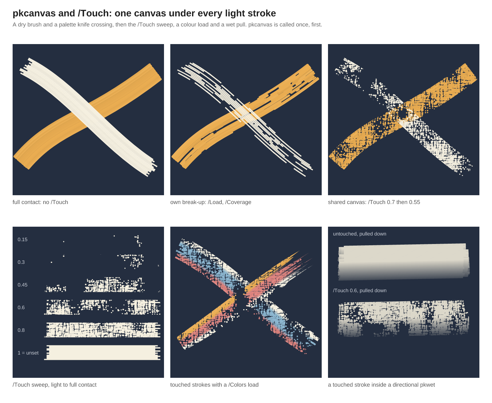
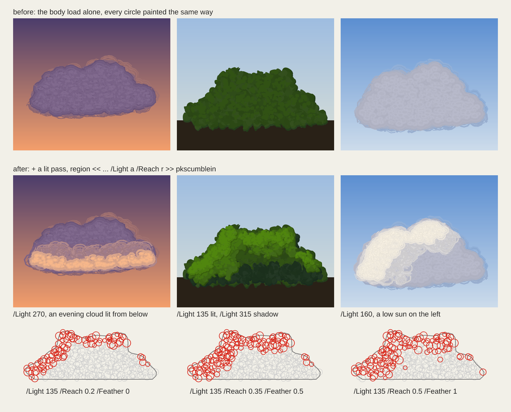

# Painting: variable-width brushes, wash and watercolor

`lib/paintkit.ps` is a set of painterly brushes. Every brush takes the **current
path** as its guide (the centreline, or the area, or the spine of a cluster) and
an options dictionary, and paints with the **current colour**, so the pattern is
always: set a colour, build a path, call a brush with its options. It builds on
[artkit](artkit.md) (load artkit first). Everything is deterministic under
`srand`.

## A first stroke

```postscript
(lib/artkit.ps) run
(lib/paintkit.ps) run
newpath 40 40 moveto 60 120 260 120 280 40 curveto
<< /Width 24 /Pressure { pktaper } >> pkribbon showpage
```

That draws a ribbon whose width follows a pressure curve along the path. The
sections below go through the other brushes, then the surface and medium tools.
For a watercolor, lay the paper first and paint a translucent wash over it
(`pkwash`, covered at the end):

```postscript
0 0 612 792 << /Grain 0.6 >> pkpaper            % the paper first
0.2 0.35 0.7 setrgbcolor
newpath 300 500 120 0 360 arc closepath
<< /Alpha 0.3 /Layers 3 /Wet 8 /Bloom 0.6 >> pkwash   % then the wash
```

## Variable-width ribbons: pkribbon

`pkribbon` treats the current path as a
centerline and fills a variable-width ribbon along it, built on
artkit's `walkpath` centerline sampler (see the [artkit guide](artkit.md)). One dict-driven
entry point -- base width, a `{t -> mult}` pressure profile over
normalized path progress (three presets ship: constant, linear taper,
and a non-linear bell curve), start/end taper, round/flat/pointed
caps, and seeded edge jitter -- with color left to the caller, same as
any other artkit shape helper. Multiple subpaths each become their own
ribbon; closed subpaths fill as two concentric loops with no caps;
degenerate paths fall back to a dot or a no-op rather than erroring.
`examples/paintkit_demo.ps` is a specimen sheet of all three
centerline shapes, all three pressure profiles, all three cap styles,
and jitter.

## Calligraphy nib: pknib

`pknib` is an angled-nib calligraphy preset
built on `pkribbon`: mark width tracks the angle between local path
direction and a fixed `/Angle`, widest perpendicular to the nib and
narrowing toward a `/MinWidth` floor parallel to it, composing with
`pkribbon`'s own pressure/taper/jitter. It requires a single open
subpath (one call per stroke). `examples/paintkit_nib_demo.ps` shows
the same path at several nib angles, corners, a direction reversal,
broad-edge lettering strokes, and a flourish.

## Dry brush: pkdry

`pkdry` is a
dry-bristle brush, also built on `pkribbon`: a bounded family of thin
offset bristles scattered across the centerline, each broken into
ink/no-ink runs by a seeded two-state Markov chain (`/Load` the
resume-contact rate, `/Dropout` the lose-contact rate, both expressed
per one `/Width` of travel so the same numbers read as the same
dryness regardless of `/Pitch`) -- ranging from a mostly loaded stroke
to visibly broken dry-brush texture with no raster work, every dash
its own small `pkribbon` call. `/Bristles` is hard-capped at 1..100,
and bristle count times raw sample count is checked against a fixed
deposit budget before any drawing starts, the two safety limits
against an accidentally unbounded render. `examples/paintkit_dry_demo.ps`
shows loaded/medium-dry/very-dry presets, bristle count/spread/width-
jitter variation, small per-bristle color variation, and a flourish.

## Spray paint: pkspray

`pkspray` is a spray-paint brush -- the one preset not
built on `pkribbon`, since spray is discrete particle deposition rather
than an offset band: seeded opaque particles scattered around each
sampled centerline stop under a radial falloff (three discrete levels,
min-of-m-uniforms draws, no pow/exp), an optional overspray mist
escaping past the nozzle edge, per-particle size variation, and
optional trigger-dwell bursts pooling particles at each subpath's
ends. Total deposits track arc length (about `/Density` per
nozzle-diameter of travel) regardless of `/Pitch`, and are bounded by
a deposit-budget safety limit checked during the counting pass, before
any drawing. Stencils need no library support: particles are plain
fills, so any active clip (`charpath` + `clip` included) masks them.
`examples/paintkit_spray_demo.ps` shows the same cloud at `/Speck` 3
(coarse bar) and `/Speck` 1.2 (fused vapour), a clean pass, a wide aerosol
pass, heavy overspray, the falloff levels, a word sprayed through a
charpath stencil, a star sprayed through an arbitrary-path stencil,
and a tag mark with bursts pooled at both ends.

## Palette knife: pktrowel

`pktrowel` is the trowel / palette knife, and the one
preset in paintkit that is deliberately **not** built on `pkribbon`.
Every other preset here offsets a band around the path *normal*, which
is what a tuft of bristles does; a palette knife holds its own angle
independently of where it is going, so the deposit has to be swept
along the *blade* direction instead — geometry `pkribbon` structurally
can't express. The blade is divided into `/Lanes` bands across its
length, each running its own contact chain, and each run of contact is
filled as one strip. It lays **no solid base pass** — `pkoil` starts
with a full-width ribbon and puts ridges on top of it, whereas a trowel
deposits broken masses straight onto whatever is underneath, which is
what makes the underlayer keep reading through however many strokes go
over it.

The four controls that all sound like "less paint" are separated onto
genuinely different axes: `/Cover` (formerly `/Load`, still
accepted as a deprecated alias) scales the deposit's *width* (a
nearly empty blade lays a narrow band), `/Coverage` is the contact
chain's steady state — holes *within* that width — `/Viscosity` is its
*rate*, trading many short chattering runs for few long chunky ones,
and `/Scrape` is static lengthwise thinning that narrows every lane and
kills some outright, the bare tracks a nicked blade leaves. `/Angle`
rakes the blade (footprint thickness goes as its cosine, so the guard
stops at ±80° rather than a silently blank 90°), `/Drag` smears each
run past where the blade lifted, and `/EdgeBuildup` piles the darker
ridges a blade leaves at its two ends. Deterministic under the caller's
own `srand`, with the random draws structurally fixed per lane and stop
so turning one control doesn't re-roll another's texture; bounded by
`Lanes * stops` against the same budget `pkoil` uses.
`examples/paintkit_trowel_demo.ps` is the specimen sheet — including
the same path set twice, once in `pktrowel` and once in `pkoil`, for
the contrast.

### Laying a plane: pktrowelplane

`pktrowelplane` is the palette knife's other job: laying a
*plane*, an area of a mountain face or a rock covered with overlapping blade
pulls so it reads as one flat facet that carries the blade's texture. The
current path is the area; `pktrowelplane` runs `pktrowel` along parallel
rows across it, in `/Direction` degrees, with every `pktrowel` key passed
straight through (`/Width`, `/Angle`, `/Coverage`, `/Scrape`, `/EdgeBuildup`,
`/Colors`, `/Light`, `/Touch`, ...). The edge is crisp because the path is the
clip, not because of the blade's geometry; each row overruns the area so the
blade's trim, drag and skew fall outside it. Rows are `Width * cos(Angle) *
(0.35 + 0.65 * Cover) * (1 - Overlap)` apart, and `/Overlap` unset follows
`/Coverage` (a patchier blade overlaps more); a tapering `/Pressure` narrows
the band, so the rows are spaced for the thinnest it gets inside the area
(read at 17 points, capped at 1, floored at 0.25) and a taper leaves no gaps
between rows; `/RowJitter` and `/AngleJitter`
keep the rows from being machine-parallel. Above about `/Overlap 0.5` the rows
also cover each other's `/Scrape` nicks. Deterministic under the caller's own
`srand`, at most 4000 rows, the path left as the caller had it. It works
under any CTM and in Ghostscript. `examples/paintkit_plane_demo.ps`
(`docs/paintkit_plane_demo.png`) builds a mountain from planes in pigment
colours and sets out the direction and overlap.

## Brushed edges: pkbrushedge

`pkbrushedge` brushes the edge of a filled mass. A meadow, a
bank or a pond starts as a filled path, and a filled path has a ruled vector
edge that paint never has; `pkbrushedge` feathers it the way a painter does,
with short strokes dragged across the boundary: the current colour (the
mass's) pulled out over what is behind it, and the colour behind (`/Under`:
a colour, a pigment name, or a procedure `x y -> r g b` for a graded sky)
cut back in, sparser, so the two interlock. The current path is the edge.
A subpath closed with `closepath` is a mass outline, and the mass itself
(the path filled nonzero, as `fill` would) decides which side is out, so a
hole is brushed into the hole and a mirrored reflection needs nothing
special; an open subpath is a bare crest whose out side is `/Outward`
(default up). `/Slant` tilts the strokes, `/Crisp` leaves stretches of the
edge untouched (lost and found edges), `/Brush` picks the brush (a small
pkbroad that runs dry by default). The strokes come from `pkfeather`, a
brush motion in the family above that paints nothing, for anyone who wants
to pair it with another preset by hand. The caller's path and graphics state
survive; it works in Ghostscript. A mass built from several overlapping closed
blobs (a cloud bank, a bush of ellipses) goes in as one path: an edge lying
inside the others is hidden, so it is not brushed.
`examples/paintkit_brushedge_demo.ps`
(`docs/paintkit_brushedge_demo.png`) shows each case before and after.



## Fan brush: pkfan

`pkfan` is the fan brush: foliage, evergreen branches,
grasses, cloud feathering, soft texture. Its nearest relative is
`pkdry`, and exactly one term separates them. `pkdry` holds each bristle
at a *fixed* lateral offset, so its bristles run as parallel tracks; a
fan brush's bristles leave a flattened ferrule and **splay** apart as
the stroke travels, so each bristle's offset opens along the path. At
`/Splay 0` `pkfan` reproduces parallel bristles exactly — the specimen
sets the two side by side to make that the visible point.

The opening has a floor: `/Splay 1` narrows the ferrule to a quarter of
the tip's spread and never further, because real ferrules are flat and wide.
Without a floor every bristle coincides near the start, turning the stroke's
first third into one opaque blob with a fan glued to the end. The splay eases
open as `t^0.6`, which reads as bristles springing apart rather than a smeared
wedge.

The two mark families fall out of the same seeded contact chain `pkdry`
uses: many fine bristles at high `/Load` give the soft feathered mark,
few bristles at low `/Load` and high `/Dropout` give separated bristle
marks. `/Ragged` varies each bristle's length so the tips feather —
without it they all stop on one straight edge and the mark reads as a
comb — and `/Flick` tapers toward the tip, applied only to the run that
actually reaches it, so a bristle broken into four dashes doesn't become
four tapered commas. A single-point subpath is a *pressed* fan radiating
about the point, which is what makes foliage clusters;
`examples/paintkit_fan_demo.ps` builds conifer limbs, a grass bank and
shrub clusters out of exactly that.

## Broad flat brush: pkbroad

`pkbroad` is the broad flat brush — the block-in tool for
sky and water bands, reflections and broad masses. Three presets here
already make a wide mark, so what earns it a place is that a brush
**runs out**: a loaded flat brush lays solid colour where it touches
down and goes progressively drier as it travels. `pkribbon` is a
geometric band with no tool character, `pknib` is a pen whose width
follows a fixed world angle, and `pktrowel` is a blade carrying a smear
rather than a reservoir (depletion is deliberately left out of it).

The band is divided into `/Grain` striations, each given a fixed
affinity for the surface, and the charge falls along the stroke as
`Charge * (1 - Depletion*t)`. A striation deposits while the charge
stays above its own affinity, so striations drop out one by one and the
band thins from solid to broken *along its own direction* — streaks,
not speckle. `/Depletion 0` turns the fade off for an even block-in; a
low `/Charge` skips from the start, the mark of a barely loaded brush.
Each striation's end tapers away when it runs out but keeps the brush's
square end when the stroke simply stops.

The controls are called `/Charge` and `/Depletion` rather than `/Load`
on purpose: `/Load` in paintkit is a contact rate per `/Width` of
travel (`pkdry`/`pkfan`/`pkoil`), and a paint reservoir draining along
the stroke is a different quantity. `/Angle` follows `pktrowel`'s reading —
brush rotation relative to travel, constant along a curve — not
`pknib`'s fixed world angle.

## Loading more than one colour

`pkbroad`, `pktrowel` and `pkfan` can carry more than one colour.
`/Colors [[r g b] ...]` lists 1 to 8 loaded colours from the brush's left
edge, looking along the travel, to its right; `/ColorMix` (0 for hard bands,
1 for a smooth gradient) blends neighbours; and `/Light` (degrees, as in
`pkdab`) puts the first colour on whichever side of each subpath faces the
light, so a stroke drawn backwards keeps its lit side. `pktrowel`'s
`/EdgeBuildup` ridges take their own edges' colours. `pkfan` takes the same
keys: the colours run across its bristles, first colour on the
left of the travel, and a pressed fan paints them across its arc. `/Colors`
replaces the current colour, but `/ColorJitter` still varies it, and unset
keys change nothing.

`pkdab` takes `/Colors` and `/ColorMix` too, but with no head to
load across, each dab takes one colour from the load, at the position its
existing outline-phase draw gives it: `[dark dark dark yellow]` is a mostly
dark mass with a few yellow dabs, and `/ColorMix 0` makes every dab one colour
outright. It takes no new random draw, so `/Colors` recolours a clump without
moving a dab. `/HighlightColor` and `/ShadowColor` on `pkdab` and `pkoil` are
the colours the lit and shaded layers mix toward instead of white and black
(`/Highlight` and `/Shadow` still say how far), so a sunlit bush can have
yellow-green highlights and blue shadows. All three are graded by an enclosing
`pkwet`.

`examples/paintkit_loading_demo.ps` is the specimen for multi-colour loads: the same loaded evergreen brush-relative and then with `/Light 150`
(the first colour moves from the underside of the left branches to the upper
face of every one), a knife pull loaded white and blue, a broad brush loaded
ochre and teal at `/ColorMix` 0, 0.3 and 1, a bush and bank lip with and
without a warm `/HighlightColor` and cool `/ShadowColor`, and the loaded
evergreen's reflection pulled down by a directional `pkwet`. Draw a branch as a
real stroke out from the trunk when you want `/Light` to flip it: a chord
shorter than `/Pitch` (a pressed fan, a dab) is never flipped.



## Pigments

Pigments give a brush a palette that mixes like paint instead
of like a lerp. `Pigments` is a named oil palette of thirteen colours
(`PigmentNames` lists them in tube order: `titaniumwhite`, `midnightblack`,
`phthaloblue`, `prussianblue`, `alizarin`, `sapgreen`, `cadmiumyellow`,
`indianyellow`, `yellowochre`, `vandykebrown`, `darksienna`, `burntumber`,
`brightred`), and `pigmix` takes name-and-weight pairs and returns `r g b` like
`mix3`:

```postscript
[ /phthaloblue 1 /cadmiumyellow 1 ] pigmix setrgbcolor   % green, not grey
[ /phthaloblue 1 /alizarin 1 ] pigmix setrgbcolor        % violet
[ /phthaloblue 1 /alizarin 1 /titaniumwhite 6 ] pigmix setrgbcolor  % lavender
/phthaloblue 0.25 pigtint setrgbcolor                    % 1 part white to 3
/sapgreen 0.1 pigshade setrgbcolor                       % a little black
```

Weights are parts, so `[ /a 3 /b 1 ]` and `[ /a 30 /b 10 ]` are the same
paint, and an entry may be a literal `[r g b]` array for any colour that is not
a pigment. The model is Kubelka-Munk's two-constant theory, run per r/g/b
channel (absorption over scatter, added by weight, then converted back to a
reflectance), with each pigment's tinting strength as its weight: a few
multiplies and three square roots per mix. Its limits are documented in
`lib/paintkit.ps` ("Pigments"): three bands, not a spectrum, so complements go
to a very dark neutral; mixed in encoded rather than linear rgb; a pot of paint,
not a glaze.

The presets take pigments through the colour keys they already have. A bare
pigment name works in `/Colors`, `/HighlightColor` and `/ShadowColor` as it
stands; `pigcolor` turns a pigment name or a `pigmix` spec into the `[r g b]`
those keys want, and `pigcolors` does a whole `/Colors` list that includes
specs (a spec written straight into a colour key is refused with a guard that
says to wrap it in `pigcolors`):

```postscript
<< /Colors [ /sapgreen /cadmiumyellow ] >> pkfan
<< /Colors [ /sapgreen [ /sapgreen 1 /cadmiumyellow 1 ] ] pigcolors >> pkfan
<< /HighlightColor /titaniumwhite /ShadowColor /prussianblue >> pkdab
<< /HighlightColor [ /cadmiumyellow 2 /sapgreen 1 ] pigcolor
   /ShadowColor /prussianblue pigcolor >> pkdab
```

`examples/paintkit_pigment_demo.ps` is the specimen: every pigment with six
tints beside the RGB lerp of the same recipe, three ramps (blue to yellow,
blue to alizarin, blue to white), eight classic landscape mixes, and the
palette driving a loaded broad brush, a bush and a fan-brush evergreen.



## Liner and detail brush: pkliner

`pkliner` is the liner/detail brush — the fine marks made
last and over everything else: bare branches, trunks, grass stems,
rigging, shoreline accents. A liner is the complement of
`pknib`, and that difference *is* the design: `pknib` is a rigid nib
whose width follows a fixed world angle, while a liner is a long soft
tip that holds far more paint than its width suggests. So the line
wanders off the centerline it was drawn from, whips from full width to a
point, and breaks into shortening dashes as the paint runs out.

The wander is the part nothing else in paintkit does. Every other preset
varies width or coverage *around* the path the caller drew — `pkribbon`'s
`/Jitter` roughens the ribbon's own edges, `pkdry`'s bristles ride at
fixed parallel offsets — but none of them leaves it. At 2pt the
centerline *is* the mark, which is the whole difference between a
painted branch and a ruled one.

Its two fades are deliberately independent: `/Taper` is the artist's
lift and changes width only; `/Charge` and `/Depletion` are the paint and
change coverage only. Coupling them would be defensible physically and
would make them inseparable in the artist's hands. The break-up comes
from a seeded surface "tooth" sampled at *absolute* spacing rather than
per-stroke, so a 300pt trunk and a 20pt twig don't come out
self-similar. Because that pool is fixed and emission draws nothing,
`pkliner` is the only seeded preset here that can promise a constant
number of random draws per subpath: retuning it re-shapes its own mark
instead of re-rolling everything drawn after it. A single-point subpath
presses a detail dot — one dab per `moveto`, and unlike `pkbroad`'s
pressed footprint it lands regardless of the tooth, because a pressed
tip makes contact by pressure.
## Foliage dabs: pkdab

`pkdab` is the foliage brush: clustered, irregular dabs for
bushes, leafy masses and vegetation texture. It is a pounce, not a drag,
so the current path is a *spine* — every stop seeds a cluster of blobby
dabs within `/Scatter` points (formerly `/Spread`, still accepted as a
deprecated alias) — and a single-point subpath is a standalone clump.
Density is per `/Size` of travel with a per-subpath accumulator (the
`pkspray` design), so `/Pitch` doesn't change coverage. Each dab is
generated once and painted in up to three layers from the same geometry:
a darker underlayer nudged away from `/Light`, the body in the current
colour, and smaller lighter dabs on the lit side. Re-deriving positions
per layer would scatter highlights off the mass they are meant to light.
`/Light` is a fixed user-space angle, like `pknib`'s `/Angle`, because
foliage is lit by the sun, not by the stroke direction. Every dab slot
draws a fixed 13 values whether or not it lands, so `/Charge`, `/Shadow`,
`/Highlight`, `/Light` and `/ColorJitter` re-shape the mark without
re-rolling it. Closed paths are not filled (no portable in-fill test); a
mass is built by pouncing along a spine through it.
`examples/paintkit_dab_demo.ps` is the specimen.

## Wet-on-wet softening: pkwet

`pkwet` is the wet-on-wet softener, and the only entry
point in paintkit that draws no mark of its own. It takes the caller's
*mark-drawing procedure* and re-runs it, each pass displaced a little
further from the true path and mixed a little further toward `/Under` —
the color the artist declares is already on the canvas there — so the
mark's core stays solid while its edge grades away into the layer
beneath:

```postscript
{ newpath 40 400 moveto 200 430 380 390 560 420 curveto
  << /Nozzle 22 /Density 70 >> pkspray }
<< /Soft 0.8 /Under [0.62 0.72 0.86] >> pkwet
```

Being a wrapper rather than a `/Wet` key bolted onto each preset means
one implementation serves every stroke family in paintkit. `/Soft` is the only knob that matters — it supplies `/Layers`
and `/Offset`, how far in points the outermost pass is displaced (formerly
`/Spread`, still accepted as a deprecated alias) — and
at `/Soft 0` it marks the page exactly as calling the
procedure directly would, random stream included. Every pass runs inside
its own `gsave` and its own `stopped`, both of which the multi-pass case
needs, so a path or graphics state the procedure leaves *behind* does not
survive the call, and a `stopped` context is an `exit` boundary.

There is deliberately **no alpha** in it. The obvious implementation is
a translucent pass, but alpha applies to every fill the wrapped procedure
makes, so `pkoil`'s ridges and `pktrowel`'s 18% seam-closing lane overlap would
composite against *themselves*, blotching the first and putting a dark
stripe at every lane boundary of the second. Grading opaque passes avoids that
and, as a bonus, needs nothing Ghostscript lacks, so `pkwet` has no
reduced-fidelity fallback path the way `pkwash` does.

Pickup is *declared*, not sampled: reading color back off the canvas
needs a pixel-sample operator PostScript doesn't have, and
the artist knows what they just laid down anyway. Pair `pkwet` with a
broken or particulate brush — `pkspray`, `pkdry`, `pktrowel` at low
`/Coverage`. A solid brush keeps its own hard silhouette and merely
gains a halo; `examples/paintkit_wet_demo.ps` shows that comparison
side by side, along with a sky, clouds and two banks of mist. A
low-`/Coverage` mark is full of gaps, so mist laid on with one lets a
treeline read straight through it without any translucency at all.

With `/Direction` the same wrapper does the *directional*
wet-on-wet blends: the passes line up along one axis instead of
scattering round the mark, each a fixed step further along it with a
seeded wobble `/Stretch` times narrower across it. `/OneSided true`
keeps them all on one side, so `/Direction 270` drags a reflection down
the way a dry brush does, and `/Direction 90` lifts a mountain's foot
into haze; two-sided, `/Direction 0` sweeps a sky across. No pixel
readback is needed: the wrapper already re-runs the mark, so it re-runs
it along a line.

```postscript
{ gsave 0 2 WL mul translate 1 -1 scale  reflected-range  grestore }
<< /Direction 270 /OneSided true /Offset 22 /Under [0.44 0.54 0.66] >> pkwet
```

The wrapped procedure has to paint in the color it inherits (grading
sets the color before each pass) or in loaded colors (`/Colors` on
`pkbroad` or `pktrowel`, which pkwet grades by the same mix), so a
scene is wrapped element by element, and `/Direction` is measured in the user space pkwet is called
in — keep a reflection's mirror inside the procedure. A directional
call defaults to enough layers to keep the passes within 2pt of each
other (up to 16), because identical copies further apart read as
stepped echoes, so with `/Layers` left to default, `/Offset` also sets
the depth and re-rolls what follows; pin `/Layers` while tuning. Any
nest with a directional call in it may multiply its innermost
procedure at most 64 times — enough to pull a reflection down and then
graze it across. `examples/paintkit_wet_pull_demo.ps` shows a
reflection sharp, pulled and pulled-then-grazed, a mountain foot under
plain wet mist and under a lift, and a sky before and after a sweep.

`/Under` may also be a procedure `x y -> r g b` for a backdrop
that changes across the mark: a cloud over a graded sky, mist over a range
that fades into it. With one colour the outer passes are right at one end and
leave a pale or dark rim at the other. Give `/At [x y]` (where the mark sits,
in the user space you call pkwet in) and each softening pass asks the
procedure for the backdrop at `/At` plus its own displacement:

```postscript
{ ... cloud ... }
<< /Soft 1 /Offset 34 /At [135 70] /Under { exch pop skyat } >> pkwet
```

The procedure runs inside pkwet's frame, so it must be a pure function: no
painting, no `pkwet`, no reliance on the operand stack, and exactly three
numbers in 0..1 out (anything else is a named error). The question is per
pass, not per pixel. A mark tall against the gradient wants it per band
: `/Box [x y w h]` and `/Bands [cols rows]` in place of `/At`
ask the procedure once per cell of a grid over the mark and paint each
softening pass once per cell, clipped to it, with the random stream replayed
so every cell lays the same marks. A literal `[r g b]` behaves exactly
as before. `examples/paintkit_wet_under_demo.ps` sets one cloud over a strong
sky gradient with a constant and a procedural `/Under`
(`docs/paintkit_wet_under_demo.png`);
`examples/paintkit_wet_bands_demo.ps` sets a tall plume over one, per pass
against per band (`docs/paintkit_wet_bands_demo.png`).

## Canvas surface: pkcanvas and /Touch

`pkcanvas` and `/Touch` give light strokes one canvas to
catch on. Every other "less paint" key in paintkit (`/Load`, `/Charge`,
`/Coverage`) models the tool, so two strokes that cross each break up on
their own. `opts pkcanvas` sets, once, a seeded weave of raised knuckles
(`/Seed` an integer, `/Weave` and `/Mottle` in canvas points, `/Relief` 0..1), and
`/Touch` (0..1) on `pktrowel`, `pkdry`, `pkfan`, `pkbroad` or `pkliner` lands
a mark only on the knuckles that pressure reaches: lower is lighter, 0
deposits nothing, 1 is full contact, identical to leaving it unset. Every
touched stroke catches on the same knuckles, so a dry brush and a knife
crossing share one weave:

```postscript
<< /Seed 7 /Weave 2.5 >> pkcanvas                 % once, first, before any translate
newpath 14 52 moveto 70 118 118 112 226 196 curveto
<< /Width 34 /Touch 0.7 >> pkdry                  % laid first, the heavier touch
newpath 18 206 moveto 90 172 150 84 224 40 curveto
<< /Width 32 /Touch 0.55 >> pktrowel              % the knife, on the same weave
```

Call `pkcanvas` before any `translate`, `scale` or `rotate` the piece
applies: the surface is defined in the space in force when it was set, and
a touched mark is clipped in that canvas space wherever it is painted
later. `/Touch` with no canvas is an error rather than a silent full mark (even
`/Touch 1`, which otherwise renders exactly as unset),
it takes no `rand` draws (so turning it on moves nothing painted after it),
and it composes with `/Colors` loads and with `pkwet`, inside which every
pass catches on the same knuckles. `examples/paintkit_canvas_demo.ps` shows
the crossing strokes full, on their own break-up and on the shared canvas,
a `/Touch` sweep, touched strokes with a `/Colors` load and a touched
stroke pulled down inside a directional `pkwet`.



## Brush motions

The presets above are brush *heads*; a painting is equally made of
brush *motions*, and the wet-on-wet vocabulary is mostly named ones.
Six path builders generate them, from a region or a guide
line plus a few artistic controls, and paint nothing: they leave an
ordinary path, so they feed any preset.

| Motion | Input | Builds | Classic brush |
|---|---|---|---|
| `pkcrisscross` | region | strokes at two crossing headings | `pkbroad` (sky) |
| `pkscumblein` | region | many small separate circles | `pkoil` (clouds) |
| `pkscumble` | the current path | a chain of overlapping loops | `pkdry` (a scrubbed edge) |
| `pktap` | the current path | short stabs along it | `pkfan`, or `/Length 0` for `pkdab` clumps |
| `pkpull` | the current path | strokes pulled from it along a direction (`/Scatter` starts them off the line, so a fall or grass is not a picket fence) | `pkbroad` down (reflection), `pkliner` up (grass) |
| `pkzigzag` | the current path | a zig-zag about it | `pkliner` (water) |

```postscript
0 0 700 160 screct << /Count 90 /Length 50 /Angle 25 >> pkcrisscross
<< /Width 30 /Charge 0.7 >> pkbroad                       % a sky block-in

newpath 0 300 moveto 800 300 lineto
<< /Direction -90 /Length 60 /Spacing 6 >> pkpull
<< /Width 5 /Charge 0.6 >> pkbroad                        % pulled down from a horizon
```

The region motions take an artkit region (`screct`, or `scpath` for any
shape) under their options dict; the line motions read the current path
as the guide, as `pkdab` does. Every motion *replaces* the current path,
so a guide, or the outline `scpath` leaves behind, is never painted. They
draw only from `frnd`, so they are deterministic under the caller's
`srand`, and each slot draws a fixed number of values, so changing
`/Length` or `/Angle` does not move where the strokes land. A region
motion lays a jittered grid sized from the region's area, so even
coverage is kept and `/Count` stays about right for a non-rectangular
region. `examples/paintkit_motion_demo.ps` shows each beside its brush.

### Light-aware massing

A scumbled mass painted in one load
is flat. Give `pkscumblein` a `/Light` (the direction the light comes
from, in degrees, as elsewhere in paintkit) and it keeps only the circles
on the side of the region that faces the light, in a band that follows
every lump of the outline: `/Reach` is how deep (a fraction of the
region's depth along the light, default 0.3) and `/Feather` grades its
inner border. Paint the body over the whole region, then the same region
again with `/Light` in a lighter load; the shadow side is the same call
with the light turned round. Unset, the motion is unchanged. With the same
seed the lit circles are a subset of the unlit ones.

```postscript
/bush { newpath 40 40 moveto 60 110 140 120 200 40 curveto closepath scpath } def
0.20 0.30 0.12 setrgbcolor                                % the body, over the whole bush
bush << /Count 200 /Radius 4 >> pkscumblein << /Size 5 /Scatter 6 >> pkdab
0.42 0.52 0.18 setrgbcolor                                % its lit side, upper left
bush << /Count 300 /Radius 3 /Light 135 /Reach 0.3 >> pkscumblein
<< /Size 4 /Scatter 5 >> pkdab
```



## Putting it together: landscapes

All of these come together in the gallery piece *Alpine Lake*
(`gallery/alpine_lake.ps`), a full wet-on-wet landscape
painted from paintkit's brushes alone. It has a `pkcrisscross` sky
painted with `pkbroad`, `pkspray` clouds and mist under `pkwet`, and
`pktrowel` snow and `pktrowelplane` shadow planes on two ranges, the near one's foot
lifted into mist. A `pkdab`-crested forest sits on the far shore, with
`pkfan` evergreens, a pulled-down reflection and `pkliner` details.
The reflection is not a second drawing: every scene element seeds its
own randomness and logs it as it paints, so the lake replays the same
marks under `1 -1 scale`, one single-colour part at a time, each
pulled down with directional `pkwet`.

How to paint each element of a landscape with these tools is written up as
a cookbook, [the landscape cookbook](landscape-cookbook.md):
eleven short recipes (sky, clouds, mountains, mist, far forest,
evergreens, bushes, water, reflections, foreground bank, grass), each with the
tools, the order, the settings that matter, the usual failure with its fix, a
complete snippet and a rendered thumbnail. `tests/landscape_cookbook.rs` runs
every snippet, so they keep rendering.

*Evening Stream* (`gallery/evening_stream.ps`) is the second
landscape, painted with the multi-colour loads and the canvas surface on one shared `pkcanvas`: a
sunset sky from a broad brush loaded with two neighbouring sky colours,
clouds scrubbed in with `pkscumblein` and lit from below, a backlit wood
whose reflection is pulled down whole by one directional `pkwet` (it
paints only in loaded colours, which `pkwet` grades), autumn trees on a
loaded `pkdab` with warm highlight and cool shadow hues, evergreens on a
fan loaded dark and lit with `/Light`, a `pkpull` fall, and
`pkzigzag` light lines that catch on the canvas weave, and `pkbrushedge`
on the stream banks, the far shore and the near banks, so no big mass has a
ruled edge (issue #382).

## Watercolor: pkwash and pkpaper

`pkwash` is the watercolor medium, and the one preset in paintkit
that needs something from the interpreter rather than only from
PostScript: it fills the current path as a *translucent* wash. Two new
operators back it — `setalpha`/`currentalpha` and `setblendmode`/
`currentblendmode` (`/Normal` or `/Multiply`), pscat extensions rather
than PLRM operators, living on the graphics state so `gsave`/`grestore`
snapshot them like any other paint attribute, and exported by `--svg`
(`fill-opacity`/`stroke-opacity`, `mix-blend-mode`) and `--pdf` (an
`ExtGState`'s `ca`/`CA`/`BM`) as well as `--png`. They reach fills,
strokes, text and `shfill`; they do **not** reach `image`/`imagemask`,
which blit their own samples. The wash itself is still pure vector
geometry: `/Layers` translucent passes, each with its own boundary
wobbled off the given path by `/Wet` (a harmonic ladder at integer
multiples of path progress, so a closed boundary joins seamlessly),
`/Bloom` edge pooling drawn as a stroke clipped to the wash so it
can't leak outside, and optional `/Grain` granulation — no diffusion
solver anywhere. `/Blend /Multiply` makes wash order commute, which
plain source-over does not. `pkpaper` lays the ground it sits on: tone
plus seeded grain and fibers. Both are deterministic under `/Seed`, or
under the caller's own `srand` without one.

This is also a part of pscat that does **not** render the
same way under plain `gs file.ps`: Ghostscript has no
PostScript-callable alpha operator at all. Rather than error there,
`pkwash`/`pkpaper` probe for `setalpha` at load and fall back to
painting each mark in its flattened-over-white equivalent — legible,
but overlaps stop mixing. Verified alpha output goes through `--pdf`
instead, which gs's own PDF interpreter renders correctly.
`docs/WATERCOLOR.md` is the decision record behind all of it (the
architecture study), `examples/paintkit_wash_demo.ps` is the
specimen sheet, and the gallery's First Rain is the piece.
