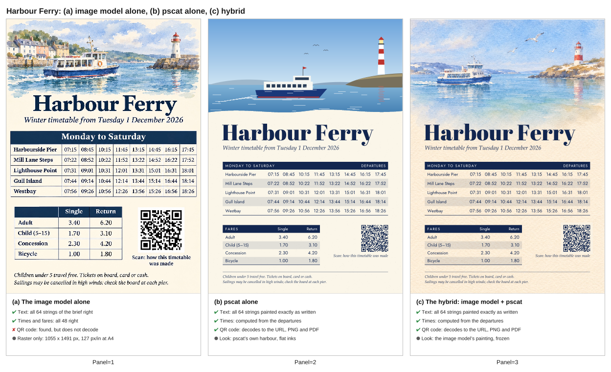
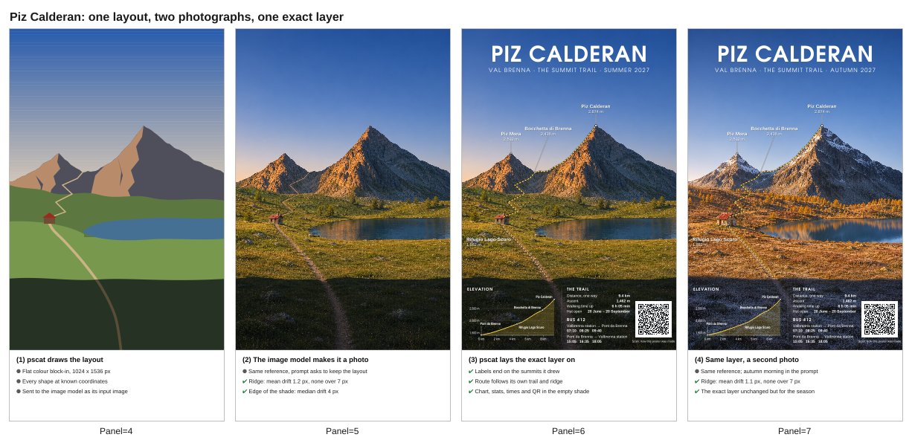
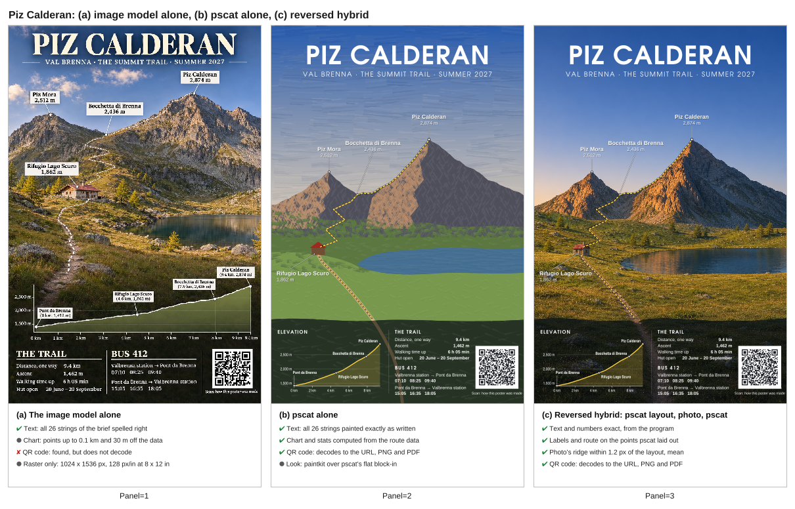

# pscat with an image model

An image model is good at light, texture and painterly mood. pscat is good at
the things that must be exactly right: words, numbers, a chart, a formula, a
QR code that scans, a layout that prints at size. Used together, each does its
own part:

- **The image model paints the atmosphere layer**: a background, a texture, an
  illustration, with nothing exact in it. You generate it once and **freeze
  it**: save the file and keep it with the program.
- **pscat sets the exact layer on top**: type, a QR code, a chart or formula,
  the frame, and the print-ready PDF.

All the iteration then happens in the pscat layer. Moving the title, fixing a
price or changing the date is an edit to a program and a re-render, and the
painting does not change, because nobody asks the image model for it again.

[When to use pscat](when-to-use-pscat.md) covers the choice between pscat, an
image model and an LLM on its own. This guide is the "use both" case, with two
worked examples and a fair comparison.

## Two worked examples

Both are in [`examples/hybrid/`](../../examples/hybrid/README.md), with their
backgrounds, the exact prompts and the commands. Render from the repository
root:

```sh
pscat --page 595x842 --pdf sky_talk.pdf examples/hybrid/sky_talk.ps     # A4
pscat --page 612x792 --pdf menu_card.pdf examples/hybrid/menu_card.ps   # US Letter
```

- **Why Is the Sky Blue?** ([`sky_talk.ps`](../../examples/hybrid/sky_talk.ps)),
  an A4 poster for a public talk. An oil-painted evening sky from the image
  model; on top, pscat's title and details, the Rayleigh formula, a bar chart
  whose bars and labels the program computes from that formula, and a QR code.
- **The Lantern Pear** ([`menu_card.ps`](../../examples/hybrid/menu_card.ps)),
  a US Letter café menu. A watercolour of pears from the image model; on top,
  pscat's name, sections, every dish and price, and a QR code.

The talk, the café and their details are invented. Both QR codes point at this
guide's page on the site.

## The comparison

For each example the image model was also asked for the **whole poster**: the
same brief, every line of text, the chart or the prices, and "a scannable QR
code that encodes exactly" the same URL. Each sheet shows (a) that image, (b)
the poster pscat makes alone, with art it draws itself (a screen-printed
vector sky; a flat-ink botanical print), and (c) the hybrid. Under each panel are only facts that were checked.


| | (a) Image model alone | (b) pscat alone | (c) Hybrid |
|---|---|---|---|
| **Text** (poster: 20 strings; menu: 24) | All spelled right, on both | All exact, on both | All exact, on both |
| **Numbers** | Chart labels right, bar heights within 2% of the data; all 9 prices right | Computed by the program, or typed in it | Same as (b) |
| **QR code** | Found by both decoders, **decodes in neither**, on both | Decodes to the URL in both decoders, PNG and PDF | Same as (b) |
| **Output** | One raster: 1055 x 1491 px (poster), 1103 x 1426 px (menu), about 127-130 px per inch at print size | Vector type, chart and QR code at any size | Vector exact layer over the painting, which is embedded at its own resolution |
| **The look** | The image model's, layout included | pscat's own vector art, with pscat's layout | The image model's painting, with pscat's layout |

How each fact was checked:

- **QR codes.** Two independent decoders, rqrr (a port of quirc) and rxing (a
  port of ZXing), the same ones the QR library's tests use. For (b) and (c)
  they read the URL exactly from pscat's PNG and from its PDF, rasterized by
  hayro, an independent PDF renderer. For (a) both find the symbol, but rqrr's
  error correction fails on it and rxing's checksum does: the pattern looks
  like a QR code and does not encode the URL, or anything else.
  `tests/hybrid.rs` checks all of this on every build.
- **Text.** For (b) and (c), the test captures every string the program paints
  and compares it with the brief, string by string. For (a), the image was
  read at full size against the brief. Every string in both images is right:
  the title, the date with its middle dot, "Gruyère" with its accent, the en
  dashes in "8–11" and "12–3".
- **Numbers.** (a)'s chart labels are right. Its bars, measured in pixels
  from the axis and scaled so the 400 nm bar reads 9.4, read 5.91, 3.80,
  2.61, 1.87 and 1.02 against 5.9, 3.8, 2.6, 1.9 and 1.0: within 2%. One
  pixel is about 3% of the shortest bar, so that is as close as a picture
  of a chart can be measured. Its nine prices are right.

Each whole-poster image is the image model's first and only attempt, with no
retries and no picking; the [examples README](../../examples/hybrid/README.md)
says how they were made.

### What this shows

Every word and number in both of the image model's posters is right. The
[repeat test](#is-it-right-every-time-a-repeat-test) below ran both briefs
six more times each, and every word and number was right in all 12 runs. Its QR codes are
where it failed, in both attempts here and in every repeat: both decoders locate a symbol
and neither can read it. The pattern looks like a QR code, but its error
correction does not check out.

So the hybrid is worth it here for what the image model cannot do, and for
what happens after the first draft:

- **A QR code that scans**, every time, because it is encoded, not drawn.
- **Numbers that come from the data.** The chart's bars are computed from the
  formula in the program. The model's bars were close, but close is all a
  picture of a chart can promise.
- **Changes without regeneration.** Ask the image model to change one price
  and it paints a new menu, which needs proofreading again from top to
  bottom. In the hybrid, a price is one edit; nothing else on the page can
  move or change.
- **Print output.** The type, the chart and the QR code are vectors in the
  PDF, sharp at A4 or poster size. The image model's poster is one raster at
  about 127 pixels per inch at A4, text included.
- **The same render again.** The program and the frozen background give the
  same pixels on every run.

And the layout is pscat's in (b) and (c): a stated grid, a display face for
the title, the formula set as a real fraction, a chart as large as the
type around it, and the menu's prices right-aligned on one column with dot
leaders. The image model's two whole-poster images set every line in one
serif family.

Where the hybrid beats pscat alone is the painting. pscat's own art (a
screen-printed sky, a botanical print) is deliberate and clean, but an image
model's painted light is richer, and costs one prompt.

## Is it right every time? A repeat test

One correct image is one sample. An image model is sampled, so we ran the
same whole-poster and whole-menu instructions again, six times each, and
checked every result the same way. The model was OpenAI's image model through
the Codex CLI 0.166 `image_generation` tool, on 2026-11-05. The instructions
were the ones above, with one sentence added at the end: "Do not check, edit
or post-process the image after generating it." That stopped Codex from
patching its own QR code, as it began to in #995. Codex rewrites
each instruction into its own prompt for the image tool, so the prompt that
reached the tool differed from run to run. Every one is recorded verbatim in
the [examples README](../../examples/hybrid/README.md#the-repeat-runs-2026-11-05).
Each saved image is byte-identical to the tool's original output.

| Run | Text errors | Number errors | QR: rqrr | QR: rxing | Largest bar-height error |
|---|---|---|---|---|---|
| Poster 1 (of 20 strings, 6 values) | 0 | 0 | found, error correction fails | checksum fails | 15% (bars 450–700 nm too tall) |
| Poster 2 (of 20 strings, 6 values) | 0 | 0 | found, error correction fails | nothing found | 5% |
| Poster 3 (of 20 strings, 6 values) | 0 | 0 | found, error correction fails | checksum fails | 8% (the 700 nm bar, about 2.5 px) |
| Poster 4 (of 20 strings, 6 values) | 0 | 0 | found, error correction fails | checksum fails | 1% |
| Poster 5 (of 20 strings, 6 values) | 0 | 0 | found, error correction fails | checksum fails | 2% |
| Poster 6 (of 20 strings, 6 values) | 0 | 0 | found, error correction fails | checksum fails | 3% |
| Menu 1 (of 24 strings, 9 prices) | 0 | 0 | found, error correction fails | checksum fails | |
| Menu 2 (of 24 strings, 9 prices) | 0 | 0 | found, error correction fails | checksum fails | |
| Menu 3 (of 24 strings, 9 prices) | 0 | 0 | found, error correction fails | checksum fails | |
| Menu 4 (of 24 strings, 9 prices) | 0 | 0 | found, error correction fails | checksum fails | |
| Menu 5 (of 24 strings, 9 prices) | 0 | 0 | found, error correction fails | checksum fails | |
| Menu 6 (of 24 strings, 9 prices) | 0 | 0 | found, error correction fails | checksum fails | |

In sum: 0 text and 0 number errors in all 12 runs, and 0 of 12 QR codes decode.

How it was checked:

- **Text and numbers.** Every string and number of the brief was read on a
  2x crop of the original image. That included every small glyph: the middle
  dots, the × signs, the en dashes in "8–11" and "12–3", which were measured
  against the digits, the accents in "Café" and "Gruyère", and the formula's
  ∝, λ and superscript 4. Nothing was wrong, missing or misplaced. Some runs
  set the formula as a stacked fraction or added y-axis tick numbers; neither
  is counted as an error.
- **Bar heights.** Each poster's bars were measured in pixels from the axis
  and scaled so that the 400 nm bar reads 9.4; the table gives each run's
  largest error. Four runs came within 5% of every value, one within 4% except
  its shortest bar, and run 1's 450 to 700 nm bars were 6 to 15% too tall (5.9
  read as 6.27, 1.0 as 1.15). One pixel is 3 to 4% of the shortest bar. The
  labels were right in every run; the bars are a picture of the numbers.
- **QR codes.** rqrr found a symbol in all 12 images and failed its error
  correction every time. rxing failed its checksum on 11 and found no code at
  all in poster run 2. Neither decoded any of them.

**Then one small edit.** We gave the image model the first poster run and
asked it to "change only the date line" to "Friday 4 December 2026 · 7:30 pm",
and gave it the first menu run with the instruction to change only the Flat
white price to 3.95. Both edits came back right, and every other string still
read correctly at full size (the edits were not proofread on 2x crops). But
the model redrew the whole image, not just the line we asked about. Outside
the edited line, 42% of the poster's pixels and 20% of the menu's changed by
more than 8 levels out of 255, and about 1% and 0.3% by more than 64: every
glyph edge and brush mark moved slightly, and the QR code's region was
redrawn with the rest. Neither code decodes. So each edit is a new image, and it needs proofreading again
from top to bottom. In the hybrid, the same edit changes one string.

So, on the date we ran it: this model set every word and number right in 12
of 12 attempts, and drew a scannable QR code in 0 of 12. That is a measured
rate for these two briefs, not a guarantee for the next run or the next
model.

## A harder example: a ferry timetable

To push on exactness, the third example is denser: an A4 ferry timetable
([`ferry_timetable.ps`](../../examples/hybrid/ferry_timetable.ps)) with five
stops, 40 departure times, 8 fares, two lines of small print and a QR code.
In pscat the times are not typed in: the program computes them from the
eight departures and each stop's minutes out, and `tests/hybrid.rs` checks
the painted times against the brief, which is typed out separately. The image
model painted the watercolour header once and it was frozen, as before.



The image model was asked for the whole timetable five times, with every
time and fare quoted in the instruction. The scoring list was written down
before any image was opened: the title, the subtitle, the five stop names,
40 times, the two column heads, four fare labels, eight fares, the small
print and the caption, 64 strings in all, 48 of them numbers. "Monday to
Saturday", which the instruction mentions but does not quote as copy, was
not scored.

| Run (2026-11-05) | Text errors (of 64 strings) | Time and fare errors (of 48) | QR: rqrr | QR: rxing |
|---|---|---|---|---|
| Timetable 1 | 0 | 0 | found, error correction fails | checksum fails |
| Timetable 2 | 0 | 0 | found, error correction fails | checksum fails |
| Timetable 3 | 0 | 0 | found, error correction fails | checksum fails |
| Timetable 4 | 0 | 0 | found, error correction fails | checksum fails |
| Timetable 5 | 0 | 0 | found, error correction fails | checksum fails |

All 200 times and all 40 fares across the five runs are right and in the
right cells, with the en dash in "Child (5–15)" and the semicolon in the
small print. The model's text did not break down on the denser page in these
runs. Its QR codes failed every time. Panel (a) is the first run, with no
picking.

## The workflow

### 1. Prompt for the atmosphere layer

Ask for the picture only, and leave room for the exact layer:

- say **"no text, no letters, no numbers, no logos"**, or the model may letter
  something in;
- say **where the type will go**: "keep the top third open, calm sky", "the
  middle and left stay almost bare paper";
- give the **page proportions**: portrait 2:3, or US Letter;
- name the medium and mood: "painterly oil painting, visible brushwork",
  "loose watercolour on cream cold-pressed paper".

The two background prompts used here:

> A painterly oil painting of a wide evening sky over a calm sea and a low dark headland, portrait orientation (2:3). Deep clear blue at the top of the sky, fading through soft lavender to warm peach and gold near the horizon; a few soft cumulus clouds in the middle catch the last light. Visible brushwork and canvas texture. Keep the top third open, calm sky with little detail, and the bottom quarter a dark, quiet sea, so the picture works as a poster background with type laid over it. No text, no letters, no numbers, no logos, no people, no frame.

> A loose watercolour painting on cream cold-pressed paper for the background of a café menu card, portrait orientation (US Letter proportions, about 8.5 by 11). Two ripe pears and a few pear leaves on a sprig sit in the bottom right corner, painted with soft wet-in-wet washes of green, gold and a little rose; a pale sage wash bleeds in from the top left corner. The whole middle and left of the sheet stays almost bare cream paper with only the faintest wash, so menu text can be printed over it. Visible paper grain and soft blooms. No text, no letters, no numbers, no logos, no frame or border.

They were run on 2026-11-04 with OpenAI's image model through the Codex CLI
0.166 `image_generation` tool; each took about a minute. Codex reported
passing both to its image tool unchanged.

The two whole-poster prompts for the comparison's panel (a), also run on
2026-11-04 the same way:

> Design a complete A4 portrait event poster as one image. Background: a painterly oil painting of an evening sky over a calm sea, deep blue above fading to peach and gold at the horizon. The poster must contain exactly this text, spelled exactly as given: the title "Why Is the Sky Blue?"; the subtitle "A free public talk on light, air and colour"; "Dr. Imogen Hartley, atmospheric physicist"; "Thursday 3 December 2026 · 7:30 pm"; "Harbourside Library, Lecture Room 2". Include the Rayleigh scattering formula "I ∝ 1/λ⁴". Include a small bar chart titled "Scattering relative to red light (700 nm)" with six bars labelled 400 nm 9.4×, 450 nm 5.9×, 500 nm 3.8×, 550 nm 2.6×, 600 nm 1.9× and 700 nm 1.0×, each bar's height in proportion to its value. Include a scannable QR code that encodes exactly https://pscatlabs.github.io/pscat/hybrid.html, with the caption "Scan: how this poster was made" beside it.

> Design a complete café menu card as one image, US Letter portrait. Background: a loose watercolour of two pears and pear leaves on cream paper. The menu must contain exactly this text, spelled exactly as given, with the prices exactly as given: the name "The Lantern Pear" and the line "Café · 14 Mill Lane". A section "Breakfast, 8–11" with "Buttermilk pancakes, maple butter 9.50", "Shakshuka with sourdough 11.25" and "Bircher muesli, poached pear 7.75". A section "Lunch, 12–3" with "Roast squash and farro salad 12.50", "Leek and Gruyère tart 13.00" and "Soup of the day with bread 8.25". A section "Drinks" with "Flat white 3.80", "Pot of tea 3.20" and "Pear and ginger soda 4.10". Include a scannable QR code that encodes exactly https://pscatlabs.github.io/pscat/hybrid.html, with the caption "Scan: how this menu was made" beside it.

For these two, Codex's image skill turns the instruction into its own prompt
before calling the tool, and the exact prompt it passed was not recorded. The
[examples README](../../examples/hybrid/README.md) has every instruction
verbatim, as sent to Codex.

### 2. Freeze it

Save the image beside the program and convert it to **JPEG**: pscat reads
JPEG through the `/DCTDecode` filter, and does not read PNG. On macOS:

```sh
sips -s format jpeg -s formatOptions 80 background.png --out background.jpg
```

Note its pixel size; the program needs it. From now on the image is an asset
like a font: you do not regenerate it to change the poster.

### 3. Place it and compose on top

Draw the image to cover the page, then everything exact over it:

```postscript partial
% the frozen painting, 1024 x 1536 px, scaled to cover the page width
gsave
  0 0 595 842 rectclip
  595 595 1024 div 1536 mul scale
  /DeviceRGB setcolorspace
  << /ImageType 1 /Width 1024 /Height 1536 /BitsPerComponent 8
     /Decode [0 1 0 1 0 1] /ImageMatrix [1024 0 0 -1536 0 1536]
     /DataSource (background.jpg) (r) file /DCTDecode filter >> image
grestore
% then the exact layer: type, a chart, a QR code
(lib/qr.ps) run
461 36 moveto (https://example.org/talk) << /Level /H >> qrencode
<< /ModuleSize 2 /Dark [0.08 0.12 0.30] /Light [1 0.96 0.88] >> qrdraw
```

Habits that keep the exact layer exact:

- **Paint the QR code's quiet zone** (`/Light` a light colour, never `null`
  over a painting): the scanner needs light around the symbol, and a painted
  sky is not light. Put modules on whole pixels at the resolution you check
  (`/ModuleSize 2` and whole-point positions are whole pixels at 72 and
  144 dpi); see [QR codes](qr-codes.md).
- **Compute what you can.** The sky poster's bar heights and labels come from
  `(700 / λ)^4` in the program, so the chart cannot disagree with its formula.
- **Fit the type to the painting, not the painting to the type.** The menu's
  price column stops at x = 316 pt, where the painted leaves begin, and the
  sections end above them; the poster's date and venue sit on the dark sea,
  with a soft shade under them.
- **Fonts with the characters you need.** The base fonts' standard encoding
  has no "é", "·" or "×"; re-encode with `ISOLatin1Encoding` (the examples
  show how, with an en dash added in a spare slot).

### 4. Render and check

```sh
pscat --page 595x842 --pdf poster.pdf poster.ps
pscat --page 595x842 --dpi 144 --png poster.png poster.ps
pscat --lint-strict --page 595x842 --png /dev/null poster.ps
```

Then check the facts: scan the QR code from the printed size, and proofread
the type once (it will not change by itself). The PDF embeds the painting
losslessly at its own resolution, so it is a few megabytes: 2.7 MB for the
poster, 2.4 MB for the menu.

## An agent prompt

For an agent that has both an image tool and pscat (the
[psart skill](../../plugin/skills/psart/SKILL.md) carries the same recipe):

> Generate a background with your image tool: a painterly evening sky over the
> sea, portrait 2:3, open sky in the top third, no text, letters or logos. Save
> it, convert it to JPEG and keep it; do not regenerate it. Then write a pscat
> program for an A4 poster that draws the JPEG to cover the page and sets the
> title, the date, the venue and a QR code for the event's URL on top. Render
> it to PDF and PNG, look at the PNG, and refine the pscat layer only.

## When it is worth it

**Worth it** when the page needs both looks and something exact:

- anything with a **QR code**, which an image model cannot make scan;
- **numbers** that come from data: a chart, a table, prices that change;
- a page that will be **edited** after the first draft, or made in several
  versions (dates, venues, languages);
- **print** at a real size, where type should be vector.

**Not worth it** when:

- **nothing on the page is exact**: a mood image or an illustration is the
  image model's job alone;
- **nothing needs to look painted**: a chart for a paper, a QR card, a form.
  pscat alone is simpler, and its own paint and dry media may be enough;
- the page is a one-off with no code to scan, and you are willing to
  proofread the model's output: in our runs its text and numbers were right
  every time (19 whole-page images and 2 edits, three briefs), but each new
  image or edit needs reading again.

## Limits

- The painting is a raster at the resolution the model gave (about 1000 to
  1500 pixels a side here, near 125 pixels per inch at A4). That suits a soft
  painted background; a detailed one printed large may look soft. The exact
  layer stays vector at any size.
- pscat reads JPEG, not PNG: convert the model's output first.
- A frozen image is fixed. If the layout changes so much that the painting
  no longer fits it, you generate a new background, and that is a new image
  with all the variation that brings.

## pscat sets the layout, the image model renders it

The workflow above lets the image model compose the picture and fits the
type around it. It can be turned round: **pscat draws the composition
first**, the image model makes that drawing a photograph, and pscat lays the
exact layer back on **at the coordinates it drew**. Neither can make this
poster alone. The image model cannot promise a QR code or a number. pscat
cannot make a photograph. And the forward hybrid never knows where the
picture's summits are.

[`examples/hybrid/alpine_trail.ps`](../../examples/hybrid/alpine_trail.ps) is
a 2:3 travel poster (8 x 12 in) for an invented summit trail, made this way:



1. **pscat draws the layout reference** (`/Stage /Reference`): a flat colour
   block-in of the scene. It shows the ridge with two summits and a col, the
   lit and shaded faces, the slopes, the lake, the hut, the trail, and a
   foreground in shade where the facts will go. Every shape sits at
   coordinates in the program. Rendered at 128 dpi it is 1024 x 1536 px, the
   size the image model works at.
2. **The image model makes it a photograph.** The reference goes in as the
   input image (`codex exec --image=ref.png "<instruction>"`). The instruction
   asks for a photograph of the scene that keeps every shape where the
   reference has it, with the same framing and aspect, and no text. The
   result is frozen as a JPEG.
3. **pscat lays the exact layer on.** The photograph covers the page at
   exactly 128 dpi, with no crop. Then the program uses the same coordinates
   as step 1:
   - leader lines that end on the summits and the col it drew;
   - a dashed route along its own trail and ridge line;
   - the hut's label;
   - in the shade it left empty: an elevation profile, the stats computed
     from that profile (distance, ascent, the DIN 33466 walking time), the
     bus times and a QR code.

Because the composition belongs to the program, the **same layer goes on a
second photograph** made from the same reference. In the fourth panel only
the season and light changed in the instruction (`/Season /Autumn`); the
labels, route, chart and QR code did not move.

### How closely the photograph follows the reference

Measured on the committed images by `tests/hybrid_reverse.rs`, with one
detector run on the reference and on the photograph. At 1024 x 1536 px, 1 px
is 0.56 pt on the poster.

| | Summer photograph | Autumn photograph |
|---|---|---|
| **Ridge against the sky**, 1024 columns | mean 1.2 px, 95% within 4 px, max 7 px | mean 1.1 px, 95% within 4 px, max 7 px |
| **Edge of the foreground shade** (the facts' zone) | median 4 px | median 5 px |
| **The hut's red roof**, centre | 3.8 px left, 4.3 px down | 14.1 px left, 1.3 px down (a larger hut) |
| **Title zone** (open sky), detail as luma deviation about each row's mean | 6.6 of 255 | 5.3 of 255 |
| **Facts zone** (the shade), same measure | 9.1 of 255 | 16.3 of 255 (frost catches the light) |

These numbers are for **OpenAI's image model through the Codex CLI 0.166
`image_generation` tool, on 2026-11-05**. Another model, or this one on
another day, will differ; measure your own the same way. In practice, the
outline of the big shapes held to about a pixel. Small objects moved more:
the autumn hut drifted 14 px and grew. And the shade edge became a soft
shadow rather than a line. So anchor the exact layer to big edges (the ridge
and its summits), and keep small anchors loose: the hut's label points at
the hut with a leader, so a few pixels do not show.

**What format works best for the reference.** Two were tried, with the
same instruction:

- a **flat colour block-in**, with the light already in it (lit west faces,
  shaded east faces, a shaded foreground): ridge drift 1.2 px;
- the **same shapes as black outlines** on white: 4 px, systematically high.

The flat colour reference was kept on that measurement; both photographs
looked equally good. Greyscale depth maps and rough paintkit renders were
not tried here.

The first, rougher reference had straight-sided peaks and a flat foreground
band, and it taught one more thing: **the model keeps your shapes, crude ones
included**. That photograph had geometric pyramids and a hard horizontal
shadow. Draw the block-in as you want the picture to be, with a jagged ridge
and soft edges, and leave the detail to the model.

### The comparison

The image model was also asked for the **whole poster** in one image, with
the same brief: every label, the chart's data points, the stats, the bus
times and "a scannable QR code that encodes exactly" the URL. It got one
attempt, with no picking. (b) is pscat alone, painting paintkit over the same
block-in. (c) is the reversed hybrid.



| | (a) Image model alone | (b) pscat alone | (c) Reversed hybrid |
|---|---|---|---|
| **Text** (26 strings) | All spelled right, arrows and en dash included | All exact | All exact |
| **Chart** | Labels right; points up to 0.1 km and 30 m off the data; its "9.4 km" tick sits at 9.5 km | Computed from the route data | Same as (b) |
| **Labels on the picture** | Placed by the model | At the coordinates it drew | At the coordinates it drew, on a photograph that kept them (table above) |
| **QR code** | rqrr finds it, error correction fails; rxing does not read it | Decodes to the URL in both decoders, PNG and PDF | Same as (b) |
| **The look** | Photograph | Flat, painted | Photograph |
| **Change a bus time** | A new poster, all of it re-proofread | One edit | One edit; the photograph does not change |

As in the two examples above, **the image model set every word right**,
including the arrows and the en dash. Text alone is not where it failed.
What separates the three:

- the QR code scans only where it was encoded;
- the chart and the stats are exact by construction, not close by luck;
- (c) has (a)'s photograph and (b)'s exactness, and its composition is the
  program's: measured, repeatable for a second photograph, and known before
  the picture exists.

### Prompting for the reference stage

What worked here, in the instruction to the image model:

- say what the attachment is ("a flat colour block-in of the scene") and ask
  for it to be **edited, not described**: "Pass the attached image to the
  image generation tool as the input image to edit, not only as a
  description";
- name every shape that carries a coordinate, and ask for it to stay at
  **the same position and size**;
- ask for the **same framing and aspect, no crop, zoom, pan or extension**,
  and check the pixel size of what comes back;
- keep the empty areas empty in words too: a **clear, cloudless sky with a
  smooth gradient**, and a foreground **in deep shadow, quiet and low in
  contrast**;
- **no text, letters, numbers, logos, signs or people**.

The full instructions, and the prompts Codex passed to its tool, are in the
[examples README](../../examples/hybrid/README.md).
