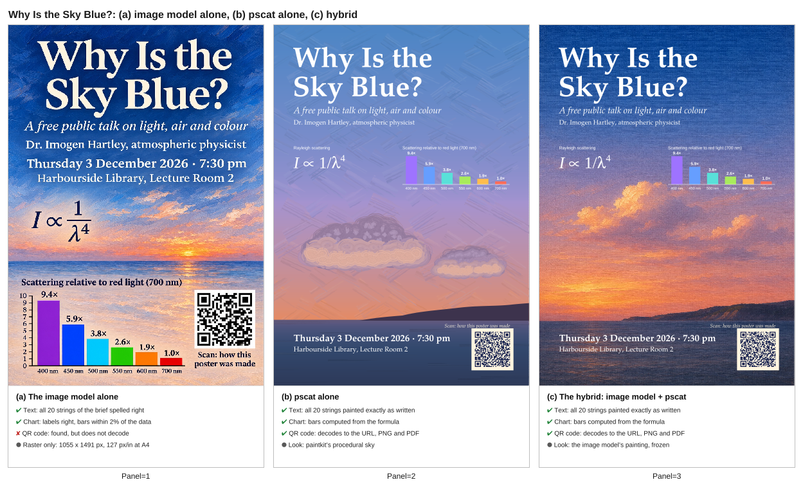
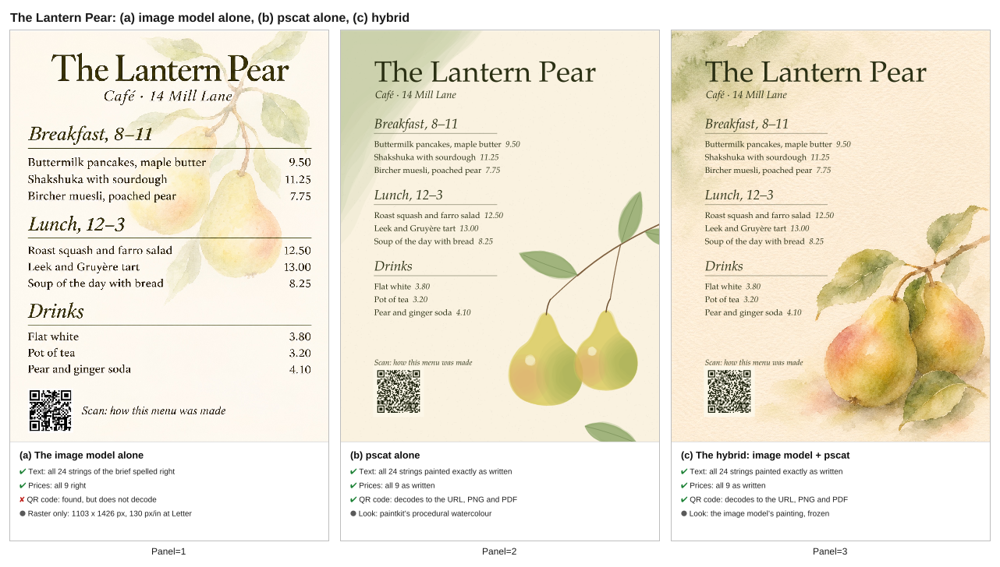

# pscat with an image model

An image model is good at light, texture and painterly mood. pscat is good at
the things that must be exactly right: words, numbers, a chart, a formula, a
QR code that scans, a layout that prints at size. Used together, each does its
own part:

- **The image model paints the atmosphere layer**: a background, a texture, an
  illustration, with nothing exact in it. You generate it once and **freeze
  it**: save the file and keep it with the program.
- **pscat sets the exact layer on top**: type, a QR code, a chart or formula,
  the frame, and the print-ready PDF.

All the iteration then happens in the pscat layer. Moving the title, fixing a
price or changing the date is an edit to a program and a re-render, and the
painting does not change, because nobody asks the image model for it again.

[When to use pscat](when-to-use-pscat.md) covers the choice between pscat, an
image model and an LLM on its own. This guide is the "use both" case, with two
worked examples and a fair comparison.

## Two worked examples

Both are in [`examples/hybrid/`](../../examples/hybrid/README.md), with their
backgrounds, the exact prompts and the commands. Render from the repository
root:

```sh
pscat --page 595x842 --pdf sky_talk.pdf examples/hybrid/sky_talk.ps     # A4
pscat --page 612x792 --pdf menu_card.pdf examples/hybrid/menu_card.ps   # US Letter
```

- **Why Is the Sky Blue?** ([`sky_talk.ps`](../../examples/hybrid/sky_talk.ps)),
  an A4 poster for a public talk. An oil-painted evening sky from the image
  model; on top, pscat's title and details, the Rayleigh formula, a bar chart
  whose bars and labels the program computes from that formula, and a QR code.
- **The Lantern Pear** ([`menu_card.ps`](../../examples/hybrid/menu_card.ps)),
  a US Letter café menu. A watercolour of pears from the image model; on top,
  pscat's name, sections, every dish and price, and a QR code.

The talk, the café and their details are invented. Both QR codes point at this
guide's page on the site.

## The comparison

For each example the image model was also asked for the **whole poster**: the
same brief, every line of text, the chart or the prices, and "a scannable QR
code that encodes exactly" the same URL. Each sheet shows (a) that image, (b)
the poster pscat makes alone, with a sky or watercolour painted by paintkit,
and (c) the hybrid. Under each panel are only facts that were checked.





| | (a) Image model alone | (b) pscat alone | (c) Hybrid |
|---|---|---|---|
| **Text** (poster: 20 strings; menu: 24) | All spelled right, on both | All exact, on both | All exact, on both |
| **Numbers** | Chart labels right, bar heights within 2% of the data; all 9 prices right | Computed by the program, or typed in it | Same as (b) |
| **QR code** | Found by both decoders, **decodes in neither**, on both | Decodes to the URL in both decoders, PNG and PDF | Same as (b) |
| **Output** | One raster: 1055 x 1491 px (poster), 1103 x 1426 px (menu), about 127-130 px per inch at print size | Vector type, chart and QR code at any size | Vector exact layer over the painting, which is embedded at its own resolution |
| **The look** | The image model's | paintkit's procedural paint | The image model's |

How each fact was checked:

- **QR codes.** Two independent decoders, rqrr (a port of quirc) and rxing (a
  port of ZXing), the same ones the QR library's tests use. For (b) and (c)
  they read the URL exactly from pscat's PNG and from its PDF, rasterized by
  hayro, an independent PDF renderer. For (a) both find the symbol, but rqrr's
  error correction fails on it and rxing's checksum does: the pattern looks
  like a QR code and does not encode the URL, or anything else.
  `tests/hybrid.rs` checks all of this on every build.
- **Text.** For (b) and (c), the test captures every string the program paints
  and compares it with the brief, string by string. For (a), the image was
  read at full size against the brief. Every string in both images is right:
  the title, the date with its middle dot, "Gruyère" with its accent, the en
  dashes in "8–11" and "12–3".
- **Numbers.** (a)'s chart labels are right and its bars, measured in pixels,
  are within 2% of the values (9.39, 5.93, 3.82, 2.58 and 1.88 times the
  700 nm bar, against 9.38, 5.86, 3.84, 2.62 and 1.85). Its nine prices are
  right.

Each whole-poster image is the image model's first and only attempt, with no
retries and no picking; the [examples README](../../examples/hybrid/README.md)
says how they were made.

### What this shows

Every word and number in both of the image model's posters is right. Its QR
codes are where it failed, in both attempts: both decoders locate a symbol
and neither can read it. The pattern looks like a QR code, but its error
correction does not check out.

So the hybrid is worth it here for what the image model cannot do, and for
what happens after the first draft:

- **A QR code that scans**, every time, because it is encoded, not drawn.
- **Numbers that come from the data.** The chart's bars are computed from the
  formula in the program. The model's bars were close, but close is all a
  picture of a chart can promise.
- **Changes without regeneration.** Ask the image model to change one price
  and it paints a new menu, which needs proofreading again from top to
  bottom. In the hybrid, a price is one edit; nothing else on the page can
  move or change.
- **Print output.** The type, the chart and the QR code are vectors in the
  PDF, sharp at A4 or poster size. The image model's poster is one raster at
  about 127 pixels per inch at A4, text included.
- **The same render again.** The program and the frozen background give the
  same pixels on every run.

And where the hybrid beats pscat alone: the look. paintkit paints a fine
sky and a fair watercolour, but an image model's painted light is better, and
costs one prompt.

## The workflow

### 1. Prompt for the atmosphere layer

Ask for the picture only, and leave room for the exact layer:

- say **"no text, no letters, no numbers, no logos"**, or the model may letter
  something in;
- say **where the type will go**: "keep the top third open, calm sky", "the
  middle and left stay almost bare paper";
- give the **page proportions**: portrait 2:3, or US Letter;
- name the medium and mood: "painterly oil painting, visible brushwork",
  "loose watercolour on cream cold-pressed paper".

The two background prompts used here:

> A painterly oil painting of a wide evening sky over a calm sea and a low dark headland, portrait orientation (2:3). Deep clear blue at the top of the sky, fading through soft lavender to warm peach and gold near the horizon; a few soft cumulus clouds in the middle catch the last light. Visible brushwork and canvas texture. Keep the top third open, calm sky with little detail, and the bottom quarter a dark, quiet sea, so the picture works as a poster background with type laid over it. No text, no letters, no numbers, no logos, no people, no frame.

> A loose watercolour painting on cream cold-pressed paper for the background of a café menu card, portrait orientation (US Letter proportions, about 8.5 by 11). Two ripe pears and a few pear leaves on a sprig sit in the bottom right corner, painted with soft wet-in-wet washes of green, gold and a little rose; a pale sage wash bleeds in from the top left corner. The whole middle and left of the sheet stays almost bare cream paper with only the faintest wash, so menu text can be printed over it. Visible paper grain and soft blooms. No text, no letters, no numbers, no logos, no frame or border.

They were run on 2026-11-04 with OpenAI's image model through the Codex CLI
0.166 `image_generation` tool; each took about a minute. Codex reported
passing both to its image tool unchanged.

The two whole-poster prompts for the comparison's panel (a), also run on
2026-11-04 the same way:

> Design a complete A4 portrait event poster as one image. Background: a painterly oil painting of an evening sky over a calm sea, deep blue above fading to peach and gold at the horizon. The poster must contain exactly this text, spelled exactly as given: the title "Why Is the Sky Blue?"; the subtitle "A free public talk on light, air and colour"; "Dr. Imogen Hartley, atmospheric physicist"; "Thursday 3 December 2026 · 7:30 pm"; "Harbourside Library, Lecture Room 2". Include the Rayleigh scattering formula "I ∝ 1/λ⁴". Include a small bar chart titled "Scattering relative to red light (700 nm)" with six bars labelled 400 nm 9.4×, 450 nm 5.9×, 500 nm 3.8×, 550 nm 2.6×, 600 nm 1.9× and 700 nm 1.0×, each bar's height in proportion to its value. Include a scannable QR code that encodes exactly https://pscatlabs.github.io/pscat/hybrid.html, with the caption "Scan: how this poster was made" beside it.

> Design a complete café menu card as one image, US Letter portrait. Background: a loose watercolour of two pears and pear leaves on cream paper. The menu must contain exactly this text, spelled exactly as given, with the prices exactly as given: the name "The Lantern Pear" and the line "Café · 14 Mill Lane". A section "Breakfast, 8–11" with "Buttermilk pancakes, maple butter 9.50", "Shakshuka with sourdough 11.25" and "Bircher muesli, poached pear 7.75". A section "Lunch, 12–3" with "Roast squash and farro salad 12.50", "Leek and Gruyère tart 13.00" and "Soup of the day with bread 8.25". A section "Drinks" with "Flat white 3.80", "Pot of tea 3.20" and "Pear and ginger soda 4.10". Include a scannable QR code that encodes exactly https://pscatlabs.github.io/pscat/hybrid.html, with the caption "Scan: how this menu was made" beside it.

For these two, Codex's image skill turns the instruction into its own prompt
before calling the tool, and the exact prompt it passed was not recorded. The
[examples README](../../examples/hybrid/README.md) has every instruction
verbatim, as sent to Codex.

### 2. Freeze it

Save the image beside the program and convert it to **JPEG**: pscat reads
JPEG through the `/DCTDecode` filter, and does not read PNG. On macOS:

```sh
sips -s format jpeg -s formatOptions 80 background.png --out background.jpg
```

Note its pixel size; the program needs it. From now on the image is an asset
like a font: you do not regenerate it to change the poster.

### 3. Place it and compose on top

Draw the image to cover the page, then everything exact over it:

```postscript partial
% the frozen painting, 1024 x 1536 px, scaled to cover the page width
gsave
  0 0 595 842 rectclip
  595 595 1024 div 1536 mul scale
  /DeviceRGB setcolorspace
  << /ImageType 1 /Width 1024 /Height 1536 /BitsPerComponent 8
     /Decode [0 1 0 1 0 1] /ImageMatrix [1024 0 0 -1536 0 1536]
     /DataSource (background.jpg) (r) file /DCTDecode filter >> image
grestore
% then the exact layer: type, a chart, a QR code
(lib/qr.ps) run
461 36 moveto (https://example.org/talk) << /Level /H >> qrencode
<< /ModuleSize 2 /Dark [0.08 0.12 0.30] /Light [1 0.96 0.88] >> qrdraw
```

Habits that keep the exact layer exact:

- **Paint the QR code's quiet zone** (`/Light` a light colour, never `null`
  over a painting): the scanner needs light around the symbol, and a painted
  sky is not light. Put modules on whole pixels at the resolution you check
  (`/ModuleSize 2` and whole-point positions are whole pixels at 72 and
  144 dpi); see [QR codes](qr-codes.md).
- **Compute what you can.** The sky poster's bar heights and labels come from
  `(700 / λ)^4` in the program, so the chart cannot disagree with its formula.
- **Fit the type to the painting, not the painting to the type.** The menu
  puts each price after its dish, not in a right-hand column, so no line runs
  into the painted pears.
- **Fonts with the characters you need.** The base fonts' standard encoding
  has no "é", "·" or "×"; re-encode with `ISOLatin1Encoding` (the examples
  show how, with an en dash added in a spare slot).

### 4. Render and check

```sh
pscat --page 595x842 --pdf poster.pdf poster.ps
pscat --page 595x842 --dpi 144 --png poster.png poster.ps
pscat --lint-strict --page 595x842 --png /dev/null poster.ps
```

Then check the facts: scan the QR code from the printed size, and proofread
the type once (it will not change by itself). The PDF embeds the painting
losslessly at its own resolution, so it is a few megabytes: 2.7 MB for the
poster, 2.4 MB for the menu.

## An agent prompt

For an agent that has both an image tool and pscat (the
[psart skill](../../plugin/skills/psart/SKILL.md) carries the same recipe):

> Generate a background with your image tool: a painterly evening sky over the
> sea, portrait 2:3, open sky in the top third, no text, letters or logos. Save
> it, convert it to JPEG and keep it; do not regenerate it. Then write a pscat
> program for an A4 poster that draws the JPEG to cover the page and sets the
> title, the date, the venue and a QR code for the event's URL on top. Render
> it to PDF and PNG, look at the PNG, and refine the pscat layer only.

## When it is worth it

**Worth it** when the page needs both looks and something exact:

- anything with a **QR code**, which an image model cannot make scan;
- **numbers** that come from data: a chart, a table, prices that change;
- a page that will be **edited** after the first draft, or made in several
  versions (dates, venues, languages);
- **print** at a real size, where type should be vector.

**Not worth it** when:

- **nothing on the page is exact**: a mood image or an illustration is the
  image model's job alone;
- **nothing needs to look painted**: a chart for a paper, a QR card, a form.
  pscat alone is simpler, and its own paint and dry media may be enough;
- the page is a one-off with a few words and no code to scan, and you are
  willing to proofread the model's output: in this test, its text was right.

## Limits

- The painting is a raster at the resolution the model gave (about 1000 to
  1500 pixels a side here, near 125 pixels per inch at A4). That suits a soft
  painted background; a detailed one printed large may look soft. The exact
  layer stays vector at any size.
- pscat reads JPEG, not PNG: convert the model's output first.
- A frozen image is fixed. If the layout changes so much that the painting
  no longer fits it, you generate a new background, and that is a new image
  with all the variation that brings.
