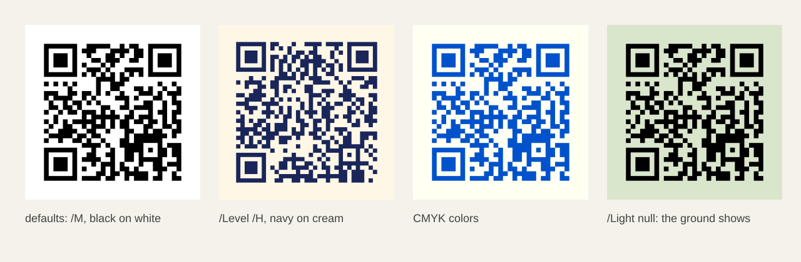

# QR codes

`lib/qr.ps` encodes text as a QR Model 2 symbol and draws it as vector
geometry. It is ordinary PostScript with no dependencies. It is compiled
into `pscat`, so `(lib/qr.ps) run` works anywhere, with no checkout. It
also runs in Ghostscript.

```postscript
(lib/qr.ps) run
72 72 moveto
(https://github.com/PSCatLabs/pscat) << >> qrencode
<< /ModuleSize 4 >> qrdraw
showpage
```

That draws a 148-point square (29 modules plus a 4-module quiet zone on
each side, 4 points per module) with its lower-left corner at (72, 72).
`pscat --png`, `--svg` and `--pdf` export the same geometry.



The four symbols above, all `/Side 140`, come from this program
(`pscat --page 640x210 --dpi 144 --png specimen.png specimen.ps`):

```postscript
(lib/qr.ps) run
/url (https://github.com/PSCatLabs/pscat) def
/Helvetica findfont 9 scalefont setfont
/label { 0.25 setgray moveto show } def
0.96 0.95 0.92 setrgbcolor clippath fill
20 50 moveto url << >> qrencode << /Side 140 >> qrdraw
(defaults: /M, black on white) 20 32 label
175 50 moveto url << /Level /H >> qrencode
  << /Side 140 /Dark [0.1 0.15 0.35] /Light [1 0.97 0.9] >> qrdraw
(/Level /H, navy on cream) 175 32 label
330 50 moveto url << >> qrencode << /Side 140 /Dark [1 0.6 0 0.2] /Light [0 0 0.05 0] >> qrdraw
(CMYK colors) 330 32 label
0.85 0.9 0.8 setrgbcolor 485 50 140 140 rectfill
485 50 moveto url << >> qrencode << /Side 140 /Light null >> qrdraw
(/Light null: the ground shows) 485 32 label
```

## Encode: `payload opts qrencode -> symbol`

`payload` is a string of raw bytes. Plain ASCII, such as a URL, works as
it is. Every symbol uses byte mode. pscat does no Unicode conversion and
writes no ECI header: non-ASCII text goes in as whatever bytes the string
holds, so pass UTF-8 bytes.

| Option | Value | Default |
|---|---|---|
| `/Level` | Error correction `/L`, `/M`, `/Q` or `/H` (about 7, 15, 25 and 30 % of the symbol recoverable). Used exactly as given, never raised. | `/M` |
| `/Version` | A fixed version 1–40 (side `17 + 4 * version` modules). `null` picks the smallest version that fits. | `null` |
| `/Mask` | A forced data mask 0–7. `null` scores all eight masks with the standard's penalty rules and keeps the lowest, which is what you want unless you are matching a reference. | `null` |

The result is a new dictionary:

| Key | Meaning |
|---|---|
| `/Version` | 1–40. |
| `/Level` | The level used. |
| `/Mask` | The mask used. |
| `/Size` | Modules per side, `17 + 4 * Version`, quiet zone not included. |
| `/Modules` | An array of `Size` rows, the **top row first**. Each row is an array of `Size` booleans, the **leftmost module first**. `true` is dark. |

So `sym /Modules get y get x get` is the module in column `x`, row `y`,
counted from the top-left corner as the QR standard counts them. The
arrays are new on every call and belong to you. Change them if you want:
`qrdraw` draws whatever they hold. A bad symbol can stop scanning, though.

```postscript
(lib/qr.ps) run
/sym (https://github.com/PSCatLabs/pscat) << /Level /H >> qrencode def
sym /Version get =                          % 4: H needs more room than M
sym /Modules get 0 get 0 get =              % true: the top-left finder
```

## Draw: `symbol opts qrdraw -`

`qrdraw` draws the symbol with the **lower-left corner of its quiet zone
at the current point**. Use `x y moveto` first. A missing current point
raises `qr-draw-needs-a-current-point`. The current transformation applies,
so a translated, rotated or scaled coordinate system moves the symbol with
it.

| Option | Value | Default |
|---|---|---|
| `/ModuleSize` | The side of one module, in user units (points). | none |
| `/Side` | The side of the whole drawing, quiet zone included, in user units. The module size is `Side / (Size + 2 * QuietZone)`. | none |
| `/QuietZone` | The light margin in modules on every side. An integer, at least 4, the minimum the standard requires. | `4` |
| `/Dark` | The dark-module color: a gray level, or `[gray]`, `[r g b]` or `[c m y k]`, each component 0–1. | `0` (black) |
| `/Light` | The light-module and quiet-zone color, in the same forms. `null` paints nothing, so the surface below shows through. | `1` (white) |

Give exactly one of `/ModuleSize` and `/Side`. Use `/Side` to fill a fixed
space, for example a 0.8-inch square on a business card:

```postscript
(lib/qr.ps) run
20 20 moveto
(https://github.com/PSCatLabs/pscat) << >> qrencode
<< /Side 57.6 /Dark [0.1 0.15 0.35] /Light [1 0.97 0.9] >> qrdraw
showpage
```

What `qrdraw` paints:

1. A light square (unless `/Light` is `null`).
2. One filled path holding one rectangle per horizontal run of dark modules.

Every corner is `origin + k * module` for a whole number `k`, so
neighboring modules share their edges exactly, and the runs are one path
filled once. So no hairline gap opens between touching modules: the test
suite checks this pixel by pixel at a fractional scale in pscat's PNG and
in independent renderings of its SVG and PDF. For the crispest PNG, choose a module size
that is a whole number of device pixels (`--dpi 72` makes 1 point 1 pixel)
and an origin on the pixel grid.

`qrdraw` leaves your graphics state (color, line width, transformation,
clip), your current path and current point, and the dictionary stack as
they were. It takes its two operands and leaves nothing.

## Scanning tips

- Keep the quiet zone light. If the symbol sits on a dark or busy
  background, leave `/Light` at a light color so the quiet zone is painted.
- Dark modules must be darker than light ones. `qrdraw` refuses the
  reverse (`qr-dark-must-be-darker-than-light`), because many scanners
  cannot read an inverted symbol. It does not check contrast beyond that:
  navy on cream scans well, mid-gray on light gray may not.
- For print, a common rule of thumb is at least about 0.3 mm (0.85 pt) per
  module for close-range phone scanning. Larger is safer. `/Level /Q` or `/H` buys tolerance for
  wear and smudging at the cost of a larger version.
- For a PNG meant for screens, make each module a whole number of pixels,
  starting on the pixel grid: at `--dpi 72`, a whole-point `/ModuleSize`
  and a whole-point `moveto`. In the test corpus, every symbol on the pixel
  grid was read by at least one of the two reference decoders, nearly all by
  both. At fractional pitches (module edges inside pixels) they miss many
  large, dense symbols, even though the pixels are exactly right.
- Keep payloads short. A short URL gives a small version with large modules
  at a given size, which scans more easily than a dense high version.

## Print size

PDF pages are in points, so a PDF prints at its true size. For a PNG, pick
the dpi when rendering: the print size is the pixel count divided by that
dpi. A 3.5 × 2 inch card at 300 dpi:

```sh
pscat --page 252x144 --dpi 300 --png card.png card.ps   # 1050 x 600 pixels
pscat --page 252x144 --pdf card.pdf card.ps             # 3.5 x 2 in
```

Tell the print dialog 300 dpi (the PNG does not record it). SVG
`width`/`height` are in points without a unit, so a browser shows them as
CSS pixels (96 per inch), three quarters of the true size. For print, use
the PDF.

## Errors

Every argument is checked before anything is drawn, so an error leaves the
page, the graphics state and the dictionary stack untouched. Errors are
named `undefined` errors, like the other pscat libraries:

| Error | Cause |
|---|---|
| `qr-options-must-be-a-dict` | The options operand is not a dictionary. |
| `qr-data-must-be-a-string`, `qr-data-must-be-readable` | Bad payload. |
| `qr-level-must-be-L-M-Q-or-H` | `/Level` is not one of the four names. |
| `qr-version-must-be-integer`, `qr-version-must-be-in-1-40` | Bad `/Version`. |
| `qr-mask-must-be-integer`, `qr-mask-must-be-in-0-7` | Bad `/Mask`. |
| `qr-data-too-long-for-level` | The payload does not fit even version 40 at that level (2953, 2331, 1663 and 1273 bytes at L, M, Q and H). |
| `qr-data-too-long-for-version` | The payload does not fit the fixed `/Version`. |
| `qr-symbol-must-be-a-qr-symbol` | `qrdraw` was not given a symbol with a valid `/Size` and `Size` rows of `Size` booleans in `/Modules`. |
| `qr-draw-needs-modulesize-or-side`, `qr-draw-takes-modulesize-or-side-not-both` | Neither size option, or both. |
| `qr-module-size-must-be-a-positive-number`, `qr-side-must-be-a-positive-number` | Bad size. |
| `qr-quiet-zone-must-be-an-integer`, `qr-quiet-zone-must-be-at-least-4` | Bad `/QuietZone`. |
| `qr-dark-must-be-a-color`, `qr-light-must-be-a-color-or-null` | Bad color. |
| `qr-dark-must-be-darker-than-light` | `/Dark` is as light as `/Light` or lighter. A CMYK color has no single brightness (Ghostscript adds `k` to each ink, pscat multiplies), so it must be darker both ways. |
| `qr-draw-needs-a-current-point` | No `moveto` before `qrdraw`. |

After an error, operands may remain on the stack.

## How it is checked

The encoder is checked against frozen output from an independent encoder
(Nayuki's QR-Code-generator) at every stage, and Ghostscript reproduces it.
The test suite renders symbols through `pscat --png`, `--svg` and `--pdf`.
It rasterizes the SVG with resvg and the PDF with hayro, two renderers
that share no code with pscat, and checks every module and the quiet zone.
Then two independent decoders, `rqrr` (from quirc) and `rxing` (from ZXing),
must read back the exact bytes, and the version, mask, level and data
codewords where each reports them. Every version from 1 to 40 at every
level, at its exact capacity and one byte past it, matches the reference
encoder's codewords and finished matrix. The tests also check physical page
sizes, the 300 dpi print recipe, the quiet zone and every module edge pixel
by pixel at several scales. The details are in
[`docs/dev/design/QR_CODE_TESTING.md`](../dev/design/QR_CODE_TESTING.md).
